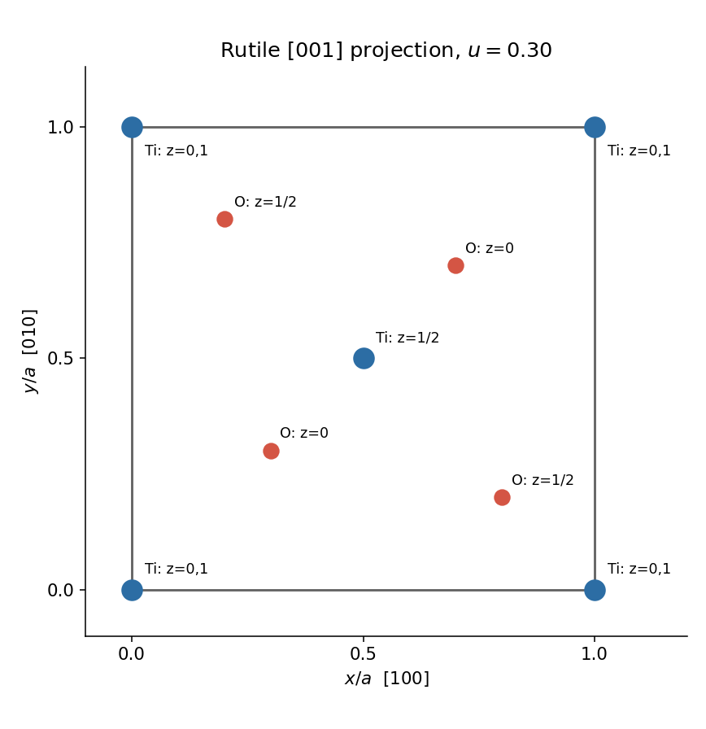
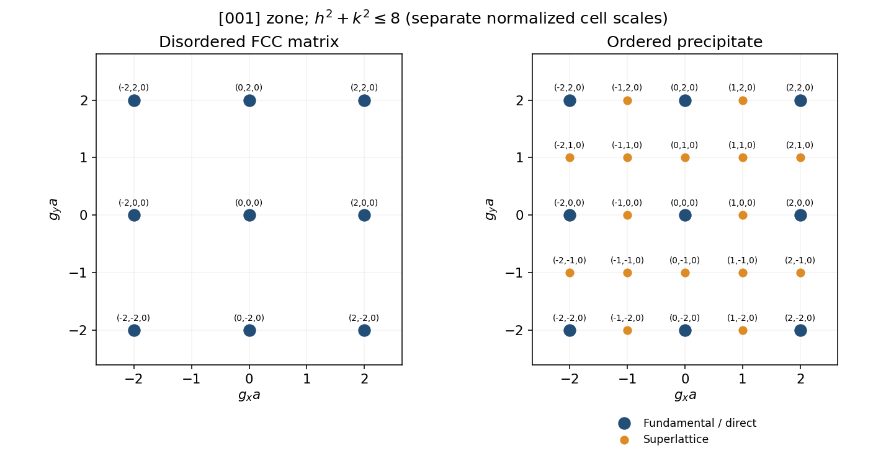
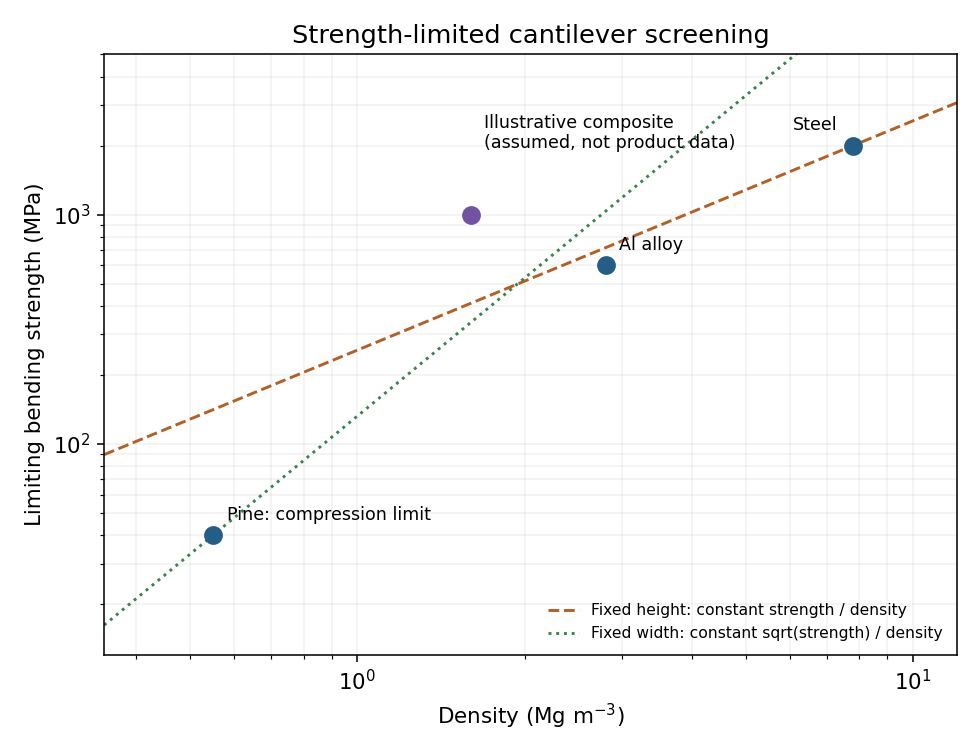
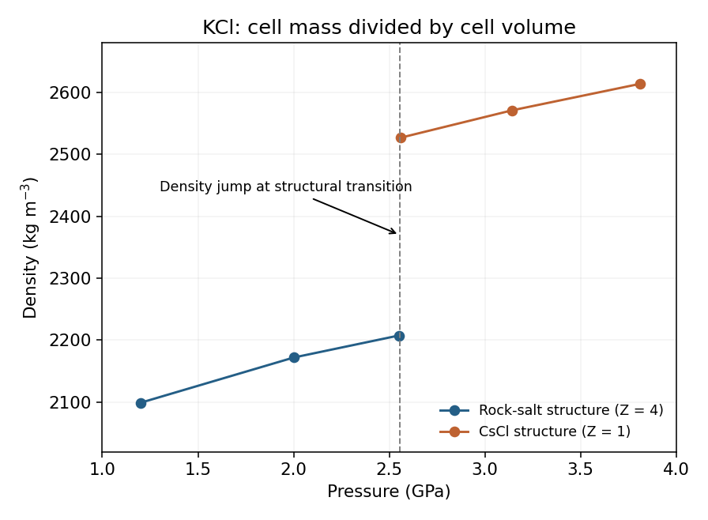

# Paper 1

↑ **Parent:** [2022](../2022.md)

[Original paper, released PDF pages 1–9](https://www.whatdotheyknow.com/request/nst_part_ia_materials_science_pa/response/2556546/attach/3/FOI%202024%2051%20Peacock%20materials.pdf?cookie_passthrough=1#page=1)

**Table of contents**

- [1](#1)
  - [a](#1/a)
    - [i](#1/a/i)
      - [Solution](#1/a/i/solution)
    - [ii](#1/a/ii)
      - [Solution](#1/a/ii/solution)
  - [b](#1/b)
    - [Solution](#1/b/solution)
  - [c](#1/c)
    - [Solution](#1/c/solution)
  - [d](#1/d)
    - [Solution](#1/d/solution)
  - [e](#1/e)
    - [Solution](#1/e/solution)
- [2](#2)
  - [a](#2/a)
    - [Solution](#2/a/solution)
  - [b](#2/b)
    - [i](#2/b/i)
      - [Solution](#2/b/i/solution)
    - [ii](#2/b/ii)
      - [Solution](#2/b/ii/solution)
    - [iii](#2/b/iii)
      - [Solution](#2/b/iii/solution)
  - [c](#2/c)
    - [Solution](#2/c/solution)
- [3](#3)
  - [a](#3/a)
    - [Solution](#3/a/solution)
  - [b](#3/b)
    - [i](#3/b/i)
      - [1](#3/b/i/1)
        - [Solution](#3/b/i/1/solution)
      - [2](#3/b/i/2)
        - [Solution](#3/b/i/2/solution)
    - [ii](#3/b/ii)
      - [Solution](#3/b/ii/solution)
  - [c](#3/c)
    - [Solution](#3/c/solution)
- [4](#4)
  - [a](#4/a)
    - [Solution](#4/a/solution)
  - [b](#4/b)
    - [i](#4/b/i)
      - [Solution](#4/b/i/solution)
    - [ii](#4/b/ii)
      - [Solution](#4/b/ii/solution)
  - [c](#4/c)
    - [Solution](#4/c/solution)
- [5](#5)
  - [a](#5/a)
    - [Solution](#5/a/solution)
  - [b](#5/b)
    - [i](#5/b/i)
      - [Solution](#5/b/i/solution)
    - [ii](#5/b/ii)
      - [Solution](#5/b/ii/solution)
    - [iii](#5/b/iii)
      - [Solution](#5/b/iii/solution)
- [6](#6)
  - [a](#6/a)
    - [Solution](#6/a/solution)
  - [b](#6/b)
    - [i](#6/b/i)
      - [Solution](#6/b/i/solution)
    - [ii](#6/b/ii)
      - [Solution](#6/b/ii/solution)
  - [c](#6/c)
    - [i](#6/c/i)
      - [Solution](#6/c/i/solution)
    - [ii](#6/c/ii)
      - [Solution](#6/c/ii/solution)
    - [iii](#6/c/iii)
      - [Solution](#6/c/iii/solution)
  - [d](#6/d)
    - [Solution](#6/d/solution)
- [7](#7)
  - [a](#7/a)
    - [Solution](#7/a/solution)
  - [b](#7/b)
    - [Solution](#7/b/solution)
  - [c](#7/c)
    - [Solution](#7/c/solution)
  - [d](#7/d)
    - [Solution](#7/d/solution)
  - [e](#7/e)
    - [Solution](#7/e/solution)

## 1

↑ **Parent:** [Paper 1](paper-1.md)

<h3 id="1/a">a</h3>

↑ **Parent:** [1](#1)

<h4 id="1/a/i">i</h4>

↑ **Parent:** [A](#1/a)

<h5 id="1/a/i/solution">Solution</h5>

↑ **Parent:** [I](#1/a/i)

**A periodic crystal cannot have a fivefold crystallographic [rotation](../../riemannian-geometry.md#rotation-mathematics) axis.** The [crystallographic restriction theorem](../../euclidean-geometry.md#crystallographic-restriction-theorem) permits [rotation](../../riemannian-geometry.md#rotation-mathematics) orders $1,2,3,4,6$ for a periodic [Bravais lattice](../../quantum-scattering.md#bravais-lattice). A $72^\circ$ [rotation](../../riemannian-geometry.md#rotation-mathematics) cannot preserve such a lattice. This restriction concerns exact [symmetry](../../physics.md#symmetry-physics) of the infinite [crystal structure](../../physical-chemistry.md#crystal-structure); an isolated finite cluster with fivefold [symmetry](../../physics.md#symmetry-physics) is a different object.

<h4 id="1/a/ii">ii</h4>

↑ **Parent:** [A](#1/a)

<h5 id="1/a/ii/solution">Solution</h5>

↑ **Parent:** [Ii](#1/a/ii)

**A motif can have fivefold [symmetry](../../physics.md#symmetry-physics).** For example, repeat an identically oriented regular pentagonal molecular motif at every point of a square translation lattice. Each isolated motif has fivefold [rotational symmetry](../../linear-algebra.md#rotational-symmetry), while the [crystal structure](../../physical-chemistry.md#crystal-structure) as a whole does not: rotating about one motif fails to map the other motif centres onto [lattice points](../../quantum-scattering.md#lattice-point). The [symmetry](../../physics.md#symmetry-physics) of an [atomic basis of a crystal](../../physical-chemistry.md#atomic-basis-of-a-crystal) need not be a [symmetry](../../physics.md#symmetry-physics) of its [Bravais lattice](../../quantum-scattering.md#bravais-lattice).

<h3 id="1/b">b</h3>

↑ **Parent:** [1](#1)

<h4 id="1/b/solution">Solution</h4>

↑ **Parent:** [B](#1/b)

Reduce the supplied fractional coordinates modulo one. The [rutile structure](../../physical-chemistry.md#rutile-structure) has Ti at $(0,0)$ with height $z=0$ and at $(1/2,1/2)$ with height $z=1/2$. The oxygen projections are $(0.30,0.30),(0.70,0.70)$ at $z=0$, and $(0.80,0.20),(0.20,0.80)$ at $z=1/2$. Include equivalent corner sites to show the boundary of a complete [unit cell](../../quantum-scattering.md#unit-cell); the cell edges are $a$ along $[100]$ and $[010]$.

**[Figure 1](#1/b/image-rutile-unit-cell-projection-along-the-tetragonal-axis). Rutile unit-cell projection along the tetragonal axis**. Original plan constructed from the fractional coordinates. Labels give height as a fraction of $c$; circle sizes distinguish species rather than ionic radii.

<h3 id="1/c">c</h3>

↑ **Parent:** [1](#1)

<h4 id="1/c/solution">Solution</h4>

↑ **Parent:** [C](#1/c)

Each Ti has [coordination number](../../ionic-bonding.md#coordination-number) **six**, with oxygen neighbours forming a distorted octahedron. Each oxygen has [coordination number](../../ionic-bonding.md#coordination-number) **three**, with titanium neighbours forming a planar triangle. For oxygen at $(u,u,0)$, the nearest Ti positions can be taken as $(0,0,0)$ and $(1/2,1/2,\pm1/2)$; all three lie in the plane $x=y$. The triangle is not generally equilateral. Equal Ti–O bond lengths in the following calculation do not make every angle ideal.

<h3 id="1/d">d</h3>

↑ **Parent:** [1](#1)

<h4 id="1/d/solution">Solution</h4>

↑ **Parent:** [D](#1/d)

In the [tetragonal crystal system](../../physical-chemistry.md#tetragonal-crystal-system), physical squared distances use $a^2(\Delta x^2+\Delta y^2)+c^2\Delta z^2$. Two Ti–O distances from the corner Ti have length $\sqrt2ua$; the other four have length $\sqrt{2a^2(1/2-u)^2+c^2/4}$. Equating both to $r$ gives

$$
a=\frac{r}{\sqrt2u},\qquad c=2r\sqrt{1-\frac{(1/2-u)^2}{u^2}}.
$$

Thus, within the equal-bond model,

$$
\boxed{a=4.596\,\mathrm{\mathring A},\qquad c=2.907\,\mathrm{\mathring A}}.
$$

The [rutile structure](../../physical-chemistry.md#rutile-structure) remains tetragonal and its octahedral angles remain distorted; these numbers are not a claim about measured ambient-pressure lattice parameters.

<h3 id="1/e">e</h3>

↑ **Parent:** [1](#1)

<h4 id="1/e/solution">Solution</h4>

↑ **Parent:** [E](#1/e)

The [Weiss zone law](../../physical-chemistry.md#weiss-zone-law) gives $u+w=0$ and $u-v=0$, so a common direction is **$[11\bar1]$**. Its physical vector is $(a,a,-c)$, while $[100]$ is parallel to $(a,0,0)$. Their [dot product](../../inner-product.md#dot-product) therefore gives

$$
\boxed{\theta=\cos^{-1}\!\frac{a}{\sqrt{2a^2+c^2}}=49.80^\circ}.
$$

Taking a Euclidean angle directly between the index triples would incorrectly treat the tetragonal axes as equal in length. Reversing the chosen common direction gives the supplementary oriented angle.

## 2

↑ **Parent:** [Paper 1](paper-1.md)

<h3 id="2/a">a</h3>

↑ **Parent:** [2](#2)

<h4 id="2/a/solution">Solution</h4>

↑ **Parent:** [A](#2/a)

The [fluorite structure](../../physical-chemistry.md#fluorite-structure) has Ce on the corner and face-centre sites of a [face-centered cubic lattice](../../quantum-scattering.md#face-centered-cubic-lattice). Oxygen occupies all eight positions $(x,y,z)$ with each coordinate independently $1/4$ or $3/4$. In projection, there are four oxygen positions $(1/4,1/4),(1/4,3/4),(3/4,1/4),(3/4,3/4)$, each representing two heights. Accounting for shared boundary sites gives **four Ce and eight O per conventional [unit cell](../../quantum-scattering.md#unit-cell)**.

**[Figure 2](#2/a/image-fluorite-unit-cell-projection-with-oxygen-heights-distinguished). Fluorite unit-cell projection with oxygen heights distinguished**. Original coordinate-based plan; each oxygen marker represents heights $1/4$ and $3/4$. Cerium edge-centre and face-centre heights are labelled.

<h3 id="2/b">b</h3>

↑ **Parent:** [2](#2)

<h4 id="2/b/i">i</h4>

↑ **Parent:** [B](#2/b)

<h5 id="2/b/i/solution">Solution</h5>

↑ **Parent:** [I](#2/b/i)

There are four cation sites per conventional [unit cell](../../quantum-scattering.md#unit-cell), hence $0.4$ Gd substitutions per cell on average. Two substitutions of Gd$^{3+}$ for Ce$^{4+}$ require one [oxygen vacancy](../../physical-chemistry.md#oxygen-vacancy) for [charge neutrality](../../electric-charge.md#charge-neutrality), so the cell contains $0.2$ vacancies. Equivalently, the composition is $\mathrm{Ce_{0.9}Gd_{0.1}O_{1.95}}$. Therefore

$$
\boxed{n_v=\frac{0.2}{a^3}=3.461\times10^{27}\,\mathrm{m^{-3}}}.
$$

This uses the supplied lattice parameter literally and treats it as the conventional fluorite-cell edge.

<h4 id="2/b/ii">ii</h4>

↑ **Parent:** [B](#2/b)

<h5 id="2/b/ii/solution">Solution</h5>

↑ **Parent:** [Ii](#2/b/ii)

An [oxygen vacancy](../../physical-chemistry.md#oxygen-vacancy) has effective carrier charge $q_v=+2e$. Combining its density with its own [diffusion coefficient](../../brownian-motion.md#diffusion-coefficient) in the [Nernst-Einstein relation](../../electric-charge.md#nernst-einstein-relation) gives

$$
\sigma_{\rm ion}=\frac{n_v(2e)^2D_v}{k_BT},\qquad
\boxed{\sigma_{\rm ion}=2.00\,\mathrm{S\,m^{-1}}}
$$

at $T=873.15\,\mathrm K$. The oxygen ions move oppositely to the vacancies and carry the same conventional current. This estimate assumes independently migrating vacancies, negligible correlation corrections, and negligible electronic contribution to the reported [ionic conductivity](../../electric-charge.md#ionic-conductivity).

<h4 id="2/b/iii">iii</h4>

↑ **Parent:** [B](#2/b)

<h5 id="2/b/iii/solution">Solution</h5>

↑ **Parent:** [Iii](#2/b/iii)

Write the [Arrhenius equation](../../chemical-kinetics.md#arrhenius-equation) as $D=D_0e^{-Q/(k_BT)}$. Eliminating the prefactor with two temperatures gives

$$
Q=\frac{k_B\ln(D_{600}/D_{300})}{1/T_{300}-1/T_{600}}
\quad\Longrightarrow\quad
\boxed{Q=0.795\,\mathrm{eV}=76.7\,\mathrm{kJ\,mol^{-1}}}.
$$

Use absolute temperatures $573.15$ and $873.15\,\mathrm K$. Because the input is a vacancy [diffusion coefficient](../../brownian-motion.md#diffusion-coefficient), this is a migration [activation energy](../../chemical-kinetics.md#activation-energy) inferred from that diffusivity; an additional vacancy-formation energy should not automatically be added.

<h3 id="2/c">c</h3>

↑ **Parent:** [2](#2)

<h4 id="2/c/solution">Solution</h4>

↑ **Parent:** [C](#2/c)

Each missing oxide ion leaves two units of excess positive effective charge, compensated by reducing two Ce$^{4+}$ ions to Ce$^{3+}$. For $0.2$ [oxygen vacancies](../../physical-chemistry.md#oxygen-vacancy) per conventional [unit cell](../../quantum-scattering.md#unit-cell), $0.4$ of its four cerium ions must be trivalent: **10% Ce$^{3+}$**. This assumes the same number of cation sites per unit [volume](../../geometry-and-topology.md#volume) as in the doped calculation and that oxygen loss is compensated entirely by this cerium-valence change. If reduction changes the cell [volume](../../geometry-and-topology.md#volume) appreciably, matching the absolute vacancy density requires correcting the percentage for that change.

## 3

↑ **Parent:** [Paper 1](paper-1.md)

<h3 id="3/a">a</h3>

↑ **Parent:** [3](#3)

<h4 id="3/a/solution">Solution</h4>

↑ **Parent:** [A](#3/a)

In the kinematic approximation, the [face-centered cubic lattice](../../quantum-scattering.md#face-centered-cubic-lattice) contributes only reflections with $h,k,l$ all even or all odd. Viewing along $[001]$ selects the zero-order zone $l=0$, so the nonzero allowed spots within the cutoff are $(\pm2,0,0),(0,\pm2,0),(\pm2,\pm2,0)$, with the transmitted beam at the centre. The nearest-neighbour separation is **$2/a_{\rm Al}$** in the crystallographic reciprocal-distance convention, or $4\pi/a_{\rm Al}$ in the angular-wavevector convention. No matrix lattice parameter is supplied, so a numerical matrix spacing would require extra data.

**[Figure 3](#3/a/image-calculated-zero-order-diffraction-spots-before-and-after-chemical-ordering). Calculated zero-order diffraction spots before and after chemical ordering**. Original kinematic spot diagrams with reciprocal coordinates normalized by the relevant cubic cell edge. The right panel shows additional superlattice positions; actual intensity also depends on thickness, excitation and scattering factors.

<h3 id="3/b">b</h3>

↑ **Parent:** [3](#3)

<h4 id="3/b/i">i</h4>

↑ **Parent:** [B](#3/b)

<h5 id="3/b/i/1">1</h5>

↑ **Parent:** [I](#3/b/i)

<h6 id="3/b/i/1/solution">Solution</h6>

↑ **Parent:** [1](#3/b/i/1)

For the [L12 structure](../../physical-chemistry.md#l12-structure), the [crystal basis structure factor](../../quantum-scattering.md#crystal-basis-structure-factor) is

$$
F_{hkl}=f_{\rm Sc}+f_{\rm Al}\left[e^{i\pi(h+k)}+e^{i\pi(h+l)}+e^{i\pi(k+l)}\right].
$$

Equal parity of $h,k,l$ makes all three phase factors $+1$, hence

$$
\boxed{F_{hkl}=f_{\rm Sc}+3f_{\rm Al}}.
$$

The [electron](../../physics.md#electron) scattering factors are evaluated at the reflection's scattering vector.

<h5 id="3/b/i/2">2</h5>

↑ **Parent:** [I](#3/b/i)

<h6 id="3/b/i/2/solution">Solution</h6>

↑ **Parent:** [2](#3/b/i/2)

For mixed parity, one of the three pair sums is even and two are odd. Thus their phase factors sum to $-1$, giving

$$
\boxed{F_{hkl}=f_{\rm Sc}-f_{\rm Al}}.
$$

These [superlattice reflections](../../quantum-scattering.md#superlattice-reflection) reveal chemical ordering. Their kinematic intensity is proportional to $|f_{\rm Sc}-f_{\rm Al}|^2$, and vanishes in the hypothetical limit of equal species scattering factors.

<h4 id="3/b/ii">ii</h4>

↑ **Parent:** [B](#3/b)

<h5 id="3/b/ii/solution">Solution</h5>

↑ **Parent:** [Ii](#3/b/ii)

Keep the matrix spots and add precipitate reflections at all integer $(h,k,0)$ with $0<h^2+k^2\leq8$. Even-even spots are fundamental; every other allowed position in this zone is a [superlattice reflection](../../quantum-scattering.md#superlattice-reflection). The added positions are $100,010,110,210,120$ and their symmetry-related signs. Each position actually denotes the corresponding signed index pair, not one radial ring. The precipitate grid spacing is $1/a_p$; the nearest fundamental separation is $2/a_p=0.4878\,\mathrm{\mathring A^{-1}}$. If matrix and precipitates are coherent and similarly oriented, their fundamental spots approximately coincide, with finite mismatch potentially giving splitting or broadening. The sketch assumes common orientation, small [strain](../../continuum-mechanics.md#strain), appreciable sampled precipitate [volume](../../geometry-and-topology.md#volume) and predominantly single scattering; [electron diffraction](../../quantum-scattering.md#electron-diffraction) can have dynamical intensity effects.

<h3 id="3/c">c</h3>

↑ **Parent:** [3](#3)

<h4 id="3/c/solution">Solution</h4>

↑ **Parent:** [C](#3/c)

Choose an objective aperture around a precipitate [superlattice reflection](../../quantum-scattering.md#superlattice-reflection), such as $100$, which is absent from the disordered aluminium matrix. The selected beam then makes precipitates bright in [dark-field transmission electron microscopy](../../optics.md#dark-field-transmission-electron-microscopy), while the matrix gives little intensity in that beam. Tilt the grain to place the chosen reflection close to its [Bragg diffraction](../../quantum-scattering.md#bragg-diffraction) condition and preferably approach a two-beam geometry. This reduces excitation error and can increase precipitate brightness; the exact maximum also depends on foil thickness, [strain](../../continuum-mechanics.md#strain) and dynamical scattering. Selecting a shared fundamental reflection would give much poorer chemical-order selectivity.

## 4

↑ **Parent:** [Paper 1](paper-1.md)

<h3 id="4/a">a</h3>

↑ **Parent:** [4](#4)

<h4 id="4/a/solution">Solution</h4>

↑ **Parent:** [A](#4/a)

At $227^\circ\mathrm C\simeq500\,\mathrm K$, $1000/T\simeq2$. Reading the [carbon](../../chemical-substance.md#carbon) line gives $D_C\sim2\times10^{-15}\,\mathrm{m^2s^{-1}}$ to graphical accuracy. With $t=60\,\mathrm s$, the characteristic [diffusion length](../../mathematical-biology.md#diffusion-length) is

$$
\boxed{\sqrt{Dt}\sim0.35\,\mathrm{\mu m}}.
$$

If “distance” means a one-coordinate root-mean-square displacement, use $\sqrt{2Dt}\sim0.49\,\mathrm{\mu m}$; the three-dimensional radial root-mean-square is $\sqrt{6Dt}\sim0.85\,\mathrm{\mu m}$. The graph does not justify precision between these conventions. Equal [diffusion](../../thermodynamics.md#diffusion) distance in equal time requires equal [diffusion coefficients](../../brownian-motion.md#diffusion-coefficient). The [copper](../../chemical-substance.md#copper) line reaches this diffusivity around $1000/T\simeq0.96$, giving **$T_{\rm Cu}\sim1.0\times10^3\,\mathrm K$, about $770^\circ\mathrm C$**. [Carbon](../../chemical-substance.md#carbon) moves interstitially through [ferrite](../../chemical-substance.md#ferrite), whereas [copper](../../chemical-substance.md#copper) self-diffusion is substitutional and vacancy-mediated, with a much higher effective activation barrier.

<h3 id="4/b">b</h3>

↑ **Parent:** [4](#4)

<h4 id="4/b/i">i</h4>

↑ **Parent:** [B](#4/b)

<h5 id="4/b/i/solution">Solution</h5>

↑ **Parent:** [I](#4/b/i)

At $700^\circ\mathrm C$ the undercooling below the eutectoid [temperature](../../temperature.md) is small, so the free-energy driving [force](../../force.md) for forming [pearlite](../../chemical-substance.md#pearlite) is weak and [nucleation](../../critical-phenomenon.md#nucleation) is difficult. At $300^\circ\mathrm C$ the driving [force](../../force.md) is larger, but [carbon](../../chemical-substance.md#carbon) [diffusion](../../thermodynamics.md#diffusion) is slow, limiting the coupled growth of [ferrite](../../chemical-substance.md#ferrite) and [cementite](../../chemical-substance.md#cementite). Their competition produces the nose of the [isothermal transformation diagram](../../chemical-substance.md#isothermal-transformation-diagram) near $550^\circ\mathrm C$ and $1\,\mathrm s$. A roughly linear quench from $740$–$800^\circ\mathrm C$ must pass left of this nose, requiring a rate of order **$2\times10^2$–$3\times10^2\,\mathrm{K\,s^{-1}}$**, then continue below the martensite-start region near $240^\circ\mathrm C$. The tangent to the full start curve, rather than just the nose, refines this estimate; a true continuous-cooling diagram would be preferable. [Martensite](../../chemical-substance.md#martensite) forms by a coordinated lattice-shape change without long-range [carbon](../../chemical-substance.md#carbon) partitioning, so its formation is a [displacive transformation](../../critical-phenomenon.md#displacive-transformation). The tetragonal-to-monoclinic transformation of [zirconia](../../chemical-substance.md#zirconia) is a nonmetallic example.

<h4 id="4/b/ii">ii</h4>

↑ **Parent:** [B](#4/b)

<h5 id="4/b/ii/solution">Solution</h5>

↑ **Parent:** [Ii](#4/b/ii)

As-quenched [martensite](../../chemical-substance.md#martensite) generally has greater [hardness](../../engineering.md#hardness) and strength, but lower ductility and [toughness](../../engineering.md#toughness), than ordinary pearlitic steel. Its supersaturated [carbon](../../chemical-substance.md#carbon) and distorted lattice impede [dislocation glide](../../physical-chemistry.md#dislocation-glide); quench [stresses](../../continuum-mechanics.md#stress) also promote cracking. [Pearlite](../../chemical-substance.md#pearlite) combines hard [cementite](../../chemical-substance.md#cementite) lamellae with more deformable [ferrite](../../chemical-substance.md#ferrite), with finer spacings generally giving greater strength. **Austenitize, quench to [martensite](../../chemical-substance.md#martensite), then temper** to obtain a useful compromise between indentation resistance and resistance to fast fracture. Tempering below the austenitizing range relieves [stresses](../../continuum-mechanics.md#stress) and develops a fine carbide-containing microstructure. It trades some maximum [hardness](../../engineering.md#hardness) for improved [toughness](../../engineering.md#toughness); the [temperature](../../temperature.md) and time must suit the required balance.

<h3 id="4/c">c</h3>

↑ **Parent:** [4](#4)

<h4 id="4/c/solution">Solution</h4>

↑ **Parent:** [C](#4/c)

The lamellae are **[ferrite](../../chemical-substance.md#ferrite) and [cementite](../../chemical-substance.md#cementite)**, together forming [pearlite](../../chemical-substance.md#pearlite). The displayed quantity is surface height in an [atomic force microscopy](../../engineering.md#atomic-force-microscopy) image. [Nital](../../chemical-substance.md#nital) preferentially attacks the [ferrite](../../chemical-substance.md#ferrite), leaving it lower and therefore darker; the narrow raised [cementite](../../chemical-substance.md#cementite) lamellae appear bright. This is not the same contrast mechanism as brightness in an optical micrograph. Faster cooling that still permits [pearlite](../../chemical-substance.md#pearlite) formation causes transformation at greater undercooling and generally gives **finer lamellar spacing**. Cooling sufficiently rapidly to bypass diffusional transformation instead produces other products, potentially [martensite](../../chemical-substance.md#martensite); it does not merely keep making [pearlite](../../chemical-substance.md#pearlite) indefinitely finer.

## 5

↑ **Parent:** [Paper 1](paper-1.md)

<h3 id="5/a">a</h3>

↑ **Parent:** [5](#5)

<h4 id="5/a/solution">Solution</h4>

↑ **Parent:** [A](#5/a)

The exponential in the [Peierls stress](../../physical-chemistry.md#peierls-stress) makes a large core-width-to-[Burgers vector](../../physical-chemistry.md#burgers-vector) ratio $w/b$ favourable for easy [dislocation glide](../../physical-chemistry.md#dislocation-glide). Densely packed slip planes often have wider cores because the shear distortion can spread over more atomic rows, reducing the lattice-periodic barrier. Close-packed directions provide short lattice translations and hence small allowed Burgers vectors; their line energies, approximately proportional to $Gb^2$, are also relatively low. These effects favour dense planes and directions, but the relation between packing and core width is a physical argument rather than a consequence of substituting arbitrary independent $w,b$ into the formula. Body-centred cubic metals have densely packed directions without a truly close-packed plane, and their screw-core behaviour can require additional qualifications.

<h3 id="5/b">b</h3>

↑ **Parent:** [5](#5)

<h4 id="5/b/i">i</h4>

↑ **Parent:** [B](#5/b)

<h5 id="5/b/i/solution">Solution</h5>

↑ **Parent:** [I](#5/b/i)

The cosine of the angle between [Burgers vector](../../physical-chemistry.md#burgers-vector) and line direction is $1/3$, so the angle is $70.53^\circ$: **the [dislocation](../../physical-chemistry.md#dislocation) is mixed**. Both vectors must lie in its [dislocation glide](../../physical-chemistry.md#dislocation-glide) plane. Their [cross product](../../vector-space.md#cross-product) is proportional to

$$
(1,-1,1)\times(1,1,1)=(-2,0,2),
$$

so the plane is **$(10\bar1)$**, a member of $\{110\}$. The screw component magnitude is $a/(2\sqrt3)$ and the edge component magnitude is $a\sqrt{2/3}$.

<h4 id="5/b/ii">ii</h4>

↑ **Parent:** [B](#5/b)

<h5 id="5/b/ii/solution">Solution</h5>

↑ **Parent:** [Ii](#5/b/ii)

At small load the deformation is elastic: $\varepsilon_{\parallel}=\sigma/E$, and, using isotropic elasticity with $E=2G(1+\nu)$, $\nu=0.30$ gives lateral contraction $\varepsilon_\perp=-0.30\varepsilon_\parallel$. At maximum load,

$$
\boxed{\sigma_{\max}=\frac{12.6\,\mathrm{kN}}{\pi(2\,\mathrm{mm})^2}=1.003\,\mathrm{GPa}}.
$$

For the specified [slip system](../../physical-chemistry.md#slip-system), the tensile direction is proportional to $(-2,-3,5)$, the slip direction to $(1,-1,1)$ and the plane normal to $(1,0,-1)$. Hence the [Schmid factor](../../physical-chemistry.md#schmid-factor) is

$$
m=\frac{|6|}{\sqrt{38}\sqrt3}\frac{|-7|}{\sqrt{38}\sqrt2}
=0.4512,\qquad \boxed{|\tau_{\max}|=0.452\,\mathrm{GPa}}.
$$

[Schmid's law](../../physical-chemistry.md#schmid-s-law) predicts glide when this reaches the [critical resolved shear stress](../../physical-chemistry.md#critical-resolved-shear-stress). Before that, unloading reverses the [strain](../../continuum-mechanics.md#strain); after activation, glide produces permanent [strain](../../continuum-mechanics.md#strain) and may generate [work hardening](../../continuum-mechanics.md#work-hardening) and additional slip. **The supplied data do not fix the yield load.** Neither the adjective “ultra-strong” nor $E/G$ supplies a critical shear [stress](../../continuum-mechanics.md#stress) or an absolute modulus. Other [slip systems](../../physical-chemistry.md#slip-system) must also be checked before claiming which activates first. In particular, the specimen remains elastic through the maximum load if every relevant system stays below its activation threshold.

<h4 id="5/b/iii">iii</h4>

↑ **Parent:** [B](#5/b)

<h5 id="5/b/iii/solution">Solution</h5>

↑ **Parent:** [Iii](#5/b/iii)

[Burgers vector](../../physical-chemistry.md#burgers-vector) conservation gives two candidate reactions, depending on the relative signs of the approaching segments:

$$
\mathbf b_1+\mathbf b_2=a[001],\qquad
\mathbf b_1-\mathbf b_2=a[1\bar10].
$$

Initially $b_1^2+b_2^2=3a^2/2$. The sum product has $b^2=a^2$, while the difference product has $b^2=2a^2$. Thus **the $a[001]$ product is favoured by [Frank's rule](../../physical-chemistry.md#frank-s-rule); the $a[1\bar10]$ product is disfavoured**. The result is not annihilation, because the two supplied vectors are not opposite. The same ordering survives a simple character correction: with $\nu=0.30$, line energy proportional to $Gb^2[\cos^2\chi+\sin^2\chi/(1-\nu)]$ gives the two parent segments a combined coefficient $1.786a^2$, whereas any character of the sum product has coefficient between $a^2$ and $1.429a^2$ and any character of the difference product at least $2a^2$, comparing equal lengths and common logarithmic factors. A favourable [dislocation junction](../../physical-chemistry.md#dislocation-junction) can obstruct further glide and harden the crystal. Its actual mobility requires the junction line and allowed glide plane: the second screw can occupy several $\{110\}$ planes containing $[\bar111]$, so geometry is not unique. For instance, its $(101)$ plane intersects $(10\bar1)$ along $[010]$; an $a[001]$ junction on that line would glide geometrically on $(100)$, not either original plane. [Dislocation cross-slip](../../physical-chemistry.md#dislocation-cross-slip), junction unzipping or bypass can compete under load. An energy inequality alone is not a universal proof of a permanently sessile product.

## 6

↑ **Parent:** [Paper 1](paper-1.md)

<h3 id="6/a">a</h3>

↑ **Parent:** [6](#6)

<h4 id="6/a/solution">Solution</h4>

↑ **Parent:** [A](#6/a)

The fixed support supplies the end shear [force](../../force.md) and the largest bending moment, $FL$. In elementary beam bending, the greatest longitudinal tensile and compressive [stresses](../../continuum-mechanics.md#stress) lie on opposite outer faces of the section at the **fixed end**, with zero longitudinal bending [stress](../../continuum-mechanics.md#stress) on the neutral axis. For a downward tip load on a horizontal [cantilever](../../elasticity-physics.md#cantilever), the upper face is in tension and the lower face in compression. Transverse shear [stress](../../continuum-mechanics.md#stress) has a different distribution, largest near the neutral axis for a rectangular section; “highest [force](../../force.md)” should therefore be interpreted with the [stress](../../continuum-mechanics.md#stress) component specified.

<h3 id="6/b">b</h3>

↑ **Parent:** [6](#6)

<h4 id="6/b/i">i</h4>

↑ **Parent:** [B](#6/b)

<h5 id="6/b/i/solution">Solution</h5>

↑ **Parent:** [I](#6/b/i)

The rectangular [second moment of area](../../elasticity-physics.md#second-moment-of-area) is $I=wh^3/12$. The maximum bending [stress](../../continuum-mechanics.md#stress) in the [cantilever](../../elasticity-physics.md#cantilever) is $FL(h/2)/I=6FL/(wh^2)$. If $h$ is fixed, choose the minimum allowed width $w=6FL/(\sigma_fh^2)$. Its [mass](../../classical-mechanics.md#mass) is then

$$
m_A=\rho Lwh=\frac{6FL^2}{h}\frac{\rho}{\sigma_f}.
$$

Thus the [material performance index](../../engineering.md#material-performance-index) to maximize is

$$
\boxed{M_A=\frac{\sigma_f}{\rho}}.
$$

For unequal tensile and compressive strengths, use the smaller permissible [stress](../../continuum-mechanics.md#stress) in this symmetric section. The derivation assumes bending-strength control, not a separate deflection, shear, buckling or existing-crack constraint.

<h4 id="6/b/ii">ii</h4>

↑ **Parent:** [B](#6/b)

<h5 id="6/b/ii/solution">Solution</h5>

↑ **Parent:** [Ii](#6/b/ii)

With $w$ fixed, bending strength requires $h=\sqrt{6FL/(w\sigma_f)}$. Substitution into the [cantilever](../../elasticity-physics.md#cantilever) [mass](../../classical-mechanics.md#mass) gives

$$
m_B=L\sqrt{6FLw}\frac{\rho}{\sqrt{\sigma_f}}.
$$

The [material performance index](../../engineering.md#material-performance-index) to maximize is therefore

$$
\boxed{M_B=\frac{\sqrt{\sigma_f}}{\rho}}.
$$

Changing the free geometric variable changes the strength exponent. A stiffness-limited problem would instead involve [Young's modulus](../../elasticity-physics.md#young-s-modulus); the supplied modulus does not enter this strength-only index.

<h3 id="6/c">c</h3>

↑ **Parent:** [6](#6)

<h4 id="6/c/i">i</h4>

↑ **Parent:** [C](#6/c)

<h5 id="6/c/i/solution">Solution</h5>

↑ **Parent:** [I](#6/c/i)

Both outer faces of the [cantilever](../../elasticity-physics.md#cantilever) are loaded, so use the pine's lower longitudinal [compressive strength](../../engineering.md#compressive-strength), $40\,\mathrm{MPa}$, rather than its $85\,\mathrm{MPa}$ [tensile strength](../../engineering.md#tensile-strength). Consistent SI units give $M_A$ values $(2.564,2.143,0.7273)\times10^5\,\mathrm{m^2s^{-2}}$ for steel, aluminium and pine respectively. Their $M_B$ values are $5.734,8.748,11.499\,\mathrm{Pa^{1/2}m^3kg^{-1}}$. Hence **Design A: steel best, pine worst; Design B: pine best, steel worst.** Aluminium is intermediate in both cases. These rankings concern the stated strength constraint; a [toughness](../../engineering.md#toughness) or deflection constraint could change feasibility.

<h4 id="6/c/ii">ii</h4>

↑ **Parent:** [C](#6/c)

<h5 id="6/c/ii/solution">Solution</h5>

↑ **Parent:** [Ii](#6/c/ii)

At identical applied load and fixed geometric constraints, minimum [mass](../../classical-mechanics.md#mass) is inversely proportional to the appropriate [material performance index](../../engineering.md#material-performance-index). Therefore

$$
\boxed{\text{Design A reduction}=1-\frac{(40/550)}{(2000/7800)}=71.6\%},
$$

$$
\boxed{\text{Design B reduction}=1-\frac{(\sqrt{2000}/7800)}{(\sqrt{40}/550)}=50.1\%}.
$$

The same percentages apply to weight under the same gravitational acceleration. It would be incorrect to compare densities alone, since the required beam dimensions also change.

<h4 id="6/c/iii">iii</h4>

↑ **Parent:** [C](#6/c)

<h5 id="6/c/iii/solution">Solution</h5>

↑ **Parent:** [Iii](#6/c/iii)

On a logarithmic strength–density [materials selection chart](../../engineering.md#materials-selection-chart), constant $M_A$ gives $\sigma_f=M_A\rho$, a guideline of slope one; constant $M_B$ gives $\sigma_f=M_B^2\rho^2$, of slope two. Moving each guideline upwards selects better candidates. **A suitably qualified longitudinal carbon-fibre-reinforced polymer is a promising candidate for both designs.** Composite families occupy favourable high-strength/low-density regions in published course selection charts, but a beam must meet its compressive as well as tensile allowable.[Unit 5, strength–density charts and composite selection examples; family comparisons are screening evidence, not universal longitudinal compression data](../../engineering.md#examples-of-materials-selection-by-wright-state-university)

For scale, an explicitly illustrative candidate with $\sigma_{\rm lim}=1\,\mathrm{GPa}$ in both required loading senses and $\rho=1600\,\mathrm{kg\,m^{-3}}$ would have $M_A=6.25\times10^5\,\mathrm{m^2s^{-2}}$ and $M_B=19.76\,\mathrm{Pa^{1/2}m^3kg^{-1}}$, exceeding the best supplied materials. These are assumed screening values, not measured properties of a specified product.

**[Figure 4](#6/c/iii/image-strength-density-selection-with-the-two-cantilever-merit-index-guidelines). Strength–density selection with the two cantilever merit-index guidelines**. Original chart of the three supplied candidates and one explicitly assumed composite design point. Pine uses its compression limit; the figure is not a complete material-family database.

<h3 id="6/d">d</h3>

↑ **Parent:** [6](#6)

<h4 id="6/d/solution">Solution</h4>

↑ **Parent:** [D](#6/d)

Check stiffness and tip deflection using [Young's modulus](../../elasticity-physics.md#young-s-modulus), failure from existing cracks using [fracture toughness](../../elasticity-physics.md#fracture-toughness) or the supplied critical energy-release rate, local crushing at supports, shear failure, buckling, fatigue and joint design. In a simple linear-elastic crack model, $K_c^2\simeq E'G_c$, so [toughness](../../engineering.md#toughness) cannot be inferred from strength alone. Wood also has grain-direction dependence, moisture sensitivity, natural defects, property scatter and time-dependent creep; the design must control grain alignment and compression-side stability. Metals raise issues of corrosion, [mass](../../classical-mechanics.md#mass), joining, machining, residual [stress](../../continuum-mechanics.md#stress) and heat-treatment state. Cost, availability, reproducibility, service [temperature](../../temperature.md) and end-of-life treatment can decide between otherwise feasible designs. A high merit index is a screening result, not a complete safety specification.

## 7

↑ **Parent:** [Paper 1](paper-1.md)

<h3 id="7/a">a</h3>

↑ **Parent:** [7](#7)

<h4 id="7/a/solution">Solution</h4>

↑ **Parent:** [A](#7/a)

A [diamond anvil cell](../../pressure.md#diamond-anvil-cell) concentrates [force](../../force.md) onto tiny opposing culets, reaching very high [pressure](../../pressure.md) with small samples and useful optical access through diamond; its small [volume](../../geometry-and-topology.md#volume), [pressure](../../pressure.md) gradients, alignment demands and difficulties with some heating or sample environments can limit experiments. A [multi-anvil press](../../pressure.md#multi-anvil-press) supports a much larger sample and is useful for high-temperature synthesis and bulk measurements, but usually reaches lower ultimate pressures and has more restricted optical access. Hydrostaticity, attainable [temperature](../../temperature.md) and calibration depend on the actual apparatus and [pressure](../../pressure.md) medium; neither design guarantees uniform [pressure](../../pressure.md).

<h3 id="7/b">b</h3>

↑ **Parent:** [7](#7)

<h4 id="7/b/solution">Solution</h4>

↑ **Parent:** [B](#7/b)

Use [mass density](../../fluid-mechanics.md#density) $\rho=ZM/(N_Aa^3)$, with $M=74.55\,\mathrm{g\,mol^{-1}}$. The [rock salt structure](../../ionic-bonding.md#rock-salt-structure) has $Z=4$ [formula units](../../chemical-substance.md#formula-unit) per conventional cell; the [CsCl structure](../../physical-chemistry.md#caesium-chloride-structure) has $Z=1$. In [pressure](../../pressure.md) order the densities are approximately

$$
\boxed{2099,\ 2172,\ 2208,\ 2527,\ 2571,\ 2614\ \mathrm{kg\,m^{-3}}}.
$$

The increase across the transition is approximately $14.5\%$, much greater than the smooth compression within either branch. Comparing $a^3$ directly without correcting the different $Z$ would create a fictitious [volume](../../geometry-and-topology.md#volume) discontinuity.

**[Figure 5](#7/b/image-kcl-density-calculated-separately-for-the-two-crystal-structures). KCl density calculated separately for the two crystal structures**. Original calculation from cell mass and volume. The narrow gap brackets the transition; separate lines avoid implying a continuous single-phase density through the jump.

<h3 id="7/c">c</h3>

↑ **Parent:** [7](#7)

<h4 id="7/c/solution">Solution</h4>

↑ **Parent:** [C](#7/c)

Within each cubic phase, increasing [pressure](../../pressure.md) decreases $a$, so $d_{hkl}=a/\sqrt{h^2+k^2+l^2}$ decreases and [Bragg's law](../../quantum-scattering.md#bragg-s-law) moves a given reflection to higher $2\theta$. Near $2.55\,\mathrm{GPa}$, peaks of the [rock salt structure](../../ionic-bonding.md#rock-salt-structure) disappear as those of the [CsCl structure](../../physical-chemistry.md#caesium-chloride-structure) appear, potentially with a coexistence interval. The former has an FCC translation selection rule, with $h,k,l$ all even or all odd; mixed-parity reflections vanish kinematically. The latter has primitive-cubic translations and basis factor $f_K+(-1)^{h+k+l}f_{Cl}$, so it has no FCC extinction rule. Odd-sum reflections may nevertheless be weak because the two ionic scattering factors are similar. Peak spacings, relative intensities and the cell [volume](../../geometry-and-topology.md#volume) per formula unit change discontinuously. A simple uniform shift of the entire original pattern cannot describe the structural transition.

<h3 id="7/d">d</h3>

↑ **Parent:** [7](#7)

<h4 id="7/d/solution">Solution</h4>

↑ **Parent:** [D](#7/d)

Use only the high-pressure [CsCl structure](../../physical-chemistry.md#caesium-chloride-structure) branch to extrapolate its [volume](../../geometry-and-topology.md#volume) per formula unit $V=a^3$. A straight-line least-squares fit to those three measurements gives approximately

$$
V(P)=(52.285-1.300P)\,\mathrm{\mathring A^3},
$$

with $P$ in GPa. Thus $V(10)\simeq39.29\,\mathrm{\mathring A^3}$, $a(10)\simeq3.400\,\mathrm{\mathring A}$ and $d_{111}=a/\sqrt3\simeq1.963\,\mathrm{\mathring A}$. Taking Cu K$\alpha$ wavelength $\lambda\simeq1.541\,\mathrm{\mathring A}$ in [Bragg's law](../../quantum-scattering.md#bragg-s-law) gives

$$
\boxed{\theta\simeq23.1^\circ,\qquad 2\theta\simeq46.2^\circ}.
$$

The estimate is model-dependent: a straight-line extrapolation of $a(P)$ instead gives $2\theta\simeq46.0^\circ$. The data stop at $3.81\,\mathrm{GPa}$, so the absence of further phase transitions does not by itself determine an exact equation of state to $10\,\mathrm{GPa}$. The $111$ peak can also be weak because its basis factor is $f_K-f_{Cl}$.

<h3 id="7/e">e</h3>

↑ **Parent:** [7](#7)

<h4 id="7/e/solution">Solution</h4>

↑ **Parent:** [E](#7/e)

The [coordination number](../../ionic-bonding.md#coordination-number) rises from six in the [rock salt structure](../../ionic-bonding.md#rock-salt-structure) to eight in the [CsCl structure](../../physical-chemistry.md#caesium-chloride-structure). In the elementary hard-sphere [ionic bonding](../../ionic-bonding.md) model, accommodating eight opposite neighbours favours a larger cation/anion radius ratio: the geometrical limiting ratios are $\sqrt2-1$ for sixfold and $\sqrt3-1$ for eightfold coordination. The high-pressure change is therefore consistent with $r_K/r_{Cl}$ increasing under compression. Since

$$
\frac{d}{dP}\ln\frac{r_K}{r_{Cl}}=\kappa_{r,Cl}-\kappa_{r,K},\qquad
\kappa_r=-\frac{d\ln r}{dP},
$$

**the chloride ion is inferred to be more compressible than the potassium ion** in this radius-ratio interpretation. This is a qualitative structural argument; real ionic radii depend on coordination and electronic structure, and the transition does not uniquely determine separate microscopic compressibilities.

## ↑ Ancestors (10)

1. [2022](../2022.md)
2. [Past exam of the materials science course of the University of Cambridge](../../past-exam-of-the-materials-science-course-of-the-university-of-cambridge.md)
3. [Materials science course of the University of Cambridge](../../university-of-cambridge.md#materials-science-course-of-the-university-of-cambridge)
4. [Year 1 of the natural sciences course of the University of Cambridge](../../university-of-cambridge.md#year-1-of-the-natural-sciences-course-of-the-university-of-cambridge)
5. [Year of the natural sciences course of the University of Cambridge](../../university-of-cambridge.md#year-of-the-natural-sciences-course-of-the-university-of-cambridge)
6. [Natural sciences course of the University of Cambridge](../../university-of-cambridge.md#natural-sciences-course-of-the-university-of-cambridge)
7. [Course of the University of Cambridge](../../university-of-cambridge.md#course-of-the-university-of-cambridge)
8. [University of Cambridge](../../university-of-cambridge.md)
9. [List of universities](../../README.md#list-of-universities)
10. [Codex Wiki](../../README.md)
