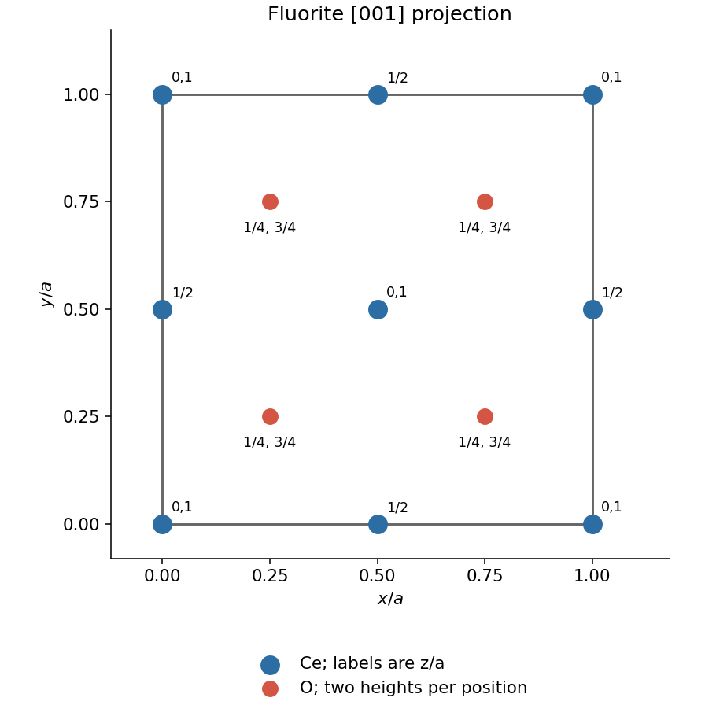

<h1 id="2/a/solution">Solution</h1>

↑ **Parent:** [A](../a.md)

The [fluorite structure](../../../../../fluorite-structure.md) has Ce on the corner and face-centre sites of a [face-centered cubic lattice](../../../../../face-centered-cubic-lattice.md). Oxygen occupies all eight positions $(x,y,z)$ with each coordinate independently $1/4$ or $3/4$. In projection, there are four oxygen positions $(1/4,1/4),(1/4,3/4),(3/4,1/4),(3/4,3/4)$, each representing two heights. Accounting for shared boundary sites gives **four Ce and eight O per conventional [unit cell](../../../../../unit-cell.md)**.

**[Figure 2](#2/a/image-fluorite-unit-cell-projection-with-oxygen-heights-distinguished). Fluorite unit-cell projection with oxygen heights distinguished**. Original coordinate-based plan; each oxygen marker represents heights $1/4$ and $3/4$. Cerium edge-centre and face-centre heights are labelled.

## ↑ Ancestors (13)

1. [A](../a.md)
2. [2](../../2.md)
3. [Paper 1](../../../paper-1-split.md)
4. [2022](../../../split.md)
5. [Past exam of the materials science course of the University of Cambridge](../../../../split.md)
6. [Materials science course of the University of Cambridge](../../../../../materials-science-course-of-the-university-of-cambridge.md)
7. [Year 1 of the natural sciences course of the University of Cambridge](../../../../../year-1-of-the-natural-sciences-course-of-the-university-of-cambridge.md)
8. [Year of the natural sciences course of the University of Cambridge](../../../../../year-of-the-natural-sciences-course-of-the-university-of-cambridge.md)
9. [Natural sciences course of the University of Cambridge](../../../../../natural-sciences-course-of-the-university-of-cambridge.md)
10. [Course of the University of Cambridge](../../../../../course-of-the-university-of-cambridge.md)
11. [University of Cambridge](../../../../../university-of-cambridge-split.md)
12. [List of universities](../../../../../list-of-universities.md)
13. [Codex Wiki](../../../../../split.md)
