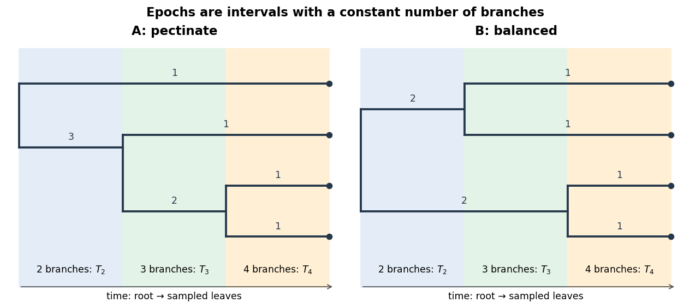

# Paper 1

↑ **Parent:** [2024](../2024.md)

[Original paper, released PDF pages 62–77](https://www.whatdotheyknow.com/request/past_exam_information_of_nst_ib_2/response/3538010/attach/2/FOI%202026%20642%20Cui%20materials%20Part2.pdf?cookie_passthrough=1#page=62)

**Table of contents**

- [A1](#a1)
  - [a](#a1/a)
    - [Solution](#a1/a/solution)
  - [b](#a1/b)
    - [Solution](#a1/b/solution)
  - [c](#a1/c)
    - [Solution](#a1/c/solution)
  - [d](#a1/d)
    - [Solution](#a1/d/solution)
  - [e](#a1/e)
    - [Solution](#a1/e/solution)
  - [f](#a1/f)
    - [Solution](#a1/f/solution)
  - [g](#a1/g)
    - [Solution](#a1/g/solution)
  - [h](#a1/h)
    - [Solution](#a1/h/solution)
- [B2](#b2)
  - [a](#b2/a)
    - [Solution](#b2/a/solution)
  - [b](#b2/b)
    - [Solution](#b2/b/solution)
  - [c](#b2/c)
    - [Solution](#b2/c/solution)
  - [d](#b2/d)
    - [Solution](#b2/d/solution)
  - [e](#b2/e)
    - [Solution](#b2/e/solution)
  - [f](#b2/f)
    - [Solution](#b2/f/solution)
- [B3](#b3)
  - [a](#b3/a)
    - [Solution](#b3/a/solution)
  - [b](#b3/b)
    - [Solution](#b3/b/solution)
  - [c](#b3/c)
    - [Solution](#b3/c/solution)
- [C4](#c4)
  - [a](#c4/a)
    - [Solution](#c4/a/solution)
  - [b](#c4/b)
    - [Solution](#c4/b/solution)
  - [c](#c4/c)
    - [Solution](#c4/c/solution)
  - [d](#c4/d)
    - [Solution](#c4/d/solution)
  - [e](#c4/e)
    - [Solution](#c4/e/solution)
  - [f](#c4/f)
    - [Solution](#c4/f/solution)
  - [g](#c4/g)
    - [Solution](#c4/g/solution)
  - [h](#c4/h)
    - [Solution](#c4/h/solution)
- [C5](#c5)
  - [a](#c5/a)
    - [Solution](#c5/a/solution)
  - [b](#c5/b)
    - [Solution](#c5/b/solution)
  - [c](#c5/c)
    - [i](#c5/c/i)
      - [Solution](#c5/c/i/solution)
    - [ii](#c5/c/ii)
      - [Solution](#c5/c/ii/solution)
  - [d](#c5/d)
    - [Solution](#c5/d/solution)
  - [e](#c5/e)
    - [Solution](#c5/e/solution)
- [D6](#d6)
  - [a](#d6/a)
    - [Solution](#d6/a/solution)
  - [b](#d6/b)
    - [i](#d6/b/i)
      - [Solution](#d6/b/i/solution)
    - [ii](#d6/b/ii)
      - [Solution](#d6/b/ii/solution)
    - [iii](#d6/b/iii)
      - [Solution](#d6/b/iii/solution)
  - [c](#d6/c)
    - [Solution](#d6/c/solution)
  - [d](#d6/d)
    - [Solution](#d6/d/solution)
- [D7](#d7)
  - [a](#d7/a)
    - [Solution](#d7/a/solution)
  - [b](#d7/b)
    - [Solution](#d7/b/solution)
  - [c](#d7/c)
    - [Solution](#d7/c/solution)
  - [d](#d7/d)
    - [Solution](#d7/d/solution)
  - [e](#d7/e)
    - [Solution](#d7/e/solution)
- [E8](#e8)
  - [a](#e8/a)
    - [Solution](#e8/a/solution)
  - [b](#e8/b)
    - [Solution](#e8/b/solution)
  - [c](#e8/c)
    - [Solution](#e8/c/solution)
  - [d](#e8/d)
    - [Solution](#e8/d/solution)
  - [e](#e8/e)
    - [i](#e8/e/i)
      - [Solution](#e8/e/i/solution)
    - [ii](#e8/e/ii)
      - [Solution](#e8/e/ii/solution)

## A1

↑ **Parent:** [Paper 1](paper-1.md)

<h3 id="a1/a">a</h3>

↑ **Parent:** [A1](#a1)

<h4 id="a1/a/solution">Solution</h4>

↑ **Parent:** [A](#a1/a)

A [probability density function](../../continuous-probability-distribution.md#probability-density-function) must have [integral](../../integral.md) one. For $\theta>-1$,

$$
1=A\int_0^1x^\theta\,dx=\frac{A}{\theta+1},\qquad \boxed{A=\theta+1}.
$$

The restriction **$\theta>-1$** is essential: for $\theta\leq-1$ the [integral](../../integral.md) diverges and no positive normalizing constant exists.

<h3 id="a1/b">b</h3>

↑ **Parent:** [A1](#a1)

<h4 id="a1/b/solution">Solution</h4>

↑ **Parent:** [B](#a1/b)

For a [moment](../../expected-value.md#moment) of order $q$ with $\theta+q>-1$, integration of the [probability density function](../../continuous-probability-distribution.md#probability-density-function) gives

$$
\mathbb E[X^q]=(\theta+1)\int_0^1x^{\theta+q}\,dx=\frac{\theta+1}{\theta+q+1}.
$$

Thus the [expected value](../../expected-value.md) and [variance](../../variance.md) are

$$
\boxed{\mathbb E[X]=\frac{\theta+1}{\theta+2}},\qquad
\operatorname{Var}(X)=\frac{\theta+1}{\theta+3}-\left(\frac{\theta+1}{\theta+2}\right)^2
=\boxed{\frac{\theta+1}{(\theta+3)(\theta+2)^2}}.
$$

The [cumulative distribution function](../../probability-distribution.md#cumulative-distribution-function) on $(0,1)$ is $F(x)=x^{\theta+1}$. Its unique [median](../../probability-distribution.md#median) $m$ satisfies $F(m)=1/2$, giving

$$
\boxed{m=2^{-1/(\theta+1)}}.
$$

<h3 id="a1/c">c</h3>

↑ **Parent:** [A1](#a1)

<h4 id="a1/c/solution">Solution</h4>

↑ **Parent:** [C](#a1/c)

For the [independent and identically distributed](../../random-variable.md#independent-and-identically-distributed-random-variables) observations, multiply the [probability density functions](../../continuous-probability-distribution.md#probability-density-function). On the admissible parameter range $\theta>-1$, the [likelihood function](../../maximum-likelihood-estimation.md#likelihood-function) and [log-likelihood](../../maximum-likelihood-estimation.md#log-likelihood) are

$$
\boxed{\mathcal L(\theta)=(\theta+1)^N\prod_{i=1}^Nx_i^\theta},\qquad
\boxed{\ell(\theta)=N\log(\theta+1)+\theta\sum_{i=1}^N\log x_i}.
$$

These expressions presume that every observation lies strictly between zero and one; an observation outside that support would give zero [likelihood](../../maximum-likelihood-estimation.md#likelihood-function) under this model.

<h3 id="a1/d">d</h3>

↑ **Parent:** [A1](#a1)

<h4 id="a1/d/solution">Solution</h4>

↑ **Parent:** [D](#a1/d)

Write $s=\sum_i\log x_i<0$. The [score function](../../statistical-modelling.md#informant-function) is

$$
\ell'(\theta)=\frac{N}{\theta+1}+s.
$$

Setting it to zero gives the [maximum-likelihood estimator](../../maximum-likelihood-estimation.md#maximum-likelihood-estimator)

$$
\boxed{\widehat\theta=-\frac{N}{\sum_i\log x_i}-1}.
$$

This lies above $-1$. The [observed Fisher information](../../statistical-modelling.md#observed-fisher-information) is

$$
\boxed{J(\theta)=-\ell''(\theta)=\frac{N}{(\theta+1)^2}>0}.
$$

Consequently the [log-likelihood](../../maximum-likelihood-estimation.md#log-likelihood) is strictly concave throughout its domain. Its stationary point is the unique global maximum, not merely a candidate local maximum. Indeed the [log-likelihood](../../maximum-likelihood-estimation.md#log-likelihood) tends to minus infinity as either $\theta\downarrow-1$ or $\theta\to\infty$.

<h3 id="a1/e">e</h3>

↑ **Parent:** [A1](#a1)

<h4 id="a1/e/solution">Solution</h4>

↑ **Parent:** [E](#a1/e)

The [sample mean](../../variance.md#sample-mean) is $\bar x=0.7$. The [method of moments](../../statistical-modelling.md#method-of-moments-statistics) equates this to the [expected value](../../expected-value.md) from part (b):

$$
0.7=\frac{\widetilde\theta+1}{\widetilde\theta+2},\qquad
\widetilde\theta=\frac{2\bar x-1}{1-\bar x}.
$$

Hence **the estimate is $\boxed{\widetilde\theta=4/3\approx1.33}$.**

<h3 id="a1/f">f</h3>

↑ **Parent:** [A1](#a1)

<h4 id="a1/f/solution">Solution</h4>

↑ **Parent:** [F](#a1/f)

Here $s=\log(0.4\times0.7\times0.8\times0.9)=-1.601469743$. The [maximum-likelihood estimate](../../maximum-likelihood-estimation.md#maximum-likelihood-estimator) and estimated [standard error](../../statistical-inference.md#standard-error) from the [observed Fisher information](../../statistical-modelling.md#observed-fisher-information) are

$$
\widehat\theta=-\frac4s-1=1.497705634,\qquad
\widehat{\operatorname{se}}(\widehat\theta)=J(\widehat\theta)^{-1/2}
=\frac{\widehat\theta+1}{\sqrt4}=1.248852817.
$$

The 95% [Wald confidence interval](../../statistical-inference.md#wald-confidence-interval) is therefore

$$
\boxed{\widehat\theta\pm1.960\,\widehat{\operatorname{se}}(\widehat\theta)
=(-0.95005,\ 3.94546)}.
$$

The whole reported [confidence interval](../../statistical-inference.md#confidence-interval) lies in $\theta>-1$, though its lower endpoint is close to the boundary. With only four observations, the [normal approximation](../../convergence-of-random-variables.md#normal-approximation) underlying this [Wald confidence interval](../../statistical-inference.md#wald-confidence-interval) need not provide accurate 95% coverage.

<h3 id="a1/g">g</h3>

↑ **Parent:** [A1](#a1)

<h4 id="a1/g/solution">Solution</h4>

↑ **Parent:** [G](#a1/g)

Keep the true parameter fixed and imagine repeatedly collecting four [independent and identically distributed](../../random-variable.md#independent-and-identically-distributed-random-variables) observations under the same model. Compute the [maximum-likelihood estimate](../../maximum-likelihood-estimation.md#maximum-likelihood-estimator), its estimated [standard error](../../statistical-inference.md#standard-error), and the [Wald confidence interval](../../statistical-inference.md#wald-confidence-interval) afresh each time. The intended coverage statement is that approximately 95% of those random [confidence intervals](../../statistical-inference.md#confidence-interval) contain the fixed true parameter, provided the [normal approximation](../../convergence-of-random-variables.md#normal-approximation) is adequate.

After these particular observations have been collected, both endpoints are fixed. The frequentist statement does not assign 95% [probability](../../probability-theory.md#probability) to the fixed parameter lying between these particular endpoints. Nor does the [confidence interval](../../statistical-inference.md#confidence-interval) describe the range containing 95% of future observations. The small sample makes the nominal 95% coverage an approximation whose accuracy is not guaranteed.

<h3 id="a1/h">h</h3>

↑ **Parent:** [A1](#a1)

<h4 id="a1/h/solution">Solution</h4>

↑ **Parent:** [H](#a1/h)

Both candidate models fit one parameter, but their parameter symbols have different meanings. For the [exponential distribution](../../continuous-probability-distribution.md#exponential-distribution) in model B,

$$
\ell_B(\theta_B)=N\log\theta_B-\theta_B\sum_i x_i,\qquad
\widehat\theta_B=\frac{N}{\sum_i x_i}=\frac{10}{7}.
$$

Its second derivative is $-N/\theta_B^2<0$, so this is its [maximum-likelihood estimate](../../maximum-likelihood-estimation.md#maximum-likelihood-estimator). The maximized [log-likelihoods](../../maximum-likelihood-estimation.md#log-likelihood), including their normalization terms, are

$$
\ell_A(\widehat\theta_A)=1.262960000,\qquad
\ell_B(\widehat\theta_B)=4\log(10/7)-4=-2.573300224.
$$

Use the [corrected Akaike information criterion](../../statistical-modelling.md#corrected-akaike-information-criterion) because $N=4$ is small relative to the number $k=1$ of fitted parameters:

$$
\operatorname{AICc}=-2\ell(\widehat\theta)+2k+\frac{2k(k+1)}{N-k-1}.
$$

The correction is $2$ for each model, giving

$$
\boxed{\operatorname{AICc}_A=1.47408,\qquad \operatorname{AICc}_B=9.14660}.
$$

**Prefer model A**, whose [corrected Akaike information criterion](../../statistical-modelling.md#corrected-akaike-information-criterion) is smaller by $7.67252$. The ordinary [Akaike information criterion](../../statistical-modelling.md#akaike-information-criterion) also gives that ranking because the two models receive equal penalties. This compares the two proposed models; it does not establish that either is a correct description of the process. The usual [corrected Akaike information criterion](../../statistical-modelling.md#corrected-akaike-information-criterion) formula is a small-sample model-selection convention, rather than an exact finite-sample guarantee for these density families.

## B2

↑ **Parent:** [Paper 1](paper-1.md)

<h3 id="b2/a">a</h3>

↑ **Parent:** [B2](#b2)

<h4 id="b2/a/solution">Solution</h4>

↑ **Parent:** [A](#b2/a)

For the [squared-denominator population map](../../mathematical-biology.md#squared-denominator-population-map), a [fixed point](../../function.md#fixed-point) satisfies

$$
\bar x=\frac{r\bar x}{(b+\bar x)^2}.
$$

There is always the extinction [fixed point](../../function.md#fixed-point) $\bar x=0$. For a positive [fixed point](../../function.md#fixed-point), divide by $\bar x$ and use $b+\bar x>0$ to obtain

$$
\boxed{\bar x=\sqrt r-b,\qquad r>b^2}.
$$

At equality the candidate merges with zero and is not positive.

<h3 id="b2/b">b</h3>

↑ **Parent:** [B2](#b2)

<h4 id="b2/b/solution">Solution</h4>

↑ **Parent:** [B](#b2/b)

Differentiate the [squared-denominator population map](../../mathematical-biology.md#squared-denominator-population-map):

$$
F'(x)=\frac{r(b-x)}{(b+x)^3}.
$$

At the positive [fixed point](../../function.md#fixed-point), $b+\bar x=\sqrt r$, so its [fixed-point multiplier](../../discrete-dynamical-system.md#multiplier-of-a-periodic-orbit-of-an-iteration) is

$$
F'(\bar x)=\frac{2b}{\sqrt r}-1.
$$

Since $0<b/\sqrt r<1$, we have $-1<F'(\bar x)<1$. A small perturbation $\varepsilon_t$ obeys $\varepsilon_{t+1}=F'(\bar x)\varepsilon_t+O(\varepsilon_t^2)$, and hence shrinks locally. Thus **the positive [fixed point](../../function.md#fixed-point) is locally asymptotically stable** by [fixed point stability for an iteration](../../dynamical-systems.md#fixed-point-stability-for-an-iteration).

<h3 id="b2/c">c</h3>

↑ **Parent:** [B2](#b2)

<h4 id="b2/c/solution">Solution</h4>

↑ **Parent:** [C](#b2/c)

This is a [stage-structured population model](../../mathematical-biology.md#stage-structured-population-model) with a census once per maturation interval. Only adults present at census $t$ contribute to the juvenile cohort at census $t+1$; each contributes $r$ new juveniles on average. Thus $r$ is an effective fecundity, including any survival of offspring needed to reach the next census. Juveniles present at $t$ do not contribute a separate birth term during this interval.

The term $cy_t$ consists of juveniles that survive and mature into adults by the next census, so $c$ is their survival-to-maturity fraction. The term $(1-d)z_t$ consists of surviving adults; $d$ is the adult mortality fraction per interval. All surviving juveniles leave the juvenile compartment in one step, adults remain adults, and there is no immigration or density dependence. The reproduction term is applied to adults counted at the start of the interval, rather than only to those surviving to its end.

<h3 id="b2/d">d</h3>

↑ **Parent:** [B2](#b2)

<h4 id="b2/d/solution">Solution</h4>

↑ **Parent:** [D](#b2/d)

Eliminate the juvenile variable from the [stage-structured population model](../../mathematical-biology.md#stage-structured-population-model). Since $y_{t+1}=2z_t$,

$$
z_{t+2}=\tfrac34 y_{t+1}+\tfrac12z_{t+1}
=\tfrac32z_t+\tfrac12z_{t+1}.
$$

The [characteristic polynomial](../../linear-operator-theory.md#characteristic-polynomial) of this [linear recurrence](../../algebra.md#linear-recurrence-relation) is

$$
q^2-\tfrac12q-\tfrac32=(q-\tfrac32)(q+1),
$$

so $z_t=A(3/2)^t+B(-1)^t$. The [initial conditions](../../differential-equation.md#initial-condition) give $z_0=0$ and $z_1=(3/4)10=15/2$, hence $A+B=0$ and $(3/2)A-B=15/2$. Therefore

$$
\boxed{z_t=3\left[\left(\frac32\right)^t-(-1)^t\right],\qquad t=0,1,2,\ldots}.
$$

The alternating term records the initial imbalance between life stages; the growing $(3/2)^t$ term dominates eventually.

<h3 id="b2/e">e</h3>

↑ **Parent:** [B2](#b2)

<h4 id="b2/e/solution">Solution</h4>

↑ **Parent:** [E](#b2/e)

At a nonzero [fixed point](../../function.md#fixed-point) of the nonlinear [stage-structured population model](../../mathematical-biology.md#stage-structured-population-model), the adult balance gives $d\bar z=c\bar y$. Substitute $\bar y=d\bar z/c$ into the juvenile equation and cancel $\bar z>0$:

$$
\frac dc=\frac r{(b+\bar z)^2}.
$$

Thus

$$
\boxed{\bar z=\sqrt{\frac{cr}{d}}-b,\qquad
\bar y=\frac dc\left(\sqrt{\frac{cr}{d}}-b\right)}.
$$

Both coordinates are positive precisely when **$\boxed{cr>db^2}$.**

<h3 id="b2/f">f</h3>

↑ **Parent:** [B2](#b2)

<h4 id="b2/f/solution">Solution</h4>

↑ **Parent:** [F](#b2/f)

The [Jacobian matrix](../../multivariable-calculus.md#jacobian-matrix) at the extinction [fixed point](../../function.md#fixed-point) is

$$
J_0=\begin{pmatrix}0&r/b^2\\c&1-d\end{pmatrix},
$$

with [characteristic polynomial](../../linear-operator-theory.md#characteristic-polynomial)

$$
p(q)=q^2-(1-d)q-\frac{cr}{b^2}.
$$

Under $cr>db^2$, $p(1)=d-cr/b^2<0$, whereas $p(q)\to\infty$ as $q\to\infty$. Hence its positive [eigenvalue](../../linear-operator-theory.md#eigenvalue)

$$
q_+=\frac{1-d+\sqrt{(1-d)^2+4cr/b^2}}2
$$

is greater than one. Its [eigenvector](../../linear-operator-theory.md#eigenvector) can be taken with both components positive: choose $(r/(b^2q_+),1)^T$. Thus there are biologically admissible positive perturbations that grow. **The extinction [fixed point](../../function.md#fixed-point) is unstable** by [linear stability analysis](../../dynamical-systems.md#linear-stability) for a [discrete dynamical system](../../discrete-dynamical-system.md).

## B3

↑ **Parent:** [Paper 1](paper-1.md)

<h3 id="b3/a">a</h3>

↑ **Parent:** [B3](#b3)

<h4 id="b3/a/solution">Solution</h4>

↑ **Parent:** [A](#b3/a)

Choose the [diagonal matrix](../../linear-algebra.md#diagonal-matrix) $W=\operatorname{diag}(w_1,\ldots,w_m)$. Multiplying a [vector](../../vector-space.md#vector) by $W$ scales its $i$th component by $w_i$. Therefore

$$
\boxed{\|Wb-WAx\|^2=\sum_{i=1}^mw_i^2\bigl(b_i-(Ax)_i\bigr)^2}.
$$

The [Euclidean norm](../../normed-vector-space.md#euclidean-norm) objective for ordinary [linear least squares](../../probability-and-statistics.md#linear-least-squares) on $(WA,Wb)$ is exactly the [weighted least squares](../../normal-linear-model.md#weighted-least-squares) objective, so the sets of minimizing [vectors](../../vector-space.md#vector) coincide. Zero weights simply discard the corresponding residuals.

<h3 id="b3/b">b</h3>

↑ **Parent:** [B3](#b3)

<h4 id="b3/b/solution">Solution</h4>

↑ **Parent:** [B](#b3/b)

Apply the [least-squares normal equations](../../linear-regression.md#normal-equations-for-linear-least-squares) to the transformed [matrix](../../vector-space.md#matrix) and [vector](../../vector-space.md#vector):

$$
\boxed{(WA)^T(WA)\widehat x_w=(WA)^TWb},
$$

or equivalently

$$
\boxed{A^TW^TWA\widehat x_w=A^TW^TWb}.
$$

Here $W^TW=\operatorname{diag}(w_1^2,\ldots,w_m^2)$. A unique minimizing [vector](../../vector-space.md#vector) exists when the weighted design [matrix](../../vector-space.md#matrix) has full column rank; the equations themselves remain valid without that assumption.

<h3 id="b3/c">c</h3>

↑ **Parent:** [B3](#b3)

<h4 id="b3/c/solution">Solution</h4>

↑ **Parent:** [C](#b3/c)

Using the paper's named weights $w_i$, take

$$
W=\operatorname{diag}(1,1,1,\tfrac12,\tfrac12),\qquad
A=\begin{pmatrix}1&1\\1&2\\1&3\\1&4\\1&5\end{pmatrix},\qquad
b=\begin{pmatrix}3\\5\\5\\4\\3\end{pmatrix}.
$$

The [least-squares normal equations](../../linear-regression.md#normal-equations-for-linear-least-squares) for [weighted least squares](../../normal-linear-model.md#weighted-least-squares) become

$$
\begin{pmatrix}7/2&33/4\\33/4&97/4\end{pmatrix}
\begin{pmatrix}\widehat\beta_0\\\widehat\beta_1\end{pmatrix}
=\begin{pmatrix}59/4\\143/4\end{pmatrix}.
$$

Multiplying by four gives $14\widehat\beta_0+33\widehat\beta_1=59$ and $33\widehat\beta_0+97\widehat\beta_1=143$. Their [determinant](../../multilinear-algebra.md#determinant) is $269$, giving

$$
\widehat\beta_0=\frac{1004}{269},\qquad \widehat\beta_1=\frac{55}{269}.
$$

Thus, to two significant digits, **$\boxed{\widehat\beta_0=3.7,\quad\widehat\beta_1=0.20}$**, with the slope measured in expression units per hour.

There is a wording convention to make explicit. Because the stated objective squares $w_i$, the choice above gives the final two _squared residuals_ one-quarter of the influence of the others. If “half as much” instead means half the coefficient of each squared residual, use $W=\operatorname{diag}(1,1,1,1/\sqrt2,1/\sqrt2)$. Then the [least-squares normal equations](../../linear-regression.md#normal-equations-for-linear-least-squares) are

$$
\begin{pmatrix}4&21/2\\21/2&69/2\end{pmatrix}
\begin{pmatrix}\widehat\beta_0\\\widehat\beta_1\end{pmatrix}
=\begin{pmatrix}33/2\\87/2\end{pmatrix},
$$

giving $\widehat\beta_0=150/37\approx\boxed{4.1}$ and $\widehat\beta_1=1/37\approx\boxed{0.027}$. Stating which quantity is halved resolves the ambiguity.

## C4

↑ **Parent:** [Paper 1](paper-1.md)

<h3 id="c4/a">a</h3>

↑ **Parent:** [C4](#c4)

<h4 id="c4/a/solution">Solution</h4>

↑ **Parent:** [A](#c4/a)

A [BLOSUM](../../molecular-genetics.md#blosum) [substitution matrix](../../molecular-genetics.md#substitution-matrix) is estimated from conserved, ungapped blocks of related [protein](../../protein.md) sequences. Closely related sequences are clustered to reduce overrepresentation, and aligned [amino acid](../../chemical-substance.md#amino-acid) pairs from different clusters are counted. Let $q_{ij}$ be their normalized observed pair frequency, and $e_{ij}$ the frequency expected from independent draws at the background [amino acid](../../chemical-substance.md#amino-acid) frequencies. With unordered pairs, $e_{ii}=p_i^2$ and $e_{ij}=2p_ip_j$ for $i\ne j$.

For [BLOSUM62](../../molecular-genetics.md#blosum62), scores are rounded half-bit [logarithms](../../calculus.md#logarithm) of these odds:

$$
\boxed{s_{ij}\simeq2\log_2(q_{ij}/e_{ij})}.
$$

A positive entry means that the aligned pair occurs more often in related sequences than the independent-background model predicts; a negative entry means less often. Adding these scores accumulates evidence across aligned positions. A score is neither a percentage identity nor a direct substitution [probability](../../probability-theory.md#probability).[The choice of substitution scores; The PAM and BLOSUM amino acid substitution matrices](../../biology-bibliography.md#the-statistics-of-sequence-similarity-scores-by-national-center-for-biotechnology-information)

<h3 id="c4/b">b</h3>

↑ **Parent:** [C4](#c4)

<h4 id="c4/b/solution">Solution</h4>

↑ **Parent:** [B](#c4/b)

A diagonal [substitution matrix](../../molecular-genetics.md#substitution-matrix) score measures enrichment over a background match, rather than simply rewarding an identical letter. [tryptophan residues](../../protein.md#tryptophan-residue) are comparatively rare, so a W–W match has a small chance background frequency $p_W^2$. Its observed conservation produces a much larger ratio $q_{WW}/p_W^2$ than the corresponding ratio for the more common [leucine](../../chemical-substance.md#leucine). The [BLOSUM62](../../molecular-genetics.md#blosum62) diagonal therefore awards W–W more than L–L. Both the background frequency and the observed pair frequency matter; rarity alone does not determine a diagonal score.[Methods, p. 10916, observed/expected pair ratios; BLOSUM62 score matrix, W–W and L–L entries](../../biology-bibliography.md#amino-acid-substitution-matrices-from-protein-blocks-by-steven-henikoff-and-jorja-g-henikoff)

<h3 id="c4/c">c</h3>

↑ **Parent:** [C4](#c4)

<h4 id="c4/c/solution">Solution</h4>

↑ **Parent:** [C](#c4/c)

The number specifies the sequence-identity threshold used when clustering related sequences before deriving a [BLOSUM](../../molecular-genetics.md#blosum) [substitution matrix](../../molecular-genetics.md#substitution-matrix). At 62%, sufficiently similar sequences are grouped and their within-cluster comparisons are excluded. Lowering the threshold merges more sequences, emphasizing comparisons across greater divergence.

Consequently **BLOSUM80 is suited to closer relatives, BLOSUM45 to more divergent sequences, and [BLOSUM62](../../molecular-genetics.md#blosum62) is intermediate**. The numbers do not specify a required identity of the query and target, nor a number of evolutionary time steps.[pp. 10916–10917, clustering levels and performance across divergence](../../biology-bibliography.md#amino-acid-substitution-matrices-from-protein-blocks-by-steven-henikoff-and-jorja-g-henikoff)

<h3 id="c4/d">d</h3>

↑ **Parent:** [C4](#c4)

<h4 id="c4/d/solution">Solution</h4>

↑ **Parent:** [D](#c4/d)

Read the ten residue–residue columns from the [BLOSUM62](../../molecular-genetics.md#blosum62) [substitution matrix](../../molecular-genetics.md#substitution-matrix). In their order in the supplied [sequence alignment](../../molecular-genetics.md#sequence-alignment), their contributions are

$$
-2+4+0-2-1+2+5+5+6+7=24.
$$

There are three gap positions, each incurring the stated [linear gap penalty](../../molecular-genetics.md#linear-gap-penalty) of four, including the leading gap. Therefore **the alignment score is $\boxed{24-3(4)=12}$.**

<h3 id="c4/e">e</h3>

↑ **Parent:** [C4](#c4)

<h4 id="c4/e/solution">Solution</h4>

↑ **Parent:** [E](#c4/e)

An [affine gap penalty](../../molecular-genetics.md#affine-gap-penalty) charges a larger opening cost than extension cost, reflecting that a single insertion or deletion event can span several residues. For a gap of length $\ell\geq1$, explicitly choose

$$
g(\ell)=o+e(\ell-1),\qquad o=4,\quad e=1.
$$

The supplied [sequence alignment](../../molecular-genetics.md#sequence-alignment) has two gap runs, of lengths one and two. Its residue–residue score remains $24$, so this choice gives

$$
\boxed{S=24-g(1)-g(2)=24-4-5=15}.
$$

More generally, this [affine gap penalty](../../molecular-genetics.md#affine-gap-penalty) convention gives $S=24-2o-e$. There is no unique numerical rescore until opening and extension costs are chosen. A concave length-dependent [gap penalty](../../molecular-genetics.md#gap-penalty) can make very long gaps progressively cheaper per added residue; distinct terminal [gap penalties](../../molecular-genetics.md#gap-penalty) can accommodate incomplete sequence ends. Each choice encodes a different assumption about insertions, deletions or sequence completeness.

<h3 id="c4/f">f</h3>

↑ **Parent:** [C4](#c4)

<h4 id="c4/f/solution">Solution</h4>

↑ **Parent:** [F](#c4/f)

Use **[global sequence alignment](../../molecular-genetics.md#global-sequence-alignment)**, for example the [Needleman-Wunsch algorithm](../../molecular-genetics.md#needleman-wunsch-algorithm) with an appropriate [substitution matrix](../../molecular-genetics.md#substitution-matrix) and [gap penalty](../../molecular-genetics.md#gap-penalty). The two full-length [globin](../../protein.md#globin) [proteins](../../protein.md) are related by [orthology](../../molecular-genetics.md#orthology) and are from closely related species, so the expected correspondence extends across both complete sequences. Unmatched ends should normally contribute to the score rather than being discarded.

With a [linear gap penalty](../../molecular-genetics.md#linear-gap-penalty) of magnitude $g$, the [dynamic programming](../../mathematical-optimization.md#dynamic-programming) entry $F_{ij}$ is the best score for the first $i$ and $j$ residues. It satisfies

$$
F_{ij}=\max\{F_{i-1,j-1}+s(a_i,b_j),\ F_{i-1,j}-g,\ F_{i,j-1}-g\},
$$

with $F_{i0}=-ig$, $F_{0j}=-jg$, and traceback from $F_{mn}$. An [affine gap penalty](../../molecular-genetics.md#affine-gap-penalty) uses separate match and gap states.

<h3 id="c4/g">g</h3>

↑ **Parent:** [C4](#c4)

<h4 id="c4/g/solution">Solution</h4>

↑ **Parent:** [G](#c4/g)

Use **[local sequence alignment](../../molecular-genetics.md#local-sequence-alignment)**, such as the [Smith-Waterman algorithm](../../molecular-genetics.md#smith-waterman-algorithm), to compare the [globin](../../protein.md#globin) fragment with the matching region of each full-length target. A [global sequence alignment](../../molecular-genetics.md#global-sequence-alignment) would penalize long target flanks absent from the fragment. For a [linear gap penalty](../../molecular-genetics.md#linear-gap-penalty) the [dynamic programming](../../mathematical-optimization.md#dynamic-programming) recurrence includes a restart option:

$$
H_{ij}=\max\{0,\ H_{i-1,j-1}+s(a_i,b_j),\ H_{i-1,j}-g,\ H_{i,j-1}-g\}.
$$

Initialize boundary entries to zero, start traceback at the largest entry anywhere, and stop at zero. If the entire query is known to be valid and must be retained, [fitting sequence alignment](../../molecular-genetics.md#fitting-sequence-alignment) is a suitable refinement: align the whole fragment while leaving target flanks unpenalized.

First check the sequence alphabet: the prompt calls the targets “genes”. If the [FASTA format](../../biology.md#fasta-format) file contains [DNA](../../polymer.md#deoxyribonucleic-acid) rather than [protein](../../protein.md), translate the relevant coding sequences into [amino acids](../../chemical-substance.md#amino-acid) before a protein-to-protein [sequence alignment](../../molecular-genetics.md#sequence-alignment). If coding frames are unknown, search translated frames. A file in [FASTA format](../../biology.md#fasta-format) specifies storage syntax, not whether the contents are nucleotides or residues.

<h3 id="c4/h">h</h3>

↑ **Parent:** [C4](#c4)

<h4 id="c4/h/solution">Solution</h4>

↑ **Parent:** [H](#c4/h)

The gain comes from avoiding a full [dynamic programming](../../mathematical-optimization.md#dynamic-programming) table for every target. [BLAST](../../molecular-genetics.md#blast) searches for short, sufficiently high-scoring word matches between query and database, then extends promising seeds. Modern versions reserve expensive gapped refinement for candidates passing earlier filters. [FASTA sequence search](../../molecular-genetics.md#fasta-sequence-search) similarly starts from short word matches, collects promising runs along alignment diagonals, and refines or joins selected regions. Word lookup and database indexing make candidate discovery inexpensive compared with considering every pair of positions.[pp. 403–406, word matches and hit extension](../../biology-bibliography.md#basic-local-alignment-search-tool-by-stephen-f-altschul-and-others)[pp. 2444–2446, FASTA search stages](../../biology-bibliography.md#improved-tools-for-biological-sequence-comparison-by-william-r-pearson-and-david-j-lipman)

These are [heuristic algorithms](../../algorithm.md#heuristic-algorithm): a good [local sequence alignment](../../molecular-genetics.md#local-sequence-alignment) can be missed if it has no acceptable seed, contains many interruptions, or is filtered before extension. Longer words and higher seed-score thresholds usually speed the search but reduce sensitivity; shorter words and looser thresholds recover weaker similarities at greater cost. Repetitive or compositionally biased regions can create many uninformative hits and erode both speed and specificity. No guarantee remains of finding the optimal [sequence alignment](../../molecular-genetics.md#sequence-alignment) for the chosen scoring scheme.

Thus the practical work depends on word length, thresholds, database composition and the number of hits. The speed-up is substantial on typical data, but does not establish a universal improved worst-case bound over $O(mn)$: an input producing many candidate hits can still require extensive refinement.

## C5

↑ **Parent:** [Paper 1](paper-1.md)

<h3 id="c5/a">a</h3>

↑ **Parent:** [C5](#c5)

<h4 id="c5/a/solution">Solution</h4>

↑ **Parent:** [A](#c5/a)

A [phylogenetic epoch](../../biology.md#phylogenetic-epoch) is a time interval between successive branching events during which the number of ancestral branches is constant. Read backward from the four sampled leaves: there are four branches until the first merger, then three until the next, then two until their common root. Write the random durations as $T_4,T_3,T_2$, with [expected values](../../expected-value.md) $E_k=\mathbb E[T_k]$.

The original solution diagram below places time horizontally and labels each branch by its number of descendant leaves. Type A is the pectinate topology; type B is the balanced topology. The coloured time strips identify the three [phylogenetic epochs](../../biology.md#phylogenetic-epoch); their drawn widths are schematic, not estimated times.

**[Figure 1](#c5/a/image-epochs-and-descendant-counts-for-four-sampled-lineages). Epochs and descendant counts for four sampled lineages**. Time runs from the common root to the sampled leaves. The two panels distinguish the three-plus-one and two-plus-two root splits; numbers on branches count sampled descendants.

<h3 id="c5/b">b</h3>

↑ **Parent:** [C5](#c5)

<h4 id="c5/b/solution">Solution</h4>

↑ **Parent:** [B](#c5/b)

Count the number of descendant leaves on each branch during each [phylogenetic epoch](../../biology.md#phylogenetic-epoch). From the tips backward, both topologies have branch-size lists $(1,1,1,1)$ during $T_4$, then $(2,1,1)$ during $T_3$. During $T_2$, type A has $(3,1)$ and type B has $(2,2)$.

Let $L_j$ be the total length of branches carrying $j$ descendant leaves. Adding the relevant [phylogenetic epoch](../../biology.md#phylogenetic-epoch) durations gives

$$
\boxed{\begin{array}{c|ccc}
&\mathbb E[L_1]&\mathbb E[L_2]&\mathbb E[L_3]\\\hline
A&4E_4+2E_3+E_2&E_3&E_2\\
B&4E_4+2E_3&E_3+2E_2&0
\end{array}}.
$$

For example, type A has one external branch and one three-descendant branch throughout $T_2$, while type B has two two-descendant branches. In either case the total expected branch length is $4E_4+3E_3+2E_2$, a useful accounting check. The stem above the common root is excluded because [mutations](../../genetics.md#mutation) there would be shared by all four samples.

<h3 id="c5/c">c</h3>

↑ **Parent:** [C5](#c5)

<h4 id="c5/c/i">i</h4>

↑ **Parent:** [C](#c5/c)

<h5 id="c5/c/i/solution">Solution</h5>

↑ **Parent:** [I](#c5/c/i)

In the [Yule process](../../continuous-time-markov-chain.md#yule-process), each of $k$ branches gives birth independently at rate $\lambda$ per generation. The next birth therefore has total rate $k\lambda$. Its waiting time has an [exponential distribution](../../continuous-probability-distribution.md#exponential-distribution), so the mean [phylogenetic epoch](../../biology.md#phylogenetic-epoch) duration is

$$
\boxed{E_k^{\rm Yule}=\frac1{k\lambda}}.
$$

For the ensuing calculation use $E_2=1/(2\lambda)$, $E_3=1/(3\lambda)$ and $E_4=1/(4\lambda)$. This is the inter-event waiting-time convention requested in the question, including an observation interval with four branches. Stopping the forward process immediately when the fourth branch is born would instead leave a zero terminal interval and describe a different sampling convention.

<h4 id="c5/c/ii">ii</h4>

↑ **Parent:** [C](#c5/c)

<h5 id="c5/c/ii/solution">Solution</h5>

↑ **Parent:** [Ii](#c5/c/ii)

For a haploid population with $N$ possible parents, each pair of ancestral lineages merges backward at rate $1/N$ in the [Kingman's coalescent](../../continuous-time-markov-chain.md#kingman-s-coalescent) approximation. With $k$ lineages there are $\binom{k}{2}$ pairs. Hence the mean [phylogenetic epoch](../../biology.md#phylogenetic-epoch) duration is

$$
\boxed{E_k^{\rm coal}=\frac{N}{\binom{k}{2}}=\frac{2N}{k(k-1)}}.
$$

Thus $E_2=N$, $E_3=N/3$ and $E_4=N/6$. For an autosomal sample from $N$ diploid individuals, replace the number of gene copies by $2N$, giving $4N/[k(k-1)]$. A mitochondrial sample naturally uses a haploid maternal [effective population size](../../population-genetics.md#effective-population-size); the common factor cancels in the ratios below.

<h3 id="c5/d">d</h3>

↑ **Parent:** [C5](#c5)

<h4 id="c5/d/solution">Solution</h4>

↑ **Parent:** [D](#c5/d)

Under the stated topology [probabilities](../../probability-theory.md#probability), $P(A)=2/3$ and $P(B)=1/3$. Averaging the branch lengths from part (b), the expected length producing the folded $3:1$ class is

$$
B_{3:1}=\tfrac23(4E_4+2E_3+2E_2)+\tfrac13(4E_4+2E_3)
=4E_4+2E_3+\tfrac43E_2.
$$

The factor $2E_2$ in type A includes both the one-descendant and three-descendant root branches. The expected length producing the $2:2$ class is

$$
B_{2:2}=\tfrac23E_3+\tfrac13(E_3+2E_2)
=E_3+\tfrac23E_2.
$$

With a common [mutation rate](../../genetics.md#mutation-rate) per unit branch length, it cancels from the ratio of expected counts in this [folded site frequency spectrum](../../population-genetics.md#folded-site-frequency-spectrum):

$$
R=\frac{4E_4+2E_3+\tfrac43E_2}{E_3+\tfrac23E_2}.
$$

For the [Yule process](../../continuous-time-markov-chain.md#yule-process),

$$
\boxed{R_{\rm Yule}=\frac{1+2/3+2/3}{1/3+1/3}=\frac72=3.5}.
$$

For [Kingman's coalescent](../../continuous-time-markov-chain.md#kingman-s-coalescent),

$$
\boxed{R_{\rm coal}=\frac{2/3+2/3+4/3}{1/3+2/3}=\frac83\approx2.67}.
$$

These are ratios of ensemble expected mutation counts, not the [expected value](../../expected-value.md) of the random ratio in one tree. The stipulated topology weights apply to both processes, and their waiting-time rates depend only on the current number of branches.

<h3 id="c5/e">e</h3>

↑ **Parent:** [C5](#c5)

<h4 id="c5/e/solution">Solution</h4>

↑ **Parent:** [E](#c5/e)

The observed [folded site frequency spectrum](../../population-genetics.md#folded-site-frequency-spectrum) has a larger $3:1$ to $2:2$ ratio than either expectation in part (d), and is closer to the [Yule process](../../continuous-time-markov-chain.md#yule-process) expectation than to the constant-size [Kingman's coalescent](../../continuous-time-markov-chain.md#kingman-s-coalescent) expectation. Both models can nevertheless produce deviations in one finite sample, especially because all mitochondrial sites largely share one genealogy; this observation alone is not a formal model-selection result.

For the [Yule process](../../continuous-time-markov-chain.md#yule-process), one possible violation is a **recent reduction in the per-lineage branching rate** rather than a constant $\lambda$. Lengthening the terminal four-branch interval adds one-descendant branch length and therefore preferentially increases the $3:1$ class.

For [Kingman's coalescent](../../continuous-time-markov-chain.md#kingman-s-coalescent), one possible violation is **recent population expansion** rather than a constant [effective population size](../../population-genetics.md#effective-population-size). Backward in time, coalescence is slow in the large recent population and faster in the smaller ancestral population. The resulting long external branches tend to increase the $3:1$ class relative to the $2:2$ class.

## D6

↑ **Parent:** [Paper 1](paper-1.md)

<h3 id="d6/a">a</h3>

↑ **Parent:** [D6](#d6)

<h4 id="d6/a/solution">Solution</h4>

↑ **Parent:** [A](#d6/a)

A [network null model](../../graph-theory.md#network-null-model) is an ensemble representing a specified baseline against which to assess an observed biological network. It should preserve the features that would otherwise confound the test: at least the number of [vertices](../../graph.md#vertex-graph-theory) and [edges](../../graph-theory.md#edge-of-a-graph), and often the [degree sequence](../../graph-theory.md#degree-sequence), direction, edge type, or relevant spatial constraints. It should randomize the feature whose biological organization is under investigation. An ensemble that preserves that very feature cannot test whether the feature is unusual.

For example, test whether a measured [protein-protein interaction network](../../protein.md#protein-protein-interaction-network) contains more closed three-protein interaction groups than can be explained by the interaction counts of individual [proteins](../../protein.md). Define [vertices](../../graph.md#vertex-graph-theory) as the measured [proteins](../../protein.md) and an undirected [edge](../../graph-theory.md#edge-of-a-graph) as a reproducible detected interaction, using a fixed assay threshold and treatment of duplicates. Preselect the triangle count as the test statistic. Generate many simple [random graphs](../../random-graph.md) by [degree-preserving edge rewiring](../../graph-theory.md#degree-preserving-edge-rewiring), rejecting [self-loops](../../graph.md#loop-graph-theory) and duplicate [edges](../../graph-theory.md#edge-of-a-graph), with enough accepted swaps and separation to obtain a well-mixed reference sample. This retains the observed [degree sequence](../../graph-theory.md#degree-sequence) while disrupting higher-order association.

Compute the same triangle count for every reference [graph](../../graph.md). Compare the observed count with this distribution; an empirical upper-tail [p-value](../../statistical-hypothesis-test.md#p-value) can be reported as $(1+\#\{T_{\rm null}\geq T_{\rm obs}\})/(M+1)$ for $M$ suitably sampled reference [graphs](../../graph.md). Report the size of the excess as well as its tail frequency, and check sensitivity to the assay threshold and any required connectivity constraint. A significant excess is evidence beyond the chosen degree baseline, while assay bias or spatial organization omitted from that baseline can still explain it.

A generative network model specifies a mechanism for producing networks, such as growth with [preferential attachment](../../random-graph.md#preferential-attachment), and asks what structures that mechanism creates. A [network null model](../../graph-theory.md#network-null-model) is defined by its role as a comparison baseline. These roles can overlap: the same random mechanism can be a proposed biological explanation in one analysis and a deliberately simplified null in another.

<h3 id="d6/b">b</h3>

↑ **Parent:** [D6](#d6)

<h4 id="d6/b/i">i</h4>

↑ **Parent:** [B](#d6/b)

<h5 id="d6/b/i/solution">Solution</h5>

↑ **Parent:** [I](#d6/b/i)

For the **[Erdős-Rényi model](../../random-graph.md#erdos-renyi-model) $G(n,p)$**, choose the number $n$ of [vertices](../../graph.md#vertex-graph-theory) and an edge [probability](../../probability-theory.md#probability) $0\leq p\leq1$. Visit every unordered pair of distinct [vertices](../../graph.md#vertex-graph-theory) once and include its [edge](../../graph-theory.md#edge-of-a-graph) independently with [probability](../../probability-theory.md#probability) $p$. This construction gives a [simple graph](../../graph.md#simple-graph) with expected edge count $p\binom n2$ and mean [vertex degree](../../graph-theory.md#degree-graph-theory) $p(n-1)$.

Increasing $p$ at fixed $n$ makes the [graph](../../graph.md) denser, increases typical [vertex degree](../../graph-theory.md#degree-graph-theory) and local [clustering coefficient](../../graph-theory.md#clustering-coefficient), and tends to shorten [graph distances](../../graph-theory.md#distance-graph-theory) and improve connectivity. Increasing $n$ at fixed $p$ also increases the mean [vertex degree](../../graph-theory.md#degree-graph-theory); to retain a sparse comparison one instead decreases $p$ approximately as $1/n$.

Its [degree distribution](../../graph-theory.md#degree-distribution) is [binomial distribution](../../discrete-probability-distribution.md#binomial-distribution), approximately [Poisson distribution](../../discrete-probability-distribution.md#poisson-distribution) in the sparse large-$n$ regime, so it is **not a [scale-free network](../../graph-theory.md#scale-free-network)**. Connected realizations can have short [average shortest path length](../../graph-theory.md#average-shortest-path-length), but their [clustering coefficients](../../graph-theory.md#clustering-coefficient) are not elevated above the random baseline they themselves define. Thus they are **not [small-world networks](../../graph-theory.md#small-world-network) under the high-clustering convention**, although “small world” is sometimes used more loosely to mean only short distances.

<h4 id="d6/b/ii">ii</h4>

↑ **Parent:** [B](#d6/b)

<h5 id="d6/b/ii/solution">Solution</h5>

↑ **Parent:** [Ii](#d6/b/ii)

For the **[Watts-Strogatz model](../../random-graph.md#watts-strogatz-model)**, choose $n$ [vertices](../../graph.md#vertex-graph-theory) on a ring, an even initial [vertex degree](../../graph-theory.md#degree-graph-theory) $K<n$, and a rewiring [probability](../../probability-theory.md#probability) $p$. Connect each [vertex](../../graph.md#vertex-graph-theory) to its $K/2$ nearest neighbours on each side. Consider each original clockwise [edge](../../graph-theory.md#edge-of-a-graph) once: with [probability](../../probability-theory.md#probability) $p$, retain its starting endpoint and replace its other endpoint uniformly, excluding [self-loops](../../graph.md#loop-graph-theory) and duplicate [edges](../../graph-theory.md#edge-of-a-graph). The edge count remains $nK/2$, although individual [vertex degrees](../../graph-theory.md#degree-graph-theory) change.

Increasing $n$ at fixed $K$ lengthens unrewired-ring [graph distances](../../graph-theory.md#distance-graph-theory). Increasing $K$ adds [edges](../../graph-theory.md#edge-of-a-graph) and shortens distances. Increasing $p$ introduces shortcuts, sharply reducing [average shortest path length](../../graph-theory.md#average-shortest-path-length) at first, then progressively reducing the [clustering coefficient](../../graph-theory.md#clustering-coefficient) by destroying local triangles.

**The [small-world network](../../graph-theory.md#small-world-network) regime occurs at intermediate $p$** with sufficient shortcuts, substantial clustering, and $K\ll n$. At $p=0$ distances are long; near $p=1$ the clustering advantage disappears. The [degree distribution](../../graph-theory.md#degree-distribution) remains concentrated around $K$, so this is **not a [scale-free network](../../graph-theory.md#scale-free-network)**.[pp. 440–441, construction and dependence on rewiring probability](../../mathematics-bibliography.md#collective-dynamics-of-small-world-networks-by-duncan-j-watts-and-steven-h-strogatz)

<h4 id="d6/b/iii">iii</h4>

↑ **Parent:** [B](#d6/b)

<h5 id="d6/b/iii/solution">Solution</h5>

↑ **Parent:** [Iii](#d6/b/iii)

For the **[Barabási-Albert model](../../random-graph.md#barabasi-albert-model)**, choose a connected seed [graph](../../graph.md) on $m_0$ [vertices](../../graph.md#vertex-graph-theory), the number $m\leq m_0$ of new [edges](../../graph-theory.md#edge-of-a-graph) per added [vertex](../../graph.md#vertex-graph-theory), and a final size $n$. A complete seed with $m_0\geq2$ suffices. Add one [vertex](../../graph.md#vertex-graph-theory) at a time, attaching it to $m$ distinct existing [vertices](../../graph.md#vertex-graph-theory) selected with weights proportional to their current [vertex degrees](../../graph-theory.md#degree-graph-theory). Exclude duplicate [edges](../../graph-theory.md#edge-of-a-graph) and [self-loops](../../graph.md#loop-graph-theory).

Increasing $n$ creates a larger network and permits older hubs to grow. Increasing $m$ makes the [graph](../../graph.md) denser, with asymptotic average [vertex degree](../../graph-theory.md#degree-graph-theory) $2m$, and tends to shorten [graph distances](../../graph-theory.md#distance-graph-theory). The seed affects early structure and the oldest hubs; standard linear [preferential attachment](../../random-graph.md#preferential-attachment) gives a robust large-size tail exponent.

Its asymptotic [degree distribution](../../graph-theory.md#degree-distribution) is $P(k)\propto k^{-3}$, so **it is a [scale-free network](../../graph-theory.md#scale-free-network)**. Hubs produce short [average shortest path length](../../graph-theory.md#average-shortest-path-length), but elevated [clustering coefficients](../../graph-theory.md#clustering-coefficient) are not automatic: $m=1$ with a tree seed gives a triangle-free [tree](../../tree-graph-theory.md), and clustering decreases with size in the standard model. **The strict clustered [small-world network](../../graph-theory.md#small-world-network) property is therefore not guaranteed.**[pp. 510–511, growth, attachment and degree exponent](../../mathematics-bibliography.md#emergence-of-scaling-in-random-networks-by-albert-laszlo-barabasi-and-reka-albert)

<h3 id="d6/c">c</h3>

↑ **Parent:** [D6](#d6)

<h4 id="d6/c/solution">Solution</h4>

↑ **Parent:** [C](#d6/c)

The supplied [adjacency matrix](../../graph-theory.md#adjacency-matrix) describes a four-[vertex](../../graph.md#vertex-graph-theory) [cycle graph](../../graph-theory.md#cycle-graph), with every [vertex degree](../../graph-theory.md#degree-graph-theory) equal to two. [Degree-preserving edge rewiring](../../graph-theory.md#degree-preserving-edge-rewiring) is random, so it does not determine one unique labelled output [adjacency matrix](../../graph-theory.md#adjacency-matrix). For example, replace [edges](../../graph-theory.md#edge-of-a-graph) $AB$ and $CD$ by $AC$ and $BD$, retaining $AD$ and $BC$. This valid switch gives, in order $A,B,C,D$,

$$
\boxed{A'=\begin{pmatrix}
0&0&1&1\\
0&0&1&1\\
1&1&0&0\\
1&1&0&0
\end{pmatrix}}.
$$

Each row still sums to two. Under the [simple graph](../../graph.md#simple-graph) convention, all allowed outputs have the same unlabelled four-cycle topology: there are three possible labelled four-cycles. A rejected switch or later return can also leave the original [adjacency matrix](../../graph-theory.md#adjacency-matrix).

**It is not a [scale-free network](../../graph-theory.md#scale-free-network).** Its [degree distribution](../../graph-theory.md#degree-distribution) is concentrated entirely at degree two, with no power-law tail; [degree-preserving edge rewiring](../../graph-theory.md#degree-preserving-edge-rewiring) cannot change that.

<h3 id="d6/d">d</h3>

↑ **Parent:** [D6](#d6)

<h4 id="d6/d/solution">Solution</h4>

↑ **Parent:** [D](#d6/d)

The diagram has all possible undirected [edges](../../graph-theory.md#edge-of-a-graph) except $AB$: it is a [complete graph](../../graph-theory.md#complete-graph) on five [vertices](../../graph.md#vertex-graph-theory) with one [edge](../../graph-theory.md#edge-of-a-graph) removed. Therefore $A$ and $B$ each have three neighbours, while $C,D,E$ each have four.

The neighbours of $A$ and $B$ form a triangle, so their [clustering coefficients](../../graph-theory.md#clustering-coefficient) equal one. Each of $C,D,E$ has five of the six possible neighbour–neighbour [edges](../../graph-theory.md#edge-of-a-graph), giving $5/6$. The nodal [average shortest path length](../../graph-theory.md#average-shortest-path-length) is $\ell_i=\frac14\sum_{j\ne i}d(i,j)$. All [graph distances](../../graph-theory.md#distance-graph-theory) equal one except $d(A,B)=d(B,A)=2$, hence

$$
\boxed{\begin{array}{c|ccccc}
i&A&B&C&D&E\\\hline
k_i&3&3&4&4&4\\
C_i&1&1&5/6&5/6&5/6\\
\ell_i&5/4&5/4&1&1&1
\end{array}}.
$$

Averaging the nodal quantities gives

$$
\boxed{\bar C=\frac9{10}=0.9,\qquad L=\frac{11}{10}=1.1}.
$$

The ordered-pair distance sum is $22$, and the [graph diameter](../../graph-theory.md#graph-diameter) is two.

If the intended unnormalized “small-worldness” is the ratio of clustering to path length, the computed quantities give

$$
\boxed{\frac{\bar C}{L}=\frac9{11}\approx0.818}.
$$

That ratio has no universal threshold for identifying a [small-world network](../../graph-theory.md#small-world-network). The standard reference-normalized [small-worldness](../../graph-theory.md#small-worldness), $\sigma=(\bar C/C_{\rm ref})/(L/L_{\rm ref})$, cannot receive a numerical value when no reference is specified and the question forbids using a [network null model](../../graph-theory.md#network-null-model).[New measures of small-world-ness, Definitions 1–2](../../mathematics-bibliography.md#network-‘small-world-ness’-a-quantitative-method-for-determining-canonical-network-equivalence-by-mark-d-humphries-and-others)

**The graph has high clustering and short paths in the descriptive sense.** With nine of ten possible [edges](../../graph-theory.md#edge-of-a-graph), however, those properties follow directly from its near completeness; they do not by themselves establish [small-world network](../../graph-theory.md#small-world-network) structure relative to a reference. This distinguishes the metrics that can be computed directly from the stronger classification that requires a stated convention.

## D7

↑ **Parent:** [Paper 1](paper-1.md)

<h3 id="d7/a">a</h3>

↑ **Parent:** [D7](#d7)

<h4 id="d7/a/solution">Solution</h4>

↑ **Parent:** [A](#d7/a)

Let $\xi_j$ be the displacement in step $j$, so the [random walk](../../random-walk.md) position is $x(n)=\sum_{j=1}^n\xi_j$. The single-step [expected value](../../expected-value.md) and second [moment](../../expected-value.md#moment) are

$$
\mathbb E[\xi_j]=\tfrac13\delta-\tfrac13\delta+\tfrac13(0)=0,\qquad
\mathbb E[\xi_j^2]=\tfrac13\delta^2+\tfrac13\delta^2=\tfrac23\delta^2.
$$

By linearity of [expected value](../../expected-value.md), **$\boxed{\langle x(n)\rangle=0}$.** The steps are [independent random variables](../../random-variable.md#independent-random-variables), so for $i\ne j$, $\mathbb E[\xi_i\xi_j]=\mathbb E[\xi_i]\mathbb E[\xi_j]=0$. Expanding the square gives the [mean squared displacement](../../brownian-motion.md#mean-squared-displacement)

$$
\boxed{\langle x^2(n)\rangle=\sum_{j=1}^n\mathbb E[\xi_j^2]
+2\sum_{i<j}\mathbb E[\xi_i\xi_j]=\frac23n\delta^2}.
$$

These are ensemble [expected values](../../expected-value.md); the empirical average over a finite number $N$ of independent cells fluctuates about them. The expected [mean squared displacement](../../brownian-motion.md#mean-squared-displacement) itself does not depend on $N$.

<h3 id="d7/b">b</h3>

↑ **Parent:** [D7](#d7)

<h4 id="d7/b/solution">Solution</h4>

↑ **Parent:** [B](#d7/b)

For unbiased one-dimensional [diffusion](../../thermodynamics.md#diffusion), the [mean squared displacement](../../brownian-motion.md#mean-squared-displacement) is $\langle x^2(t)\rangle=2Dt$. With $t=n\tau$, compare this to the mutant expression:

$$
2Dn\tau=\frac16n\delta^2,\qquad D=\frac{\delta^2}{12\tau}.
$$

Therefore the mutant [diffusion coefficient](../../brownian-motion.md#diffusion-coefficient) is

$$
\boxed{D=\frac{(10\,\mu\mathrm m)^2}{12(50\,\mathrm s)}
=\frac16\,\mu\mathrm m^2\mathrm s^{-1}\approx0.167\,\mu\mathrm m^2/\mathrm s}.
$$

<h3 id="d7/c">c</h3>

↑ **Parent:** [D7](#d7)

<h4 id="d7/c/solution">Solution</h4>

↑ **Parent:** [C](#d7/c)

On a moving step, the largest speed resolved by the discrete model is the distance per interval,

$$
\boxed{v_{\max}=\delta/\tau=0.20\,\mu\mathrm m/\mathrm s
=2.0\times10^{-5}\,\mathrm{cm}/\mathrm s}.
$$

This is a step-averaged speed; the model does not specify motion within the interval. Use the cell length $a=2r=20\,\mu\mathrm m=2.0\times10^{-3}\,\mathrm{cm}$ in the stated [Reynolds number](../../dynamic-viscosity.md#reynolds-number) formula. In consistent centimetre–gram–second units,

$$
\boxed{R_{\max}=\frac{av_{\max}\rho}{\eta}
=\frac{(2.0\times10^{-3})(2.0\times10^{-5})(1)}{10^{-2}}
=4.0\times10^{-6}}.
$$

Thus viscous effects dominate inertia overwhelmingly. The surrounding flow is in the [Stokes flow](../../stokes-flow.md) regime: sustained movement needs applied forces, and inertial coasting is negligible. Using radius rather than the specified length as the characteristic size would halve the [Reynolds number](../../dynamic-viscosity.md#reynolds-number), without changing that physical conclusion.

<h3 id="d7/d">d</h3>

↑ **Parent:** [D7](#d7)

<h4 id="d7/d/solution">Solution</h4>

↑ **Parent:** [D](#d7/d)

Take the membrane [particle flux](../../physics.md#particle-flux) density to be positive from [cytoplasm](../../biological-cell.md#cytoplasm) into the [cell nucleus](../../biological-cell.md#cell-nucleus). With [membrane permeability](../../cell-membrane.md#membrane-permeability) $\alpha$,

$$
j_m=\alpha(c_c-c_n)=\alpha\Delta c.
$$

For fixed compartment volumes, [conservation of mass](../../continuum-mechanics.md#mass-conservation) and the absence of exterior [flux](../../mathematical-physics.md#flux) give

$$
V_n\frac{dc_n}{dt}=A_n\alpha\Delta c,\qquad
V_c\frac{dc_c}{dt}=-A_n\alpha\Delta c.
$$

Subtract the two [concentration](../../mathematical-physics.md#concentration) derivatives:

$$
\frac{d\Delta c}{dt}=-\alpha A_n\left(\frac1{V_c}+\frac1{V_n}\right)\Delta c.
$$

This [linear ordinary differential equation](../../linear-ordinary-differential-equation.md) has solution

$$
\boxed{\Delta c(t)=\Delta c(0)\exp\!\left[-\alpha A_n\left(\frac1{V_c}+\frac1{V_n}\right)t\right]}.
$$

Its relaxation time is $\boxed{T=V_cV_n/[\alpha A_n(V_c+V_n)]}$. Here $\alpha$ has dimensions length/time, so $\alpha A_n/V$ has dimensions inverse time. A positive initial [concentration](../../mathematical-physics.md#concentration) difference decays monotonically toward zero; a negative one approaches zero from below.

<h3 id="d7/e">e</h3>

↑ **Parent:** [D7](#d7)

<h4 id="d7/e/solution">Solution</h4>

↑ **Parent:** [E](#d7/e)

The conserved total molecule amount fixes the final common [concentration](../../mathematical-physics.md#concentration):

$$
c_\infty=\frac{V_cc_c(0)+V_nc_n(0)}{V_c+V_n}.
$$

Solve $c_c-c_n=\Delta c(t)$ together with $V_cc_c+V_nc_n=(V_c+V_n)c_\infty$ to obtain

$$
\boxed{c_c(t)=c_\infty+\frac{V_n}{V_c+V_n}\Delta c(t)},\qquad
\boxed{c_n(t)=c_\infty-\frac{V_c}{V_c+V_n}\Delta c(t)}.
$$

Substituting the decaying [concentration](../../mathematical-physics.md#concentration) difference from part (d) supplies both explicit time dependences. The [concentrations](../../mathematical-physics.md#concentration) approach the volume-weighted initial average, which need not be the arithmetic average if the compartment volumes differ.

## E8

↑ **Parent:** [Paper 1](paper-1.md)

<h3 id="e8/a">a</h3>

↑ **Parent:** [E8](#e8)

<h4 id="e8/a/solution">Solution</h4>

↑ **Parent:** [A](#e8/a)

**Yes, the data are centred.** Both coordinate [sample means](../../variance.md#sample-mean) vanish:

$$
\bar x=\frac{7-8+1}{3}=0,\qquad
\bar y=\frac{1+6-7}{3}=0.
$$

Thus [principal component analysis](../../statistical-learning.md#principal-component-analysis) can be applied without further [data centering](../../statistical-modelling.md#data-centering).

<h3 id="e8/b">b</h3>

↑ **Parent:** [E8](#e8)

<h4 id="e8/b/solution">Solution</h4>

↑ **Parent:** [B](#e8/b)

Place observations in rows of the data [matrix](../../vector-space.md#matrix) $X$. Since the coordinate [sample means](../../variance.md#sample-mean) are zero, the [Gram matrix](../../inner-product.md#gram-matrix) of its columns is

$$
X^TX=\begin{pmatrix}114&-48\\-48&86\end{pmatrix}.
$$

The [sample covariance matrix](../../variance.md#sample-covariance-matrix) is $S=X^TX/(3-1)$; using divisor three instead changes [eigenvalues](../../linear-operator-theory.md#eigenvalue) by a common factor and leaves [principal component loadings](../../statistical-learning.md#principal-component-loading) unchanged. For $X^TX$, the [characteristic polynomial](../../linear-operator-theory.md#characteristic-polynomial) is

$$
\det(X^TX-\lambda I)=(114-\lambda)(86-\lambda)-48^2
=\lambda^2-200\lambda+7500=(\lambda-150)(\lambda-50).
$$

For the larger [eigenvalue](../../linear-operator-theory.md#eigenvalue) $150$, the [eigenvector](../../linear-operator-theory.md#eigenvector) equation gives $-36\alpha-48\beta=0$, so $3\alpha+4\beta=0$. Normalize to unit [Euclidean norm](../../normed-vector-space.md#euclidean-norm) and choose $v_1=(4/5,-3/5)^T$. An orthogonal unit [eigenvector](../../linear-operator-theory.md#eigenvector) for $50$ is $v_2=(3/5,4/5)^T$. Therefore

$$
\boxed{PC_1=\frac45x-\frac35y,\qquad PC_2=\frac35x+\frac45y}.
$$

The [sample variances](../../statistical-inference.md#sample-variance) of these [principal components](../../statistical-learning.md#principal-component) are $75$ and $25$, respectively. Their [principal component scores](../../statistical-learning.md#principal-component-score) for observations $A,B,C$ are

$$
\begin{array}{c|rr}
&PC_1&PC_2\\\hline
A&5&5\\
B&-10&0\\
C&5&-5
\end{array}.
$$

Either [eigenvector](../../linear-operator-theory.md#eigenvector) may be multiplied by $-1$ without changing its [principal component](../../statistical-learning.md#principal-component) direction or its [variance](../../variance.md). No coordinate standardization is applied here: that would instead be [principal component analysis on a correlation matrix](../../statistical-learning.md#principal-component-analysis-on-a-correlation-matrix).

<h3 id="e8/c">c</h3>

↑ **Parent:** [E8](#e8)

<h4 id="e8/c/solution">Solution</h4>

↑ **Parent:** [C](#e8/c)

The [explained variance of a principal component](../../statistical-learning.md#explained-variance-of-a-principal-component) is its [eigenvalue](../../linear-operator-theory.md#eigenvalue) divided by the sum of all [eigenvalues](../../linear-operator-theory.md#eigenvalue) of the [covariance matrix](../../variance.md#covariance-matrix). A common divisor cancels, so the first [principal component](../../statistical-learning.md#principal-component) explains

$$
\boxed{\frac{150}{150+50}=\frac34=75\%}
$$

of the total [variance](../../variance.md).

<h3 id="e8/d">d</h3>

↑ **Parent:** [E8](#e8)

<h4 id="e8/d/solution">Solution</h4>

↑ **Parent:** [D](#e8/d)

The one-dimensional [principal component analysis](../../statistical-learning.md#principal-component-analysis) reconstruction lies along $v_1=(4/5,-3/5)^T$ through the zero [sample mean](../../variance.md#sample-mean). Its discarded [principal component](../../statistical-learning.md#principal-component) coordinate is $PC_2=0$, so

$$
\frac35x+\frac45y=0,\qquad y=-\frac34x.
$$

At $x=6$, **$\boxed{\widehat y=-4.5}$.** This intersects the retained [principal component](../../statistical-learning.md#principal-component) line with the vertical line at the supplied $x$. It is a reconstruction from that line, rather than an ordinary [linear regression](../../linear-regression.md) of $y$ on $x$.

<h3 id="e8/e">e</h3>

↑ **Parent:** [E8](#e8)

<h4 id="e8/e/i">i</h4>

↑ **Parent:** [E](#e8/e)

<h5 id="e8/e/i/solution">Solution</h5>

↑ **Parent:** [I](#e8/e/i)

The premise contains a wording error: $\lambda$ must be a nonzero **[eigenvalue](../../linear-operator-theory.md#eigenvalue)**, rather than a nonzero [eigenvector](../../linear-operator-theory.md#eigenvector). Let $v\ne0$ satisfy

$$
X^TXv=\lambda v,\qquad \lambda\ne0.
$$

Then $Xv\ne0$, since otherwise $X^TXv=0$ would force $\lambda v=0$. Multiplying by $X$ gives

$$
XX^T(Xv)=X(X^TXv)=\lambda(Xv).
$$

Thus **$\boxed{\lambda\text{ is an eigenvalue of }XX^T}$**, with [eigenvector](../../linear-operator-theory.md#eigenvector) $Xv$. Conversely, applying $X^T$ maps an [eigenvector](../../linear-operator-theory.md#eigenvector) of $XX^T$ with nonzero [eigenvalue](../../linear-operator-theory.md#eigenvalue) to one of $X^TX$.

These maps are inverses up to the factor $\lambda$ on the corresponding [eigenspaces](../../linear-operator-theory.md#eigenspace), so the nonzero [eigenvalues](../../linear-operator-theory.md#eigenvalue) have equal multiplicities. Their zero [eigenvalues](../../linear-operator-theory.md#eigenvalue) need not have the same multiplicity because the two [matrices](../../vector-space.md#matrix) can have different sizes. For a unit [eigenvector](../../linear-operator-theory.md#eigenvector) $v$ and real $X$, the normalized partner is $u=Xv/\sqrt\lambda$, since $\|Xv\|^2=v^TX^TXv=\lambda>0$.

<h4 id="e8/e/ii">ii</h4>

↑ **Parent:** [E](#e8/e)

<h5 id="e8/e/ii/solution">Solution</h5>

↑ **Parent:** [Ii](#e8/e/ii)

For centred data, [classical multidimensional scaling](../../statistical-learning.md#classical-multidimensional-scaling) from [Euclidean distances](../../topological-analysis.md#euclidean-distance) constructs the observation [Gram matrix](../../inner-product.md#gram-matrix)

$$
B=-\tfrac12HD^{(2)}H=XX^T,\qquad H=I-\tfrac1n\mathbf1\mathbf1^T,
$$

where $D^{(2)}_{ij}=\|x_i-x_j\|^2$. By part (i), its nonzero [eigenvalues](../../linear-operator-theory.md#eigenvalue) agree with those of $X^TX$, the [matrix](../../vector-space.md#matrix) used for [principal component analysis](../../statistical-learning.md#principal-component-analysis) before dividing by a covariance normalization.

If $u_i=Xv_i/\sqrt{\lambda_i}$ is the unit observation-space [eigenvector](../../linear-operator-theory.md#eigenvector), the corresponding [classical multidimensional scaling](../../statistical-learning.md#classical-multidimensional-scaling) coordinate column is

$$
\boxed{\sqrt{\lambda_i}\,u_i=Xv_i}.
$$

That is exactly the column of [principal component scores](../../statistical-learning.md#principal-component-score). Consequently **[classical multidimensional scaling](../../statistical-learning.md#classical-multidimensional-scaling) of Euclidean pairwise distances recovers the same reduced coordinates as [principal component analysis](../../statistical-learning.md#principal-component-analysis)**, up to signs and arbitrary [orthogonal transformations](../../linear-algebra.md#orthogonal-transformation) within equal-[eigenvalue](../../linear-operator-theory.md#eigenvalue) subspaces. Distances alone cannot fix translation or orientation. The equivalence presumes centred data and Euclidean distances; general dissimilarities need not yield a positive semidefinite [Gram matrix](../../inner-product.md#gram-matrix) or a corresponding data [covariance matrix](../../variance.md#covariance-matrix).

## ↑ Ancestors (10)

1. [2024](../2024.md)
2. [Past exam of the mathematical and Computational Biology course of the University of Cambridge](../../past-exam-of-the-mathematical-and-computational-biology-course-of-the-university-of-cambridge.md)
3. [Mathematical and Computational Biology course of the University of Cambridge](../../university-of-cambridge.md#mathematical-and-computational-biology-course-of-the-university-of-cambridge)
4. [Year 2 of the natural sciences course of the University of Cambridge](../../university-of-cambridge.md#year-2-of-the-natural-sciences-course-of-the-university-of-cambridge)
5. [Year of the natural sciences course of the University of Cambridge](../../university-of-cambridge.md#year-of-the-natural-sciences-course-of-the-university-of-cambridge)
6. [Natural sciences course of the University of Cambridge](../../university-of-cambridge.md#natural-sciences-course-of-the-university-of-cambridge)
7. [Course of the University of Cambridge](../../university-of-cambridge.md#course-of-the-university-of-cambridge)
8. [University of Cambridge](../../university-of-cambridge.md)
9. [List of universities](../../README.md#list-of-universities)
10. [Codex Wiki](../../README.md)
