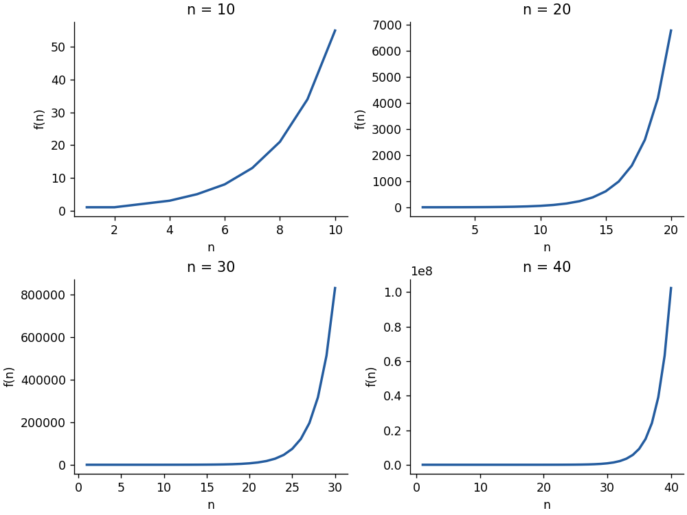
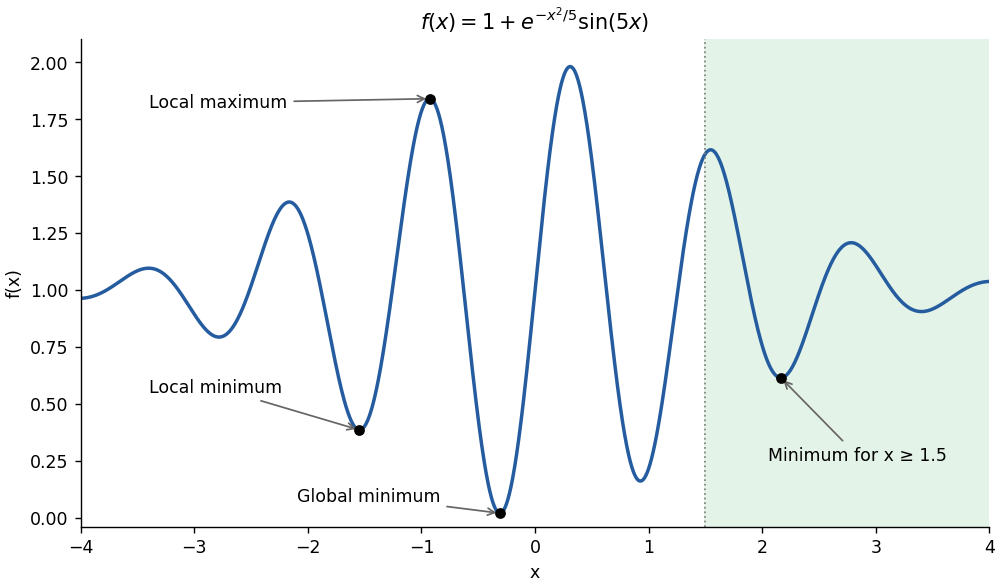
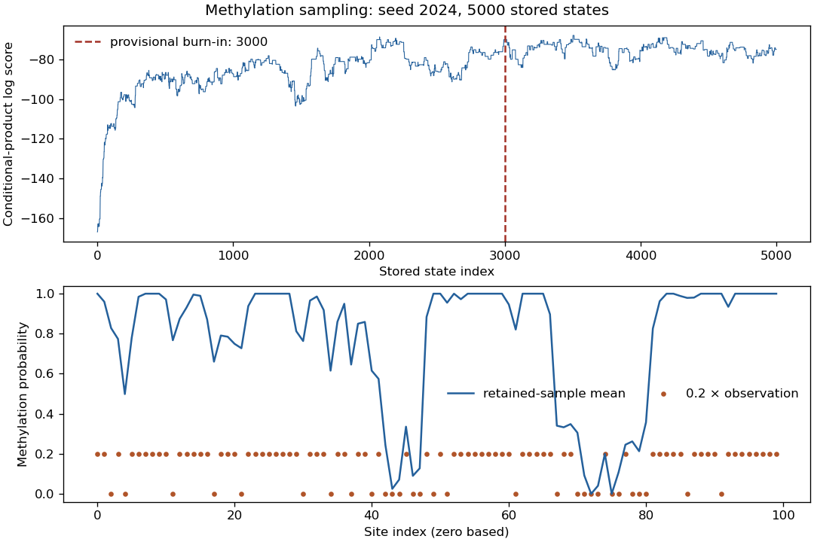

# Paper 2

↑ **Parent:** [2024](../2024.md)

[Original paper, released PDF pages 78–110](https://www.whatdotheyknow.com/request/past_exam_information_of_nst_ib_2/response/3538010/attach/2/FOI%202026%20642%20Cui%20materials%20Part2.pdf?cookie_passthrough=1#page=78)

**Table of contents**

- [A1](#a1)
  - [a](#a1/a)
    - [Solution](#a1/a/solution)
  - [b](#a1/b)
    - [Solution](#a1/b/solution)
  - [c](#a1/c)
    - [Solution](#a1/c/solution)
- [A2](#a2)
  - [a](#a2/a)
    - [Solution](#a2/a/solution)
  - [b](#a2/b)
    - [Solution](#a2/b/solution)
  - [c](#a2/c)
    - [Solution](#a2/c/solution)
  - [d](#a2/d)
    - [Solution](#a2/d/solution)
  - [e](#a2/e)
    - [Solution](#a2/e/solution)
  - [f](#a2/f)
    - [Solution](#a2/f/solution)
- [A3](#a3)
  - [a](#a3/a)
    - [Solution](#a3/a/solution)
  - [b](#a3/b)
    - [Solution](#a3/b/solution)
  - [c](#a3/c)
    - [Solution](#a3/c/solution)
  - [d](#a3/d)
    - [Solution](#a3/d/solution)
- [B4](#b4)
  - [a](#b4/a)
    - [Solution](#b4/a/solution)
  - [b](#b4/b)
    - [Solution](#b4/b/solution)
  - [c](#b4/c)
    - [Solution](#b4/c/solution)
  - [d](#b4/d)
    - [Solution](#b4/d/solution)
- [B5](#b5)
  - [a](#b5/a)
    - [Solution](#b5/a/solution)
  - [b](#b5/b)
    - [Solution](#b5/b/solution)
- [B6](#b6)
  - [a](#b6/a)
    - [Solution](#b6/a/solution)
  - [b](#b6/b)
    - [Solution](#b6/b/solution)
  - [c](#b6/c)
    - [Solution](#b6/c/solution)
  - [d](#b6/d)
    - [Solution](#b6/d/solution)
- [C7](#c7)
  - [a](#c7/a)
    - [Solution](#c7/a/solution)
  - [b](#c7/b)
    - [Solution](#c7/b/solution)
  - [c](#c7/c)
    - [Solution](#c7/c/solution)
- [C8](#c8)
  - [a](#c8/a)
    - [Solution](#c8/a/solution)
  - [b](#c8/b)
    - [Solution](#c8/b/solution)
  - [c](#c8/c)
    - [Solution](#c8/c/solution)
  - [d](#c8/d)
    - [Solution](#c8/d/solution)
- [C9](#c9)
  - [a](#c9/a)
    - [Solution](#c9/a/solution)
  - [b](#c9/b)
    - [Solution](#c9/b/solution)
  - [c](#c9/c)
    - [Solution](#c9/c/solution)
  - [d](#c9/d)
    - [Solution](#c9/d/solution)
  - [e](#c9/e)
    - [Solution](#c9/e/solution)
- [D10](#d10)
  - [a](#d10/a)
    - [Solution](#d10/a/solution)
  - [b](#d10/b)
    - [Solution](#d10/b/solution)
  - [c](#d10/c)
    - [Solution](#d10/c/solution)
  - [d](#d10/d)
    - [Solution](#d10/d/solution)
- [D11](#d11)
  - [a](#d11/a)
    - [Solution](#d11/a/solution)
  - [b](#d11/b)
    - [Solution](#d11/b/solution)
  - [c](#d11/c)
    - [Solution](#d11/c/solution)
  - [d](#d11/d)
    - [Solution](#d11/d/solution)
- [D12](#d12)
  - [Solution](#d12/solution)

## A1

↑ **Parent:** [Paper 2](paper-2.md)

<h3 id="a1/a">a</h3>

↑ **Parent:** [A1](#a1)

<h4 id="a1/a/solution">Solution</h4>

↑ **Parent:** [A](#a1/a)

The expression is the [Binet formula](../../sequence-and-series.md#binet-formula) for the [Fibonacci numbers](../../sequence-and-series.md#fibonacci-number). Compute the two roots and round the result to the nearest [integer](../../integer.md):


```
from math import sqrt


def binet(n):
    phi = (1 + sqrt(5)) / 2
    psi = (1 - sqrt(5)) / 2
    return round((phi**n - psi**n) / sqrt(5))
```
The returned object is an integer. This [floating-point arithmetic](../../floating-point-arithmetic.md) implementation correctly rounds the requested range through $n=50$; it is not an arbitrary-precision method for indefinitely large $n$. An integer recurrence is a useful independent numerical check.

<h3 id="a1/b">b</h3>

↑ **Parent:** [A1](#a1)

<h4 id="a1/b/solution">Solution</h4>

↑ **Parent:** [B](#a1/b)

A [list comprehension](../../programming-language.md#list-comprehension) evaluates the function for the fifty required indices:


```
list50 = [binet(n) for n in range(1, 51)]
```
Python's upper range endpoint is excluded, so 51 includes index 50. The first entries are $1,1,2,3,5,8,13,21,34,55$, and **the final entry is $F_{50}=12586269025$**.

<h3 id="a1/c">c</h3>

↑ **Parent:** [A1](#a1)

<h4 id="a1/c/solution">Solution</h4>

↑ **Parent:** [C](#a1/c)

Use the first 10, 20, 30 and 40 entries of the already computed list in a two-by-two array of axes. Each subplot needs an index sequence starting at one and having the same length as its data:


```
import matplotlib.pyplot as plt

fig, axes = plt.subplots(2, 2, figsize=(8, 6), layout="constrained")
for ax, stop in zip(axes.flat, [10, 20, 30, 40]):
    ax.plot(range(1, stop + 1), list50[:stop])
    ax.set(title=f"n = {stop}", xlabel="n", ylabel="f(n)")
plt.show()
```
The panels use different vertical scales, which is why the exponential-looking growth remains visible at each range. The available values through 50 are retained in `list50`, even though the requested four panels stop at 40.

<a id="a1/c/image-fibonacci-growth-over-four-index-ranges-generated-directly-from-the-closed-formula"></a>


**[Figure 1](#a1/c/image-fibonacci-growth-over-four-index-ranges-generated-directly-from-the-closed-formula). Fibonacci growth over four index ranges, generated directly from the closed formula**.

## A2

↑ **Parent:** [Paper 2](paper-2.md)

<h3 id="a2/a">a</h3>

↑ **Parent:** [A2](#a2)

<h4 id="a2/a/solution">Solution</h4>

↑ **Parent:** [A](#a2/a)

**TODO: The numerical/data-specific answer awaits the original `MultiPathogenData.csv` dataset. The file was not supplied; no numerical output is fabricated.**

<h3 id="a2/b">b</h3>

↑ **Parent:** [A2](#a2)

<h4 id="a2/b/solution">Solution</h4>

↑ **Parent:** [B](#a2/b)

**TODO: The numerical/data-specific answer awaits the original `MultiPathogenData.csv` dataset. The file was not supplied; no numerical output is fabricated.**

<h3 id="a2/c">c</h3>

↑ **Parent:** [A2](#a2)

<h4 id="a2/c/solution">Solution</h4>

↑ **Parent:** [C](#a2/c)

**TODO: The numerical/data-specific answer awaits the original `MultiPathogenData.csv` dataset. The file was not supplied; no numerical output is fabricated.**

<h3 id="a2/d">d</h3>

↑ **Parent:** [A2](#a2)

<h4 id="a2/d/solution">Solution</h4>

↑ **Parent:** [D](#a2/d)

**TODO: The numerical/data-specific answer awaits the original `MultiPathogenData.csv` dataset. The file was not supplied; no numerical output is fabricated.**

<h3 id="a2/e">e</h3>

↑ **Parent:** [A2](#a2)

<h4 id="a2/e/solution">Solution</h4>

↑ **Parent:** [E](#a2/e)

**TODO: The numerical/data-specific answer awaits the original `MultiPathogenData.csv` dataset. The file was not supplied; no numerical output is fabricated.**

<h3 id="a2/f">f</h3>

↑ **Parent:** [A2](#a2)

<h4 id="a2/f/solution">Solution</h4>

↑ **Parent:** [F](#a2/f)

**TODO: The numerical/data-specific answer awaits the original `MultiPathogenData.csv` dataset. The file was not supplied; no numerical output is fabricated.**

## A3

↑ **Parent:** [Paper 2](paper-2.md)

<h3 id="a3/a">a</h3>

↑ **Parent:** [A3](#a3)

<h4 id="a3/a/solution">Solution</h4>

↑ **Parent:** [A](#a3/a)

The first instruction asks for maximization, whereas the later parts refer to minimization. For the literal maximization task, minimize the negative objective:


```
import numpy as np
from scipy import optimize as opt


def f(x):
    return 1 + np.exp(-x*x/5) * np.sin(5*x)


maximum = opt.minimize(lambda z: -f(z[0]), x0=[-1.0])
print(maximum.x[0], f(maximum.x[0]))
```
This gives a [local maximum](../../analysis.md#local-maximum) near **$x=-0.927662$, $f(x)=1.839576$**. If minimization was intended, use `opt.minimize(lambda z: f(z[0]), x0=[-1.0])`, which instead returns a [local minimum](../../analysis.md#local-minimum) near **$x=-1.546182$, $f(x)=0.384751$**. The optimizer's stopping criterion establishes local numerical convergence, not a certificate of a global optimum.

<h3 id="a3/b">b</h3>

↑ **Parent:** [A3](#a3)

<h4 id="a3/b/solution">Solution</h4>

↑ **Parent:** [B](#a3/b)

Plot the entire stated interval:


```
import matplotlib.pyplot as plt

x_grid = np.linspace(-4, 4, 1500)
plt.plot(x_grid, f(x_grid))
plt.xlabel("x")
plt.ylabel("f(x)")
plt.show()
```
The oscillating objective has several wells. A local search starting at $-1$ need not reach the deepest one, which is near $-0.309$. For the literal maximization in part (a), no minimum was being sought at all. Under the intended minimization interpretation, the result near $-1.546$ belongs to a different attraction region from the [global minimum](../../analysis.md#global-minimum).

<a id="a3/b/image-local-extrema-the-global-minimum-and-the-constrained-minimum-of-the-oscillatory-objective"></a>


**[Figure 2](#a3/b/image-local-extrema-the-global-minimum-and-the-constrained-minimum-of-the-oscillatory-objective). Local extrema, the global minimum and the constrained minimum of the oscillatory objective**.

<h3 id="a3/c">c</h3>

↑ **Parent:** [A3](#a3)

<h4 id="a3/c/solution">Solution</h4>

↑ **Parent:** [C](#a3/c)

Use reproducible random starts and retain the best successful result:


```
rng = np.random.default_rng(2024)
starts = rng.uniform(-4, 4, size=100)
results = [opt.minimize(lambda z: f(z[0]), x0=[x0]) for x0 in starts]
successful = [result for result in results if result.success]
best = min(successful, key=lambda result: result.fun)
print(best.x[0], best.fun)
```
The estimate is **$x_{\min}\simeq-0.309213$, $f_{\min}\simeq0.0192409$**. This [random-restart optimization](../../mathematical-optimization.md#random-restart-optimization) improves coverage of the different attraction regions, but their number alone does not guarantee global optimality.

Here an analytic check is possible. For $|x|\geq\pi/5$, the envelope gives $f(x)\geq1-e^{-\pi^2/125}\simeq0.0759$, above the candidate. On $[0,\pi/5]$, $f\geq1$. In the remaining interval $[-\pi/5,0]$, the [derivative](../../calculus.md#derivative) condition is equivalent, with $z=-x$, to $\cot(5z)=0.08z$. The left side decreases strictly from $+\infty$ to $-\infty$ while the right side increases, giving one minimum. This certifies the selected well as global rather than relying only on the restart experiment.

<h3 id="a3/d">d</h3>

↑ **Parent:** [A3](#a3)

<h4 id="a3/d/solution">Solution</h4>

↑ **Parent:** [D](#a3/d)

Set $x=1.5+e^y$. Every finite unconstrained value of $y$ then gives an allowed point with $x>1.5$:


```
def transformed(y):
    return f(1.5 + np.exp(y[0]))


result = opt.minimize(transformed, x0=[0.0])
x_interior = 1.5 + np.exp(result.x[0])
x_best = min([1.5, x_interior], key=f)
print(x_best, f(x_best))
```
Explicitly checking $x=1.5$ covers the boundary omitted by the exponential transformation. The minimum is **$x\simeq2.164817$, $f(x)\simeq0.614056$**, whereas $f(1.5)\simeq1.59810$.

[Constraint reparameterization](../../numerical-analysis.md#constraint-reparameterization) enforces feasibility but does not remove nonconvexity. In this example, $f\geq1$ up to the next negative-sine lobe, the [derivative](../../calculus.md#derivative) has one minimum in that lobe, and for $x\geq4\pi/5$ the envelope gives $f(x)\geq1-e^{-16\pi^2/125}\simeq0.7173$. Thus later oscillations cannot improve on the displayed constrained minimum.

## B4

↑ **Parent:** [Paper 2](paper-2.md)

<h3 id="b4/a">a</h3>

↑ **Parent:** [B4](#b4)

<h4 id="b4/a/solution">Solution</h4>

↑ **Parent:** [A](#b4/a)

Write $m_i\in\{0,1\}$ for the true [DNA methylation](../../molecular-genetics.md#dna-methylation) status and $o_i$ for its observation. The observation [likelihood function](../../maximum-likelihood-estimation.md#likelihood-function) is a [binary symmetric channel](../../coding-theory.md#binary-symmetric-channel), so

$$
\log p(o\mid m)=\sum_{i=0}^{99}\begin{cases}\log(0.8),&o_i=m_i,\\\log(0.2),&o_i\ne m_i.\end{cases}
$$

For the loop suggested in the practical, set $p_i=(0.1,0.5,0.9)_{m_{i-1}+m_{i+1}}$ and add $\log p_i$ when $m_i=1$, or $\log(1-p_i)$ otherwise. The following independent implementation combines these terms without multiplying many small numbers:

```
import numpy as np

def methylation_score(pattern, observed):
    """Conditional-product score used by the practical's natural loop filling."""
    pattern=np.asarray(pattern,dtype=int);observed=np.asarray(observed,dtype=int)
    if pattern[0]!=1 or pattern[-1]!=1:return -np.inf
    neighbour_sum=pattern[:-2]+pattern[2:]
    p=np.array([.1,.5,.9])[neighbour_sum]
    prior_terms=np.where(pattern[1:-1]==1,p,1-p)
    observation_terms=np.where(pattern==observed,.8,.2)
    return float(np.log(prior_terms).sum()+np.log(observation_terms).sum())

log_likelihood = methylation_score
print(f"{log_likelihood(obs, obs):.2f}")
```

**The conditional-product log score at the observed pattern is $-102.14$.** The endpoint observations are included once each, while the endpoint statuses are fixed rather than assigned an additional prior probability.

There is a modeling qualification: multiplying the specified neighbour [conditional probabilities](../../probability-theory.md#conditional-probability) gives a [pseudolikelihood](../../statistical-inference.md#pseudolikelihood), not generally the [joint probability distribution](../../probability-distribution.md#joint-probability-distribution) having those [conditional probabilities](../../probability-theory.md#conditional-probability). Thus the function above defines the practical's conditional-product target; the pure observation [log-likelihood](../../maximum-likelihood-estimation.md#log-likelihood) at $m=o$ would instead be $100\log(0.8)=-22.3144$.

If the neighbour probabilities are intended literally as full conditionals of a [Markov random field](../../statistical-model.md#markov-random-field), a coherent alternative has edge weights $T_{aa}=3/4$ and $T_{ab}=1/4$ for $a\ne b$, with both endpoints fixed. Given two equal neighbours, the matching centre has conditional odds $(3/4)^2:(1/4)^2=9:1$; mixed neighbours give equal weights. Consequently its unnormalized [posterior probability](../../bayesian-statistics.md#posterior-probability) has log score

$$
\ell_J(m;o)=\sum_{i=0}^{98}\log T_{m_i m_{i+1}}+\log p(o\mid m).
$$

For this alternative, $\ell_J(o;o)=-94.7394$ before the constant associated with conditioning the endpoints. It can be implemented as follows, but its numerical results must not be mixed with the conditional-product results in the remaining parts:

```
def joint_methylation_score(pattern,observed):
    """Coherent nearest-neighbour model with the specified full conditionals."""
    pattern=np.asarray(pattern,dtype=int);observed=np.asarray(observed,dtype=int)
    if pattern[0]!=1 or pattern[-1]!=1:return -np.inf
    edges=np.where(pattern[1:]==pattern[:-1],.75,.25)
    emissions=np.where(pattern==observed,.8,.2)
    return float(np.log(edges).sum()+np.log(emissions).sum())
```

<h3 id="b4/b">b</h3>

↑ **Parent:** [B4](#b4)

<h4 id="b4/b/solution">Solution</h4>

↑ **Parent:** [B](#b4/b)

A single randomly chosen internal-site flip is a symmetric proposal: the reverse flip has the same probability $1/98$. Therefore the [Metropolis–Hastings algorithm](../../bayesian-statistics.md#metropolis-hastings-algorithm) accepts with

$$
\boxed{\alpha=\min\{1,\exp(s(m';o)-s(m;o))\}}.
$$

Comparing logarithms avoids overflow. On rejection the old state must be retained, including a repeated copy in the stored [Markov chain](../../markov-chain.md); retaining only accepted states would sample a different distribution. This implementation also stores the actual initial state at row zero:

```
def sample_methylation(observed, nsteps=5000, seed=2024, score=methylation_score):
    rng=np.random.default_rng(seed)
    state=rng.integers(0,2,size=len(observed));state[[0,-1]]=1
    states=np.empty((nsteps,len(state)),dtype=int);values=np.empty(nsteps)
    states[0]=state;values[0]=score(state,observed)
    accepted=0
    for t in range(1,nsteps):
        candidate=state.copy();site=rng.integers(1,len(state)-1)
        candidate[site]=1-candidate[site]
        trial=score(candidate,observed)
        if np.log(rng.random())<min(0.,trial-values[t-1]):
            state=candidate;values[t]=trial;accepted+=1
        else:values[t]=values[t-1]
        states[t]=state
    return values,states,accepted/(nsteps-1)

lls, meths, acceptance = sample_methylation(obs, nsteps=5000, seed=2024)
import matplotlib.pyplot as plt
plt.plot(lls)
plt.xlabel("Stored state index")
plt.ylabel("Conditional-product log score")
plt.show()
```

For this random-number convention, **the acceptance fraction is approximately $0.157$**. The trace climbs substantially during its first several thousand updates, so a small fixed [burn-in](../../bayesian-statistics.md#burn-in) such as 100 iterations would discard too little of the initial transient. Five thousand single-site proposals are only about fifty updates per site on average.

<a id="b4/b/image-conditional-product-sampling-trace-and-retained-sample-methylation-profile-with-a-provisional-burn-in-of-3000-stored-states"></a>


**[Figure 3](#b4/b/image-conditional-product-sampling-trace-and-retained-sample-methylation-profile-with-a-provisional-burn-in-of-3000-stored-states). Conditional-product sampling trace and retained-sample methylation profile, with a provisional burn-in of 3000 stored states**.

<h3 id="b4/c">c</h3>

↑ **Parent:** [B4](#b4)

<h4 id="b4/c/solution">Solution</h4>

↑ **Parent:** [C](#b4/c)

For a binary state, its [expected value](../../expected-value.md) is its probability of being one. Hence the [Monte Carlo method](../../monte-carlo-method.md) estimate of the [posterior methylation profile](../../molecular-genetics.md#posterior-methylation-profile) under the chosen target is

$$
\widehat p_i=\frac{1}{N-B}\sum_{t=B}^{N-1}m_i^{(t)}.
$$

The averaging axis must be zero: average over sampled patterns while keeping the site index. A provisional choice for this particular trace is **$B=3000$**, retaining 2000 states:

```
def mean_methylation(meths, burnin):
    if not 0 <= burnin < len(meths):
        raise ValueError("burn-in must leave at least one state")
    return np.asarray(meths)[burnin:].mean(axis=0)

burnin = 3000
profile_estimate = mean_methylation(meths, burnin)
print(lls[burnin:].mean())
plt.plot(profile_estimate, label="retained-sample mean")
plt.scatter(np.arange(len(obs)), .2*obs, s=10, label="0.2 × observation")
plt.xlabel("Site index")
plt.ylabel("Methylation probability")
plt.legend()
plt.show()
```

**The retained mean log score is $-74.8895$**, and the profile is shown below the trace in part (b). The fixed endpoints have estimate exactly one; adjacent sites are often smoothed into methylated or unmethylated stretches despite individual conflicting observations. The rescaled observations are only a visual comparison and are not another estimate of the [posterior probability](../../bayesian-statistics.md#posterior-probability).

This is a finite-chain estimate for the conditional-product target defined in part (a). A [burn-in](../../bayesian-statistics.md#burn-in) chosen by inspection does not establish convergence, and the long excursions in this short [Markov chain](../../markov-chain.md) leave substantial uncertainty in individual-site estimates; several longer runs would be needed for precise inference. To sample the coherent joint alternative instead, pass `score=joint_methylation_score` and inspect that new trace before choosing its own [burn-in](../../bayesian-statistics.md#burn-in).

<h3 id="b4/d">d</h3>

↑ **Parent:** [B4](#b4)

<h4 id="b4/d/solution">Solution</h4>

↑ **Parent:** [D](#b4/d)

The retained mean conditional-product log score, **$-74.89$**, is higher than the observed-pattern score, **$-102.14$**, because sampled patterns can improve agreement between neighbouring [CpG sites](../../molecular-genetics.md#cpg-site) while tolerating some observational errors. The observation-matching pattern maximizes the observation [likelihood function](../../maximum-likelihood-estimation.md#likelihood-function) alone, whereas this score also rewards the assumed spatial structure, and its posterior mean is not its maximum.

## B5

↑ **Parent:** [Paper 2](paper-2.md)

<h3 id="b5/a">a</h3>

↑ **Parent:** [B5](#b5)

<h4 id="b5/a/solution">Solution</h4>

↑ **Parent:** [A](#b5/a)

Generate independent [Bernoulli random variables](../../discrete-probability-distribution.md#bernoulli-distribution) above the diagonal and set everything else to zero. Taking the strict upper triangle of a random square array gives each allowed entry probability $1/2$ of being one:

```
import numpy as np
rng = np.random.default_rng(2024)


def rand_triu(n):
    return np.triu(rng.integers(0, 2, size=(n, n)), k=1)


example = rand_triu(10)
print(example)
```

One reproducible [strictly upper triangular matrix](../../linear-algebra.md#strictly-upper-triangular-matrix) is:

```
0 1 0 0 0 0 1 1 1 1
0 0 1 0 0 0 1 0 0 0
0 0 0 1 1 0 0 1 1 0
0 0 0 0 1 1 1 1 0 0
0 0 0 0 0 0 1 1 1 0
0 0 0 0 0 0 0 0 0 0
0 0 0 0 0 0 0 0 0 1
0 0 0 0 0 0 0 0 0 0
0 0 0 0 0 0 0 0 0 0
0 0 0 0 0 0 0 0 0 0
```

Every matrix returned in this way is a [nilpotent matrix](../../linear-operator-theory.md#nilpotent-matrix); randomness affects its [nilpotency index](../../linear-operator-theory.md#nilpotency-index), not the fact of the nilpotent property.

<h3 id="b5/b">b</h3>

↑ **Parent:** [B5](#b5)

<h4 id="b5/b/solution">Solution</h4>

↑ **Parent:** [B](#b5/b)

Starting with the [identity matrix](../../vector-space.md#identity-matrix), multiply by $M$ once per iteration and test the resulting power. Using integer objects keeps the calculation exact and avoids fixed-width integer overflow accidentally turning a nonzero power into zero:

```
def kzero(matrix,kmax=100):
    a=np.asarray(matrix,dtype=object)
    if a.ndim!=2 or a.shape[0]!=a.shape[1]:raise ValueError('square matrix required')
    power=np.eye(len(a),dtype=object)
    for k in range(1,kmax+1):
        power=power@a
        if np.equal(power,0).all():return k
    return None

print([kzero(rand_triu(10)) for _ in range(5)])
```

Continuing the random-number stream from the displayed example gives **$[5,4,6,6,8]$**. These are the least positive zero powers, rather than the number of nonzero powers; in particular, a zero matrix has [nilpotency index](../../linear-operator-theory.md#nilpotency-index) one.

For a [strictly upper triangular matrix](../../linear-algebra.md#strictly-upper-triangular-matrix), a nonzero entry of $M^k$ can only lie at least $k$ positions above the diagonal. Thus $M^n=0$, and every one of these $10\times10$ examples must return an integer at most ten. The code interprets “up to” as including `kmax`; if the final strict inequality in the question is intended instead, replace `range(1,kmax+1)` by `range(1,kmax)`.

## B6

↑ **Parent:** [Paper 2](paper-2.md)

<h3 id="b6/a">a</h3>

↑ **Parent:** [B6](#b6)

<h4 id="b6/a/solution">Solution</h4>

↑ **Parent:** [A](#b6/a)

**TODO: The numerical/data-specific answer awaits the original `clustering_dataset.csv` dataset. The file was not supplied; no numerical output is fabricated.**

<h3 id="b6/b">b</h3>

↑ **Parent:** [B6](#b6)

<h4 id="b6/b/solution">Solution</h4>

↑ **Parent:** [B](#b6/b)

**TODO: The numerical/data-specific answer awaits the original `clustering_dataset.csv` dataset. The file was not supplied; no numerical output is fabricated.**

<h3 id="b6/c">c</h3>

↑ **Parent:** [B6](#b6)

<h4 id="b6/c/solution">Solution</h4>

↑ **Parent:** [C](#b6/c)

**TODO: The numerical/data-specific answer awaits the original `clustering_dataset.csv` dataset. The file was not supplied; no numerical output is fabricated.**

<h3 id="b6/d">d</h3>

↑ **Parent:** [B6](#b6)

<h4 id="b6/d/solution">Solution</h4>

↑ **Parent:** [D](#b6/d)

**TODO: The numerical/data-specific answer awaits the original `clustering_dataset.csv` dataset. The file was not supplied; no numerical output is fabricated.**

## C7

↑ **Parent:** [Paper 2](paper-2.md)

<h3 id="c7/a">a</h3>

↑ **Parent:** [C7](#c7)

<h4 id="c7/a/solution">Solution</h4>

↑ **Parent:** [A](#c7/a)

Use the supplied [BLOSUM62](../../molecular-genetics.md#blosum62) entry for every diagonal move in the [Smith-Waterman algorithm](../../molecular-genetics.md#smith-waterman-algorithm), while retaining the stipulated linear [gap penalty](../../molecular-genetics.md#gap-penalty) of $-1$. If $q_i$ and $r_j$ are the current [amino acids](../../chemical-substance.md#amino-acid), the [dynamic programming](../../mathematical-optimization.md#dynamic-programming) recurrence is

$$
H_{ij}=\max\{0,H_{i,j-1}-1,H_{i-1,j}-1,H_{i-1,j-1}+B(q_i,r_j)\}.
$$

The zero option permits a new local start. The following original implementation also records the traceback coordinates needed in part (c); its tie ordering is left, up, diagonal, and an equal overall maximum replaces the previous best cell, as in the supplied convention:

```
def local_alignment(query,reference,alphabet,scores,gap=-1):
    lookup={aa:i for i,aa in enumerate(alphabet)}
    table=np.asarray(scores,dtype=int)
    height,width=len(query)+1,len(reference)+1
    H=np.zeros((height,width),dtype=int)
    back=np.zeros((height,width),dtype=np.int8)
    best=(0,0,0)
    for i,a in enumerate(query,1):
        for j,b in enumerate(reference,1):
            # Order implements the printed LEFT, UP, DIAGONAL tie priority.
            candidates=(0,H[i,j-1]+gap,H[i-1,j]+gap,
                        H[i-1,j-1]+int(table[lookup[a],lookup[b]]))
            value=max(candidates);H[i,j]=value
            back[i,j]=0 if value==0 else candidates.index(value)
            if value>=best[0]:best=(value,i,j)
    score,i,j=best;query_end,ref_end=i,j
    aq=[];ar=[]
    while H[i,j]>0:
        step=back[i,j]
        if step==1:aq.append('-');ar.append(reference[j-1]);j-=1
        elif step==2:aq.append(query[i-1]);ar.append('-');i-=1
        elif step==3:aq.append(query[i-1]);ar.append(reference[j-1]);i-=1;j-=1
    qa=''.join(reversed(aq));ra=''.join(reversed(ar));length=len(qa)
    identities=sum(a==b and a!='-' for a,b in zip(qa,ra))
    similarities=sum(a!='-' and b!='-' and table[lookup[a],lookup[b]]>0 for a,b in zip(qa,ra))
    gaps=sum(a=='-' or b=='-' for a,b in zip(qa,ra))
    return dict(query=qa,reference=ra,score=int(score),query_start=i+1,query_end=query_end,
                reference_start=j+1,reference_end=ref_end,query_length=len(query),reference_length=len(reference),
                alignment_length=length,identities=int(identities),similarities=int(similarities),gaps=int(gaps),
                identity_percent=100*identities/length if length else 0.,
                similarity_percent=100*similarities/length if length else 0.,gap_percent=100*gaps/length if length else 0.)

queries = {"baboon": baboon, "squirrel_monkey": squirrel_monkey,
           "dingo": dingo, "goldfish": goldfish}
alignments = {
    name: local_alignment(seq, reference_epo_receptor_human, amino_acids, bmat)
    for name, seq in queries.items()
}
for name, result in alignments.items():
    print(name, "score", result["score"])
    print(result["query"])
    print(result["reference"])
```

The resulting local [sequence alignments](../../molecular-genetics.md#sequence-alignment), with the query above the reference, are:

**baboon; score 314**

```
SLLTPSDLDPLILTLSLILVLIVVLLTVLALLSHRRALKQKIWPGIPSPESEFEGLFTTHKG-FQL
SLLTPSDLDPLILTLSLILVVILVLLTVLALLSHRRALKQKIWPGIPSPESEFEGLFTTHKGNFQL
```

**squirrel monkey; score 278**

```
VCFWEEAASAGMGPDNYSFSYQL-DNEPWKR-CRLHQTPTARGVVRFWCSLPRADTSS
VCFWEEAASAGVGPGNYSFSYQLED-EPWK-LCRLHQAPTARGAVRFWCSLPTADTSS
```

**dingo; score 301**

```
MNHLW--THLWPG-VGSLCLLLAGAAWASLPKP-L-DPKFESKAALLAARAPEELLCFTERLEDLVCFWEE
MDHL-GAS-LWP-QVGSLCLLLAGAAWAP-P-PNLPDPKFESKAALLAARGPEELLCFTERLEDLVCFWEE
```

**goldfish; score 190**

```
L--LVLSIGLILC--L-LSLTVI-L-SHQKFLLK-KLWPDIPTPEHKFPGLFTVYKGDFKE-WMSH-NNGSM
LDPLILTLSLILVVILVL-LTVLALLSHRR-ALKQKIWPGIPSPESEFEGLFTTHKGNF-QLWL-YQNDGCL
```

The several short gaps are a consequence of the specified inexpensive linear [gap penalty](../../molecular-genetics.md#gap-penalty); substituting a different default or an affine [gap penalty](../../molecular-genetics.md#gap-penalty) would solve a different scoring problem.

<h3 id="c7/b">b</h3>

↑ **Parent:** [C7](#c7)

<h4 id="c7/b/solution">Solution</h4>

↑ **Parent:** [B](#c7/b)

Use the number of alignment columns, including gap columns, as the denominator. A column contributes to [sequence identity](../../molecular-genetics.md#sequence-identity) when its two nongap letters are equal, to [sequence similarity](../../molecular-genetics.md#sequence-similarity) when its two nongap letters have a strictly positive [BLOSUM62](../../molecular-genetics.md#blosum62) score, and to the [gap fraction](../../molecular-genetics.md#gap-fraction) when either letter is a gap. A zero substitution score is not counted as similar.

The implementation in part (a) computes each numerator directly during its final pass through the aligned strings:

```
for name, a in alignments.items():
    print(name, a["alignment_length"], a["identities"],
          a["similarities"], a["gaps"])
    print(a["identity_percent"], a["similarity_percent"], a["gap_percent"])
```

| Query | Columns | Identical | Similar | Gap columns |
| --- | --- | --- | --- | --- |
| baboon | 66 | 63 (95.45%) | 65 (98.48%) | 1 (1.52%) |
| squirrel monkey | 58 | 49 (84.48%) | 50 (86.21%) | 4 (6.90%) |
| dingo | 71 | 57 (80.28%) | 59 (83.10%) | 10 (14.08%) |
| goldfish | 72 | 34 (47.22%) | 50 (69.44%) | 14 (19.44%) |

Identical columns also count as similar for these data, so these percentages are overlapping summaries rather than three categories summing to 100%.

<h3 id="c7/c">c</h3>

↑ **Parent:** [C7](#c7)

<h4 id="c7/c/solution">Solution</h4>

↑ **Parent:** [C](#c7/c)

The maximum-scoring cell records the inclusive end position in each sequence. During traceback, moving left consumes a reference residue, moving up consumes a query residue, and moving diagonally consumes both; when traceback stops, the remaining prefix lengths are one less than the corresponding one-based starts. Consequently `i+1` and `j+1` are the correct starts returned in part (a), without counting any inserted gaps as sequence residues.

The following report joins these coordinates to the alignments and [sequence identity](../../molecular-genetics.md#sequence-identity)/[sequence similarity](../../molecular-genetics.md#sequence-similarity) values already calculated:

```
for name, a in alignments.items():
    print(f"{name}: query length={a['query_length']}, "
          f"reference length={a['reference_length']}, "
          f"alignment columns={a['alignment_length']}, score={a['score']}")
    print(f"Query {a['query_start']} {a['query']} {a['query_end']}")
    print(f"Ref   {a['reference_start']} {a['reference']} {a['reference_end']}")
    print(f"Identity {a['identity_percent']:.2f}%; "
          f"similarity {a['similarity_percent']:.2f}%; "
          f"gaps {a['gap_percent']:.2f}%")
```

All reference sequences have length **508**. The following are one-based inclusive coordinates; the aligned strings and all percentages are given in parts (a) and (b).

| Query | Query length | Query interval | Reference interval | Columns | Score |
| --- | --- | --- | --- | --- | --- |
| baboon | 65 | 1–65 | 241–306 | 66 | 314 |
| squirrel monkey | 56 | 1–56 | 61–116 | 58 | 278 |
| dingo | 66 | 1–66 | 1–66 | 71 | 301 |
| goldfish | 63 | 2–63 | 248–315 | 72 | 190 |

For example, the goldfish [local sequence alignment](../../molecular-genetics.md#local-sequence-alignment) excludes its first query residue and aligns residues 2–63. As a check, removing gaps from each aligned string gives exactly the sequence slice determined by its reported interval.

## C8

↑ **Parent:** [Paper 2](paper-2.md)

<h3 id="c8/a">a</h3>

↑ **Parent:** [C8](#c8)

<h4 id="c8/a/solution">Solution</h4>

↑ **Parent:** [A](#c8/a)

Convert the supplied [multiple sequence alignment](../../molecular-genetics.md#multiple-sequence-alignment) to an ordinary array so that reducing over rows returns one value per column. With nine sequences, fewer than 30% gaps means at most two gaps in a column:

```
from collections import Counter
A = np.asarray(msa_matrix)
gap_fraction = np.mean(A == ".", axis=0)
match_mask = gap_fraction < .30
match_columns = np.flatnonzero(match_mask)
print(match_columns + 1)  # human-readable, one-based alignment columns
```

**There are 72 [match states](../../markov-process.md#match-state): alignment columns 1–21 and 29–79**, using one-based numbering. The seven remaining columns, 22–28, form one contiguous insertion region. The strict inequality is applied to the actual fraction, rather than to rounded percentages.

<h3 id="c8/b">b</h3>

↑ **Parent:** [C8](#c8)

<h4 id="c8/b/solution">Solution</h4>

↑ **Parent:** [B](#c8/b)

For each [match state](../../markov-process.md#match-state), count the nongap [amino acids](../../chemical-substance.md#amino-acid) and divide by the number of nongap observations in that column. A gap is not one of the twenty emitted [amino acids](../../chemical-substance.md#amino-acid); including it in the denominator would make the [emission probabilities](../../markov-process.md#emission-probability) sum to less than one:

```
def emission_counts(column):
    counts = Counter(str(x) for x in column if x != ".")
    n = sum(counts.values())
    if n == 0:
        raise ValueError("an all-gap column has no empirical emission distribution")
    return counts, n

match_emissions = {}
for state, j in enumerate(match_columns, 1):
    counts, n = emission_counts(A[:, j])
    match_emissions[state] = {aa: count/n for aa, count in counts.items()}
    print(state, j+1, match_emissions[state])
```

The table gives an exact compact representation of **every [emission probability](../../markov-process.md#emission-probability)**: divide each displayed count by the denominator $n$ in its row; all unlisted [amino acids](../../chemical-substance.md#amino-acid) have probability zero. The state number follows the order of [match states](../../markov-process.md#match-state), while the column refers to the original [multiple sequence alignment](../../molecular-genetics.md#multiple-sequence-alignment).

| State | Alignment column | $n$ | Nongap counts |
| --- | --- | --- | --- |
| 1 | 1 | 9 | I:1, K:1, R:1, S:2, V:3, Y:1 |
| 2 | 2 | 9 | D:1, E:2, G:1, I:1, L:1, Q:2, S:1 |
| 3 | 3 | 9 | E:2, I:1, K:1, Q:1, R:3, T:1 |
| 4 | 4 | 9 | L:8, M:1 |
| 5 | 5 | 9 | E:3, G:1, L:2, N:1, Q:1, S:1 |
| 6 | 6 | 9 | A:1, D:2, G:1, K:1, N:1, S:2, T:1 |
| 7 | 7 | 9 | A:1, E:3, I:2, L:1, M:1, V:1 |
| 8 | 8 | 9 | I:2, L:7 |
| 9 | 9 | 9 | D:3, E:1, K:1, L:2, N:1, Q:1 |
| 10 | 10 | 9 | D:1, E:3, G:1, N:1, P:1, S:2 |
| 11 | 11 | 9 | A:5, D:1, G:1, P:1, T:1 |
| 12 | 12 | 9 | I:1, L:7, Y:1 |
| 13 | 13 | 9 | E:1, F:1, G:1, H:2, M:1, Q:2, T:1 |
| 14 | 14 | 9 | F:9 |
| 15 | 15 | 9 | F:1, L:8 |
| 16 | 16 | 9 | E:1, I:1, L:1, N:3, Q:1, R:1, Y:1 |
| 17 | 17 | 9 | D:6, E:2, S:1 |
| 18 | 18 | 9 | C:7, F:1, S:1 |
| 19 | 19 | 9 | K:1, N:6, R:2 |
| 20 | 20 | 9 | E:1, F:1, I:5, L:1, V:1 |
| 21 | 21 | 9 | K:3, P:1, Q:1, S:4 |
| 22 | 29 | 7 | K:4, P:1, R:1, S:1 |
| 23 | 30 | 7 | E:2, F:1, G:1, I:1, K:1, V:1 |
| 24 | 31 | 7 | D:3, E:1, G:1, K:1, S:1 |
| 25 | 32 | 8 | D:1, E:1, G:1, K:1, N:1, R:3 |
| 26 | 33 | 8 | D:7, N:1 |
| 27 | 34 | 8 | A:1, P:6, S:1 |
| 28 | 35 | 9 | C:1, H:1, I:1, K:1, M:1, R:1, T:3 |
| 29 | 36 | 9 | E:1, F:1, G:1, L:1, Q:3, W:1, Y:1 |
| 30 | 37 | 9 | I:5, L:1, T:2, Y:1 |
| 31 | 38 | 9 | A:1, G:1, P:3, S:4 |
| 32 | 39 | 9 | I:1, K:6, L:1, R:1 |
| 33 | 40 | 9 | F:1, N:1, Q:4, T:2, V:1 |
| 34 | 41 | 9 | A:1, F:1, I:1, V:6 |
| 35 | 42 | 9 | I:1, L:7, V:1 |
| 36 | 43 | 9 | A:1, C:1, E:1, N:1, R:1, S:3, V:1 |
| 37 | 44 | 9 | D:3, E:5, Q:1 |
| 38 | 45 | 9 | A:1, C:7, I:1 |
| 39 | 46 | 9 | K:2, L:3, R:4 |
| 40 | 47 | 9 | A:3, E:1, L:1, N:3, T:1 |
| 41 | 48 | 9 | I:4, L:1, T:1, V:3 |
| 42 | 49 | 9 | L:9 |
| 43 | 50 | 9 | D:1, E:1, H:1, Q:1, S:1, T:1, V:1, Y:2 |
| 44 | 51 | 9 | E:1, K:1, Q:2, R:1, V:4 |
| 45 | 52 | 9 | L:9 |
| 46 | 53 | 9 | G:9 |
| 47 | 54 | 9 | P:8, T:1 |
| 48 | 55 | 9 | W:9 |
| 49 | 56 | 9 | A:2, C:7 |
| 50 | 57 | 9 | A:6, C:1, L:1, T:1 |
| 51 | 58 | 9 | A:1, D:3, F:1, S:2, V:1, Y:1 |
| 52 | 59 | 9 | K:4, R:2, S:3 |
| 53 | 60 | 9 | A:2, F:1, I:2, L:2, V:2 |
| 54 | 61 | 9 | A:7, G:1, Y:1 |
| 55 | 62 | 9 | E:3, G:3, Q:3 |
| 56 | 63 | 9 | I:3, M:3, T:1, Y:2 |
| 57 | 64 | 9 | F:3, L:2, M:3, N:1 |
| 58 | 65 | 9 | H:1, I:3, L:1, V:4 |
| 59 | 66 | 9 | K:1, M:1, P:1, R:4, S:1, T:1 |
| 60 | 67 | 9 | D:1, E:3, Q:4, Y:1 |
| 61 | 68 | 9 | I:1, L:7, M:1 |
| 62 | 69 | 9 | D:1, E:4, Q:4 |
| 63 | 70 | 9 | K:7, R:2 |
| 64 | 71 | 9 | A:1, I:2, M:1, N:1, R:1, Y:3 |
| 65 | 72 | 9 | A:1, C:1, D:1, E:2, I:2, V:2 |
| 66 | 73 | 9 | K:9 |
| 67 | 74 | 9 | H:4, L:1, Q:2, S:1, V:1 |
| 68 | 75 | 9 | E:8, Q:1 |
| 69 | 76 | 9 | Q:3, R:1, S:2, T:3 |
| 70 | 77 | 9 | C:2, E:3, G:1, R:1, S:1, V:1 |
| 71 | 78 | 9 | A:1, D:2, E:3, I:1, K:1, Y:1 |
| 72 | 79 | 9 | I:2, L:3, M:1, N:1, Q:1, V:1 |

These are unregularized [maximum-likelihood estimates](../../maximum-likelihood-estimation.md#maximum-likelihood-estimator) of the [emission probabilities](../../markov-process.md#emission-probability). No additional artificial observations are added. Although only emissions are requested here, a full [profile hidden Markov model](../../markov-process.md#profile-hidden-markov-model) would also require transitions and deletion mechanisms to represent the gaps that remain in some match columns.

<h3 id="c8/c">c</h3>

↑ **Parent:** [C8](#c8)

<h4 id="c8/c/solution">Solution</h4>

↑ **Parent:** [C](#c8/c)

For each alignment column, ignore gaps, form the [empirical distribution](../../information-theory.md#type-information-theory) of its [amino acids](../../chemical-substance.md#amino-acid), and calculate its [Shannon entropy](../../information-entropy.md) in bits. The requested [alignment column information content](../../molecular-genetics.md#alignment-column-information-content) is

$$
\boxed{R_i=\log_2(20)-H_i
=\sum_{a:p_{ia}>0}p_{ia}\log_2(20p_{ia}).}
$$

Thus it is the [relative entropy](../../f-divergence.md#kullback-leibler-divergence) from the column distribution to the uniform distribution on twenty [amino acids](../../chemical-substance.md#amino-acid), not the ordinary [Shannon entropy](../../information-entropy.md) itself. A column containing one residue type has the maximum value $\log_2(20)=4.321928$ bits.

```
information = []
for j in range(A.shape[1]):
    counts, n = emission_counts(A[:, j])
    p = np.array(list(counts.values()), dtype=float) / n
    H = -np.sum(p * np.log2(p))
    information.append(float(np.log2(20) - H))
print(np.round(information, 4))
```

**The values for all 79 alignment columns are as follows**, in bits. Each line lists its one-based column interval followed by the corresponding values in order:

```
01–10: 1.9025, 1.5964, 1.9025, 3.8187, 1.9025, 1.5964, 1.9025, 3.5577, 1.9025, 1.9025
11–20: 2.4420, 3.3355, 1.5964, 4.3219, 3.8187, 1.6803, 3.0975, 3.3355, 3.0975, 2.4420
21–30: 2.5692, 2.8219, 3.5106, 3.3219, 4.3219, 4.3219, 2.8000, 2.0703, 2.6574, 1.8003
31–40: 2.1938, 1.9163, 3.7784, 3.2606, 1.6803, 1.6803, 2.6642, 2.5692, 2.8753, 2.2631
41–50: 2.8753, 3.3355, 1.6803, 2.9703, 3.3355, 2.7914, 2.2086, 2.5692, 4.3219, 1.3742
51–60: 2.2631, 4.3219, 4.3219, 3.8187, 4.3219, 3.5577, 2.8753, 1.9025, 2.7914, 2.0409
61–70: 3.3355, 2.7370, 2.4309, 2.4309, 2.5692, 2.0409, 2.5692, 3.3355, 2.9298, 3.5577
71–79: 1.9025, 1.8187, 4.3219, 2.2631, 3.8187, 2.4309, 1.9025, 1.9025, 1.9025
```

A high score indicates conservation among the observed nongap letters, but does not itself imply low [gap fraction](../../molecular-genetics.md#gap-fraction). For example, an insertion column represented by only one observed nongap residue has maximal information by this calculation; its tiny sample size still makes that estimate uncertain.

<h3 id="c8/d">d</h3>

↑ **Parent:** [C8](#c8)

<h4 id="c8/d/solution">Solution</h4>

↑ **Parent:** [D](#c8/d)

Columns 22–28 form one run between alignment columns 21 and 29, corresponding to [match states](../../markov-process.md#match-state) $M_{21}$ and $M_{22}$. A self-repeating [insertion state](../../markov-process.md#insertion-state) can emit a variable number of residues, so these seven alignment columns require **one populated [insertion state](../../markov-process.md#insertion-state)**, not seven successive mandatory states.

Pool all nongap residues in this run to estimate its [emission probabilities](../../markov-process.md#emission-probability):

```
insert_columns = np.flatnonzero(~match_mask)
runs = np.split(insert_columns, np.flatnonzero(np.diff(insert_columns) > 1) + 1)
insert_emissions = []
for run in runs:
    if len(run):
        counts, n = emission_counts(A[:, run].ravel())
        insert_emissions.append({aa: count/n for aa, count in counts.items()})
        print(run+1, n, insert_emissions[-1])
```

There are **24 emitted residues**, giving

$$
\begin{array}{c|rrrrrrrrrrr}
a&A&D&E&G&H&I&L&N&P&T&V\\\hline
24\,p_I(a)&1&3&7&1&2&1&2&2&1&1&3
\end{array}
$$

All other [amino acids](../../chemical-substance.md#amino-acid) have probability zero in this empirical [emission probabilities](../../markov-process.md#emission-probability). A conventional full architecture may provide an optional [insertion state](../../markov-process.md#insertion-state) at every boundary, including the two ends, giving $72+1=73$ possible insertion positions; only one has an observed insertion here and is required by this alignment's populated insertion region.

## C9

↑ **Parent:** [Paper 2](paper-2.md)

<h3 id="c9/a">a</h3>

↑ **Parent:** [C9](#c9)

<h4 id="c9/a/solution">Solution</h4>

↑ **Parent:** [A](#c9/a)

Take $\mu$ to be the total instantaneous [mutation rate](../../genetics.md#mutation-rate) away from a base, so each specified alternative has rate $\mu/3$. Under the [Jukes-Cantor model](../../genetics.md#jukes-cantor-model), the uniform component is stationary and the three contrast components decay as $e^{-4\mu t/3}$, giving

$$
P_{ab}(t)=\begin{cases}
\frac14+\frac34e^{-4\mu t/3},&a=b,\\
\frac14(1-e^{-4\mu t/3}),&a\ne b.
\end{cases}
$$

An implementation is:

```
def jukes(a, b, t, mu):
    decay = np.exp(-4*mu*t/3)
    return .25 + .75*decay if a == b else .25*(1-decay)

print(f"{jukes(2,2,1,.5):.3f} {jukes(2,3,1,.5):.3f}")
```

**The two probabilities are $0.635$ and $0.122$.** The probabilities in any row sum to one, at $t=0$ the [transition matrix](../../markov-chain.md#stochastic-matrix) is the identity, and at long times every entry tends to $1/4$.

The [Jukes-Cantor model](../../genetics.md#jukes-cantor-model) is also parameterized by a rate $q$ for each specified replacement, in which case the exponential is $e^{-4qt}$ and $\mu=3q$. The total-rate convention is used consistently below; it yields an optimum within the stated search interval, whereas the corresponding per-replacement rate is about $0.0522$.

<h3 id="c9/b">b</h3>

↑ **Parent:** [C9](#c9)

<h4 id="c9/b/solution">Solution</h4>

↑ **Parent:** [B](#c9/b)

Initialize all **eight** leaves, not seven: every observed base contributes a one-hot vector in the order A, C, G, T. The reference to $L-1$ leaf rows in the prose is inconsistent with its eight-leaf tree.

```
def initialise_prob(leafList):
    alphabet = {base: j for j, base in enumerate("ACGT")}
    result = np.zeros((2*len(leafList)-1, 4), dtype=float)
    for i, base in enumerate(leafList):
        result[i, alphabet[base]] = 1.
    return result

leaves = ["G", "A", "T", "G", "G", "G", "C", "G"]
prob = initialise_prob(leaves)
print(prob[:len(leaves)])
```

The initialized leaf rows are:

```
0 0 1 0
1 0 0 0
0 0 0 1
0 0 1 0
0 0 1 0
0 0 1 0
0 1 0 0
0 0 1 0
```

The remaining seven internal-node rows initially contain zeros. Their eventual entries are conditional [likelihoods](../../maximum-likelihood-estimation.md#likelihood-function) of descendant observations given the ancestral base, rather than normalized [posterior probabilities](../../bayesian-statistics.md#posterior-probability) of that ancestral base.

<h3 id="c9/c">c</h3>

↑ **Parent:** [C9](#c9)

<h4 id="c9/c/solution">Solution</h4>

↑ **Parent:** [C](#c9/c)

For node $v$ with children $l,r$, the [phylogenetic pruning algorithm](../../biology.md#phylogenetic-pruning-algorithm) combines the two conditionally independent descendant subtrees:

$$
L_v(a)=\left[\sum_b P_{ab}(t_l)L_l(b)\right]
\left[\sum_c P_{ac}(t_r)L_r(c)\right].
$$

The [likelihood function](../../maximum-likelihood-estimation.md#likelihood-function) is $\mathcal L(\mu)=\frac14\sum_a L_{\mathrm{root}}(a)$ under a uniform ancestral prior. In the supplied numbering, children have smaller indices than their parents, so increasing node order is a valid bottom-up traversal:

```
def felsenstein(prob, mu, L, left, right, left_time, right_time):
    # All four entries are overwritten at every internal node.
    for node in range(L, 2*L-1):
        Tl = np.array([[jukes(a,b,left_time[node],mu)
                        for b in range(4)] for a in range(4)])
        Tr = np.array([[jukes(a,b,right_time[node],mu)
                        for b in range(4)] for a in range(4)])
        prob[node] = (Tl @ prob[left[node]]) * (Tr @ prob[right[node]])
    return float(np.log(prob[-1].mean()))

print(felsenstein(prob, .5, len(leaves), left, right, left_time, right_time))
```

**At $\mu=0.5$, the log-likelihood is $-10.5052883$.** Internal rows must remain unnormalized in this implementation, because their magnitudes contribute to the tree [likelihood function](../../maximum-likelihood-estimation.md#likelihood-function); normalization without retaining the removed factors would lose that information. The final root normalization required for a [posterior probability](../../bayesian-statistics.md#posterior-probability) is a separate step in part (e).

<h3 id="c9/d">d</h3>

↑ **Parent:** [C9](#c9)

<h4 id="c9/d/solution">Solution</h4>

↑ **Parent:** [D](#c9/d)

Evaluate the [log-likelihood function](../../maximum-likelihood-estimation.md#log-likelihood) on the specified interval, retaining the rate with the largest value. A grid spacing of $0.001$ finds $0.157$; refining locally avoids relying on a coarse-grid location when reporting three significant figures:

```
def evaluate(mu):
    p = initialise_prob(leaves)
    return felsenstein(p, mu, len(leaves), left, right, left_time, right_time)

coarse = np.linspace(.1, 1., 901)
centre = coarse[np.argmax([evaluate(mu) for mu in coarse])]
fine = np.linspace(max(.1, centre-.001), min(1., centre+.001), 2001)
mu_max = float(fine[np.argmax([evaluate(mu) for mu in fine])])
print(f"mu = {mu_max:.3g}; log-likelihood = {evaluate(mu_max):.8f}")
```

**The maximum-likelihood estimate is $\boxed{\widehat\mu=0.157}$** to three significant figures, with refined value about $0.156556$ and log-likelihood $-9.86147978$. Under the alternative per-replacement convention this same fitted [transition matrix](../../markov-chain.md#stochastic-matrix) has $\widehat q=\widehat\mu/3\simeq0.0521854$; these are equivalent parameterizations, not competing fitted trees.

<h3 id="c9/e">e</h3>

↑ **Parent:** [C9](#c9)

<h4 id="c9/e/solution">Solution</h4>

↑ **Parent:** [E](#c9/e)

Recompute the root conditional [likelihoods](../../maximum-likelihood-estimation.md#likelihood-function) at the fitted rate, then multiply by the uniform root prior and normalize. The factors $1/4$ cancel between numerator and denominator:

$$
p(a\mid\text{leaf data},\widehat\mu)
=\frac{L_{\mathrm{root}}(a)}{\sum_bL_{\mathrm{root}}(b)}.
$$

```
prob = initialise_prob(leaves)
felsenstein(prob, mu_max, len(leaves), left, right, left_time, right_time)
root_posterior = prob[-1] / prob[-1].sum()
print(dict(zip("ACGT", root_posterior)))
```

At the refined optimum, the [posterior distribution](../../bayesian-statistics.md#bayesian-posterior) is

$$
\boxed{(p_A,p_C,p_G,p_T)\simeq(0.115499,\ 0.152301,\ 0.616701,\ 0.115499).}
$$

Thus G is the most probable ancestral base, but it is not inferred with certainty. This conditions on the fitted rate and does not additionally average over uncertainty in that rate.

## D10

↑ **Parent:** [Paper 2](paper-2.md)

<h3 id="d10/a">a</h3>

↑ **Parent:** [D10](#d10)

<h4 id="d10/a/solution">Solution</h4>

↑ **Parent:** [A](#d10/a)

**TODO: The numerical/data-specific answer awaits the original `SerologyData.csv` dataset. The file was not supplied; no numerical output is fabricated.**

<h3 id="d10/b">b</h3>

↑ **Parent:** [D10](#d10)

<h4 id="d10/b/solution">Solution</h4>

↑ **Parent:** [B](#d10/b)

**TODO: The numerical/data-specific answer awaits the original `SerologyData.csv` dataset. The file was not supplied; no numerical output is fabricated.**

<h3 id="d10/c">c</h3>

↑ **Parent:** [D10](#d10)

<h4 id="d10/c/solution">Solution</h4>

↑ **Parent:** [C](#d10/c)

**TODO: The numerical/data-specific answer awaits the original `SerologyData.csv` dataset. The file was not supplied; no numerical output is fabricated.**

<h3 id="d10/d">d</h3>

↑ **Parent:** [D10](#d10)

<h4 id="d10/d/solution">Solution</h4>

↑ **Parent:** [D](#d10/d)

**TODO: The numerical/data-specific answer awaits the original `SerologyData.csv` dataset. The file was not supplied; no numerical output is fabricated.**

## D11

↑ **Parent:** [Paper 2](paper-2.md)

<h3 id="d11/a">a</h3>

↑ **Parent:** [D11](#d11)

<h4 id="d11/a/solution">Solution</h4>

↑ **Parent:** [A](#d11/a)

The [Gillespie algorithm](../../mathematical-biology.md#gillespie-algorithm) draws a waiting time with total event rate $a=\beta SI/N+\gamma I$, then chooses infection with probability $(\beta SI/N)/a$ and recovery otherwise. Each event conserves $S+I+R=N$, and $I=0$ is absorbing in this closed [stochastic SIR model](../../mathematical-biology.md#stochastic-sir-model).

Choose a horizon of 100 days, which is longer than all extinction times in the runs reported here. This independent implementation also avoids executing a sampled event beyond the horizon:

```
import numpy as np
import matplotlib.pyplot as plt

EPIDEMIC_RNG = np.random.default_rng(2345)

def sir_sim(t_max,X0,beta,gamma,rng=None):
    if rng is None:rng=EPIDEMIC_RNG
    state=np.array(X0,dtype=int);population=state.sum();time=0.
    times=[time];states=[state.copy()]
    while time<t_max and state[1]>0:
        infection=beta*state[0]*state[1]/population;recovery=gamma*state[1]
        rate=infection+recovery
        if rate==0:
            times.append(float(t_max));states.append(state.copy());break
        next_time=time+rng.exponential(1/rate)
        if next_time>t_max:
            times.append(float(t_max));states.append(state.copy());break
        if rng.random()<infection/rate:state+=np.array([-1,1,0])
        else:state+=np.array([0,-1,1])
        time=next_time;times.append(time);states.append(state.copy())
    return np.array(times),np.array(states)

rng = np.random.default_rng(2345)
trajectories = [sir_sim(100, [99,1,0], 1, .25, rng) for _ in range(10)]
for times, states in trajectories:
    plt.step(times, states[:,1], where="post", alpha=.8)
plt.xlabel("Time (days)")
plt.ylabel("Infected individuals")
plt.show()
```

A step plot represents the piecewise constant infected population between events. The trajectories show both substantial outbreaks and early [epidemic extinction](../../mathematical-biology.md#epidemic-extinction) despite the large [basic reproduction number](../../mathematical-biology.md#basic-reproduction-number) $R_0=\beta/\gamma=4$.

<a id="d11/a/image-ten-original-stochastic-sir-trajectories-with-frequency-dependent-transmission-and-one-initial-infection"></a>


**[Figure 4](#d11/a/image-ten-original-stochastic-sir-trajectories-with-frequency-dependent-transmission-and-one-initial-infection). Ten original stochastic SIR trajectories, with frequency-dependent transmission and one initial infection**.

<h3 id="d11/b">b</h3>

↑ **Parent:** [D11](#d11)

<h4 id="d11/b/solution">Solution</h4>

↑ **Parent:** [B](#d11/b)

One simulation contributes its largest observed infected population and its last recorded time. Repeating this operation produces one row per realization:

```
def sir_sim_stats(n_sim,t_max,X0,beta,gamma,rng=None):
    result=np.empty((n_sim,2))
    for run in range(n_sim):
        t,s=sir_sim(t_max,X0,beta,gamma,rng)
        result[run]=s[:,1].max(),t[-1]
    return result
```

The maximum must be taken over the infected column, `states[:,1]`, rather than across all compartments. With the implementation in part (a), the final time is the [epidemic extinction](../../mathematical-biology.md#epidemic-extinction) time if extinction occurs first, and otherwise the specified horizon; an outbreak still active at that horizon has a censored extinction time.

<h3 id="d11/c">c</h3>

↑ **Parent:** [D11](#d11)

<h4 id="d11/c/solution">Solution</h4>

↑ **Parent:** [C](#d11/c)

Continue the random-number stream used for the ten trajectories, then generate 1000 further independent realizations with the same model parameters. Plot each statistic in its own [histogram](../../probability-and-statistics.md#histogram):

```
stats = sir_sim_stats(1000, 100, [99,1,0], 1, .25, rng)
fig, axes = plt.subplots(1, 2, figsize=(9, 4), layout="constrained")
axes[0].hist(stats[:,0], bins=np.arange(.5,65.6,2))
axes[1].hist(stats[:,1], bins=np.arange(0,61,2))
axes[0].set(xlabel="Peak infected population", ylabel="Number of outbreaks")
axes[1].set(xlabel="Final recorded time (days)", ylabel="Number of outbreaks")
plt.show()
```

Both [histograms](../../probability-and-statistics.md#histogram) have a group of early failures separated from a group of large outbreaks. For this reproducible run the mean peak is **33.73 individuals**, and the mean final time is **22.165 days**; the largest final time is 56.916 days, so all 1000 runs reached [epidemic extinction](../../mathematical-biology.md#epidemic-extinction) before the 100-day horizon.

<a id="d11/c/image-peak-size-and-extinction-time-for-1000-original-stochastic-sir-realizations-with-operational-failure-cutoffs"></a>


**[Figure 5](#d11/c/image-peak-size-and-extinction-time-for-1000-original-stochastic-sir-realizations-with-operational-failure-cutoffs). Peak size and extinction time for 1000 original stochastic SIR realizations, with operational failure cutoffs**.

<h3 id="d11/d">d</h3>

↑ **Parent:** [D11](#d11)

<h4 id="d11/d/solution">Solution</h4>

↑ **Parent:** [D](#d11/d)

“Failed to take off” needs an operational definition; the two separated groups in the [histograms](../../probability-and-statistics.md#histogram) suggest a low peak or an early end. For example, classify a run as a failure if its peak is below ten infected individuals, or alternatively if its extinction time is below ten days:

```
failed_by_peak = stats[:,0] < 10
failed_by_time = stats[:,1] < 10
print(failed_by_peak.mean(), failed_by_time.mean())
```

**Both definitions give $255/1000=0.255$ in this run.** Here they also classify the same 255 realizations, although agreement is not guaranteed for other simulations or cutoffs. These are empirical failure fractions for the stated rules, not exact model constants.

The early [branching process](../../stochastic-process.md#branching-process) approximation provides a useful check: while susceptible depletion is negligible, $R_0\simeq4$ gives eventual extinction probability about $1/R_0=0.25$ from one initial infection. Allowing for the initial susceptible fraction gives a rate ratio $\gamma/(\beta\times0.99)\simeq0.253$; both approximations are compatible with this simulation, but neither defines the finite-population cutoff exactly.

## D12

↑ **Parent:** [Paper 2](paper-2.md)

<h3 id="d12/solution">Solution</h3>

↑ **Parent:** [D12](#d12)

For an undirected [graph](../../graph.md) with [adjacency matrix](../../graph-theory.md#adjacency-matrix) $A$, [degrees of vertices](../../graph-theory.md#degree-graph-theory) $k_i$ and $m$ edges, [network modularity](../../graph-theory.md#network-modularity) is

$$
Q=\frac{1}{2m}\sum_{C}\sum_{i,j\in C}
\left(A_{ij}-\frac{k_i k_j}{2m}\right).
$$

Each undirected edge contributes twice to the double sum, explaining the denominator $2m$. Include the terms with $i=j$: even though the observed graph has no self-loops, the null-model contribution on the diagonal is part of this definition.

An independent implementation forms the modularity matrix and sums its within-community blocks. Initializing the best value to negative infinity also handles a candidate collection whose scores are all negative:

```
def modularity(adjacency,communities):
    a=np.asarray(adjacency);degrees=a.sum(axis=1);twom=degrees.sum()
    if twom==0:raise ValueError('positive edge count required')
    B=a-np.outer(degrees,degrees)/twom
    return sum(B[np.ix_(group,group)].sum() for group in communities)/twom

best_score = -np.inf
best_partition = None
for candidate in community_partitions:
    value = modularity(adjacency_matrix, candidate)
    if value > best_score:
        best_score, best_partition = value, candidate
print(best_partition, best_score)
```

**The best partition is $\boxed{\{0,1,2\}\mid\{3,4,5\}}$, with $\boxed{Q=5/14\simeq0.357143}$.** There are seven edges, and each selected community has three internal edges and total degree seven, so independently

$$
Q=2\left(\frac{3}{7}-\left(\frac{7}{14}\right)^2\right)=\frac5{14}.
$$

The supplied candidates include the optimum, but do not exhaust even the balanced two-community [set partitions](../../combinatorics.md#set-partition): there are $\binom{5}{2}=10$ of those, rather than six. To substantiate a best partition among all community counts, the following short recursion enumerates all 203 unlabeled [set partitions](../../combinatorics.md#set-partition) of the six vertices:

```
def partitions(items):
    if not items:
        yield [];return
    first,*rest=items
    for part in partitions(rest):
        yield [[first]]+[g.copy() for g in part]
        for j in range(len(part)):
            new=[g.copy() for g in part];new[j]=[first]+new[j];yield new

candidates = list(partitions(list(range(len(adjacency_matrix)))))
best_partition = max(candidates, key=lambda p: modularity(adjacency_matrix, p))
print(len(candidates), best_partition, modularity(adjacency_matrix, best_partition))
```

This exhaustive calculation returns the same two triangles and the same [network modularity](../../graph-theory.md#network-modularity). Enumerating every [set partition](../../combinatorics.md#set-partition) becomes impractical rapidly as the number of vertices increases, but is small enough here to verify the global optimum.

## ↑ Ancestors (10)

1. [2024](../2024.md)
2. [Past exam of the mathematical and Computational Biology course of the University of Cambridge](../../past-exam-of-the-mathematical-and-computational-biology-course-of-the-university-of-cambridge.md)
3. [Mathematical and Computational Biology course of the University of Cambridge](../../university-of-cambridge.md#mathematical-and-computational-biology-course-of-the-university-of-cambridge)
4. [Year 2 of the natural sciences course of the University of Cambridge](../../university-of-cambridge.md#year-2-of-the-natural-sciences-course-of-the-university-of-cambridge)
5. [Year of the natural sciences course of the University of Cambridge](../../university-of-cambridge.md#year-of-the-natural-sciences-course-of-the-university-of-cambridge)
6. [Natural sciences course of the University of Cambridge](../../university-of-cambridge.md#natural-sciences-course-of-the-university-of-cambridge)
7. [Course of the University of Cambridge](../../university-of-cambridge.md#course-of-the-university-of-cambridge)
8. [University of Cambridge](../../university-of-cambridge.md)
9. [List of universities](../../README.md#list-of-universities)
10. [Codex Wiki](../../README.md)
