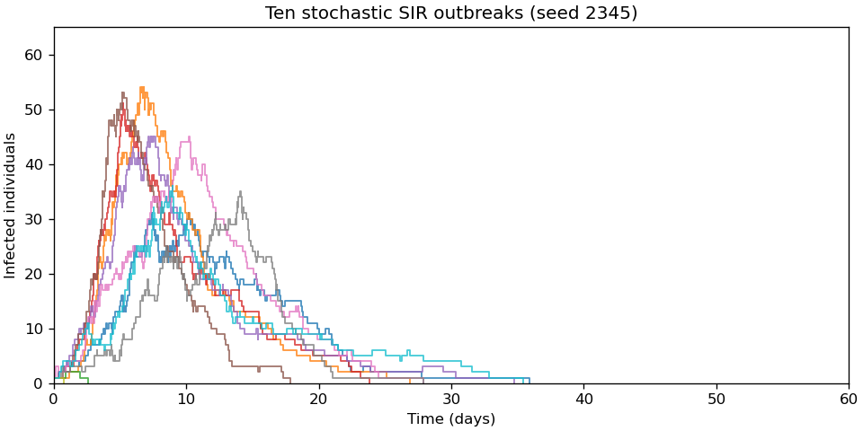

<h1 id="d11/a/solution">Solution</h1>

↑ **Parent:** [A](../a.md)

The [Gillespie algorithm](../../../../../gillespie-algorithm.md) draws a waiting time with total event rate $a=\beta SI/N+\gamma I$, then chooses infection with probability $(\beta SI/N)/a$ and recovery otherwise. Each event conserves $S+I+R=N$, and $I=0$ is absorbing in this closed [stochastic SIR model](../../../../../stochastic-sir-model.md).

Choose a horizon of 100 days, which is longer than all extinction times in the runs reported here. This independent implementation also avoids executing a sampled event beyond the horizon:

```
import numpy as np
import matplotlib.pyplot as plt

EPIDEMIC_RNG = np.random.default_rng(2345)

def sir_sim(t_max,X0,beta,gamma,rng=None):
    if rng is None:rng=EPIDEMIC_RNG
    state=np.array(X0,dtype=int);population=state.sum();time=0.
    times=[time];states=[state.copy()]
    while time<t_max and state[1]>0:
        infection=beta*state[0]*state[1]/population;recovery=gamma*state[1]
        rate=infection+recovery
        if rate==0:
            times.append(float(t_max));states.append(state.copy());break
        next_time=time+rng.exponential(1/rate)
        if next_time>t_max:
            times.append(float(t_max));states.append(state.copy());break
        if rng.random()<infection/rate:state+=np.array([-1,1,0])
        else:state+=np.array([0,-1,1])
        time=next_time;times.append(time);states.append(state.copy())
    return np.array(times),np.array(states)

rng = np.random.default_rng(2345)
trajectories = [sir_sim(100, [99,1,0], 1, .25, rng) for _ in range(10)]
for times, states in trajectories:
    plt.step(times, states[:,1], where="post", alpha=.8)
plt.xlabel("Time (days)")
plt.ylabel("Infected individuals")
plt.show()
```

A step plot represents the piecewise constant infected population between events. The trajectories show both substantial outbreaks and early [epidemic extinction](../../../../../epidemic-extinction.md) despite the large [basic reproduction number](../../../../../basic-reproduction-number.md) $R_0=\beta/\gamma=4$.

<a id="d11/a/image-ten-original-stochastic-sir-trajectories-with-frequency-dependent-transmission-and-one-initial-infection"></a>


**[Figure 4](#d11/a/image-ten-original-stochastic-sir-trajectories-with-frequency-dependent-transmission-and-one-initial-infection). Ten original stochastic SIR trajectories, with frequency-dependent transmission and one initial infection**.

## ↑ Ancestors (13)

1. [A](../a.md)
2. [D11](../../d11.md)
3. [Paper 2](../../../paper-2-split.md)
4. [2024](../../../split.md)
5. [Past exam of the mathematical and Computational Biology course of the University of Cambridge](../../../../split.md)
6. [Mathematical and Computational Biology course of the University of Cambridge](../../../../../mathematical-and-computational-biology-course-of-the-university-of-cambridge.md)
7. [Year 2 of the natural sciences course of the University of Cambridge](../../../../../year-2-of-the-natural-sciences-course-of-the-university-of-cambridge.md)
8. [Year of the natural sciences course of the University of Cambridge](../../../../../year-of-the-natural-sciences-course-of-the-university-of-cambridge.md)
9. [Natural sciences course of the University of Cambridge](../../../../../natural-sciences-course-of-the-university-of-cambridge.md)
10. [Course of the University of Cambridge](../../../../../course-of-the-university-of-cambridge.md)
11. [University of Cambridge](../../../../../university-of-cambridge-split.md)
12. [List of universities](../../../../../list-of-universities.md)
13. [Codex Wiki](../../../../../split.md)
