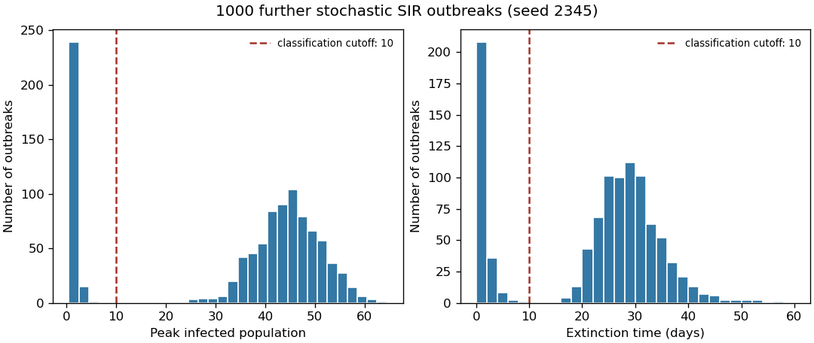

<h1 id="d11/c/solution">Solution</h1>

↑ **Parent:** [C](../c.md)

Continue the random-number stream used for the ten trajectories, then generate 1000 further independent realizations with the same model parameters. Plot each statistic in its own [histogram](../../../../../histogram.md):

```
stats = sir_sim_stats(1000, 100, [99,1,0], 1, .25, rng)
fig, axes = plt.subplots(1, 2, figsize=(9, 4), layout="constrained")
axes[0].hist(stats[:,0], bins=np.arange(.5,65.6,2))
axes[1].hist(stats[:,1], bins=np.arange(0,61,2))
axes[0].set(xlabel="Peak infected population", ylabel="Number of outbreaks")
axes[1].set(xlabel="Final recorded time (days)", ylabel="Number of outbreaks")
plt.show()
```

Both [histograms](../../../../../histogram.md) have a group of early failures separated from a group of large outbreaks. For this reproducible run the mean peak is **33.73 individuals**, and the mean final time is **22.165 days**; the largest final time is 56.916 days, so all 1000 runs reached [epidemic extinction](../../../../../epidemic-extinction.md) before the 100-day horizon.

<a id="d11/c/image-peak-size-and-extinction-time-for-1000-original-stochastic-sir-realizations-with-operational-failure-cutoffs"></a>


**[Figure 5](#d11/c/image-peak-size-and-extinction-time-for-1000-original-stochastic-sir-realizations-with-operational-failure-cutoffs). Peak size and extinction time for 1000 original stochastic SIR realizations, with operational failure cutoffs**.

## ↑ Ancestors (13)

1. [C](../c.md)
2. [D11](../../d11.md)
3. [Paper 2](../../../paper-2-split.md)
4. [2024](../../../split.md)
5. [Past exam of the mathematical and Computational Biology course of the University of Cambridge](../../../../split.md)
6. [Mathematical and Computational Biology course of the University of Cambridge](../../../../../mathematical-and-computational-biology-course-of-the-university-of-cambridge.md)
7. [Year 2 of the natural sciences course of the University of Cambridge](../../../../../year-2-of-the-natural-sciences-course-of-the-university-of-cambridge.md)
8. [Year of the natural sciences course of the University of Cambridge](../../../../../year-of-the-natural-sciences-course-of-the-university-of-cambridge.md)
9. [Natural sciences course of the University of Cambridge](../../../../../natural-sciences-course-of-the-university-of-cambridge.md)
10. [Course of the University of Cambridge](../../../../../course-of-the-university-of-cambridge.md)
11. [University of Cambridge](../../../../../university-of-cambridge-split.md)
12. [List of universities](../../../../../list-of-universities.md)
13. [Codex Wiki](../../../../../split.md)
