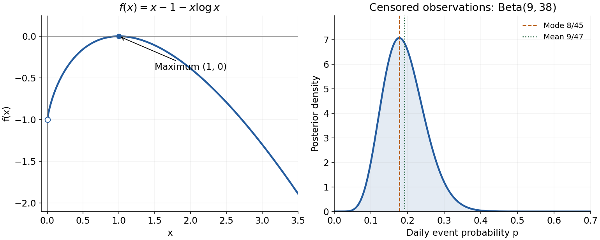

<h1 id="5/b/solution">Solution</h1>

↑ **Parent:** [B](../b.md)

The function is strictly [concave](../../../../../concave-function.md) on $x>0$. Its [derivative](../../../../../derivative.md) is positive for $0<x<1$, zero at $x=1$, and negative for $x>1$. Thus it rises from the limiting value $-1$ as $x\downarrow0$, touches the horizontal axis at its unique [maximum](../../../../../maximum-of-a-subset-of-a-total-order.md) $(1,0)$, and then decreases to $-\infty$. It never crosses above the axis. The left endpoint is not included, and the slope tends to $+\infty$ there.

**[Figure 1](#5/b/image-concave-logarithmic-function-and-the-beta-posterior-for-the-censored-observations). Concave logarithmic function and the beta posterior for the censored observations**.

The left panel shows the required sketch; the right panel is used for question 6(e).

## ↑ Ancestors (13)

1. [B](../b.md)
2. [5](../../5.md)
3. [Paper 1](../../../paper-1-split.md)
4. [2025](../../../split.md)
5. [Past exam of the mathematical and Computational Biology course of the University of Cambridge](../../../../split.md)
6. [Mathematical and Computational Biology course of the University of Cambridge](../../../../../mathematical-and-computational-biology-course-of-the-university-of-cambridge.md)
7. [Year 2 of the natural sciences course of the University of Cambridge](../../../../../year-2-of-the-natural-sciences-course-of-the-university-of-cambridge.md)
8. [Year of the natural sciences course of the University of Cambridge](../../../../../year-of-the-natural-sciences-course-of-the-university-of-cambridge.md)
9. [Natural sciences course of the University of Cambridge](../../../../../natural-sciences-course-of-the-university-of-cambridge.md)
10. [Course of the University of Cambridge](../../../../../course-of-the-university-of-cambridge.md)
11. [University of Cambridge](../../../../../university-of-cambridge-split.md)
12. [List of universities](../../../../../list-of-universities.md)
13. [Codex Wiki](../../../../../split.md)
