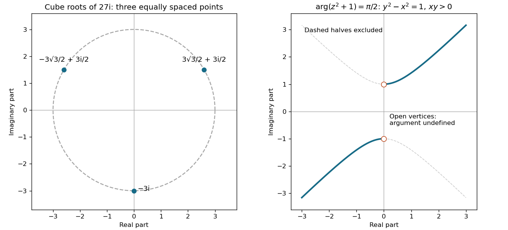

# 2013 resit

↑ **Parent:** [Past exam of the mathematical methods I course of the University of Oxford](../past-exam-of-the-mathematical-methods-i-course-of-the-university-of-oxford.md)

Source paper: [https://www.whatdotheyknow.com/request/physics_preliminary_examinations/response/1162943/attach/3/Twain.7z?cookie_passthrough=1](https://www.whatdotheyknow.com/request/physics_preliminary_examinations/response/1162943/attach/3/Twain.7z?cookie_passthrough=1)

The dated cover identifies the 11 September 2013 resit despite its printed “Trinity Term” heading. The separate June paper is not substituted for it. All Section B alternatives are solved. In Question 10, editorial scopes separate the two bullet points and the subsequent marked blocks.

**Table of contents**

- [1](#1)
  - [Solution](#1/solution)
- [2](#2)
  - [Solution](#2/solution)
- [3](#3)
  - [Solution](#3/solution)
- [4](#4)
  - [Solution](#4/solution)
- [5](#5)
  - [Solution](#5/solution)
- [6](#6)
  - [Solution](#6/solution)
- [7](#7)
  - [Solution](#7/solution)
- [8](#8)
  - [Solution](#8/solution)
- [9](#9)
  - [a](#9/a)
    - [Solution](#9/a/solution)
  - [b](#9/b)
    - [Solution](#9/b/solution)
  - [c](#9/c)
    - [Solution](#9/c/solution)
  - [d](#9/d)
    - [Solution](#9/d/solution)
- [10](#10)
  - [a](#10/a)
    - [i](#10/a/i)
      - [Solution](#10/a/i/solution)
    - [ii](#10/a/ii)
      - [Solution](#10/a/ii/solution)
  - [b](#10/b)
    - [Solution](#10/b/solution)
  - [c](#10/c)
    - [Solution](#10/c/solution)
- [11](#11)
  - [a](#11/a)
    - [Solution](#11/a/solution)
  - [b](#11/b)
    - [Solution](#11/b/solution)
- [12](#12)
  - [a](#12/a)
    - [Solution](#12/a/solution)
  - [b](#12/b)
    - [Solution](#12/b/solution)
  - [c](#12/c)
    - [Solution](#12/c/solution)

## 1

↑ **Parent:** [2013 resit](2013-resit.md)

<h3 id="1/solution">Solution</h3>

↑ **Parent:** [1](#1)

Squaring first is simpler than expanding the tenth powers. Since $(1-i)^2=-2i$ and $(1+i)^2=2i$, while $i^4=1$, the requested Cartesian forms are

$$
\boxed{\bigl((1-i)^2\bigr)^5=-32i=0-32i,\qquad
\bigl((1+i)^2\bigr)^5=32i=0+32i.}
$$

Thus the [real part](../complex-analysis.md#real-part) is zero in each case, and the [imaginary parts](../complex-analysis.md#imaginary-part) are $-32$ and $32$. The results are [complex conjugates](../complex-analysis.md#complex-conjugate), as also follows because the two inputs are [complex conjugates](../complex-analysis.md#complex-conjugate) and the fifth-power polynomial has real coefficients.

## 2

↑ **Parent:** [2013 resit](2013-resit.md)

<h3 id="2/solution">Solution</h3>

↑ **Parent:** [2](#2)

Write $27i=27e^{i(\pi/2+2\pi k)}$. Every [cube root](../arithmetic.md#cube-root) has [complex modulus](../complex-analysis.md#complex-modulus) $3$ and an angle one third of one of these [complex arguments](../complex-analysis.md#argument-complex-analysis):

$$
\boxed{z_k=3e^{i(\pi/6+2\pi k/3)},\quad k=0,1,2.}
$$

Equivalently the three [complex roots](../polynomial.md#complex-root) are

$$
\boxed{\frac{3\sqrt3}{2}+\frac32i,\qquad
-\frac{3\sqrt3}{2}+\frac32i,\qquad -3i.}
$$

They lie on the circle of radius $3$ centred at the origin in the [Argand plane](../complex-analysis.md#complex-plane), spaced by $2\pi/3$. Further integer values of $k$ repeat these three points. Cubing any of them multiplies its angle by three and cubes its [complex modulus](../complex-analysis.md#complex-modulus) from $3$ to $27$, giving $27i$.

**[Figure 1](#2/image-original-argand-diagrams-for-the-three-cube-roots-and-the-argument-constrained-hyperbola). Original Argand diagrams for the three cube roots and the argument-constrained hyperbola**.

## 3

↑ **Parent:** [2013 resit](2013-resit.md)

<h3 id="3/solution">Solution</h3>

↑ **Parent:** [3](#3)

Put $z=x+iy$. The expression whose [complex argument](../complex-analysis.md#argument-complex-analysis) is constrained becomes

$$
z^2+1=(x^2-y^2+1)+2ixy.
$$

Its [principal argument](../complex-analysis.md#principal-argument) is $\pi/2$ exactly when its [real part](../complex-analysis.md#real-part) is zero and its [imaginary part](../complex-analysis.md#imaginary-part) is **strictly positive**. Hence

$$
\boxed{y^2-x^2=1,\qquad xy>0.}
$$

The [locus](../euclidean-geometry.md#locus-mathematics) consists of the upper-right half of the upper [hyperbola](../euclidean-geometry.md#hyperbola) branch, $y=\sqrt{x^2+1}$ with $x>0$, and the lower-left half of the lower branch, $y=-\sqrt{x^2+1}$ with $x<0$. The vertices $z=\pm i$ are excluded because $z^2+1=0$ there and zero has no [complex argument](../complex-analysis.md#argument-complex-analysis). The remaining halves have negative [imaginary part](../complex-analysis.md#imaginary-part) and give argument $-\pi/2$, not $\pi/2$. The right panel of the original illustration marks the excluded vertices with open circles.

## 4

↑ **Parent:** [2013 resit](2013-resit.md)

<h3 id="4/solution">Solution</h3>

↑ **Parent:** [4](#4)

Use [parametric equations](../geometry-and-topology.md#parametric-equation) for the two lines,

$$
\mathbf r=\mathbf p+t\mathbf u,\quad \mathbf p=(2,3,-1),\quad\mathbf u=(2,1,2),
\qquad
\mathbf r=\mathbf q+s\mathbf v,\quad\mathbf q=(-2,-1,1),\quad\mathbf v=(1,2,1).
$$

Their [cross product](../vector-space.md#cross-product) is $\mathbf u\times\mathbf v=(-3,0,3)\ne0$. Projection of the separation of the base points onto this common normal gives the [shortest distance between skew lines](../euclidean-geometry.md#shortest-distance-between-skew-lines):

$$
\boxed{d=\frac{|(\mathbf q-\mathbf p)\cdot(\mathbf u\times\mathbf v)|}{|\mathbf u\times\mathbf v|}
=\frac{18}{3\sqrt2}=3\sqrt2.}
$$

This projection is a lower bound on every connecting segment because adding either line's direction leaves its normal component unchanged. It is attained: imposing perpendicularity of $\mathbf p+t\mathbf u-\mathbf q-s\mathbf v$ to both directions gives $t=2/3$ and $s=7/3$. The corresponding points are $(10/3,11/3,1/3)$ and $(1/3,11/3,10/3)$; their difference is $(3,0,-3)$, perpendicular to both lines and of length $3\sqrt2$.

## 5

↑ **Parent:** [2013 resit](2013-resit.md)

<h3 id="5/solution">Solution</h3>

↑ **Parent:** [5](#5)

Subtracting the first equation from the third gives $4x-4z=6$, so $z=x-3/2$. The second equation then becomes $(\alpha-2)x=\beta-3$. The third fixes $y=7(1-x)/5$. Therefore the three possibilities are

$$
\boxed{\begin{array}{c|c}
\alpha\ne2 & \text{one solution},\quad
x=\dfrac{\beta-3}{\alpha-2},\ y=\dfrac75(1-x),\ z=x-\dfrac32\\[4pt]
\alpha=2,\ \beta=3 & \text{infinitely many},\quad
(x,y,z)=\left(t,\dfrac75(1-t),t-\dfrac32\right)\\[4pt]
\alpha=2,\ \beta\ne3 & \text{no solution}.
\end{array}}
$$

For the first case the coefficient [determinant](../multilinear-algebra.md#determinant) is $20(\alpha-2)\ne0$, confirming uniqueness. At $\alpha=2$ its [matrix rank](../vector-space.md#matrix-rank) is two. The [augmented matrix](../linear-algebra.md#augmented-matrix) has the same [matrix rank](../vector-space.md#matrix-rank) only for $\beta=3$, giving one [free variable in a linear system](../linear-algebra.md#free-variable-in-a-linear-system); otherwise the [linear system](../linear-algebra.md#system-of-linear-equations) is inconsistent.

## 6

↑ **Parent:** [2013 resit](2013-resit.md)

<h3 id="6/solution">Solution</h3>

↑ **Parent:** [6](#6)

A real square [orthogonal matrix](../linear-algebra.md#orthogonal-matrix) satisfies $Q^TQ=I$. A complex square [unitary matrix](../linear-operator-theory.md#unitary-matrix) satisfies $U^\dagger U=I$, where $\dagger$ denotes conjugate transpose. A [Hermitian matrix](../hilbert-space.md#hermitian-operator) satisfies $H^\dagger=H$. The distinction between transpose and conjugate transpose matters for imaginary entries.

For the three displayed matrices, in their source order:

- First: a [unitary matrix](../linear-operator-theory.md#unitary-matrix), but neither an [orthogonal matrix](../linear-algebra.md#orthogonal-matrix) nor a [Hermitian matrix](../hilbert-space.md#hermitian-operator).
- Second: an [orthogonal matrix](../linear-algebra.md#orthogonal-matrix), a [unitary matrix](../linear-operator-theory.md#unitary-matrix), and a [Hermitian matrix](../hilbert-space.md#hermitian-operator).
- Third: a [Hermitian matrix](../hilbert-space.md#hermitian-operator), but neither an [orthogonal matrix](../linear-algebra.md#orthogonal-matrix) nor a [unitary matrix](../linear-operator-theory.md#unitary-matrix).

For the first matrix, $A^\dagger=-A$ and $A^2=-I$, so $A^\dagger A=I$ but $A^\dagger\ne A$. It also fails $A^TA=I$, even if complex orthogonality is considered. The second matrix is real diagonal with entries $1,-1$: its transpose, conjugate transpose and inverse all equal itself. In the third matrix the imaginary off-diagonal entries are conjugate pairs, establishing the [Hermitian matrix](../hilbert-space.md#hermitian-operator) condition. Its first column has squared norm $1+3=4$, so it is not a [unitary matrix](../linear-operator-theory.md#unitary-matrix); it is not real orthogonal, and the complex bilinear first-column square is $1-3=-2\ne1$ as well.

## 7

↑ **Parent:** [2013 resit](2013-resit.md)

<h3 id="7/solution">Solution</h3>

↑ **Parent:** [7](#7)

For this [homogeneous tangent differential equation](../differential-equation.md#homogeneous-tangent-differential-equation), set $u=y/x$ on an interval not containing $x=0$. Since $y'=u+xu'$, cancellation gives $xu'=2\tan u$. Away from zeros of $\tan u$, separation and [integration](../integral.md) give

$$
\int\cot u\,du=2\int\frac{dx}{x},\qquad
\log|\sin u|=2\log|x|+C_0.
$$

Restoring a signed constant yields the compact implicit solution

$$
\boxed{\sin(y/x)=Cx^2.}
$$

A complete real branch description is

$$
\boxed{y=x\left[k\pi+(-1)^k\arcsin(Cx^2)\right],\qquad k\in\mathbb Z.}
$$

Here $C$ is real and the interval must satisfy $x\ne0$ and $|Cx^2|<1$. The strict inequality excludes points with $\cos(y/x)=0$, where the original [tangent function](../geometry-and-topology.md#tangent-function) is undefined. Separating divided by $\tan u$, so its zeros must be checked separately: $u=k\pi$ gives $y=k\pi x$. These are exactly the $C=0$ branches already included. The branch integer is fixed on each connected solution interval; it cannot be changed arbitrarily at a regular point.

## 8

↑ **Parent:** [2013 resit](2013-resit.md)

<h3 id="8/solution">Solution</h3>

↑ **Parent:** [8](#8)

The constant term belongs on the forcing side: the equation is $y''-2y'=x+1$. Set $v=y'$ to obtain the first-order linear equation $v'-2v=x+1$. A particular solution is $v_p=-x/2-3/4$, while $v_h=Ae^{2x}$. Imposing $v(0)=0$ fixes $A=3/4$. Integrating and then using $y(0)=0$ gives

$$
\boxed{y(x)=\frac38(e^{2x}-1)-\frac{x^2}{4}-\frac{3x}{4}.}
$$

Direct [differentiation](../calculus.md#differentiation) gives $y'=3e^{2x}/4-x/2-3/4$ and $y''=3e^{2x}/2-1/2$, so $y''-2y'-1=x$. Both initial values vanish. The nonzero exponential term is required by the initial derivative, even though the forcing is polynomial.

## 9

↑ **Parent:** [2013 resit](2013-resit.md)

<h3 id="9/a">a</h3>

↑ **Parent:** [9](#9)

<h4 id="9/a/solution">Solution</h4>

↑ **Parent:** [A](#9/a)

Let $D=\mathbf a\cdot(\mathbf b\times\mathbf c)\ne0$ be the [scalar triple product](../multilinear-algebra.md#scalar-triple-product). The [reciprocal basis](../multilinear-algebra.md#reciprocal-basis) satisfies $\mathbf a\cdot\mathbf a'=1$ and all mismatched dot products vanish, with cyclic analogues. Apply the given [vector triple product](../multivariable-calculus.md#vector-triple-product) identity to obtain

$$
\mathbf b'\times\mathbf c'
=\frac{(\mathbf c\times\mathbf a)\times(\mathbf a\times\mathbf b)}{D^2}
=\frac{D\mathbf a}{D^2}=\frac{\mathbf a}{D}.
$$

Dotting with $\mathbf a'$ gives

$$
\boxed{\mathbf a'\cdot(\mathbf b'\times\mathbf c')=\frac1D.}
$$

The sign is retained: a negatively oriented original [basis](../vector-space.md#basis) has a negatively oriented [reciprocal basis](../multilinear-algebra.md#reciprocal-basis). Equivalently, if the original vectors are columns of $B$, their reciprocals are columns of $B^{-T}$, whose [determinant](../multilinear-algebra.md#determinant) is $1/\det B$.

<h3 id="9/b">b</h3>

↑ **Parent:** [9](#9)

<h4 id="9/b/solution">Solution</h4>

↑ **Parent:** [B](#9/b)

The denominator for taking reciprocals a second time is $D'=1/D$. The preceding cross-product result therefore gives

$$
\boxed{\frac{\mathbf b'\times\mathbf c'}{D'}=\frac{\mathbf a/D}{1/D}=\mathbf a.}
$$

Cyclic permutation gives $\mathbf b$ and $\mathbf c$. Thus taking the [reciprocal basis](../multilinear-algebra.md#reciprocal-basis) twice returns the original [basis](../vector-space.md#basis). The matrix statement is the same [reciprocal basis involution](../multilinear-algebra.md#reciprocal-basis-involution): $(B^{-T})^{-T}=B$. Noncoplanarity is essential, since otherwise the defining denominator and the matrix inverse do not exist.

<h3 id="9/c">c</h3>

↑ **Parent:** [9](#9)

<h4 id="9/c/solution">Solution</h4>

↑ **Parent:** [C](#9/c)

Dot the reciprocal-basis expansion with each member of the original [basis](../vector-space.md#basis). All mismatched dot products vanish and the matching one equals one. Consequently

$$
\boxed{\alpha=\mathbf r\cdot\mathbf a,\qquad
\beta=\mathbf r\cdot\mathbf b,\qquad
\gamma=\mathbf r\cdot\mathbf c.}
$$

These are coefficients in the [reciprocal basis](../multilinear-algebra.md#reciprocal-basis). They would instead involve dot products with the reciprocal vectors if $\mathbf r$ were being expanded in the original [basis](../vector-space.md#basis). The two coefficient conventions should not be interchanged for a nonorthonormal [basis](../vector-space.md#basis).

<h3 id="9/d">d</h3>

↑ **Parent:** [9](#9)

<h4 id="9/d/solution">Solution</h4>

↑ **Parent:** [D](#9/d)

Use the preceding coefficient identities with the three prescribed plane equations. They immediately give

$$
\boxed{\mathbf r=s\mathbf a'+t\mathbf b'+u\mathbf c'.}
$$

For example, its dot product with $\mathbf a$ is $s$, because $\mathbf a'\cdot\mathbf a=1$ while the other two terms give zero; the other equations follow cyclically. This verifies existence. If two points satisfied all three equations, their difference would be perpendicular to all three members of a [basis](../vector-space.md#basis) and therefore zero. Hence the intersection is unique, not merely one possible intersection point.

## 10

↑ **Parent:** [2013 resit](2013-resit.md)

<h3 id="10/a">a</h3>

↑ **Parent:** [10](#10)

<h4 id="10/a/i">i</h4>

↑ **Parent:** [A](#10/a)

<h5 id="10/a/i/solution">Solution</h5>

↑ **Parent:** [I](#10/a/i)

Use active [rotations](../riemannian-geometry.md#rotation-mathematics) on column vectors and positive angles counter-clockwise when viewed from the positive axis toward the origin. Rotation about $z$ takes $\mathbf e_x$ to $(\cos\alpha,\sin\alpha,0)$, $\mathbf e_y$ to $(-\sin\alpha,\cos\alpha,0)$, and leaves $\mathbf e_z$ fixed. These images are the columns of the [rotation matrix](../linear-algebra.md#rotation-matrix):

$$
\boxed{R_z(\alpha)=\begin{pmatrix}
\cos\alpha&-\sin\alpha&0\\
\sin\alpha&\cos\alpha&0\\
0&0&1
\end{pmatrix}.}
$$

It satisfies $R_z^TR_z=I$ and $\det R_z=1$. Stating the viewing convention avoids confusing this active [rotation](../riemannian-geometry.md#rotation-mathematics) with a passive change of axes.

<h4 id="10/a/ii">ii</h4>

↑ **Parent:** [A](#10/a)

<h5 id="10/a/ii/solution">Solution</h5>

↑ **Parent:** [Ii](#10/a/ii)

With the same active [rotation](../riemannian-geometry.md#rotation-mathematics) convention, the $x$ axis remains fixed, while $\mathbf e_y$ moves toward $\mathbf e_z$. Therefore

$$
\boxed{R_x(\beta)=\begin{pmatrix}
1&0&0\\
0&\cos\beta&-\sin\beta\\
0&\sin\beta&\cos\beta
\end{pmatrix}.}
$$

For instance, a positive quarter-turn maps $\mathbf e_y$ to $\mathbf e_z$ and $\mathbf e_z$ to $-\mathbf e_y$, checking both signs. This is again an [orthogonal matrix](../linear-algebra.md#orthogonal-matrix) of [determinant](../multilinear-algebra.md#determinant) one.

<h3 id="10/b">b</h3>

↑ **Parent:** [10](#10)

<h4 id="10/b/solution">Solution</h4>

↑ **Parent:** [B](#10/b)

The first operation acts nearest the column vector, so the composite [rotation matrix](../linear-algebra.md#rotation-matrix) is $M=R_z(\alpha)R_x(\beta)$:

$$
\boxed{M=\begin{pmatrix}
\cos\alpha&-\sin\alpha\cos\beta&\sin\alpha\sin\beta\\
\sin\alpha&\cos\alpha\cos\beta&-\cos\alpha\sin\beta\\
0&\sin\beta&\cos\beta
\end{pmatrix}.}
$$

At $\alpha=\beta=\pi/2$ this reduces to

$$
M=\begin{pmatrix}0&0&1\\1&0&0\\0&1&0\end{pmatrix},\qquad
(x,y,z)\mapsto(z,x,y).
$$

Solving $M\mathbf v=\mathbf v$ gives $v_x=v_y=v_z$. Normalization yields the fixed-axis [unit vectors](../vector-space.md#unit-vector)

$$
\boxed{\mathbf v=\pm\frac1{\sqrt3}(1,1,1).}
$$

Both signs describe the same unoriented axis. The operation is a cyclic permutation, and $M^3=I$; it is not generally obtained by reversing the multiplication order.

<h3 id="10/c">c</h3>

↑ **Parent:** [10](#10)

<h4 id="10/c/solution">Solution</h4>

↑ **Parent:** [C](#10/c)

Choose the [unit vector](../vector-space.md#unit-vector) $\mathbf p=(1,-1,0)/\sqrt2$, which is perpendicular to $\mathbf v$. Then $M\mathbf p=(0,1,-1)/\sqrt2$. Their dot product is $-1/2$, and the [rotation matrix](../linear-algebra.md#rotation-matrix) preserves their norms, so

$$
\boxed{\angle(\mathbf p,M\mathbf p)=\arccos(-1/2)=\frac{2\pi}{3}.}
$$

The same unsigned angle holds for every nonzero vector perpendicular to the axis: this is the rotation plane of a three-dimensional proper [rotation](../riemannian-geometry.md#rotation-mathematics). Alternatively, $\operatorname{tr}M=0=1+2\cos\chi$ gives the same rotation angle $\chi=2\pi/3$.

## 11

↑ **Parent:** [2013 resit](2013-resit.md)

<h3 id="11/a">a</h3>

↑ **Parent:** [11](#11)

<h4 id="11/a/solution">Solution</h4>

↑ **Parent:** [A](#11/a)

Take the [imaginary part](../complex-analysis.md#imaginary-part) of [De Moivre's theorem](../analysis.md#de-moivre-s-theorem) at exponent five. Writing $s=\sin\theta$ and $c=\cos\theta$ gives

$$
\sin5\theta=5c^4s-10c^2s^3+s^5
=5s(1-s^2)^2-10s^3(1-s^2)+s^5
=16s^5-20s^3+5s.
$$

For real $x\in[-1,1]$, put $x=\sin\theta$. The equation becomes $\sin5\theta=1$, so $\theta=\pi/10+2\pi k/5$. The distinct sine values are $1$, $(\sqrt5-1)/4$, and $-(1+\sqrt5)/4$. To establish completeness over the complex numbers as well, factor the polynomial:

$$
16x^5-20x^3+5x-1=(x-1)(4x^2+2x-1)^2.
$$

Thus all [polynomial roots](../polynomial.md#root-of-a-polynomial), including their [multiplicities](../polynomial.md#multiplicity-mathematics), are

$$
\boxed{x=1\ \text{(simple)},\qquad
x=\frac{-1+\sqrt5}{4},\ \frac{-1-\sqrt5}{4}\ \text{(each double)}.}
$$

The repeated sine values account for the double roots; there are no additional nonreal roots hidden by the trigonometric parametrization.

<h3 id="11/b">b</h3>

↑ **Parent:** [11](#11)

<h4 id="11/b/solution">Solution</h4>

↑ **Parent:** [B](#11/b)

Set $w=(z+1)/(z-1)$, with $z\ne1$. For a nonzero integer $n$, all solutions of $w^n=i$ are

$$
w_k=\exp\left(\frac{i(\pi/2+2\pi k)}n\right),\qquad k=0,\ldots,|n|-1.
$$

This covers negative integers too: $w$ is then nonzero and $w^{|n|}=-i$. No $w_k$ equals one. Inverting the [Möbius transformation](../group-theory.md#mobius-transformation) and using half-angle identities gives the [cotangent roots of a powered Möbius transformation](../group-theory.md#cotangent-roots-of-a-powered-mobius-transformation):

$$
\boxed{z_k=\frac{w_k+1}{w_k-1}
=-i\cot\left(\frac{\pi/4+\pi k}{n}\right),\quad k=0,\ldots,|n|-1.}
$$

These $|n|$ solutions are distinct and purely imaginary. For $n=0$ there is no solution: every defined zeroth power is one, not $i$. For negative $n$, $z=-1$ must additionally be excluded from the equation's domain; none of the displayed roots equals it.

For the cubic, direct expansion shows

$$
(1-i)(z^3+3iz^2+3z+i)=(z+1)^3-i(z-1)^3.
$$

Since $z=1$ is not a root, the cubic is precisely the $n=3$ case. Taking $k=0,1,2$ yields

$$
\boxed{z=-i(2+\sqrt3),\qquad -i(2-\sqrt3),\qquad i.}
$$

For an algebraic check, the cubic factors as $(z-i)(z^2+4iz-1)$, which gives the same three distinct roots.

## 12

↑ **Parent:** [2013 resit](2013-resit.md)

<h3 id="12/a">a</h3>

↑ **Parent:** [12](#12)

<h4 id="12/a/solution">Solution</h4>

↑ **Parent:** [A](#12/a)

Set $u=x+1$, so the equation is linear: $y'-y/u=1+2/u$, with $u\ne0$. An [integrating factor](../linear-ordinary-differential-equation.md#integrating-factor) is $1/u$ on either connected side of $u=0$. Thus

$$
\frac d{dx}\left(\frac yu\right)=\frac1u+\frac2{u^2},\qquad
\frac yu=\log|u|-\frac2u+C.
$$

Consequently the full real solution is

$$
\boxed{y=(x+1)\left(C+\log|x+1|\right)-2,\qquad x\ne-1.}
$$

The original equation is undefined at $x=-1$, so a continuation of the formula through that point is not a solution on an interval containing it. Constants can be chosen independently on the two separated domain components.

<h3 id="12/b">b</h3>

↑ **Parent:** [12](#12)

<h4 id="12/b/solution">Solution</h4>

↑ **Parent:** [B](#12/b)

Again put $u=y/x$, requiring $x\ne0$. Substituting $y'=u+xu'$ gives $xu'=1+u^2$. For real $u$ the factor $1+u^2$ never vanishes, so separation loses no constant real solution:

$$
\arctan u=\log|x|+C\quad\text{locally},\qquad
\boxed{y=x\tan\left(\log|x|+C\right).}
$$

Each real solution is defined on a connected interval avoiding zero and every pole of the [tangent function](../geometry-and-topology.md#tangent-function). Changing the constant by an integer multiple of $\pi$ gives the same branch. If complex-valued solutions are also allowed, the separated-out constant values $u=\pm i$ supply the additional solutions $y=\pm ix$; these do not occur in the real-valued family.

<h3 id="12/c">c</h3>

↑ **Parent:** [12](#12)

<h4 id="12/c/solution">Solution</h4>

↑ **Parent:** [C](#12/c)

The [characteristic polynomial](../linear-operator-theory.md#characteristic-polynomial) of the homogeneous constant-coefficient equation is $r^2+2r+2$, with roots $-1\pm i$. Its real [complementary function](../linear-ordinary-differential-equation.md#homogeneous-solution) is therefore $e^{-x}(C_1\cos x+C_2\sin x)$. The forcing $e^{-x}$ is not resonant because $r=-1$ is not a root. Substituting $y_p=Ae^{-x}$ into the differential operator gives $Ae^{-x}$, so $A=1$. Hence

$$
\boxed{y=e^{-x}\left(C_1\cos x+C_2\sin x+1\right).}
$$

A useful independent check is the substitution $y=e^{-x}v$: the equation becomes $v''+v=1$, whose general solution is $v=C_1\cos x+C_2\sin x+1$.

## ↑ Ancestors (9)

1. [Past exam of the mathematical methods I course of the University of Oxford](../past-exam-of-the-mathematical-methods-i-course-of-the-university-of-oxford.md)
2. [Mathematical methods I course of the University of Oxford](../university-of-oxford.md#mathematical-methods-i-course-of-the-university-of-oxford)
3. [Year 1 of the physics course of the University of Oxford](../university-of-oxford.md#year-1-of-the-physics-course-of-the-university-of-oxford)
4. [Physics course of the University of Oxford](../university-of-oxford.md#physics-course-of-the-university-of-oxford)
5. [Undergraduate course of the University of Oxford](../university-of-oxford.md#undergraduate-course-of-the-university-of-oxford)
6. [Course of the University of Oxford](../university-of-oxford.md#course-of-the-university-of-oxford)
7. [University of Oxford](../university-of-oxford.md)
8. [List of universities](../README.md#list-of-universities)
9. [Codex Wiki](../README.md)
