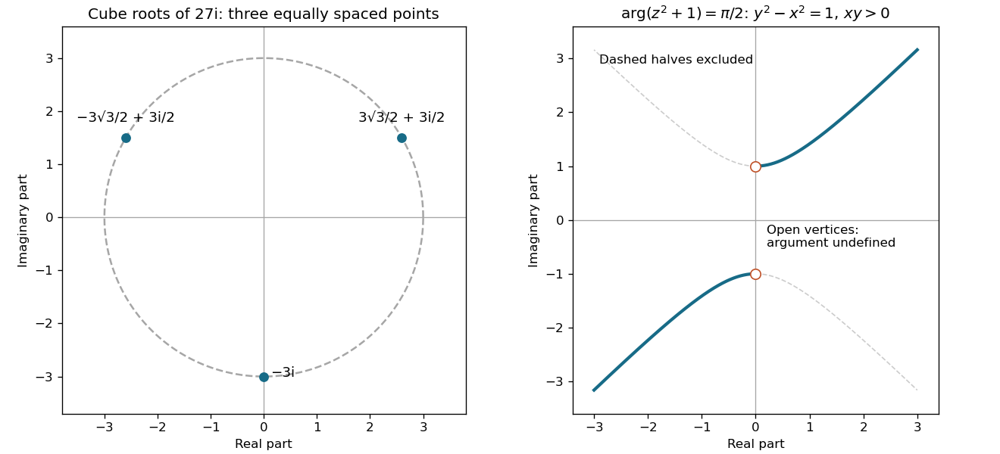

<h1 id="2/solution">Solution</h1>

↑ **Parent:** [2](../2.md)

Write $27i=27e^{i(\pi/2+2\pi k)}$. Every [cube root](../../../cube-root.md) has [complex modulus](../../../complex-modulus.md) $3$ and an angle one third of one of these [complex arguments](../../../argument-complex-analysis.md):

$$
\boxed{z_k=3e^{i(\pi/6+2\pi k/3)},\quad k=0,1,2.}
$$

Equivalently the three [complex roots](../../../complex-root.md) are

$$
\boxed{\frac{3\sqrt3}{2}+\frac32i,\qquad
-\frac{3\sqrt3}{2}+\frac32i,\qquad -3i.}
$$

They lie on the circle of radius $3$ centred at the origin in the [Argand plane](../../../complex-plane.md), spaced by $2\pi/3$. Further integer values of $k$ repeat these three points. Cubing any of them multiplies its angle by three and cubes its [complex modulus](../../../complex-modulus.md) from $3$ to $27$, giving $27i$.

**[Figure 1](#2/image-original-argand-diagrams-for-the-three-cube-roots-and-the-argument-constrained-hyperbola). Original Argand diagrams for the three cube roots and the argument-constrained hyperbola**.

## ↑ Ancestors (11)

1. [2](../2.md)
2. [2013 resit](../../2013-resit-split.md)
3. [Past exam of the mathematical methods I course of the University of Oxford](../../split.md)
4. [Mathematical methods I course of the University of Oxford](../../../mathematical-methods-i-course-of-the-university-of-oxford.md)
5. [Year 1 of the physics course of the University of Oxford](../../../year-1-of-the-physics-course-of-the-university-of-oxford.md)
6. [Physics course of the University of Oxford](../../../physics-course-of-the-university-of-oxford.md)
7. [Undergraduate course of the University of Oxford](../../../undergraduate-course-of-the-university-of-oxford.md)
8. [Course of the University of Oxford](../../../course-of-the-university-of-oxford.md)
9. [University of Oxford](../../../university-of-oxford-split.md)
10. [List of universities](../../../list-of-universities.md)
11. [Codex Wiki](../../../split.md)
