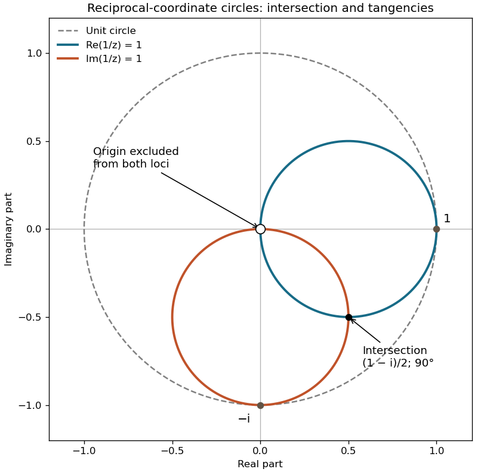

<h1 id="10/d/solution">Solution</h1>

↑ **Parent:** [D](../d.md)

For $z=x+iy\ne0$, $z^{-1}=(x-iy)/(x^2+y^2)$. The first constraint is $x=x^2+y^2$ and the second is $-y=x^2+y^2$. Completing the squares gives

$$
\boxed{\left(x-\frac12\right)^2+y^2=\frac14,\qquad
x^2+\left(y+\frac12\right)^2=\frac14,\qquad z\ne0.}
$$

These [circles](../../../../circle.md) have centres $(1/2,0)$ and $(0,-1/2)$ and radius $1/2$. Their algebraic intersections satisfy $x=-y$ and $2x^2=x$, giving zero and $(1-i)/2$. Zero is excluded from both original [loci](../../../../locus-mathematics.md), so their only actual intersection is

$$
\boxed{z=\frac{1-i}{2}.}
$$

At $(x,y)=(1/2,-1/2)$ the two circle normals are $(0,-1)$ and $(1,0)$, so the tangent directions are perpendicular. The intersection angle is $\boxed{\pi/2}$. This is also an instance of the [orthogonality of reciprocal-coordinate circles](../../../../orthogonality-of-reciprocal-coordinate-circles.md) under complex inversion.

The first small circle touches the unit [circle](../../../../circle.md) at $z=1$, and the second at $z=-i$. On the first, $r^2=x\le r$; on the second, $r^2=-y\le r$. Thus each lies entirely within $r\le1$, attaining equality only at its stated point. They are internally tangent to the unit [circle](../../../../circle.md) and do not cross it. The original sketch marks the excluded common origin with an open symbol and the genuine intersection with a filled symbol.

**[Figure 1](#10/d/image-original-argand-diagram-of-reciprocal-coordinate-circles-their-orthogonal-intersection-and-tangency-to-the-unit-circle). Original Argand diagram of reciprocal-coordinate circles, their orthogonal intersection, and tangency to the unit circle**.

## ↑ Ancestors (12)

1. [D](../d.md)
2. [10](../../10.md)
3. [2013](../../../2013-split.md)
4. [Past exam of the mathematical methods I course of the University of Oxford](../../../split.md)
5. [Mathematical methods I course of the University of Oxford](../../../../mathematical-methods-i-course-of-the-university-of-oxford.md)
6. [Year 1 of the physics course of the University of Oxford](../../../../year-1-of-the-physics-course-of-the-university-of-oxford.md)
7. [Physics course of the University of Oxford](../../../../physics-course-of-the-university-of-oxford.md)
8. [Undergraduate course of the University of Oxford](../../../../undergraduate-course-of-the-university-of-oxford.md)
9. [Course of the University of Oxford](../../../../course-of-the-university-of-oxford.md)
10. [University of Oxford](../../../../university-of-oxford-split.md)
11. [List of universities](../../../../list-of-universities.md)
12. [Codex Wiki](../../../../split.md)
