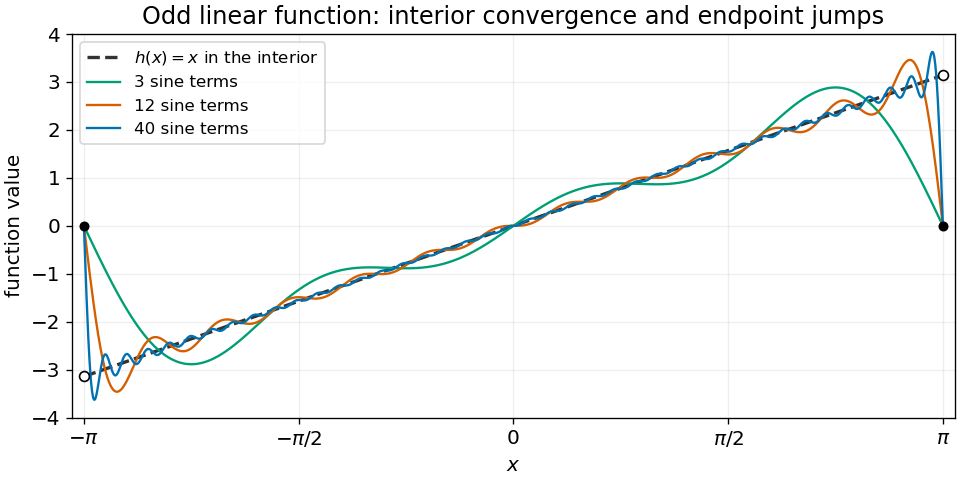
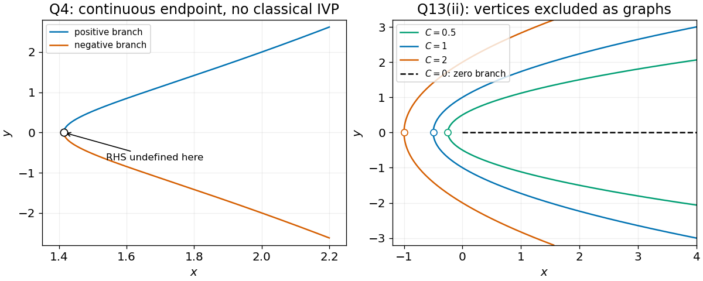

# 2014 resit

↑ **Parent:** [Past exam of the mathematical methods I course of the University of Oxford](../past-exam-of-the-mathematical-methods-i-course-of-the-university-of-oxford.md)

Source paper: [https://www.whatdotheyknow.com/request/physics_preliminary_examinations/response/1162943/attach/3/Twain.7z?cookie_passthrough=1](https://www.whatdotheyknow.com/request/physics_preliminary_examinations/response/1162943/attach/3/Twain.7z?cookie_passthrough=1)

**Table of contents**

- [1](#1)
  - [i](#1/i)
    - [Solution](#1/i/solution)
  - [ii](#1/ii)
    - [Solution](#1/ii/solution)
- [2](#2)
  - [Solution](#2/solution)
- [3](#3)
  - [i](#3/i)
    - [Solution](#3/i/solution)
  - [ii](#3/ii)
    - [Solution](#3/ii/solution)
  - [iii](#3/iii)
    - [Solution](#3/iii/solution)
- [4](#4)
  - [Solution](#4/solution)
- [5](#5)
  - [Solution](#5/solution)
- [6](#6)
  - [i](#6/i)
    - [Solution](#6/i/solution)
  - [ii](#6/ii)
    - [Solution](#6/ii/solution)
- [7](#7)
  - [Solution](#7/solution)
- [8](#8)
  - [Solution](#8/solution)
- [9](#9)
  - [Solution](#9/solution)
- [10](#10)
  - [a](#10/a)
    - [i](#10/a/i)
      - [Solution](#10/a/i/solution)
    - [ii](#10/a/ii)
      - [Solution](#10/a/ii/solution)
  - [b](#10/b)
    - [Solution](#10/b/solution)
  - [Solution](#10/solution)
  - [c](#10/c)
    - [Solution](#10/c/solution)
- [11](#11)
  - [i](#11/i)
    - [Solution](#11/i/solution)
  - [ii](#11/ii)
    - [Solution](#11/ii/solution)
  - [iii](#11/iii)
    - [Solution](#11/iii/solution)
  - [iv](#11/iv)
    - [Solution](#11/iv/solution)
  - [v](#11/v)
    - [Solution](#11/v/solution)
- [12](#12)
  - [i](#12/i)
    - [Solution](#12/i/solution)
  - [ii](#12/ii)
    - [Solution](#12/ii/solution)
  - [iii](#12/iii)
    - [Solution](#12/iii/solution)
  - [iv](#12/iv)
    - [Solution](#12/iv/solution)
  - [v](#12/v)
    - [Solution](#12/v/solution)
  - [vi](#12/vi)
    - [Solution](#12/vi/solution)
  - [vii](#12/vii)
    - [Solution](#12/vii/solution)
  - [viii](#12/viii)
    - [Solution](#12/viii/solution)
- [13](#13)
  - [i](#13/i)
    - [Solution](#13/i/solution)
  - [ii](#13/ii)
    - [Solution](#13/ii/solution)
  - [iii](#13/iii)
    - [Solution](#13/iii/solution)
  - [iv](#13/iv)
    - [Solution](#13/iv/solution)
  - [v](#13/v)
    - [Solution](#13/v/solution)

## 1

↑ **Parent:** [2014 resit](2014-resit.md)

<h3 id="1/i">i</h3>

↑ **Parent:** [1](#1)

<h4 id="1/i/solution">Solution</h4>

↑ **Parent:** [I](#1/i)

The [complex exponential](../calculus.md#complex-exponential-function) factors as $e^{(3+i)(a+ib)}=e^{3a-b}e^{i(a+3b)}$. Its positive real prefactor is its [modulus](../complex-analysis.md#modulus), while its phase gives its [complex argument](../complex-analysis.md#argument-complex-analysis):

$$
\boxed{|e^{(3+i)z}|=e^{3a-b},\qquad\arg(e^{(3+i)z})=a+3b\pmod{2\pi}.}
$$

For the principal [complex argument](../complex-analysis.md#argument-complex-analysis), reduce $a+3b$ to the chosen principal interval.

<h3 id="1/ii">ii</h3>

↑ **Parent:** [1](#1)

<h4 id="1/ii/solution">Solution</h4>

↑ **Parent:** [Ii](#1/ii)

The [polar form](../complex-analysis.md#polar-form-of-a-complex-number) $1+i=\sqrt2e^{i\pi/4}$ gives $(1+i)^6=-8i$. Multiplication therefore scales the [modulus](../complex-analysis.md#modulus) by $8$ and rotates the [complex argument](../complex-analysis.md#argument-complex-analysis) through $-\pi/2$:

$$
\boxed{|(1+i)^6z|=8\sqrt{a^2+b^2},\qquad\arg((1+i)^6z)=\arg(a+ib)-\frac\pi2\pmod{2\pi}.}
$$

Equivalently the result is $8b-8ia$, whose [complex argument](../complex-analysis.md#argument-complex-analysis) is $\operatorname{atan2}(-a,b)$. If $a=b=0$, its [modulus](../complex-analysis.md#modulus) is zero and its [complex argument](../complex-analysis.md#argument-complex-analysis) is undefined.

## 2

↑ **Parent:** [2014 resit](2014-resit.md)

<h3 id="2/solution">Solution</h3>

↑ **Parent:** [2](#2)

Expand the [determinant](../multilinear-algebra.md#determinant) along its first row:

$$
\det A=2(5-8)-(5+12)=\boxed{-23.}
$$

In particular the [matrix](../vector-space.md#matrix) has an [inverse matrix](../matrix-inverse.md).

## 3

↑ **Parent:** [2014 resit](2014-resit.md)

<h3 id="3/i">i</h3>

↑ **Parent:** [3](#3)

<h4 id="3/i/solution">Solution</h4>

↑ **Parent:** [I](#3/i)

The [determinant](../multilinear-algebra.md#determinant) is an [alternating multilinear map](../multilinear-algebra.md#alternating-multilinear-map) of its rows, so exchanging two rows gives **the negative of the original determinant**: $\det A\mapsto-\det A$. This also holds when the [determinant](../multilinear-algebra.md#determinant) is zero.

<h3 id="3/ii">ii</h3>

↑ **Parent:** [3](#3)

<h4 id="3/ii/solution">Solution</h4>

↑ **Parent:** [Ii](#3/ii)

**The determinant is unchanged by transposition**: $\boxed{\det(A^T)=\det A}$. In the [Leibniz formula for determinants](../multilinear-algebra.md#leibniz-formula-for-determinants), replacing each [permutation](../combinatorics.md#permutation) by its inverse interchanges the row and column roles without changing its [sign of a permutation](../finite-group-theory.md#sign-of-a-permutation).

<h3 id="3/iii">iii</h3>

↑ **Parent:** [3](#3)

<h4 id="3/iii/solution">Solution</h4>

↑ **Parent:** [Iii](#3/iii)

Scaling the whole [matrix](../vector-space.md#matrix) scales all $n$ rows. The [multilinearity](../multilinear-algebra.md#multilinearity) of the [determinant](../multilinear-algebra.md#determinant) therefore gives

$$
\boxed{\det(cA)=c^n\det A.}
$$

This includes $c=0$ for $n\ge1$.

## 4

↑ **Parent:** [2014 resit](2014-resit.md)

<h3 id="4/solution">Solution</h3>

↑ **Parent:** [4](#4)

Where $y\ne0$ and $x^2\ne1$, the [separable differential equation](../differential-equation.md#separable-differential-equation) gives

$$
\frac{y\,dy}{2y^2+1}=\frac{x\,dx}{x^2-1},\qquad
\frac14\log(2y^2+1)=\frac12\log|x^2-1|+C.
$$

The requested point selects the [implicit solution](../differential-equation.md#implicit-solution) $2y^2+1=(x^2-1)^2$. The two real branches approaching that point are

$$
\boxed{y=\pm\frac{x}{\sqrt2}\sqrt{x^2-2},\qquad x>\sqrt2.}
$$

There is an important [initial value problem](../differential-equation.md#initial-value-problem) qualification: **the differential equation as printed has no classical solution through the specified initial point**. Its right side is undefined at $y=0$, and these branches have an infinite one-sided [derivative](../calculus.md#derivative) as $x\downarrow\sqrt2$. They satisfy the [differential equation](../differential-equation.md) on $x>\sqrt2$ and extend continuously to the requested point. Multiplying by the vanishing denominator produces an [implicit differential equation](../differential-equation.md#implicit-differential-equation) with a larger domain; it does not repair the original [initial value problem](../differential-equation.md#initial-value-problem).

## 5

↑ **Parent:** [2014 resit](2014-resit.md)

<h3 id="5/solution">Solution</h3>

↑ **Parent:** [5](#5)

The [characteristic polynomial](../linear-operator-theory.md#characteristic-polynomial) of the [Hermitian matrix](../hilbert-space.md#hermitian-operator) is

$$
\det(A-\lambda I)=\left(\frac32-\lambda\right)^2-\frac{25}{4}=(\lambda-4)(\lambda+1).
$$

Solving the two [eigenvector](../linear-operator-theory.md#eigenvector) equations and using the [Hermitian inner product](../linear-algebra.md#hermitian-inner-product) to normalize gives

$$
\boxed{\lambda_1=4,\quad v_1=\frac1{\sqrt2}\binom{i}{1};\qquad
\lambda_2=-1,\quad v_2=\frac1{\sqrt2}\binom{-i}{1}.}
$$

Indeed $v_1^\dagger v_2=0$ and both [norms](../normed-vector-space.md#norm) equal one. Multiplication of either [eigenvector](../linear-operator-theory.md#eigenvector) by any unit [phase factor](../wave.md#phase-factor) gives an equally valid normalized choice.

## 6

↑ **Parent:** [2014 resit](2014-resit.md)

<h3 id="6/i">i</h3>

↑ **Parent:** [6](#6)

<h4 id="6/i/solution">Solution</h4>

↑ **Parent:** [I](#6/i)

For an [idempotent matrix](../function.md#idempotent-matrix), $A^k=A$ for every integer $k\ge1$. Thus any scalar [polynomial](../polynomial.md) reduces to

$$
\boxed{p(A)=p(0)I+[p(1)-p(0)]A,}
$$

or equivalently $aI+bA$. This expression describes all [polynomials](../polynomial.md) in $A$, although its two coefficients need not be unique if $A=0$ or $A=I$.

<h3 id="6/ii">ii</h3>

↑ **Parent:** [6](#6)

<h4 id="6/ii/solution">Solution</h4>

↑ **Parent:** [Ii](#6/ii)

If $Av=\lambda v$ for a nonzero [eigenvector](../linear-operator-theory.md#eigenvector), [idempotence](../algebraic-operation.md#idempotence) gives $\lambda^2v=A^2v=Av=\lambda v$. Hence

$$
\boxed{\lambda\in\{0,1\}.}
$$

These are the only possible [eigenvalues](../linear-operator-theory.md#eigenvalue); either may be absent. In fact $v=Av+(I-A)v$ decomposes every [vector](../vector-space.md#vector) into the [image](../set-theory.md#image-of-a-function) and [kernel](../kernel-of-a-linear-map.md) of $A$, so every [idempotent matrix](../function.md#idempotent-matrix) is [diagonalizable](../linear-operator-theory.md#diagonalizable-matrix) even when it is not an [orthogonal projection](../hilbert-space.md#orthogonal-projection).

## 7

↑ **Parent:** [2014 resit](2014-resit.md)

<h3 id="7/solution">Solution</h3>

↑ **Parent:** [7](#7)

The common real [variable](../mathematics.md#variable-mathematics) gives the [parametric equation](../geometry-and-topology.md#parametric-equation) of the [line](../euclidean-geometry.md#straight-line):

$$
\boxed{\mathbf r=(2,-1,4)+t(1,3,2),\qquad t\in\mathbb R.}
$$

Write $p=(2,-1,4)$ and $u=(1,3,2)$. The point closest to the origin is [orthogonal](../inner-product.md#orthogonal-vectors) to $u$, so $t_*=-p\cdot u/|u|^2=-7/14=-1/2$. Its position is $(3/2,-5/2,3)$. The [distance from a point to a line in three dimensions](../topological-analysis.md#distance-from-a-point-to-a-line-in-three-dimensions) is therefore

$$
\boxed{d=\sqrt{|p|^2-\frac{(p\cdot u)^2}{|u|^2}}=\sqrt{\frac{35}{2}}=\frac{\sqrt{70}}2.}
$$

## 8

↑ **Parent:** [2014 resit](2014-resit.md)

<h3 id="8/solution">Solution</h3>

↑ **Parent:** [8](#8)

Subtracting the first equation from the third gives $x-z=3/2$. The second equation then becomes $(\alpha-2)x=\beta-3$, and the third fixes $y=(7-7x)/5$. The [linear system](../linear-algebra.md#system-of-linear-equations) has the following three consistency cases:

$$
\boxed{\begin{aligned}
\alpha\ne2:\quad &(x,y,z)=\left(\frac{\beta-3}{\alpha-2},\frac{7(\alpha-\beta+1)}{5(\alpha-2)},\frac{2\beta-3\alpha}{2(\alpha-2)}\right);\\
\alpha=2,\ \beta=3:\quad &(x,y,z)=\left(t,\frac{7(1-t)}5,t-\frac32\right),\quad t\in\mathbb R;\\
\alpha=2,\ \beta\ne3:\quad &\text{no solution}.
\end{aligned}}
$$

The first case is a unique solution, the second is an [affine line in a vector space](../vector-space.md#affine-line-in-a-vector-space) of solutions, and the third is an [inconsistent linear system](../linear-algebra.md#inconsistent-linear-system).

## 9

↑ **Parent:** [2014 resit](2014-resit.md)

<h3 id="9/solution">Solution</h3>

↑ **Parent:** [9](#9)

Normalize the [normal vector](../differential-geometry.md#normal-vector) $(2,4,3)$, whose [Euclidean norm](../normed-vector-space.md#euclidean-norm) is $\sqrt{29}$. The [plane](../geometry-and-topology.md#plane) has the form

$$
\boxed{\mathbf r\cdot\mathbf n=d,\qquad\mathbf n=\frac{(2,4,3)}{\sqrt{29}},\quad d=\frac3{\sqrt{29}}.}
$$

The scalar $d$ is the signed perpendicular [distance](../geometry-and-topology.md#distance) from the origin in the chosen [unit normal](../differential-geometry.md#unit-normal) direction; the unsigned [distance](../geometry-and-topology.md#distance) is $|d|$. The nearest point is $d\mathbf n$.

## 10

↑ **Parent:** [2014 resit](2014-resit.md)

<h3 id="10/a">a</h3>

↑ **Parent:** [10](#10)

<h4 id="10/a/i">i</h4>

↑ **Parent:** [A](#10/a)

<h5 id="10/a/i/solution">Solution</h5>

↑ **Parent:** [I](#10/a/i)

For $n\ge1$, use $\sin^2(nx)=[1-\cos(2nx)]/2$. The [inner product](../inner-product.md) is

$$
\boxed{\langle f_n,f_n\rangle=\int_{-\pi}^{\pi}\sin^2(nx)\,dx=\pi\quad(n\ge1).}
$$

The stated nonnegative index range also includes $n=0$. Since $f_0$ is the [zero function](../computability-theory.md#zero-function), $\langle f_0,f_0\rangle=0$, so it must be removed from any proposed [basis](../vector-space.md#basis).

<h4 id="10/a/ii">ii</h4>

↑ **Parent:** [A](#10/a)

<h5 id="10/a/ii/solution">Solution</h5>

↑ **Parent:** [Ii](#10/a/ii)

The [product-to-sum formula](../geometry-and-topology.md#product-to-sum-formula) gives

$$
\langle f_n,f_m\rangle=\frac12\int_{-\pi}^{\pi}\big[\cos((n-m)x)-\cos((n+m)x)\big]dx=\boxed{0\quad(n\ne m).}
$$

When both indices are positive the two integer [frequencies](../wave.md#frequency) integrate to zero. If either index is zero the integrand already vanishes. This is [Fourier orthogonality](../fourier-series.md#fourier-orthogonality).

<h3 id="10/b">b</h3>

↑ **Parent:** [10](#10)

<h4 id="10/b/solution">Solution</h4>

↑ **Parent:** [B](#10/b)

For positive integer indices, distinct members are [orthogonal](../inner-product.md#orthogonal-vectors) and each has nonzero squared [norm](../normed-vector-space.md#norm) $\pi$. Thus $\{\sin(nx):n\ge1\}$ is an [orthogonal basis](../inner-product.md#orthogonal-basis) in the [Hilbert space](../hilbert-space.md) of [odd](../calculus.md#odd-function) [L2 functions](../measure-theory.md#square-integrable-function) on $(-\pi,\pi)$. The zero-index member must be omitted. More precisely this is a complete [Fourier sine basis](../fourier-series.md#fourier-sine-basis), with generally infinite [L2 norm convergence](../normed-vector-space.md#l2-norm-convergence), rather than a [Hamel basis](../vector-space.md#basis) with finite linear combinations. A claim about arbitrary real [functions](../function.md) requires suitable integrability and a specified sense of [convergence](../calculus.md#convergence).

<h3 id="10/solution">Solution</h3>

↑ **Parent:** [10](#10)

Taking the [inner product](../inner-product.md) with $f_m$ and using [Fourier orthogonality](../fourier-series.md#fourier-orthogonality) isolates $a_m$. Since $x\sin(mx)$ is [even](../calculus.md#even-function), [integration by parts](../calculus.md#integration-by-parts) gives

$$
\pi a_m=2\int_0^\pi x\sin(mx)\,dx=-\frac{2\pi(-1)^m}{m}.
$$

Consequently the [Fourier sine series](../fourier-series.md#fourier-sine-series) is

$$
\boxed{x=2\sum_{n=1}^\infty\frac{(-1)^{n+1}}n\sin(nx),\qquad-\pi<x<\pi.}
$$

The [series](../sequence-and-series.md#series-mathematics) converges to $x$ at each interior point and in the [L2 norm](../real-analysis.md#l2-norm). Its periodic extension has jumps at $\pm\pi$, where the [Fourier series](../fourier-series.md) instead converges to the midpoint value zero. The overshoot near those jumps is the [Gibbs phenomenon](../fourier-series.md#gibbs-phenomenon).

**[Figure 1](#10/image-fourier-sine-partial-sums-recover-the-odd-linear-function-inside-the-interval-with-endpoint-jump-overshoot). Fourier sine partial sums recover the odd linear function inside the interval, with endpoint jump overshoot**.

<h3 id="10/c">c</h3>

↑ **Parent:** [10](#10)

<h4 id="10/c/solution">Solution</h4>

↑ **Parent:** [C](#10/c)

Every finite sum of the [sine](../geometry-and-topology.md#sine) modes is [odd](../calculus.md#odd-function), and so is a limit in the [L2 norm](../real-analysis.md#l2-norm) of such sums. In contrast, $x^2-1$ is a nonzero [even function](../calculus.md#even-function). Its [inner product](../inner-product.md) with every [odd](../calculus.md#odd-function) [sine](../geometry-and-topology.md#sine) mode vanishes, so all its proposed [Fourier sine series](../fourier-series.md#fourier-sine-series) coefficients would be zero. **It cannot be represented by this basis on the symmetric interval.** An [even](../calculus.md#even-function) [Fourier cosine series](../fourier-series.md#fourier-cosine-series) is the appropriate alternative there.

## 11

↑ **Parent:** [2014 resit](2014-resit.md)

<h3 id="11/i">i</h3>

↑ **Parent:** [11](#11)

<h4 id="11/i/solution">Solution</h4>

↑ **Parent:** [I](#11/i)

Put $\mu=|b|^2>0$ and $\lambda=a\cdot b$. Expanding the nonnegative squared [Euclidean norm](../normed-vector-space.md#euclidean-norm) of $c=\mu a-\lambda b$ gives

$$
0\le|c|^2=\mu^2|a|^2-2\mu\lambda^2+\lambda^2|b|^2
=\mu\big(|a|^2|b|^2-(a\cdot b)^2\big).
$$

Dividing by $\mu$ and taking nonnegative [square roots](../algebra.md#square-root) proves the [Cauchy-Schwarz inequality](../probability-and-statistics.md#cauchy-schwarz-inequality):

$$
\boxed{|a\cdot b|\le|a|\,|b|.}
$$

Equality holds exactly when $c=0$, equivalently when the nonzero [vectors](../vector-space.md#vector) $a,b$ are [linearly dependent](../vector-space.md#linear-dependence).

<h3 id="11/ii">ii</h3>

↑ **Parent:** [11](#11)

<h4 id="11/ii/solution">Solution</h4>

↑ **Parent:** [Ii](#11/ii)

Expanding the squared [Euclidean norm](../normed-vector-space.md#euclidean-norm) and applying the [Cauchy-Schwarz inequality](../probability-and-statistics.md#cauchy-schwarz-inequality) gives

$$
|a+b|^2=|a|^2+2a\cdot b+|b|^2
\le|a|^2+2|a|\,|b|+|b|^2=(|a|+|b|)^2.
$$

Both sides are nonnegative, so taking [square roots](../algebra.md#square-root) proves the [triangle inequality](../topological-analysis.md#triangle-inequality), $\boxed{|a+b|\le|a|+|b|}$. For nonzero [vectors](../vector-space.md#vector), equality requires a positive real proportionality factor.

<h3 id="11/iii">iii</h3>

↑ **Parent:** [11](#11)

<h4 id="11/iii/solution">Solution</h4>

↑ **Parent:** [Iii](#11/iii)

With conjugation in its first slot, a complex [inner product](../inner-product.md) has [conjugate symmetry](../linear-algebra.md#conjugate-symmetry), [linearity](../vector-space.md#linearity) in its second slot, and [positive definiteness](../bilinear-form.md#positive-definiteness). For the proposed [Hermitian inner product](../linear-algebra.md#hermitian-inner-product), direct expansion gives

$$
\langle z,y\rangle=\overline{\langle y,z\rangle},\qquad
\langle z,\alpha y+\beta w\rangle=\alpha\langle z,y\rangle+\beta\langle z,w\rangle,\qquad
\langle z,z\rangle=\sum_j|z_j|^2\ge0.
$$

The last expression vanishes exactly for the [zero vector](../vector-space.md#zero-vector). [Conjugate symmetry](../linear-algebra.md#conjugate-symmetry) and [linearity](../vector-space.md#linearity) also give [antilinearity](../vector-space.md#antilinear-map) in the first slot: $\langle\alpha z+\beta w,y\rangle=\bar\alpha\langle z,y\rangle+\bar\beta\langle w,y\rangle$. These verify all three axioms and the associated first-slot consequence.

<h3 id="11/iv">iv</h3>

↑ **Parent:** [11](#11)

<h4 id="11/iv/solution">Solution</h4>

↑ **Parent:** [Iv](#11/iv)

Using the [Hermitian inner product](../linear-algebra.md#hermitian-inner-product), the scalar product is $1-i+2i^2=-1-i$. The two squared [norms](../normed-vector-space.md#norm) are $6$ and $4$. The specified [real angle in a complex inner product space](../inner-product.md#real-angle-in-a-complex-inner-product-space) therefore has

$$
\boxed{\cos\theta=\frac{\operatorname{Re}(-1-i)}{\sqrt6\sqrt4}=-\frac1{2\sqrt6}.}
$$

The real part is essential: the complex scalar product itself need not be real.

<h3 id="11/v">v</h3>

↑ **Parent:** [11](#11)

<h4 id="11/v/solution">Solution</h4>

↑ **Parent:** [V](#11/v)

Conjugating the first [vector](../vector-space.md#vector) gives

$$
\langle a,b\rangle=ie^{-ix}+(1-i)e^{inx},\qquad
\operatorname{Re}\langle a,b\rangle=\sin x+\cos(nx)+\sin(nx).
$$

Their squared [norms](../normed-vector-space.md#norm) are $3$ and $2$, independently of $x,n$. Thus the specified [real angle in a complex inner product space](../inner-product.md#real-angle-in-a-complex-inner-product-space) obeys

$$
\boxed{\cos\theta=\frac{\sin x+\cos(nx)+\sin(nx)}{\sqrt6}.}
$$

The complex [Cauchy-Schwarz inequality](../probability-and-statistics.md#cauchy-schwarz-inequality) ensures that this real quotient lies in $[-1,1]$.

## 12

↑ **Parent:** [2014 resit](2014-resit.md)

<h3 id="12/i">i</h3>

↑ **Parent:** [12](#12)

<h4 id="12/i/solution">Solution</h4>

↑ **Parent:** [I](#12/i)

In components the [scalar triple product](../multilinear-algebra.md#scalar-triple-product) is $A_i\epsilon_{ijk}B_jC_k$. A cyclic [permutation](../combinatorics.md#permutation) has positive [sign of a permutation](../finite-group-theory.md#sign-of-a-permutation), so $\epsilon_{ijk}=\epsilon_{kij}$. Relabelling the summed indices therefore gives

$$
A_i\epsilon_{ijk}B_jC_k=\epsilon_{kij}A_iB_jC_k=(A\times B)_kC_k,
$$

which proves $A\cdot(B\times C)=(A\times B)\cdot C$. Equivalently both expressions are the same three-column [determinant](../multilinear-algebra.md#determinant).

<h3 id="12/ii">ii</h3>

↑ **Parent:** [12](#12)

<h4 id="12/ii/solution">Solution</h4>

↑ **Parent:** [Ii](#12/ii)

Apply the [contraction of two Levi-Civita symbols](../multivariable-calculus.md#contraction-of-two-levi-civita-symbols) to the [cross product](../vector-space.md#cross-product):

$$
[A\times(B\times C)]_i=\epsilon_{ijk}\epsilon_{klm}A_jB_lC_m
=(\delta_{il}\delta_{jm}-\delta_{im}\delta_{jl})A_jB_lC_m.
$$

Thus the [vector triple product identity](../multivariable-calculus.md#vector-triple-product) is

$$
\boxed{A\times(B\times C)=B(A\cdot C)-C(A\cdot B).}
$$

<h3 id="12/iii">iii</h3>

↑ **Parent:** [12](#12)

<h4 id="12/iii/solution">Solution</h4>

↑ **Parent:** [Iii](#12/iii)

Three [vectors](../vector-space.md#vector) form a [basis](../vector-space.md#basis) of $\mathbb R^3$ exactly when they are [linearly independent](../vector-space.md#linear-independence). The [determinant](../multilinear-algebra.md#determinant) with those [vectors](../vector-space.md#vector) as columns is their [scalar triple product](../multilinear-algebra.md#scalar-triple-product), so the condition is

$$
\boxed{A\cdot(B\times C)\ne0.}
$$

Geometrically their [parallelepiped](../euclidean-geometry.md#parallelepiped) must have nonzero [volume](../geometry-and-topology.md#volume).

<h3 id="12/iv">iv</h3>

↑ **Parent:** [12](#12)

<h4 id="12/iv/solution">Solution</h4>

↑ **Parent:** [Iv](#12/iv)

If two indices of the [n-dimensional Levi-Civita symbol](../multivariable-calculus.md#n-dimensional-levi-civita-symbol) are equal, exchanging them leaves the component unchanged. [Antisymmetry of a multilinear map](../multilinear-algebra.md#antisymmetry-of-a-multilinear-map) simultaneously negates it, so $\epsilon=-\epsilon$. Over the real numbers this implies $\boxed{\epsilon=0}$.

<h3 id="12/v">v</h3>

↑ **Parent:** [12](#12)

<h4 id="12/v/solution">Solution</h4>

↑ **Parent:** [V](#12/v)

If all $n$ indices are distinct and each lies in $\{1,\ldots,n\}$, their list is a [permutation](../combinatorics.md#permutation) of $(1,\ldots,n)$. Sorting it takes some number $N$ of transpositions. The [n-dimensional Levi-Civita symbol](../multivariable-calculus.md#n-dimensional-levi-civita-symbol) equals $(-1)^N$ because its sorted component is $1$. Therefore

$$
\boxed{\epsilon_{i_1\cdots i_n}=\begin{cases}
0,&\text{some indices repeat},\\
+1,&(i_1,\ldots,i_n)\text{ is an even permutation},\\
-1,&(i_1,\ldots,i_n)\text{ is an odd permutation}.
\end{cases}}
$$

The [parity of a permutation](../finite-group-theory.md#parity-of-a-permutation) is independent of the chosen sequence of transpositions.

<h3 id="12/vi">vi</h3>

↑ **Parent:** [12](#12)

<h4 id="12/vi/solution">Solution</h4>

↑ **Parent:** [Vi](#12/vi)

Reversal has one [inversion of a permutation](../combinatorics.md#inversion-of-a-permutation) for every pair of indices, hence $\binom n2=n(n-1)/2$ [inversions of a permutation](../combinatorics.md#inversion-of-a-permutation). The [sign of a permutation](../finite-group-theory.md#sign-of-a-permutation) gives

$$
\boxed{\epsilon_{n,n-1,\ldots,1}=(-1)^{n(n-1)/2}.}
$$

It is $+1$ for $n\equiv0,1\pmod4$ and $-1$ for $n\equiv2,3\pmod4$.

<h3 id="12/vii">vii</h3>

↑ **Parent:** [12](#12)

<h4 id="12/vii/solution">Solution</h4>

↑ **Parent:** [Vii](#12/vii)

Every nonzero component of the [n-dimensional Levi-Civita symbol](../multivariable-calculus.md#n-dimensional-levi-civita-symbol) is $\pm1$, so its square is one. There are exactly $n!$ [permutations](../combinatorics.md#permutation) of the $n$ distinct indices; all remaining index lists have a repeat and contribute zero. Hence

$$
\boxed{\sum_{i_1,\ldots,i_n=1}^n\epsilon_{i_1\cdots i_n}^{\,2}=n!.}
$$

<h3 id="12/viii">viii</h3>

↑ **Parent:** [12](#12)

<h4 id="12/viii/solution">Solution</h4>

↑ **Parent:** [Viii](#12/viii)

Let $M$ be the [square matrix](../vector-space.md#square-matrix) whose $j$th column is $A_j$. The [Leibniz formula for determinants](../multilinear-algebra.md#leibniz-formula-for-determinants) is precisely the stated contraction:

$$
S=\sum_{i_1,\ldots,i_n}\epsilon_{i_1\cdots i_n}M_{i_1,1}\cdots M_{i_n,n}=\det M.
$$

A [square matrix](../vector-space.md#square-matrix) has zero [determinant](../multilinear-algebra.md#determinant) exactly when its columns are [linearly dependent](../vector-space.md#linear-dependence), proving the required equivalence. One direction also follows directly from [multilinearity](../multilinear-algebra.md#multilinearity) and [antisymmetry of a multilinear map](../multilinear-algebra.md#antisymmetry-of-a-multilinear-map): replacing one column by a linear combination of the others leaves only terms with repeated columns, each zero. Conversely, nonzero [determinant](../multilinear-algebra.md#determinant) gives an [inverse matrix](../matrix-inverse.md) and hence independent columns.

## 13

↑ **Parent:** [2014 resit](2014-resit.md)

<h3 id="13/i">i</h3>

↑ **Parent:** [13](#13)

<h4 id="13/i/solution">Solution</h4>

↑ **Parent:** [I](#13/i)

For a nonzero real solution use the [Bernoulli power substitution](../differential-equation.md#bernoulli-power-substitution) $u=\sqrt[3]y$. Dividing the [differential equation](../differential-equation.md) by $3u^2$ gives $u'+u/3=x/3$. The [integrating factor](../linear-ordinary-differential-equation.md#integrating-factor) $e^{x/3}$ yields

$$
u=x-3+Ce^{-x/3},\qquad
\boxed{y=(x-3+Ce^{-x/3})^3.}
$$

Direct substitution shows this formula also solves the equation at its zeros. Division temporarily discarded the additional solution $\boxed{y\equiv0}$. Since the real power $y^{2/3}$ is not [locally Lipschitz](../real-analysis.md#locally-lipschitz-function) at zero, the complete real solution family also permits [waiting-time solutions of a sublinear Bernoulli equation](../differential-equation.md#waiting-time-solutions-of-a-sublinear-bernoulli-equation): join a zero interval to a displayed branch at a root of $x-3+Ce^{-x/3}$. At a joining point the branch and its [derivative](../calculus.md#derivative) are both zero, so the joined function satisfies the original equation. On each open nonzero interval every solution has the displayed form.

<h3 id="13/ii">ii</h3>

↑ **Parent:** [13](#13)

<h4 id="13/ii/solution">Solution</h4>

↑ **Parent:** [Ii](#13/ii)

Set $r=\sqrt{x^2+y^2}$. Wherever $r>0$, the [chain rule](../calculus.md#chain-rule) and the given [implicit differential equation](../differential-equation.md#implicit-differential-equation) give

$$
\frac{dr}{dx}=\frac{x+yy'}r=\frac{x-x+r}r=1.
$$

Thus $r=x+C$ and $C=r-x\ge0$. Squaring without losing the square-root sign restriction gives

$$
\boxed{y^2=2Cx+C^2,\quad C>0,\quad x>-C/2,}
$$

with either sign of $y$ on its [interval](../real-analysis.md#interval-mathematics) of definition. These [parabolas](../euclidean-geometry.md#parabola) satisfy $x+C>0$. Their vertex $(-C/2,0)$ is a regular point as a parametrized curve but cannot belong to a differentiable graph $y(x)$ satisfying the equation: there $yy'=0$ while $-x+r=C>0$. The degenerate case $C=0$ gives the separate solution $\boxed{y=0\text{ for }x\ge0}$ in the differential-form interpretation printed in the paper. It would be lost by dividing the equation by $y$.

**[Figure 2](#13/ii/image-singular-initial-point-branches-and-the-parabolic-integral-curves-with-their-graph-domain-restrictions). Singular initial-point branches and the parabolic integral curves, with their graph-domain restrictions**.

<h3 id="13/iii">iii</h3>

↑ **Parent:** [13](#13)

<h4 id="13/iii/solution">Solution</h4>

↑ **Parent:** [Iii](#13/iii)

For the [linear differential operator](../analysis.md#linear-differential-operator) $L=(D-\alpha)(D-\beta)$, the [exponential function](../calculus.md#exponential-function) is an [eigenfunction](../linear-operator-theory.md#eigenfunction): $Le^{\epsilon x}=(\epsilon-\alpha)(\epsilon-\beta)e^{\epsilon x}$. Distinct $\alpha,\beta$ give the two [homogeneous solutions](../linear-ordinary-differential-equation.md#homogeneous-solution), while the [method of undetermined coefficients](../linear-ordinary-differential-equation.md#method-of-undetermined-coefficients) supplies a particular solution at the distinct forcing exponent $\gamma$:

$$
\boxed{y=C_1e^{\alpha x}+C_2e^{\beta x}+\frac{k e^{\gamma x}}{(\gamma-\alpha)(\gamma-\beta)}.}
$$

<h3 id="13/iv">iv</h3>

↑ **Parent:** [13](#13)

<h4 id="13/iv/solution">Solution</h4>

↑ **Parent:** [Iv](#13/iv)

With $z=(D-\beta)y$ and $\gamma=\alpha$, the first equation is $z'-\alpha z=ke^{\alpha x}$. Multiplication by its [integrating factor](../linear-ordinary-differential-equation.md#integrating-factor) gives $(e^{-\alpha x}z)'=k$, hence

$$
\boxed{z=e^{\alpha x}(C+kx).}
$$

This holds whether or not $\beta=\alpha$. If $\beta\ne\alpha$, solving $y'-\beta y=z$ by a second [integrating factor](../linear-ordinary-differential-equation.md#integrating-factor) gives

$$
y=C_1e^{\alpha x}+C_2e^{\beta x}+\frac{kx e^{\alpha x}}{\alpha-\beta}.
$$

The extra factor $x$ is the response to the [resonance condition](../linear-ordinary-differential-equation.md#resonance-condition) at the forcing exponent; the coincident-root case requires the next part.

<h3 id="13/v">v</h3>

↑ **Parent:** [13](#13)

<h4 id="13/v/solution">Solution</h4>

↑ **Parent:** [V](#13/v)

When all three exponents equal $\alpha$, write $y=e^{\alpha x}v$. The [exponential shift rule for differential operators](../analysis.md#exponential-shift-rule-for-differential-operators) gives $(D-\alpha)y=e^{\alpha x}v'$ and $(D-\alpha)^2y=e^{\alpha x}v''$. Thus $v''=k$. Two integrations give

$$
\boxed{y=e^{\alpha x}\left(C_1+C_2x+\frac{kx^2}{2}\right).}
$$

The repeated [characteristic root](../differential-equation.md#characteristic-root-of-a-constant-coefficient-differential-equation) supplies $e^{\alpha x}$ and $xe^{\alpha x}$ as [homogeneous solutions](../linear-ordinary-differential-equation.md#homogeneous-solution); forcing at that same exponent needs the further $x^2$ factor.

## ↑ Ancestors (9)

1. [Past exam of the mathematical methods I course of the University of Oxford](../past-exam-of-the-mathematical-methods-i-course-of-the-university-of-oxford.md)
2. [Mathematical methods I course of the University of Oxford](../university-of-oxford.md#mathematical-methods-i-course-of-the-university-of-oxford)
3. [Year 1 of the physics course of the University of Oxford](../university-of-oxford.md#year-1-of-the-physics-course-of-the-university-of-oxford)
4. [Physics course of the University of Oxford](../university-of-oxford.md#physics-course-of-the-university-of-oxford)
5. [Undergraduate course of the University of Oxford](../university-of-oxford.md#undergraduate-course-of-the-university-of-oxford)
6. [Course of the University of Oxford](../university-of-oxford.md#course-of-the-university-of-oxford)
7. [University of Oxford](../university-of-oxford.md)
8. [List of universities](../README.md#list-of-universities)
9. [Codex Wiki](../README.md)
