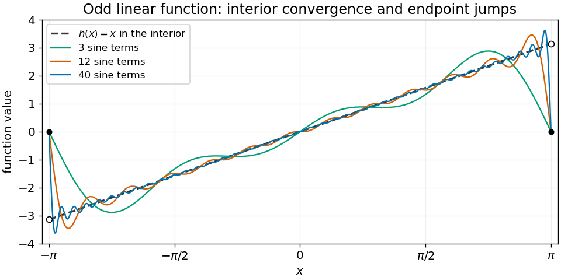

<h1 id="10/solution">Solution</h1>

↑ **Parent:** [10](../10.md)

Taking the [inner product](../../../inner-product-split.md) with $f_m$ and using [Fourier orthogonality](../../../fourier-orthogonality.md) isolates $a_m$. Since $x\sin(mx)$ is [even](../../../even-function.md), [integration by parts](../../../integration-by-parts.md) gives

$$
\pi a_m=2\int_0^\pi x\sin(mx)\,dx=-\frac{2\pi(-1)^m}{m}.
$$

Consequently the [Fourier sine series](../../../fourier-sine-series.md) is

$$
\boxed{x=2\sum_{n=1}^\infty\frac{(-1)^{n+1}}n\sin(nx),\qquad-\pi<x<\pi.}
$$

The [series](../../../series-mathematics.md) converges to $x$ at each interior point and in the [L2 norm](../../../l2-norm.md). Its periodic extension has jumps at $\pm\pi$, where the [Fourier series](../../../fourier-series-split.md) instead converges to the midpoint value zero. The overshoot near those jumps is the [Gibbs phenomenon](../../../gibbs-phenomenon.md).

**[Figure 1](#10/image-fourier-sine-partial-sums-recover-the-odd-linear-function-inside-the-interval-with-endpoint-jump-overshoot). Fourier sine partial sums recover the odd linear function inside the interval, with endpoint jump overshoot**.

## ↑ Ancestors (11)

1. [10](../10.md)
2. [2014 resit](../../2014-resit-split.md)
3. [Past exam of the mathematical methods I course of the University of Oxford](../../split.md)
4. [Mathematical methods I course of the University of Oxford](../../../mathematical-methods-i-course-of-the-university-of-oxford.md)
5. [Year 1 of the physics course of the University of Oxford](../../../year-1-of-the-physics-course-of-the-university-of-oxford.md)
6. [Physics course of the University of Oxford](../../../physics-course-of-the-university-of-oxford.md)
7. [Undergraduate course of the University of Oxford](../../../undergraduate-course-of-the-university-of-oxford.md)
8. [Course of the University of Oxford](../../../course-of-the-university-of-oxford.md)
9. [University of Oxford](../../../university-of-oxford-split.md)
10. [List of universities](../../../list-of-universities.md)
11. [Codex Wiki](../../../split.md)
