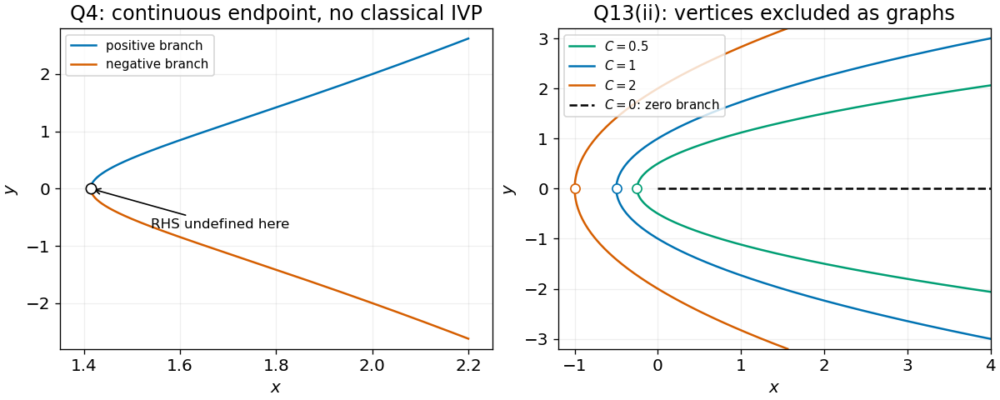

<h1 id="13/ii/solution">Solution</h1>

↑ **Parent:** [Ii](../ii.md)

Set $r=\sqrt{x^2+y^2}$. Wherever $r>0$, the [chain rule](../../../../chain-rule.md) and the given [implicit differential equation](../../../../implicit-differential-equation.md) give

$$
\frac{dr}{dx}=\frac{x+yy'}r=\frac{x-x+r}r=1.
$$

Thus $r=x+C$ and $C=r-x\ge0$. Squaring without losing the square-root sign restriction gives

$$
\boxed{y^2=2Cx+C^2,\quad C>0,\quad x>-C/2,}
$$

with either sign of $y$ on its [interval](../../../../interval-mathematics.md) of definition. These [parabolas](../../../../parabola.md) satisfy $x+C>0$. Their vertex $(-C/2,0)$ is a regular point as a parametrized curve but cannot belong to a differentiable graph $y(x)$ satisfying the equation: there $yy'=0$ while $-x+r=C>0$. The degenerate case $C=0$ gives the separate solution $\boxed{y=0\text{ for }x\ge0}$ in the differential-form interpretation printed in the paper. It would be lost by dividing the equation by $y$.

**[Figure 2](#13/ii/image-singular-initial-point-branches-and-the-parabolic-integral-curves-with-their-graph-domain-restrictions). Singular initial-point branches and the parabolic integral curves, with their graph-domain restrictions**.

## ↑ Ancestors (12)

1. [Ii](../ii.md)
2. [13](../../13.md)
3. [2014 resit](../../../2014-resit-split.md)
4. [Past exam of the mathematical methods I course of the University of Oxford](../../../split.md)
5. [Mathematical methods I course of the University of Oxford](../../../../mathematical-methods-i-course-of-the-university-of-oxford.md)
6. [Year 1 of the physics course of the University of Oxford](../../../../year-1-of-the-physics-course-of-the-university-of-oxford.md)
7. [Physics course of the University of Oxford](../../../../physics-course-of-the-university-of-oxford.md)
8. [Undergraduate course of the University of Oxford](../../../../undergraduate-course-of-the-university-of-oxford.md)
9. [Course of the University of Oxford](../../../../course-of-the-university-of-oxford.md)
10. [University of Oxford](../../../../university-of-oxford-split.md)
11. [List of universities](../../../../list-of-universities.md)
12. [Codex Wiki](../../../../split.md)
