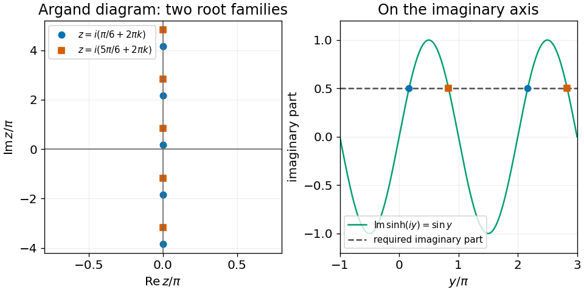
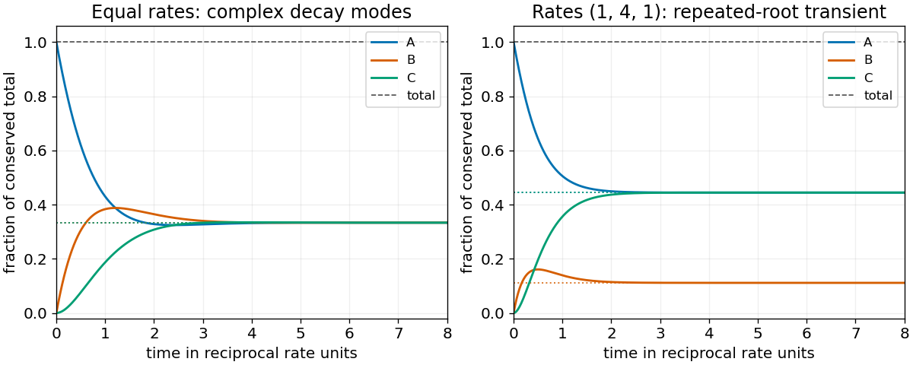

# 2014

↑ **Parent:** [Past exam of the mathematical methods I course of the University of Oxford](../past-exam-of-the-mathematical-methods-i-course-of-the-university-of-oxford.md)

Source paper: [https://www.whatdotheyknow.com/request/physics_preliminary_examinations/response/1162943/attach/3/Twain.7z?cookie_passthrough=1](https://www.whatdotheyknow.com/request/physics_preliminary_examinations/response/1162943/attach/3/Twain.7z?cookie_passthrough=1)

**Table of contents**

- [1](#1)
  - [Solution](#1/solution)
- [2](#2)
  - [Solution](#2/solution)
- [3](#3)
  - [Solution](#3/solution)
- [4](#4)
  - [Solution](#4/solution)
- [5](#5)
  - [Solution](#5/solution)
- [6](#6)
  - [Solution](#6/solution)
- [7](#7)
  - [i](#7/i)
    - [Solution](#7/i/solution)
  - [ii](#7/ii)
    - [Solution](#7/ii/solution)
  - [iii](#7/iii)
    - [Solution](#7/iii/solution)
  - [iv](#7/iv)
    - [Solution](#7/iv/solution)
- [8](#8)
  - [Solution](#8/solution)
- [9](#9)
  - [a](#9/a)
    - [Solution](#9/a/solution)
  - [b](#9/b)
    - [Solution](#9/b/solution)
  - [c](#9/c)
    - [Solution](#9/c/solution)
  - [Solution](#9/solution)
- [10](#10)
  - [a](#10/a)
    - [i](#10/a/i)
      - [Solution](#10/a/i/solution)
    - [ii](#10/a/ii)
      - [Solution](#10/a/ii/solution)
    - [iii](#10/a/iii)
      - [Solution](#10/a/iii/solution)
  - [b](#10/b)
    - [i](#10/b/i)
      - [Solution](#10/b/i/solution)
    - [ii](#10/b/ii)
      - [Solution](#10/b/ii/solution)
    - [iii](#10/b/iii)
      - [Solution](#10/b/iii/solution)
- [11](#11)
  - [i](#11/i)
    - [Solution](#11/i/solution)
  - [ii](#11/ii)
    - [Solution](#11/ii/solution)
  - [iii](#11/iii)
    - [Solution](#11/iii/solution)
  - [iv](#11/iv)
    - [Solution](#11/iv/solution)
  - [v](#11/v)
    - [Solution](#11/v/solution)
- [12](#12)
  - [i](#12/i)
    - [Solution](#12/i/solution)
  - [ii](#12/ii)
    - [Solution](#12/ii/solution)
  - [iii](#12/iii)
    - [Solution](#12/iii/solution)
  - [iv](#12/iv)
    - [Solution](#12/iv/solution)
  - [v](#12/v)
    - [Solution](#12/v/solution)
  - [vi](#12/vi)
    - [Solution](#12/vi/solution)

## 1

↑ **Parent:** [2014](2014.md)

<h3 id="1/solution">Solution</h3>

↑ **Parent:** [1](#1)

Multiply numerator and denominator by the denominator's [complex conjugate](../complex-analysis.md#complex-conjugate):

$$
\frac{3+2i}{5-4i}=\frac{(3+2i)(5+4i)}{25+16}=\frac{7+22i}{41}.
$$

Thus the [real part](../complex-analysis.md#real-part) is $\boxed{7/41}$ and the [imaginary part](../complex-analysis.md#imaginary-part) is $\boxed{22/41}$.

## 2

↑ **Parent:** [2014](2014.md)

<h3 id="2/solution">Solution</h3>

↑ **Parent:** [2](#2)

The [determinant](../multilinear-algebra.md#determinant) is $a^2-i(-i)=a^2-1$. The [adjugate matrix](../linear-algebra.md#adjugate-matrix) formula gives

$$
\boxed{A^{-1}=\frac1{a^2-1}\begin{pmatrix}a&-i\\i&a\end{pmatrix},\qquad a\ne\pm1.}
$$

When $a=1$ or $a=-1$ we have a [singular matrix](../linear-algebra.md#singular-matrix), so no [inverse matrix](../matrix-inverse.md) exists. This criterion holds for real or complex $a$.

## 3

↑ **Parent:** [2014](2014.md)

<h3 id="3/solution">Solution</h3>

↑ **Parent:** [3](#3)

Write $z=x+iy$ with real $x,y$. The complex [hyperbolic sine](../calculus.md#hyperbolic-sine) is $\sinh z=\sinh x\cos y+i\cosh x\sin y$. Its zero [real part](../complex-analysis.md#real-part) requires $\sinh x\cos y=0$. If $\cos y=0$, the magnitude of the [imaginary part](../complex-analysis.md#imaginary-part) would be $\cosh x\ge1$, which cannot equal $1/2$. Therefore $x=0$ and $\sin y=1/2$. All solutions are

$$
\boxed{z=i\left(\frac\pi6+2\pi k\right)\quad\text{or}\quad z=i\left(\frac{5\pi}6+2\pi k\right),\qquad k\in\mathbb Z.}
$$

On the [Argand diagram](../complex-analysis.md#complex-plane) these are two interlaced arithmetic sequences on the imaginary axis; both repeat with imaginary period $2\pi i$.

**[Figure 1](#3/image-all-roots-lie-on-the-imaginary-axis-in-two-families-repeating-every-2-pi-i). All roots lie on the imaginary axis in two families repeating every $2\pi i$**.

## 4

↑ **Parent:** [2014](2014.md)

<h3 id="4/solution">Solution</h3>

↑ **Parent:** [4](#4)

The elementary [row operation](../numerical-linear-algebra.md#elementary-row-operation) $R_2\leftarrow R_2+3R_1$ gives

$$
\begin{pmatrix}1&4&2\\0&a+12&0\\0&0&b\end{pmatrix}.
$$

The nonzero rows here have distinct [pivots](../probability-and-statistics.md#pivotal-quantity). Therefore the [matrix rank](../vector-space.md#matrix-rank) is

$$
\boxed{\operatorname{rank}A=\begin{cases}
3,&a\ne-12,\ b\ne0,\\
2,&\text{exactly one of }a=-12,\ b=0\text{ holds},\\
1,&a=-12,\ b=0.
\end{cases}}
$$

There is always at least one nonzero row, so rank zero is impossible.

## 5

↑ **Parent:** [2014](2014.md)

<h3 id="5/solution">Solution</h3>

↑ **Parent:** [5](#5)

Rearrange as $x''-4x'+3x=10t$. The [characteristic polynomial](../linear-operator-theory.md#characteristic-polynomial) factors as $(r-1)(r-3)$, giving the [homogeneous solutions](../linear-ordinary-differential-equation.md#homogeneous-solution) $e^t,e^{3t}$. A particular [polynomial](../polynomial.md) solution $At+B$ obeys $3A=10$ and $3B-4A=0$. Hence

$$
\boxed{x(t)=C_1e^t+C_2e^{3t}+\frac{10}{3}t+\frac{40}{9}.}
$$

This is the full two-constant solution of the [second-order linear differential equation](../linear-ordinary-differential-equation.md#second-order-linear-differential-equation).

## 6

↑ **Parent:** [2014](2014.md)

<h3 id="6/solution">Solution</h3>

↑ **Parent:** [6](#6)

Let $\omega=e^{i\pi/7}$, a primitive fourteenth [root of unity](../algebra.md#root-of-unity). The [geometric series](../sequence-and-series.md#geometric-series) gives $\sum_{k=1}^{14}\omega^k=0$. Taking the [real part](../complex-analysis.md#real-part) and adding the remaining fifteenth term therefore yields

$$
\boxed{S=\cos\frac{15\pi}{7}=\cos\frac\pi7.}
$$

The upper summation limit matters: the first fourteen terms complete one full cycle, and the fifteenth supplies one additional term.

## 7

↑ **Parent:** [2014](2014.md)

<h3 id="7/i">i</h3>

↑ **Parent:** [7](#7)

<h4 id="7/i/solution">Solution</h4>

↑ **Parent:** [I](#7/i)

The finite-dimensional [spectral theorem](../hilbert-space.md#spectral-theorem) diagonalizes the [Hermitian matrix](../hilbert-space.md#hermitian-operator) in its [orthonormal eigenbasis](../linear-operator-theory.md#orthonormal-eigenbasis). The [determinant](../multilinear-algebra.md#determinant) is the product of the [eigenvalues](../linear-operator-theory.md#eigenvalue):

$$
\boxed{\det H=\lambda_1\lambda_2.}
$$

<h3 id="7/ii">ii</h3>

↑ **Parent:** [7](#7)

<h4 id="7/ii/solution">Solution</h4>

↑ **Parent:** [Ii](#7/ii)

The [trace](../linear-algebra.md#matrix-trace) is unchanged by [similarity](../linear-algebra.md#matrix-similarity), so in the same [eigenbasis](../linear-operator-theory.md#eigenbasis)

$$
\boxed{\operatorname{tr}H=\lambda_1+\lambda_2.}
$$

<h3 id="7/iii">iii</h3>

↑ **Parent:** [7](#7)

<h4 id="7/iii/solution">Solution</h4>

↑ **Parent:** [Iii](#7/iii)

Every [eigenvalue](../linear-operator-theory.md#eigenvalue) of a [Hermitian matrix](../hilbert-space.md#hermitian-operator) is real: if $He=\lambda e$ with $e^\dagger e=1$, then $\lambda=e^\dagger He=\overline{e^\dagger He}$. Therefore

$$
\boxed{\operatorname{Im}(\lambda_1\lambda_2)=0.}
$$

<h3 id="7/iv">iv</h3>

↑ **Parent:** [7](#7)

<h4 id="7/iv/solution">Solution</h4>

↑ **Parent:** [Iv](#7/iv)

Distinct [eigenvalues](../linear-operator-theory.md#eigenvalue) of a [Hermitian matrix](../hilbert-space.md#hermitian-operator) have [orthogonal](../inner-product.md#orthogonal-vectors) [eigenvectors](../linear-operator-theory.md#eigenvector), since $\lambda_2e_1^\dagger e_2=e_1^\dagger He_2=\lambda_1e_1^\dagger e_2$. The given normalization then gives

$$
\boxed{e_1^\dagger(e_1+e_2)=1+0=1.}
$$

## 8

↑ **Parent:** [2014](2014.md)

<h3 id="8/solution">Solution</h3>

↑ **Parent:** [8](#8)

Here $M^2=-I$, so its even powers alternate between $\pm I$ and its odd powers between $\pm M$. Collecting even and odd terms of the [matrix exponential](../linear-operator-theory.md#matrix-exponential) yields

$$
R(\phi)=I\cos\phi+M\sin\phi
=\boxed{\begin{pmatrix}\cos\phi&-\sin\phi\\\sin\phi&\cos\phi\end{pmatrix}.}
$$

Thus $R^TR=I$, $\det R=1$, and $R(\phi)(1,0)^T=(\cos\phi,\sin\phi)^T$. It is the [rotation matrix](../linear-algebra.md#rotation-matrix) for a counterclockwise [rotation](../riemannian-geometry.md#rotation-mathematics) through angle $\phi$, preserving [lengths](../physics.md#length) and [orientation](../algebraic-topology.md#orientation-of-a-simplex).

## 9

↑ **Parent:** [2014](2014.md)

<h3 id="9/a">a</h3>

↑ **Parent:** [9](#9)

<h4 id="9/a/solution">Solution</h4>

↑ **Parent:** [A](#9/a)

The [substitution](../algebra.md#substitution-algebra) $u=x+y$ turns the equation into $u'=1+u^2$. Separating and integrating gives $\arctan u=x+C$, hence

$$
\boxed{y=\tan(x+C)-x.}
$$

Each real solution is defined on an [interval](../real-analysis.md#interval-mathematics) containing no pole of the [tangent](../geometry-and-topology.md#tangent). There is no real constant-$u$ solution discarded by division, since $1+u^2>0$.

<h3 id="9/b">b</h3>

↑ **Parent:** [9](#9)

<h4 id="9/b/solution">Solution</h4>

↑ **Parent:** [B](#9/b)

The [first-order linear differential equation](../linear-ordinary-differential-equation.md#first-order-linear-differential-equation) has [integrating factor](../linear-ordinary-differential-equation.md#integrating-factor) $e^{\sin x}$. Multiplying through gives

$$
(ye^{\sin x})'=2\sin x\cos x\,e^{\sin x}.
$$

With $u=\sin x$, the right side integrates to $2e^u(u-1)$. Consequently

$$
\boxed{y=2\sin x-2+Ce^{-\sin x}.}
$$

All coefficients are smooth, so these real solutions extend over the whole real axis.

<h3 id="9/c">c</h3>

↑ **Parent:** [9](#9)

<h4 id="9/c/solution">Solution</h4>

↑ **Parent:** [C](#9/c)

Put $v=y^2$, so $v'=2yy'$. On an [interval](../real-analysis.md#interval-mathematics) with $x\ne0$, the resulting [first-order linear differential equation](../linear-ordinary-differential-equation.md#first-order-linear-differential-equation) is $v'-4v/x=2x$. Its [integrating factor](../linear-ordinary-differential-equation.md#integrating-factor) $x^{-4}$ gives $(v/x^4)'=2/x^3$, hence

$$
\boxed{y^2=Cx^4-x^2,\qquad y=\pm\sqrt{Cx^4-x^2}.}
$$

For real differentiable graphs one needs $C>0$ and $|x|>1/\sqrt C$, with either fixed sign on a connected [interval](../real-analysis.md#interval-mathematics). The points $x=0$ are outside the original equation's domain. At $|x|=1/\sqrt C$, $y=0$ would make the left side zero while the right side is $x\ne0$, so those endpoints are also excluded. The identically zero function is not an additional solution.

<h3 id="9/solution">Solution</h3>

↑ **Parent:** [9](#9)

**One scalar initial condition is needed in each case**, because each equation is first order and each regular solution has one integration constant. The usual [Picard-Lindelöf theorem](../differential-equation.md#picard-lindelof-theorem) applies locally at a regular initial point. For part (c), this requires $x_0\ne0$ and $y_0\ne0$; a condition at an excluded singular endpoint cannot specify a classical solution there. Arbitrary distant boundary data also need not be compatible with one common [interval](../real-analysis.md#interval-mathematics) of existence.

## 10

↑ **Parent:** [2014](2014.md)

<h3 id="10/a">a</h3>

↑ **Parent:** [10](#10)

<h4 id="10/a/i">i</h4>

↑ **Parent:** [A](#10/a)

<h5 id="10/a/i/solution">Solution</h5>

↑ **Parent:** [I](#10/a/i)

A direction of the intersection [line](../euclidean-geometry.md#straight-line) must be [orthogonal](../inner-product.md#orthogonal-vectors) to both [normal vectors](../differential-geometry.md#normal-vector). Their [cross product](../vector-space.md#cross-product) is

$$
(2,6,-3)\times(5,2,-1)=(0,-13,-26).
$$

Thus a convenient parallel [vector](../vector-space.md#vector) is $\boxed{u=(0,1,2)}$.

<h4 id="10/a/ii">ii</h4>

↑ **Parent:** [A](#10/a)

<h5 id="10/a/ii/solution">Solution</h5>

↑ **Parent:** [Ii](#10/a/ii)

Eliminating $2y-z$ from the two [plane](../geometry-and-topology.md#plane) equations gives $x=2$, followed by $2y-z=2$. Taking $y=1$ gives the point $\boxed{p=(2,1,0)}$. The entire intersection [line](../euclidean-geometry.md#straight-line) is $\mathbf r=p+tu$, where $u=(0,1,2)$.

<h4 id="10/a/iii">iii</h4>

↑ **Parent:** [A](#10/a)

<h5 id="10/a/iii/solution">Solution</h5>

↑ **Parent:** [Iii](#10/a/iii)

The [orthogonal projection](../hilbert-space.md#orthogonal-projection) of the origin onto the [line](../euclidean-geometry.md#straight-line) occurs at $t_*=-p\cdot u/|u|^2=-1/5$, giving closest point $(2,4/5,-2/5)$. Hence the [distance from a point to a line in three dimensions](../topological-analysis.md#distance-from-a-point-to-a-line-in-three-dimensions) is

$$
\boxed{d=\sqrt{4+\frac{16+4}{25}}=\sqrt{\frac{24}{5}}=\frac{2\sqrt{30}}5.}
$$

<h3 id="10/b">b</h3>

↑ **Parent:** [10](#10)

<h4 id="10/b/i">i</h4>

↑ **Parent:** [B](#10/b)

<h5 id="10/b/i/solution">Solution</h5>

↑ **Parent:** [I](#10/b/i)

For $r=0$, the [norm](../normed-vector-space.md#norm) equation requires $x=c$. Thus the [locus](../euclidean-geometry.md#locus-mathematics) is

$$
\boxed{\{c\}\text{ if }a\cdot(c-b)=0;\qquad\varnothing\text{ otherwise}.}
$$

This includes $a=0$, when the first condition imposes no restriction.

<h4 id="10/b/ii">ii</h4>

↑ **Parent:** [B](#10/b)

<h5 id="10/b/ii/solution">Solution</h5>

↑ **Parent:** [Ii](#10/b/ii)

First assume $a\ne0$. The first equation is a [plane](../geometry-and-topology.md#plane), and the second is a [sphere](../euclidean-geometry.md#sphere) centred at $c$. Define its signed normal separation and projected centre by

$$
h=\frac{a\cdot(c-b)}{|a|},\qquad q=c-\frac{a\cdot(c-b)}{|a|^2}a.
$$

The [intersection of a plane and a sphere](../euclidean-geometry.md#intersection-of-a-plane-and-a-sphere) is

$$
\boxed{\begin{cases}
\text{a circle with centre }q\text{ and radius }\sqrt{r^2-h^2},&|h|<r,\\
\{q\},&|h|=r,\\
\varnothing,&|h|>r.
\end{cases}}
$$

The [circle](../topology.md#circle) lies in the given [plane](../geometry-and-topology.md#plane). Its radius follows from the [Pythagorean theorem](../euclidean-geometry.md#pythagorean-theorem), splitting $x-c=(x-q)+(q-c)$ into [orthogonal](../inner-product.md#orthogonal-vectors) components. If $a=0$, the first equation is the identity $0=0$, so the locus is the **entire sphere**, rather than a planar section.

<h4 id="10/b/iii">iii</h4>

↑ **Parent:** [B](#10/b)

<h5 id="10/b/iii/solution">Solution</h5>

↑ **Parent:** [Iii](#10/b/iii)

A [norm](../normed-vector-space.md#norm) is nonnegative, so it cannot equal a negative $r$. The [locus](../euclidean-geometry.md#locus-mathematics) is therefore $\boxed{\varnothing}$, irrespective of $a,b,c$.

## 11

↑ **Parent:** [2014](2014.md)

<h3 id="11/i">i</h3>

↑ **Parent:** [11](#11)

<h4 id="11/i/solution">Solution</h4>

↑ **Parent:** [I](#11/i)

Reading the coefficients in the ordered concentration [vector](../vector-space.md#vector) gives the [linear system of ordinary differential equations](../linear-ordinary-differential-equation.md#linear-system-of-differential-equations)

$$
\boxed{\dot x=Mx,\qquad M=\begin{pmatrix}-\epsilon&0&\delta\\\epsilon&-\eta&0\\0&\eta&-\delta\end{pmatrix}.}
$$

Its columns sum to zero, so $d(A+B+C)/dt=0$. This [three-state cyclic conversion model](../linear-ordinary-differential-equation.md#three-state-cyclic-conversion-model) conserves total concentration.

<h3 id="11/ii">ii</h3>

↑ **Parent:** [11](#11)

<h4 id="11/ii/solution">Solution</h4>

↑ **Parent:** [Ii](#11/ii)

Put $p=\epsilon+\delta+\eta$ and $q=\epsilon\delta+\delta\eta+\eta\epsilon$. Direct expansion gives the [characteristic polynomial](../linear-operator-theory.md#characteristic-polynomial)

$$
\det(\lambda I-M)=(\lambda+\epsilon)(\lambda+\eta)(\lambda+\delta)-\epsilon\eta\delta
=\lambda(\lambda^2+p\lambda+q).
$$

The quadratic formula therefore gives

$$
\boxed{K=-\frac{\epsilon+\delta+\eta}{2},\qquad W=\epsilon\delta+\delta\eta+\eta\epsilon,\qquad\lambda_\pm=K\pm\sqrt{K^2-W}.}
$$

Since $p,q>0$, both nonzero [eigenvalues](../linear-operator-theory.md#eigenvalue) have negative [real part](../complex-analysis.md#real-part). They need not be real; equal rates give a complex-conjugate pair.

<h3 id="11/iii">iii</h3>

↑ **Parent:** [11](#11)

<h4 id="11/iii/solution">Solution</h4>

↑ **Parent:** [Iii](#11/iii)

The remaining [eigenvalue](../linear-operator-theory.md#eigenvalue) is $\boxed{\lambda_3=0}$. At a [steady state](../dynamical-systems.md#steady-state), the three cyclic fluxes agree: $\epsilon A=\eta B=\delta C$. A corresponding nonzero [eigenvector](../linear-operator-theory.md#eigenvector) is therefore

$$
\boxed{v_0=\begin{pmatrix}1/\epsilon\\1/\eta\\1/\delta\end{pmatrix},}
$$

or its scalar multiple $(\delta\eta,\epsilon\delta,\epsilon\eta)^T$. Its positive components express a possible equilibrium concentration ratio.

<h3 id="11/iv">iv</h3>

↑ **Parent:** [11](#11)

<h4 id="11/iv/solution">Solution</h4>

↑ **Parent:** [Iv](#11/iv)

If $K^2\ne W$, the three [eigenvalues](../linear-operator-theory.md#eigenvalue) are distinct, so a basis of [eigenvectors](../linear-operator-theory.md#eigenvector) gives

$$
\boxed{M'=\operatorname{diag}(-\rho_1,-\rho_2,0),\qquad
\rho_1=-K-\sqrt{K^2-W},\quad\rho_2=-K+\sqrt{K^2-W}.}
$$

The transformed coordinates then have the displayed exponential form. If $K^2<W$, this is a complex [eigenbasis](../linear-operator-theory.md#eigenbasis); real concentrations are recovered by conjugate-paired coefficients. A real basis instead gives a decaying two-dimensional rotation block with decay rate $-K$ and angular frequency $\sqrt{W-K^2}$.

The proposed [diagonalization](../linear-operator-theory.md#diagonalization-of-a-matrix) is **not valid for every positive choice of rates**. For example $\epsilon=\delta=1$, $\eta=4$ gives $K=-3$, $W=9$, with repeated [eigenvalue](../linear-operator-theory.md#eigenvalue) $-3$ and only one corresponding [eigenvector](../linear-operator-theory.md#eigenvector). More generally the [defective repeated eigenvalue in a cyclic conversion model](../linear-ordinary-differential-equation.md#defective-repeated-eigenvalue-in-a-cyclic-conversion-model) occurs when $K^2=W$. A [Jordan basis](../linear-operator-theory.md#jordan-basis) then gives

$$
M'=\begin{pmatrix}K&1&0\\0&K&0\\0&0&0\end{pmatrix},\qquad
x'(t)=\begin{pmatrix}(c_1+c_2t)e^{Kt}\\c_2e^{Kt}\\c_3\end{pmatrix}.
$$

The extra factor $t$ cannot be represented by two independent pure exponential coordinates in a diagonal basis.

<h3 id="11/v">v</h3>

↑ **Parent:** [11](#11)

<h4 id="11/v/solution">Solution</h4>

↑ **Parent:** [V](#11/v)

All nonzero [eigenmodes](../wave-equation.md#normal-mode) decay, including the $te^{Kt}$ term in the repeated-root case. Total concentration is conserved and initially equals $n$. Combining $A_\infty+B_\infty+C_\infty=n$ with the equal-flux ratios gives

$$
\boxed{A_\infty=\frac{n\delta\eta}{q},\qquad B_\infty=\frac{n\epsilon\delta}{q},\qquad C_\infty=\frac{n\epsilon\eta}{q},\qquad
q=\epsilon\delta+\delta\eta+\eta\epsilon.}
$$

These are the unique [steady state](../dynamical-systems.md#steady-state) concentrations with this total. The formula remains valid when the transient [eigenvalues](../linear-operator-theory.md#eigenvalue) are complex or repeated.

**[Figure 2](#11/v/image-three-state-conversion-conserves-total-concentration-equal-rates-give-damped-oscillations-and-repeated-roots-give-a-jordan-transient). Three-state conversion conserves total concentration; equal rates give damped oscillations and repeated roots give a Jordan transient**.

## 12

↑ **Parent:** [2014](2014.md)

<h3 id="12/i">i</h3>

↑ **Parent:** [12](#12)

<h4 id="12/i/solution">Solution</h4>

↑ **Parent:** [I](#12/i)

A real [symmetric matrix](../linear-algebra.md#symmetric-matrix) has $n$ freely chosen diagonal entries and $n(n-1)/2$ freely chosen entries above the diagonal. The entries below are then fixed by symmetry. Consequently

$$
\boxed{\dim\mathcal S=\frac{n(n+1)}2.}
$$

<h3 id="12/ii">ii</h3>

↑ **Parent:** [12](#12)

<h4 id="12/ii/solution">Solution</h4>

↑ **Parent:** [Ii](#12/ii)

An explicit [basis](../vector-space.md#basis) is

$$
\boxed{E_1=\begin{pmatrix}1&0\\0&0\end{pmatrix},\qquad
E_2=\begin{pmatrix}0&0\\0&1\end{pmatrix},\qquad
E_3=\begin{pmatrix}0&1\\1&0\end{pmatrix}.}
$$

Indeed every real [symmetric matrix](../linear-algebra.md#symmetric-matrix) $\begin{pmatrix}a&b\\b&c\end{pmatrix}$ has the unique [linear combination](../vector-space.md#linear-combination) $aE_1+cE_2+bE_3$.

<h3 id="12/iii">iii</h3>

↑ **Parent:** [12](#12)

<h4 id="12/iii/solution">Solution</h4>

↑ **Parent:** [Iii](#12/iii)

The [cyclic property of the trace](../linear-algebra.md#cyclic-property-of-the-trace) gives $\operatorname{tr}(AB)=\operatorname{tr}(BA)$, which is C1. The [linearity](../vector-space.md#linearity) of [trace](../linear-algebra.md#matrix-trace) and [matrix multiplication](../vector-space.md#matrix-multiplication) gives C2 and C3. Finally symmetry of $A$ gives

$$
\langle A,A\rangle=\operatorname{tr}(A^2)=\sum_{i,j}A_{ij}A_{ji}=\sum_{i,j}A_{ij}^2\ge0,
$$

with equality exactly when every entry is zero. Thus C4 also holds. This is the [Frobenius inner product](../inner-product.md#frobenius-inner-product) restricted to the real [vector space](../vector-space.md) of [symmetric matrices](../linear-algebra.md#symmetric-matrix).

<h3 id="12/iv">iv</h3>

↑ **Parent:** [12](#12)

<h4 id="12/iv/solution">Solution</h4>

↑ **Parent:** [Iv](#12/iv)

Apply the [cyclic property of the trace](../linear-algebra.md#cyclic-property-of-the-trace) and $BB^{-1}=I$:

$$
\boxed{\operatorname{tr}(B^{-1}AB)=\operatorname{tr}(ABB^{-1})=\operatorname{tr}A.}
$$

This proves [similarity invariance of trace](../linear-algebra.md#similarity-invariance-of-trace) without requiring $A$ or $B$ to be symmetric.

<h3 id="12/v">v</h3>

↑ **Parent:** [12](#12)

<h4 id="12/v/solution">Solution</h4>

↑ **Parent:** [V](#12/v)

Taking the [trace](../linear-algebra.md#matrix-trace) of the proposed [commutator](../lie-algebra.md#commutator) identity would give

$$
0=\operatorname{tr}(AB)-\operatorname{tr}(BA)=\operatorname{tr}I=n,
$$

a contradiction for positive integer $n$ over the real numbers. **No such finite real matrices exist.** This is the [trace of a commutator](../linear-algebra.md#trace-of-a-commutator) obstruction; it also applies to complex finite matrices.

<h3 id="12/vi">vi</h3>

↑ **Parent:** [12](#12)

<h4 id="12/vi/solution">Solution</h4>

↑ **Parent:** [Vi](#12/vi)

Multiplicativity of the [determinant](../multilinear-algebra.md#determinant) gives $\langle A,B\rangle=\det A\det B$. Thus **C1 holds**. For $n\ge2$, **C2 fails**: choosing $A=B=I$ and $\lambda=2$ gives $\det(2I)=2^n\ne2$. The same choice $A=B=C=I$ disproves **C3**, since $\det(B+C)=2^n\ne2$. The nonnegativity portion of **C4 holds**, because $\det(A^2)=(\det A)^2\ge0$, but its positive-definiteness clause fails: a nonzero [singular matrix](../linear-algebra.md#singular-matrix) that is [symmetric](../set-theory.md#symmetric-relation), such as $\operatorname{diag}(1,0,\ldots,0)$, has zero self-pairing.

Therefore **this is not an inner product for $n\ge2$**. For the exceptional case $n=1$, the [determinant](../multilinear-algebra.md#determinant) is the scalar entry and the pairing is ordinary multiplication of real numbers, so all four conditions hold. The [determinant pairing is not an inner product](../inner-product.md#determinant-pairing-is-not-an-inner-product) in higher dimension because it measures volume scaling rather than a bilinear length geometry.

## ↑ Ancestors (9)

1. [Past exam of the mathematical methods I course of the University of Oxford](../past-exam-of-the-mathematical-methods-i-course-of-the-university-of-oxford.md)
2. [Mathematical methods I course of the University of Oxford](../university-of-oxford.md#mathematical-methods-i-course-of-the-university-of-oxford)
3. [Year 1 of the physics course of the University of Oxford](../university-of-oxford.md#year-1-of-the-physics-course-of-the-university-of-oxford)
4. [Physics course of the University of Oxford](../university-of-oxford.md#physics-course-of-the-university-of-oxford)
5. [Undergraduate course of the University of Oxford](../university-of-oxford.md#undergraduate-course-of-the-university-of-oxford)
6. [Course of the University of Oxford](../university-of-oxford.md#course-of-the-university-of-oxford)
7. [University of Oxford](../university-of-oxford.md)
8. [List of universities](../README.md#list-of-universities)
9. [Codex Wiki](../README.md)
