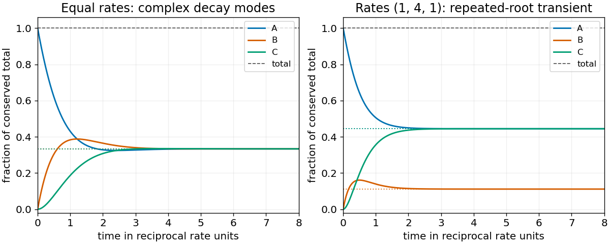

<h1 id="11/v/solution">Solution</h1>

↑ **Parent:** [V](../v.md)

All nonzero [eigenmodes](../../../../normal-mode.md) decay, including the $te^{Kt}$ term in the repeated-root case. Total concentration is conserved and initially equals $n$. Combining $A_\infty+B_\infty+C_\infty=n$ with the equal-flux ratios gives

$$
\boxed{A_\infty=\frac{n\delta\eta}{q},\qquad B_\infty=\frac{n\epsilon\delta}{q},\qquad C_\infty=\frac{n\epsilon\eta}{q},\qquad
q=\epsilon\delta+\delta\eta+\eta\epsilon.}
$$

These are the unique [steady state](../../../../steady-state.md) concentrations with this total. The formula remains valid when the transient [eigenvalues](../../../../eigenvalue.md) are complex or repeated.

**[Figure 2](#11/v/image-three-state-conversion-conserves-total-concentration-equal-rates-give-damped-oscillations-and-repeated-roots-give-a-jordan-transient). Three-state conversion conserves total concentration; equal rates give damped oscillations and repeated roots give a Jordan transient**.

## ↑ Ancestors (12)

1. [V](../v.md)
2. [11](../../11.md)
3. [2014](../../../2014-split.md)
4. [Past exam of the mathematical methods I course of the University of Oxford](../../../split.md)
5. [Mathematical methods I course of the University of Oxford](../../../../mathematical-methods-i-course-of-the-university-of-oxford.md)
6. [Year 1 of the physics course of the University of Oxford](../../../../year-1-of-the-physics-course-of-the-university-of-oxford.md)
7. [Physics course of the University of Oxford](../../../../physics-course-of-the-university-of-oxford.md)
8. [Undergraduate course of the University of Oxford](../../../../undergraduate-course-of-the-university-of-oxford.md)
9. [Course of the University of Oxford](../../../../course-of-the-university-of-oxford.md)
10. [University of Oxford](../../../../university-of-oxford-split.md)
11. [List of universities](../../../../list-of-universities.md)
12. [Codex Wiki](../../../../split.md)
