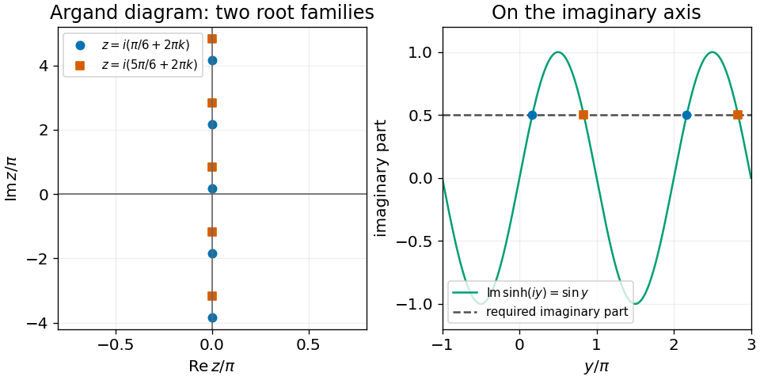

<h1 id="3/solution">Solution</h1>

↑ **Parent:** [3](../3.md)

Write $z=x+iy$ with real $x,y$. The complex [hyperbolic sine](../../../hyperbolic-sine.md) is $\sinh z=\sinh x\cos y+i\cosh x\sin y$. Its zero [real part](../../../real-part.md) requires $\sinh x\cos y=0$. If $\cos y=0$, the magnitude of the [imaginary part](../../../imaginary-part.md) would be $\cosh x\ge1$, which cannot equal $1/2$. Therefore $x=0$ and $\sin y=1/2$. All solutions are

$$
\boxed{z=i\left(\frac\pi6+2\pi k\right)\quad\text{or}\quad z=i\left(\frac{5\pi}6+2\pi k\right),\qquad k\in\mathbb Z.}
$$

On the [Argand diagram](../../../complex-plane.md) these are two interlaced arithmetic sequences on the imaginary axis; both repeat with imaginary period $2\pi i$.

**[Figure 1](#3/image-all-roots-lie-on-the-imaginary-axis-in-two-families-repeating-every-2-pi-i). All roots lie on the imaginary axis in two families repeating every $2\pi i$**.

## ↑ Ancestors (11)

1. [3](../3.md)
2. [2014](../../2014-split.md)
3. [Past exam of the mathematical methods I course of the University of Oxford](../../split.md)
4. [Mathematical methods I course of the University of Oxford](../../../mathematical-methods-i-course-of-the-university-of-oxford.md)
5. [Year 1 of the physics course of the University of Oxford](../../../year-1-of-the-physics-course-of-the-university-of-oxford.md)
6. [Physics course of the University of Oxford](../../../physics-course-of-the-university-of-oxford.md)
7. [Undergraduate course of the University of Oxford](../../../undergraduate-course-of-the-university-of-oxford.md)
8. [Course of the University of Oxford](../../../course-of-the-university-of-oxford.md)
9. [University of Oxford](../../../university-of-oxford-split.md)
10. [List of universities](../../../list-of-universities.md)
11. [Codex Wiki](../../../split.md)
