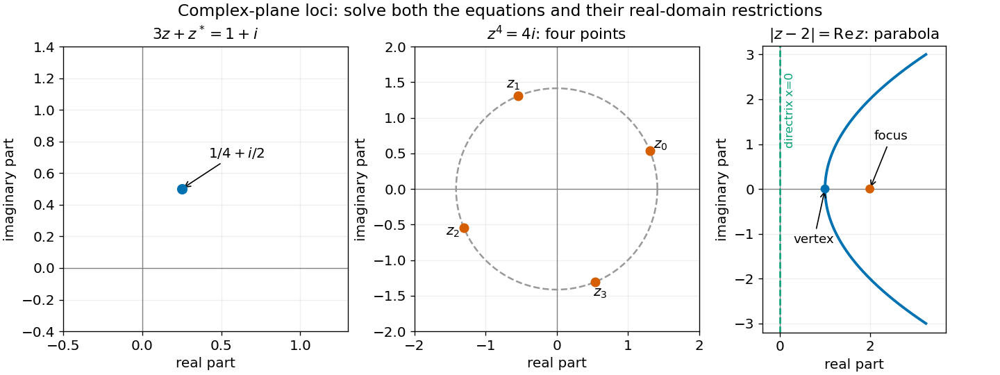

<h1 id="1/iii/solution">Solution</h1>

↑ **Parent:** [Iii](../iii.md)

For $z=x+iy$, the equation becomes $\sqrt{(x-2)^2+y^2}=x$. Its right side must be nonnegative. Squaring then gives $y^2=4(x-1)$, whose points already have $x\ge1$, so no extraneous branch has been introduced:

$$
\boxed{x=1+\frac{y^2}{4}.}
$$

This is a [parabola](../../../../parabola.md) opening along the positive real axis, with vertex $(1,0)$, focus $(2,0)$ and directrix $x=0$. The original [modulus](../../../../modulus.md) equation equates distance from the focus with distance from that directrix.

**[Figure 1](#1/iii/image-the-three-complex-plane-loci-a-single-point-four-fourth-roots-and-a-right-opening-parabola). The three complex-plane loci: a single point, four fourth roots, and a right-opening parabola**.

## ↑ Ancestors (12)

1. [Iii](../iii.md)
2. [1](../../1.md)
3. [2015 resit](../../../2015-resit-split.md)
4. [Past exam of the mathematical methods I course of the University of Oxford](../../../split.md)
5. [Mathematical methods I course of the University of Oxford](../../../../mathematical-methods-i-course-of-the-university-of-oxford.md)
6. [Year 1 of the physics course of the University of Oxford](../../../../year-1-of-the-physics-course-of-the-university-of-oxford.md)
7. [Physics course of the University of Oxford](../../../../physics-course-of-the-university-of-oxford.md)
8. [Undergraduate course of the University of Oxford](../../../../undergraduate-course-of-the-university-of-oxford.md)
9. [Course of the University of Oxford](../../../../course-of-the-university-of-oxford.md)
10. [University of Oxford](../../../../university-of-oxford-split.md)
11. [List of universities](../../../../list-of-universities.md)
12. [Codex Wiki](../../../../split.md)
