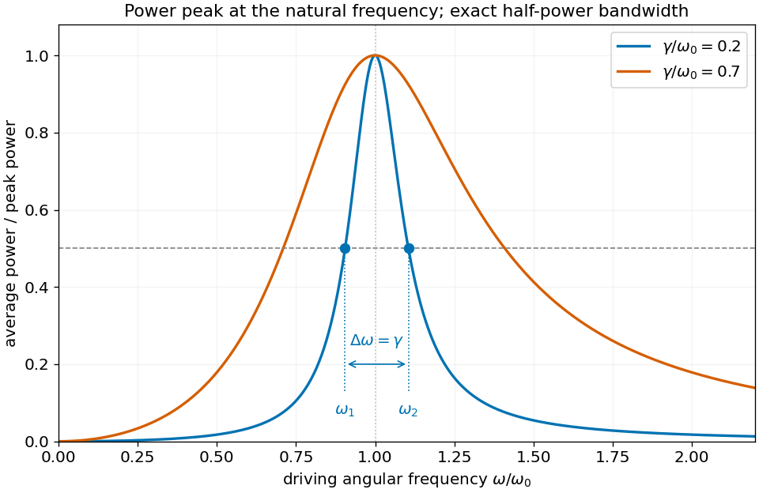

<h1 id="10/solution">Solution</h1>

↑ **Parent:** [10](../10.md)

Dividing Newton's equation by the mass gives the stated model: $\ddot z$ is the acceleration, $\gamma\dot z$ represents viscous damping, $(k/m)z$ is the spring's restoring acceleration, and the right side is the applied driving force per unit mass. The complex notation is a convenience; the physical displacement is the real part. Put $\omega_0^2=k/m$. The homogeneous characteristic roots are

$$
s=-\frac\gamma2\pm\sqrt{\frac{\gamma^2}4-\omega_0^2}.
$$

For $m,k>0$ and damping $\gamma\ge0$, oscillations occur when $\gamma^2<4\omega_0^2$, the underdamped case of the [damped harmonic oscillator](../../../damped-harmonic-oscillator.md).

For a steady response $z=Ze^{i\omega t}$, substitution gives

$$
Z=\frac{F_0/m}{\omega_0^2-\omega^2+i\gamma\omega}=re^{-i\phi}.
$$

Taking the [modulus](../../../modulus.md) and phase gives

$$
\boxed{r=\frac{F_0/m}{\sqrt{(\omega_0^2-\omega^2)^2+\gamma^2\omega^2}},\qquad\phi=\operatorname{atan2}(\gamma\omega,\omega_0^2-\omega^2).}
$$

The phase is between zero and $\pi$ for positive damping and frequency; an unqualified arctangent loses the correct quadrant above resonance.

With the real drive $F_0\cos\omega t$ and real response $r\cos(\omega t-\phi)$, the average driving [power](../../../power.md) equals the dissipated viscous power:

$$
W_{\mathrm{av}}=m\gamma\langle\dot z^2\rangle=\frac12m\gamma r^2\omega^2=\frac{F_0^2\gamma\omega^2}{2m[(\omega_0^2-\omega^2)^2+\gamma^2\omega^2]}.
$$

For $\gamma>0$, write this as

$$
\frac{W_{\mathrm{av}}}{F_0^2/(2m\gamma)}=\frac1{1+[(\omega_0^2-\omega^2)/(\gamma\omega)]^2}.
$$

It is largest when the squared term vanishes, giving

$$
\boxed{\omega=\omega_0,\qquad W_{\mathrm{av,max}}=\frac{F_0^2}{2m\gamma}.}
$$

This power peak is at $\omega_0$ even when the displacement-amplitude peak is shifted. The [frequency bandwidth of viscous oscillator power absorption](../../../frequency-bandwidth-of-viscous-oscillator-power-absorption.md) follows from the half-power condition $|\omega_0^2-\omega^2|=\gamma\omega$:

$$
\boxed{\omega_1=\frac{\sqrt{4\omega_0^2+\gamma^2}-\gamma}{2},\quad\omega_2=\frac{\sqrt{4\omega_0^2+\gamma^2}+\gamma}{2},\quad\omega_2-\omega_1=\gamma.}
$$

In fact the bandwidth identity is exact in this model. Sharp resonance additionally gives $\omega_{1,2}\simeq\omega_0\mp\gamma/2$. With zero damping at exact resonance, there is no bounded steady harmonic response to which these finite-power formulas apply.

**[Figure 2](#10/image-driven-oscillator-power-peaks-at-the-natural-frequency-the-exact-separation-of-the-half-power-frequencies-is-the-damping-coefficient). Driven-oscillator power peaks at the natural frequency; the exact separation of the half-power frequencies is the damping coefficient**.

## ↑ Ancestors (11)

1. [10](../10.md)
2. [2015 resit](../../2015-resit-split.md)
3. [Past exam of the mathematical methods I course of the University of Oxford](../../split.md)
4. [Mathematical methods I course of the University of Oxford](../../../mathematical-methods-i-course-of-the-university-of-oxford.md)
5. [Year 1 of the physics course of the University of Oxford](../../../year-1-of-the-physics-course-of-the-university-of-oxford.md)
6. [Physics course of the University of Oxford](../../../physics-course-of-the-university-of-oxford.md)
7. [Undergraduate course of the University of Oxford](../../../undergraduate-course-of-the-university-of-oxford.md)
8. [Course of the University of Oxford](../../../course-of-the-university-of-oxford.md)
9. [University of Oxford](../../../university-of-oxford-split.md)
10. [List of universities](../../../list-of-universities.md)
11. [Codex Wiki](../../../split.md)
