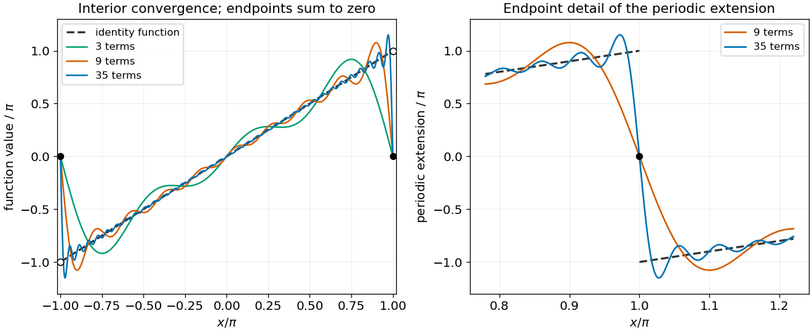

<h1 id="12/b/solution">Solution</h1>

↑ **Parent:** [B](../b.md)

After discarding $f_0=0$, the preceding [inner products](../../../../inner-product-split.md) show that distinct sine functions are [orthogonal](../../../../orthogonal-vectors.md); dividing each by $\sqrt\pi$ makes them [orthonormal](../../../../orthonormal-set.md). More precisely, their infinite expansions form an [orthogonal basis](../../../../orthogonal-basis.md) of the odd part of $L^2(-\pi,\pi)$ in the Hilbert-space sense. This is not a claim that every arbitrary odd function is a finite [linear combination](../../../../linear-combination.md) of sines.

Take the [inner product](../../../../inner-product-split.md) of $x=\sum_{n\ge1}a_n\sin(nx)$ with $\sin(mx)$. Orthogonality gives

$$
a_m=\frac1\pi\int_{-\pi}^{\pi}x\sin(mx)\,dx=\frac2\pi\left[-\frac{x\cos(mx)}m+\frac{\sin(mx)}{m^2}\right]_0^\pi=\frac{2(-1)^{m+1}}m.
$$

Therefore the [Fourier series of a periodic sawtooth](../../../../fourier-series-of-a-periodic-sawtooth.md), scaled to this interval, is

$$
\boxed{x=2\sum_{n=1}^{\infty}\frac{(-1)^{n+1}}n\sin(nx),\qquad-\pi<x<\pi.}
$$

Its periodic extension is piecewise smooth, so the [Dirichlet convergence theorem for Fourier series](../../../../dirichlet-s-theorem-on-fourier-series.md) gives pointwise convergence to $x$ inside the interval. At the jump endpoints of that periodic extension, the series instead converges to zero, the midpoint of the two one-sided limits.

**[Figure 3](#12/b/image-fourier-sine-partial-sums-approximate-the-identity-inside-the-interval-while-their-periodic-extension-has-endpoint-jumps). Fourier sine partial sums approximate the identity inside the interval, while their periodic extension has endpoint jumps**.

## ↑ Ancestors (12)

1. [B](../b.md)
2. [12](../../12.md)
3. [2015 resit](../../../2015-resit-split.md)
4. [Past exam of the mathematical methods I course of the University of Oxford](../../../split.md)
5. [Mathematical methods I course of the University of Oxford](../../../../mathematical-methods-i-course-of-the-university-of-oxford.md)
6. [Year 1 of the physics course of the University of Oxford](../../../../year-1-of-the-physics-course-of-the-university-of-oxford.md)
7. [Physics course of the University of Oxford](../../../../physics-course-of-the-university-of-oxford.md)
8. [Undergraduate course of the University of Oxford](../../../../undergraduate-course-of-the-university-of-oxford.md)
9. [Course of the University of Oxford](../../../../course-of-the-university-of-oxford.md)
10. [University of Oxford](../../../../university-of-oxford-split.md)
11. [List of universities](../../../../list-of-universities.md)
12. [Codex Wiki](../../../../split.md)
