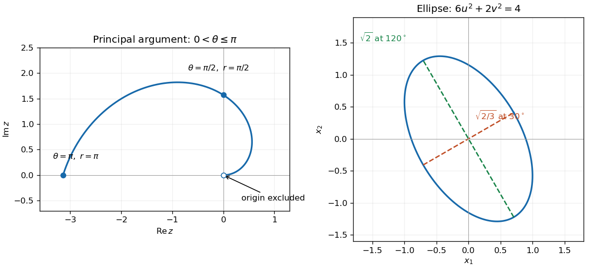
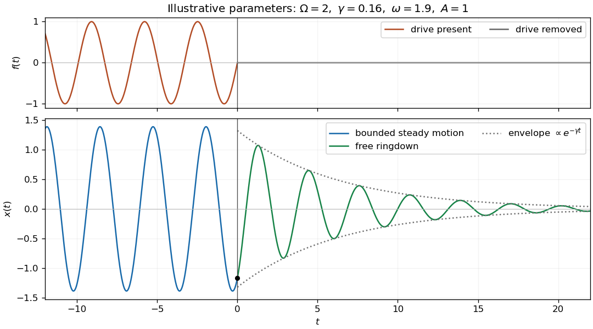

# 2015

↑ **Parent:** [Past exam of the mathematical methods I course of the University of Oxford](../past-exam-of-the-mathematical-methods-i-course-of-the-university-of-oxford.md)

Source paper: [https://www.whatdotheyknow.com/request/oxford_physics_past_papers_2/response/2340696/attach/3/Physics%20Papers%202014.pdf?cookie_passthrough=1](https://www.whatdotheyknow.com/request/oxford_physics_past_papers_2/response/2340696/attach/3/Physics%20Papers%202014.pdf?cookie_passthrough=1)

**Table of contents**

- [1](#1)
  - [Solution](#1/solution)
- [2](#2)
  - [Solution](#2/solution)
- [3](#3)
  - [Solution](#3/solution)
- [4](#4)
  - [Solution](#4/solution)
- [5](#5)
  - [i](#5/i)
    - [Solution](#5/i/solution)
  - [ii](#5/ii)
    - [Solution](#5/ii/solution)
  - [iii](#5/iii)
    - [Solution](#5/iii/solution)
  - [iv](#5/iv)
    - [Solution](#5/iv/solution)
- [6](#6)
  - [Solution](#6/solution)
- [7](#7)
  - [Solution](#7/solution)
- [8](#8)
  - [i](#8/i)
    - [Solution](#8/i/solution)
  - [ii](#8/ii)
    - [Solution](#8/ii/solution)
  - [iii](#8/iii)
    - [Solution](#8/iii/solution)
  - [iv](#8/iv)
    - [Solution](#8/iv/solution)
- [9](#9)
  - [Solution](#9/solution)
- [10](#10)
  - [a](#10/a)
    - [i](#10/a/i)
      - [Solution](#10/a/i/solution)
    - [ii](#10/a/ii)
      - [Solution](#10/a/ii/solution)
    - [iii](#10/a/iii)
      - [Solution](#10/a/iii/solution)
    - [Solution](#10/a/solution)
  - [b](#10/b)
    - [Solution](#10/b/solution)
- [11](#11)
  - [i](#11/i)
    - [Solution](#11/i/solution)
  - [ii](#11/ii)
    - [Solution](#11/ii/solution)
  - [Solution](#11/solution)
- [12](#12)
  - [i](#12/i)
    - [Solution](#12/i/solution)
  - [ii](#12/ii)
    - [Solution](#12/ii/solution)
  - [iii](#12/iii)
    - [Solution](#12/iii/solution)
  - [iv](#12/iv)
    - [Solution](#12/iv/solution)
  - [v](#12/v)
    - [Solution](#12/v/solution)
  - [vi](#12/vi)
    - [Solution](#12/vi/solution)
  - [vii](#12/vii)
    - [Solution](#12/vii/solution)
- [13](#13)
  - [a](#13/a)
    - [i](#13/a/i)
      - [Solution](#13/a/i/solution)
    - [ii](#13/a/ii)
      - [Solution](#13/a/ii/solution)
    - [iii](#13/a/iii)
      - [Solution](#13/a/iii/solution)
  - [b](#13/b)
    - [i](#13/b/i)
      - [Solution](#13/b/i/solution)
    - [ii](#13/b/ii)
      - [Solution](#13/b/ii/solution)

## 1

↑ **Parent:** [2015](2015.md)

<h3 id="1/solution">Solution</h3>

↑ **Parent:** [1](#1)

Use [polar coordinates](../multivariable-calculus.md#polar-coordinates) $z=re^{i\theta}$, where $r=|z|\geq0$. The equation sets $r=\theta$, giving an [Archimedean spiral](../topology.md#archimedean-spiral). The origin is excluded because the [complex argument](../complex-analysis.md#argument-complex-analysis) of zero is undefined. With the principal [complex argument](../complex-analysis.md#argument-complex-analysis) in $(-\pi,\pi]$, the locus is

$$
\boxed{z(\theta)=\theta\cos\theta+i\theta\sin\theta,\qquad0<\theta\leq\pi.}
$$

It approaches the excluded origin along the positive real axis, passes through $i\pi/2$, and ends at $-\pi$. The choice of argument matters: the convention $[0,2\pi)$ instead gives $0<\theta<2\pi$, while allowing all values of the [complex argument](../complex-analysis.md#argument-complex-analysis) gives every turn with $\theta>0$.

**[Figure 1](#1/image-the-principal-argument-spiral-and-the-rotated-ellipse-obtained-from-the-quadratic-form). The principal-argument spiral and the rotated ellipse obtained from the quadratic form**.

## 2

↑ **Parent:** [2015](2015.md)

<h3 id="2/solution">Solution</h3>

↑ **Parent:** [2](#2)

All [complex logarithms](../analysis.md#complex-logarithm) of $i$ are $i(\pi/2+2\pi k)$ for integer $k$. By [complex exponentiation](../analysis.md#complex-exponentiation),

$$
\boxed{i^i=\exp\!\left[-\frac\pi2-2\pi k\right],\qquad k\in\mathbb Z.}
$$

Every value is positive and real. If the power is defined using the [principal logarithm](../analysis.md#principal-complex-logarithm), the single value is $\boxed{e^{-\pi/2}}$. Keeping the logarithm branch explicit distinguishes this value from the full multivalued set.

## 3

↑ **Parent:** [2015](2015.md)

<h3 id="3/solution">Solution</h3>

↑ **Parent:** [3](#3)

An [integrating factor](../linear-ordinary-differential-equation.md#integrating-factor) for the [first-order linear differential equation](../linear-ordinary-differential-equation.md#first-order-linear-differential-equation) is $\mu(x)=e^{\sin x}$. Multiplication gives

$$
(ye^{\sin x})'=2\sin x\cos x\,e^{\sin x}.
$$

Substitute $u=\sin x$ in the [antiderivative](../integral.md#antiderivative): $\int2u e^u\,du=2(u-1)e^u$. Therefore

$$
\boxed{y(x)=2\sin x-2+Ce^{-\sin x},\qquad C\in\mathbb R.}
$$

Differentiating verifies the equation everywhere on the real line; no division by $\cos x$ restricts the solution.

## 4

↑ **Parent:** [2015](2015.md)

<h3 id="4/solution">Solution</h3>

↑ **Parent:** [4](#4)

The addition formulas for the [hyperbolic functions](../calculus.md#hyperbolic-function) imply

$$
B(u)B(v)=B(u+v),\qquad B(u)=\begin{pmatrix}\cosh u&\sinh u\\\sinh u&\cosh u\end{pmatrix}.
$$

Since $M=B(y)/2$, its fourth [matrix power](../vector-space.md#matrix-power) is

$$
\boxed{M^4=\frac1{16}\begin{pmatrix}\cosh4y&\sinh4y\\\sinh4y&\cosh4y\end{pmatrix}.}
$$

Alternatively, the orthonormal [eigenvectors](../linear-operator-theory.md#eigenvector) $(1,\pm1)/\sqrt2$ have [eigenvalues](../linear-operator-theory.md#eigenvalue) $e^{\pm y}/2$. Raising these [eigenvalues](../linear-operator-theory.md#eigenvalue) to the fourth power gives the same result by [spectral decomposition](../linear-operator-theory.md#spectral-decomposition).

## 5

↑ **Parent:** [2015](2015.md)

<h3 id="5/i">i</h3>

↑ **Parent:** [5](#5)

<h4 id="5/i/solution">Solution</h4>

↑ **Parent:** [I](#5/i)

Taking the [conjugate transpose](../linear-operator-theory.md#conjugate-transpose) reverses the product order: $(AB)^\dagger=B^\dagger A^\dagger=BA$. Thus

$$
\boxed{AB\text{ is Hermitian if and only if }AB=BA.}
$$

The necessary and sufficient additional condition is that the two [Hermitian matrices](../hilbert-space.md#hermitian-operator) [commute](../algebraic-operation.md#commuting-elements).

<h3 id="5/ii">ii</h3>

↑ **Parent:** [5](#5)

<h4 id="5/ii/solution">Solution</h4>

↑ **Parent:** [Ii](#5/ii)

Complex conjugation changes $i$ to $-i$, and transposition reverses the factors. Hence

$$
[i(AB-BA)]^\dagger=-i(BA-AB)=i(AB-BA).
$$

Thus the expression is a [Hermitian matrix](../hilbert-space.md#hermitian-operator) **without any additional condition**. Equivalently, the [commutator](../lie-algebra.md#commutator) of two [Hermitian matrices](../hilbert-space.md#hermitian-operator) is skew-Hermitian.

<h3 id="5/iii">iii</h3>

↑ **Parent:** [5](#5)

<h4 id="5/iii/solution">Solution</h4>

↑ **Parent:** [Iii](#5/iii)

The diagonal entries of a [Hermitian matrix](../hilbert-space.md#hermitian-operator) satisfy $A_{jj}=\overline{A_{jj}}$, so each is real. Consequently their sum, the [trace](../linear-algebra.md#matrix-trace), is real. **No additional condition is required.** The same conclusion follows by summing the real [eigenvalues](../linear-operator-theory.md#eigenvalue).

<h3 id="5/iv">iv</h3>

↑ **Parent:** [5](#5)

<h4 id="5/iv/solution">Solution</h4>

↑ **Parent:** [Iv](#5/iv)

If $Au=\lambda u$ and $Av=\mu v$, the [Hermitian matrix](../hilbert-space.md#hermitian-operator) identity gives

$$
\lambda\langle u,v\rangle=\langle Au,v\rangle=\langle u,Av\rangle=\mu\langle u,v\rangle,
$$

because both [eigenvalues](../linear-operator-theory.md#eigenvalue) are real. Thus [eigenvectors](../linear-operator-theory.md#eigenvector) belonging to **distinct eigenvalues are automatically orthogonal**. A [simple spectrum](../linear-operator-theory.md#simple-spectrum) guarantees this for an arbitrary choice of one [eigenvector](../linear-operator-theory.md#eigenvector) per [eigenvalue](../linear-operator-theory.md#eigenvalue).

Within a degenerate [eigenspace](../linear-operator-theory.md#eigenspace), arbitrary independent [eigenvectors](../linear-operator-theory.md#eigenvector) need not be orthogonal. The [Gram-Schmidt process](../inner-product.md#gram-schmidt-process) always supplies an [orthonormal basis](../inner-product.md#orthonormal-basis) of that [eigenspace](../linear-operator-theory.md#eigenspace). Accordingly the existence of an [orthonormal eigenbasis](../linear-operator-theory.md#orthonormal-eigenbasis) requires no additional condition, whereas automatic orthogonality of arbitrary independent [eigenvectors](../linear-operator-theory.md#eigenvector) is ensured by distinct [eigenvalues](../linear-operator-theory.md#eigenvalue). Scalar multiples of the same nonzero [eigenvector](../linear-operator-theory.md#eigenvector) are of course not mutually orthogonal.

## 6

↑ **Parent:** [2015](2015.md)

<h3 id="6/solution">Solution</h3>

↑ **Parent:** [6](#6)

The [characteristic polynomial](../linear-operator-theory.md#characteristic-polynomial) is $(5-\lambda)(3-\lambda)-3=(\lambda-6)(\lambda-2)$. Corresponding normalized [eigenvectors](../linear-operator-theory.md#eigenvector) are

$$
\lambda=6:\quad e_6=\frac12(\sqrt3,1),\qquad
\lambda=2:\quad e_2=\frac12(-1,\sqrt3).
$$

These form an [orthonormal basis](../inner-product.md#orthonormal-basis). Write $x=u e_6+v e_2$; the [quadratic form](../quadratic-form.md) becomes

$$
6u^2+2v^2=4,\qquad\boxed{\frac{u^2}{2/3}+\frac{v^2}{2}=1.}
$$

The locus is an [ellipse](../euclidean-geometry.md#ellipse) centred at the origin. Its minor semiaxis has length $\sqrt{2/3}$ along the direction $30^\circ$ from the positive horizontal axis; its major semiaxis has length $\sqrt2$ along $120^\circ$. The right panel of the figure in part 1 shows these principal directions.

## 7

↑ **Parent:** [2015](2015.md)

<h3 id="7/solution">Solution</h3>

↑ **Parent:** [7](#7)

Subtract the first vertex from the remaining three to obtain edge vectors $a=(1,2,-2)$, $b=(0,1,3)$, $c=(-1,-1,0)$. Their [scalar triple product](../multilinear-algebra.md#scalar-triple-product) is

$$
a\cdot(b\times c)=(1,2,-2)\cdot(3,-3,1)=-5.
$$

A [tetrahedron](../euclidean-geometry.md#tetrahedron) occupies one sixth of the corresponding [parallelepiped](../euclidean-geometry.md#parallelepiped), so its [volume](../geometry-and-topology.md#volume) is

$$
\boxed{V=\frac16|a\cdot(b\times c)|=\frac56.}
$$

The absolute value removes the orientation sign of the [determinant](../multilinear-algebra.md#determinant).

## 8

↑ **Parent:** [2015](2015.md)

<h3 id="8/i">i</h3>

↑ **Parent:** [8](#8)

<h4 id="8/i/solution">Solution</h4>

↑ **Parent:** [I](#8/i)

The [Leibniz formula for determinants](../multilinear-algebra.md#leibniz-formula-for-determinants) is unchanged by interchanging rows and columns, or equivalently replacing each [permutation](../combinatorics.md#permutation) by its inverse. Thus

$$
\boxed{\det(A^T)=\det A.}
$$

<h3 id="8/ii">ii</h3>

↑ **Parent:** [8](#8)

<h4 id="8/ii/solution">Solution</h4>

↑ **Parent:** [Ii](#8/ii)

Use the multiplicativity of the [determinant](../multilinear-algebra.md#determinant) on $AA^{-1}=I$:

$$
\det A\,\det(A^{-1})=1,\qquad\boxed{\det(A^{-1})=\frac1{\det A}.}
$$

The denominator is nonzero because $A$ is an [invertible matrix](../linear-algebra.md#invertible-matrix).

<h3 id="8/iii">iii</h3>

↑ **Parent:** [8](#8)

<h4 id="8/iii/solution">Solution</h4>

↑ **Parent:** [Iii](#8/iii)

Multiplying $A$ by $c$ multiplies each of its $n$ columns by $c$. The [multilinearity](../multilinear-algebra.md#multilinearity) of the [determinant](../multilinear-algebra.md#determinant) therefore gives

$$
\boxed{\det(cA)=c^n\det A.}
$$

This includes $c=0$.

<h3 id="8/iv">iv</h3>

↑ **Parent:** [8](#8)

<h4 id="8/iv/solution">Solution</h4>

↑ **Parent:** [Iv](#8/iv)

For an integer $c$, repeated multiplicativity of the [determinant](../multilinear-algebra.md#determinant), with the inverse identity for negative powers, gives

$$
\boxed{\det(A^c)=(\det A)^c\quad(c\in\mathbb Z).}
$$

For an arbitrary real $c$, an invertible real [matrix](../vector-space.md#matrix) does not by itself define a unique real [matrix power](../vector-space.md#matrix-power). For example, the scalar matrix $(-1)$ has no real square root. If a [matrix logarithm](../vector-space.md#matrix-logarithm) $L$ has been chosen with $e^L=A$ and $A^c$ is defined as $e^{cL}$, the [matrix exponential determinant identity](../linear-operator-theory.md#matrix-exponential-determinant-identity) gives the precise formula

$$
\boxed{\det(A^c)=e^{c\operatorname{tr}L}.}
$$

This cannot always be replaced by an independently chosen scalar branch of $(\det A)^c$. For instance, $A=-I_2$ has the complex square root $iI_2$, whose [determinant](../multilinear-algebra.md#determinant) is $-1$, while the principal scalar square root of $\det A=1$ is $+1$. For a positive-definite [symmetric matrix](../linear-algebra.md#symmetric-matrix) with its usual positive spectral power, all [eigenvalues](../linear-operator-theory.md#eigenvalue) are positive and the familiar formula $(\det A)^c$ holds for every real $c$.

## 9

↑ **Parent:** [2015](2015.md)

<h3 id="9/solution">Solution</h3>

↑ **Parent:** [9](#9)

Let $P$ have columns $a,b,c$ and let $G$ have columns $A,B,C$. The cross-product formulas defining the [reciprocal basis](../multilinear-algebra.md#reciprocal-basis) give

$$
G^TP=I,\qquad G=P^{-T},
$$

provided the original [scalar triple product](../multilinear-algebra.md#scalar-triple-product) $T=\det P$ is nonzero. Taking [determinants](../multilinear-algebra.md#determinant) yields the [reciprocal basis involution](../multilinear-algebra.md#reciprocal-basis-involution) identity

$$
\boxed{\langle A,B,C\rangle=\det G=\frac1{\det P}=\frac1{\langle a,b,c\rangle}.}
$$

When $T=0$, the displayed reciprocal vectors are undefined, so there is no additional zero-denominator case to evaluate.

## 10

↑ **Parent:** [2015](2015.md)

<h3 id="10/a">a</h3>

↑ **Parent:** [10](#10)

<h4 id="10/a/i">i</h4>

↑ **Parent:** [A](#10/a)

<h5 id="10/a/i/solution">Solution</h5>

↑ **Parent:** [I](#10/a/i)

In one dimension the nonzero vector $b$ already spans the real line. Hence $\operatorname{span}(b,c)=\mathbb R$, and translating it by $a$ leaves

$$
\boxed{S=\mathbb R.}
$$

This is an [affine subspace](../vector-space.md#affine-subspace) containing the origin for every allowed choice of the three vectors.

<h4 id="10/a/ii">ii</h4>

↑ **Parent:** [A](#10/a)

<h5 id="10/a/ii/solution">Solution</h5>

↑ **Parent:** [Ii](#10/a/ii)

The [affine subspace](../vector-space.md#affine-subspace) is $S=a+\operatorname{span}(b,c)$. If $b,c$ are [linearly independent](../vector-space.md#linear-independence), their [linear span](../vector-space.md#linear-span) is all of $\mathbb R^2$, so **$S$ is the whole plane**. If they are proportional, **$S$ is the line through $a$ in direction $b$**. This line passes through the origin exactly when $a\in\operatorname{span}(b)$. Because $b$ is nonzero, the set cannot be a single point.

<h4 id="10/a/iii">iii</h4>

↑ **Parent:** [A](#10/a)

<h5 id="10/a/iii/solution">Solution</h5>

↑ **Parent:** [Iii](#10/a/iii)

If $b,c$ are [linearly independent](../vector-space.md#linear-independence), **$S$ is the plane through $a$ with normal $b\times c$**. Its equation is

$$
(x-a)\cdot(b\times c)=0,
$$

so it contains the origin exactly when $a\cdot(b\times c)=0$. If $b,c$ are proportional, **$S$ is the line through $a$ in direction $b$**, containing the origin exactly when $a$ is proportional to $b$. The [linear span](../vector-space.md#linear-span) of two nonzero vectors has dimension one or two, so neither a single point nor all of $\mathbb R^3$ occurs.

<h4 id="10/a/solution">Solution</h4>

↑ **Parent:** [A](#10/a)

For the remaining distance calculation with $b=c$, every point on the line is $a+tb$. The nearest point to $p$ is found by [orthogonal projection](../hilbert-space.md#orthogonal-projection) onto $b$:

$$
t_* =\frac{(p-a)\cdot b}{|b|^2},\qquad
\boxed{d(p,S)=\left|(p-a)-\frac{(p-a)\cdot b}{|b|^2}b\right|=\frac{|(p-a)\times b|}{|b|}.}
$$

Indeed, differentiating $|a+tb-p|^2$ sets its component along $b$ to zero. Its second derivative is $2|b|^2>0$, proving this is the minimum.

<h3 id="10/b">b</h3>

↑ **Parent:** [10](#10)

<h4 id="10/b/solution">Solution</h4>

↑ **Parent:** [B](#10/b)

A negative value of either radius makes the intersection empty. Assume henceforth $\alpha,\beta\geq0$ and put $D=|d|$. If $D=0$, the two [spheres](../euclidean-geometry.md#sphere) are concentric: their intersection is the entire sphere when $\alpha=\beta>0$, the origin when $\alpha=\beta=0$, and empty otherwise.

For $D>0$, subtract their squared equations to obtain the plane

$$
x\cdot d=\frac{D^2+\alpha^2-\beta^2}{2}.
$$

The [centre of the circle of intersection of two spheres](../euclidean-geometry.md#centre-of-the-circle-of-intersection-of-two-spheres) is $x_0=s\widehat d$, where

$$
\widehat d=\frac dD,\qquad s=\frac{D^2+\alpha^2-\beta^2}{2D}.
$$

Every point of that plane can be written $x=x_0+u$ with $u\cdot d=0$. Its remaining equation is

$$
|u|^2=\rho^2=\alpha^2-s^2
=\frac{[(\alpha+\beta)^2-D^2][D^2-(\alpha-\beta)^2]}{4D^2}.
$$

Thus **the intersection is a circle** of centre $x_0$ and radius $\rho$ if $|\alpha-\beta|<D<\alpha+\beta$; **a single point** $x_0$ at either equality; and **empty** otherwise. These include tangency to a zero-radius sphere. A negative $s$ places the circle centre beyond the first sphere's centre on the side opposite $d$.

In $\mathbb R^n$ for $n\geq2$, the same calculation gives an $(n-2)$-dimensional [sphere](../euclidean-geometry.md#sphere) in the perpendicular affine hyperplane when $\rho^2>0$, a point when $\rho^2=0$, and the empty set otherwise. In two dimensions the positive-radius case consists of two points. In one dimension the perpendicular hyperplane has only one point, so a nonconcentric intersection exists only when $\rho^2=0$. Concentric equal-radius sets coincide in every dimension.

## 11

↑ **Parent:** [2015](2015.md)

<h3 id="11/i">i</h3>

↑ **Parent:** [11](#11)

<h4 id="11/i/solution">Solution</h4>

↑ **Parent:** [I](#11/i)

Put $D=\Omega^2-\omega^2$, $E=2\gamma\omega$, and $N=D^2+E^2$. Substituting a sine-and-cosine trial solution for the [forced harmonic oscillator](../analysis.md#forced-harmonic-oscillator) gives

$$
\boxed{x(t)=\frac A N\left[D\sin\omega t-E\cos\omega t\right],\qquad t\leq0.}
$$

The complementary solution is $e^{-\gamma t}(C\cos\nu t+S\sin\nu t)$, where $\nu=\sqrt{\Omega^2-\gamma^2}$. Every nonzero such solution is unbounded as $t\to-\infty$, so boundedness on the whole negative time axis forces $C=S=0$. This fixes the phase as well as the amplitude. In particular,

$$
x_0=x(0)=-\frac{AE}{N},\qquad v_0=\dot x(0)=\frac{AD\omega}{N}.
$$

<h3 id="11/ii">ii</h3>

↑ **Parent:** [11](#11)

<h4 id="11/ii/solution">Solution</h4>

↑ **Parent:** [Ii](#11/ii)

After the force is removed, the [damped harmonic oscillator](../analysis.md#damped-harmonic-oscillator) evolves freely. There is no impulsive force at zero, so both displacement and velocity are continuous. Matching the values in part (i) gives

$$
\boxed{x(t)=e^{-\gamma t}\left[x_0\cos\nu t+\frac{v_0+\gamma x_0}{\nu}\sin\nu t\right],\qquad t>0.}
$$

Equivalently,

$$
x(t)=\frac{A\omega e^{-\gamma t}}N\left[-2\gamma\cos\nu t+\frac{\Omega^2-\omega^2-2\gamma^2}{\nu}\sin\nu t\right].
$$

This is bounded in positive time, completing the unique globally bounded solution. The formulas also include $\omega=0$, for which the forcing and solution both vanish.

**[Figure 2](#11/ii/image-steady-forced-motion-before-switch-off-joins-continuously-to-a-freely-decaying-oscillation). Steady forced motion before switch-off joins continuously to a freely decaying oscillation**.

<h3 id="11/solution">Solution</h3>

↑ **Parent:** [11](#11)

For a sinusoidal drive of variable positive angular frequency, the average absorbed [power](../energy.md#power) is proportional to

$$
\frac{\omega^2}{(\Omega^2-\omega^2)^2+4\gamma^2\omega^2}.
$$

It peaks at $\omega=\Omega$. The [absorbed-power bandwidth of a viscously damped oscillator](../dynamical-systems.md#absorbed-power-bandwidth-of-a-viscously-damped-oscillator) is the separation of its half-power frequencies: solving $|\Omega^2-\omega^2|=2\gamma\omega$ gives

$$
\omega_\pm=\sqrt{\Omega^2+\gamma^2}\pm\gamma,\qquad\boxed{\Delta\omega=2\gamma.}
$$

The usual [quality factor](../dynamical-systems.md#q-factor) is $\boxed{Q=\Omega/(2\gamma)=\Omega/\Delta\omega}$. Large $Q$ means a narrow response band relative to the resonant frequency. The post-drive motion has amplitude envelope $e^{-\gamma t}$, connecting a narrow [bandwidth](../electrical-engineering.md#bandwidth-signal-processing) to a long [ringdown](../analysis.md#ringdown). For weak damping, the cycle-averaged energy decays as $e^{-2\gamma t}$ and $Q$ is also $2\pi$ times stored energy divided by the energy lost per cycle. The exact instantaneous energy has an oscillatory factor, so this cycle interpretation uses the weak-damping approximation.

## 12

↑ **Parent:** [2015](2015.md)

<h3 id="12/i">i</h3>

↑ **Parent:** [12](#12)

<h4 id="12/i/solution">Solution</h4>

↑ **Parent:** [I](#12/i)

Direct multiplication of the [Pauli matrices](../algebra.md#pauli-matrices) gives $\sigma_j^2=I$, $\sigma_1\sigma_2=i\sigma_3$ and its cyclic permutations; reversing unequal factors changes the sign. Hence, using the [Levi-Civita symbol](../multivariable-calculus.md#levi-civita-symbol),

$$
\sigma_j\sigma_k=\delta_{jk}I+i\epsilon_{jk\ell}\sigma_\ell,\qquad
\boxed{[\sigma_j,\sigma_k]=2i\epsilon_{jk\ell}\sigma_\ell.}
$$

Repeated $\ell$ is summed, while the [Kronecker delta](../multilinear-algebra.md#kronecker-delta) handles the equal-index case.

<h3 id="12/ii">ii</h3>

↑ **Parent:** [12](#12)

<h4 id="12/ii/solution">Solution</h4>

↑ **Parent:** [Ii](#12/ii)

For $v=(a,b)^T$, multiplying each [Pauli matrix](../algebra.md#pauli-matrices) between $v^\dagger$ and $v$ gives

$$
\boxed{x=\left(\operatorname{Re}(a^*b),\operatorname{Im}(a^*b),\frac{|a|^2-|b|^2}{2}\right).}
$$

All three components are real. Moreover $|x|=(|a|^2+|b|^2)/2=\|v\|^2/2$. Thus normalized two-component [spinors](../algebra-over-a-field.md#spinor) map to the radius-$1/2$ version of the [Bloch sphere](../density-matrix.md#bloch-sphere); the usual unit-radius convention multiplies these coordinates by two.

<h3 id="12/iii">iii</h3>

↑ **Parent:** [12](#12)

<h4 id="12/iii/solution">Solution</h4>

↑ **Parent:** [Iii](#12/iii)

Each [Pauli matrix](../algebra.md#pauli-matrices) is Hermitian and the coefficients $\alpha_j$ are real, so $T^\dagger=T$. Taking the [conjugate transpose](../linear-operator-theory.md#conjugate-transpose) of the absolutely convergent [matrix exponential](../linear-operator-theory.md#matrix-exponential) series yields

$$
U^\dagger=e^{-iT/2}.
$$

The exponents $-iT/2$ and $iT/2$ [commute](../algebraic-operation.md#commuting-elements). Therefore $U^\dagger U=e^{-iT/2+iT/2}=I$, proving that **$U$ is unitary**.

<h3 id="12/iv">iv</h3>

↑ **Parent:** [12](#12)

<h4 id="12/iv/solution">Solution</h4>

↑ **Parent:** [Iv](#12/iv)

If $Tv=tv$ with $v\ne0$, induction gives $T^kv=t^kv$ for every nonnegative integer $k$. Substituting into the [matrix exponential](../linear-operator-theory.md#matrix-exponential) series gives

$$
Uv=\sum_{k=0}^\infty\frac{(i/2)^kT^kv}{k!}=e^{it/2}v.
$$

Thus **each eigenvector of $T$ is an eigenvector of $U$**, with [eigenvalue](../linear-operator-theory.md#eigenvalue) $e^{it/2}$. Different [eigenvalues](../linear-operator-theory.md#eigenvalue) of $T$ can produce the same exponential [eigenvalue](../linear-operator-theory.md#eigenvalue).

<h3 id="12/v">v</h3>

↑ **Parent:** [12](#12)

<h4 id="12/v/solution">Solution</h4>

↑ **Parent:** [V](#12/v)

The anticommuting unequal [Pauli matrices](../algebra.md#pauli-matrices) cancel the cross terms, leaving

$$
T^2=(\alpha_1^2+\alpha_2^2+\alpha_3^2)I=|\alpha|^2I.
$$

Also $\operatorname{tr}T=0$, so its [eigenvalues](../linear-operator-theory.md#eigenvalue) are $\pm|\alpha|$. Consequently

$$
\boxed{\lambda_\pm(U)=e^{\pm i|\alpha|/2}.}
$$

For $|\alpha|>0$, the [matrix exponential for a scalar square](../linear-operator-theory.md#matrix-exponential-for-a-scalar-square) also gives $U=I\cos(|\alpha|/2)+iT\sin(|\alpha|/2)/|\alpha|$. At $\alpha=0$, its continuous limit is $U=I$. The two exponential [eigenvalues](../linear-operator-theory.md#eigenvalue) coincide when $|\alpha|=2\pi k$, making $U=(-1)^kI$.

<h3 id="12/vi">vi</h3>

↑ **Parent:** [12](#12)

<h4 id="12/vi/solution">Solution</h4>

↑ **Parent:** [Vi](#12/vi)

With only $\alpha_3$ nonzero, $T=\operatorname{diag}(\alpha_3,-\alpha_3)$ and

$$
U=\operatorname{diag}(e^{i\alpha_3/2},e^{-i\alpha_3/2}).
$$

For $\alpha_3\notin2\pi\mathbb Z$, the [eigenvectors](../linear-operator-theory.md#eigenvector) are **the nonzero multiples of $(1,0)^T$ and $(0,1)^T$**. When $\alpha_3=2\pi k$, $U=(-1)^kI$ and **every nonzero vector is an eigenvector**.

<h3 id="12/vii">vii</h3>

↑ **Parent:** [12](#12)

<h4 id="12/vii/solution">Solution</h4>

↑ **Parent:** [Vii](#12/vii)

The transformed components are $a'=e^{i\alpha_3/2}a$, $b'=e^{-i\alpha_3/2}b$. Hence $(a')^*b'=e^{-i\alpha_3}a^*b$, while the two [moduli](../complex-analysis.md#modulus) are unchanged. Taking real and imaginary parts in the expression from part (ii) gives

$$
\boxed{\begin{pmatrix}x'_1\\x'_2\\x'_3\end{pmatrix}=\begin{pmatrix}\cos\alpha_3&\sin\alpha_3&0\\-\sin\alpha_3&\cos\alpha_3&0\\0&0&1\end{pmatrix}\begin{pmatrix}x_1\\x_2\\x_3\end{pmatrix}.}
$$

This is a right-handed active [rotation](../riemannian-geometry.md#rotation-mathematics) through **$-\alpha_3$ about the third axis**. The minus sign follows from the positive sign in $U=e^{+iT/2}$; changing that convention reverses the rotation. A $2\pi$ spatial [rotation](../riemannian-geometry.md#rotation-mathematics) changes the [spinor](../algebra-over-a-field.md#spinor) sign while leaving the three-vector unchanged.

## 13

↑ **Parent:** [2015](2015.md)

<h3 id="13/a">a</h3>

↑ **Parent:** [13](#13)

<h4 id="13/a/i">i</h4>

↑ **Parent:** [A](#13/a)

<h5 id="13/a/i/solution">Solution</h5>

↑ **Parent:** [I](#13/a/i)

A [fixed point](../function.md#fixed-point) obeys $(I-M)X=c$. Thus the necessary and sufficient existence condition is

$$
\boxed{c\in\operatorname{range}(I-M).}
$$

If $1$ is not an [eigenvalue](../linear-operator-theory.md#eigenvalue) of $M$, then $I-M$ is an [invertible matrix](../linear-algebra.md#invertible-matrix) and the unique constant solution is $\boxed{X=(I-M)^{-1}c}$. If $I-M$ is singular but the equation is consistent, all constant solutions are $X_0+\ker(I-M)$ for any particular solution $X_0$. For an existing [fixed point](../function.md#fixed-point), $x_{k+1}-X=M(x_k-X)$; the successive difference in the question likewise obeys $\delta x_{k+1}=M\delta x_k$.

<h4 id="13/a/ii">ii</h4>

↑ **Parent:** [A](#13/a)

<h5 id="13/a/ii/solution">Solution</h5>

↑ **Parent:** [Ii](#13/a/ii)

Repeated substitution in the [affine iteration](../numerical-analysis.md#affine-iteration) gives

$$
x_k=M^{k-1}x_1+(I+M+\cdots+M^{k-2})c.
$$

Therefore the required [matrix polynomials](../vector-space.md#matrix-polynomial) are

$$
\boxed{f(M)=M^{k-1},\qquad g(M)=\sum_{j=0}^{k-2}M^j.}
$$

These formulas do not require an inverse. If $I-M$ is an [invertible matrix](../linear-algebra.md#invertible-matrix), multiplying the finite geometric sum by $I-M$ gives $g(M)=(I-M^{k-1})(I-M)^{-1}$.

<h4 id="13/a/iii">iii</h4>

↑ **Parent:** [A](#13/a)

<h5 id="13/a/iii/solution">Solution</h5>

↑ **Parent:** [Iii](#13/a/iii)

For a [diagonalizable matrix](../linear-operator-theory.md#diagonalizable-matrix), write $M=P\operatorname{diag}(\lambda_j)P^{-1}$. Relative to an existing [fixed point](../function.md#fixed-point),

$$
x_k-X=P\operatorname{diag}(\lambda_j^{k-1})P^{-1}(x_1-X).
$$

Convergence to the **same fixed point for every initial vector** therefore holds exactly when

$$
\boxed{|\lambda_j|<1\text{ for all }j,\quad\text{equivalently }\rho(M)<1.}
$$

Here $\rho(M)$ is the [spectral radius](../analysis.md#spectral-radius). Necessity follows by choosing an initial displacement in each [eigenspace](../linear-operator-theory.md#eigenspace); sufficiency follows because every displayed scalar power tends to zero. The condition also makes $I-M$ an [invertible matrix](../linear-algebra.md#invertible-matrix), so that [fixed point](../function.md#fixed-point) exists uniquely for every $c$.

If instead different initial vectors may converge to different constant solutions, an [eigenvalue](../linear-operator-theory.md#eigenvalue) $1$ is allowed: all other [eigenvalues](../linear-operator-theory.md#eigenvalue) must have [modulus](../complex-analysis.md#modulus) less than one, and the component of $c$ in the [eigenspace](../linear-operator-theory.md#eigenspace) for $1$ must vanish. That component of the initial vector then remains unchanged. No other unit-modulus [eigenvalue](../linear-operator-theory.md#eigenvalue) is compatible with convergence for arbitrary initial vectors.

<h3 id="13/b">b</h3>

↑ **Parent:** [13](#13)

<h4 id="13/b/i">i</h4>

↑ **Parent:** [B](#13/b)

<h5 id="13/b/i/solution">Solution</h5>

↑ **Parent:** [I](#13/b/i)

Because $A$ is a real [symmetric matrix](../linear-algebra.md#symmetric-matrix), differentiating the [quadratic form](../quadratic-form.md) gives

$$
\nabla_v a=(A-\alpha I)v.
$$

Thus the stationary vectors are precisely $\ker(A-\alpha I)$, and at every one of them

$$
\boxed{a=0.}
$$

The zero vector is always stationary. Nonzero stationary vectors exist exactly when $\alpha$ is an [eigenvalue](../linear-operator-theory.md#eigenvalue) of $A$, and are exactly its nonzero [eigenvectors](../linear-operator-theory.md#eigenvector) with that [eigenvalue](../linear-operator-theory.md#eigenvalue). There is no norm constraint here; introducing one would change the stationary-value problem.

<h4 id="13/b/ii">ii</h4>

↑ **Parent:** [B](#13/b)

<h5 id="13/b/ii/solution">Solution</h5>

↑ **Parent:** [Ii](#13/b/ii)

The second [gradient](../multivariable-calculus.md#gradient) is $\nabla_v b=[A+B-(\alpha+\beta)I]v$. Combining its vanishing with $(A-\alpha I)v=0$ gives

$$
\boxed{v\in\ker(A-\alpha I)\cap\ker(B-\beta I).}
$$

The zero vector always works. A nonzero common stationary vector exists exactly when $A,B$ have a common [eigenvector](../linear-operator-theory.md#eigenvector) with respective [eigenvalues](../linear-operator-theory.md#eigenvalue) $\alpha,\beta$; both stationary values are then zero. [Commuting symmetric matrices have a common orthonormal eigenbasis](../mathematics.md#commuting-symmetric-matrices-have-a-common-orthonormal-eigenbasis), so commutation is sufficient to find such vectors for the paired [eigenvalues](../linear-operator-theory.md#eigenvalue) in that basis. It does not guarantee an arbitrary prescribed pair.

Commutation is also not necessary for one common [eigenvector](../linear-operator-theory.md#eigenvector). For example,

$$
A=\operatorname{diag}(1,2,3),\qquad B=\begin{pmatrix}\beta&0&0\\0&0&1\\0&1&0\end{pmatrix}
$$

are real [symmetric matrices](../linear-algebra.md#symmetric-matrix) sharing $e_1$ with [eigenvalues](../linear-operator-theory.md#eigenvalue) $1,\beta$, but $AB\ne BA$. This separates the question's common-vector condition from the stronger [simultaneous diagonalization](../mathematics.md#simultaneous-diagonalization) of the entire space.

## ↑ Ancestors (9)

1. [Past exam of the mathematical methods I course of the University of Oxford](../past-exam-of-the-mathematical-methods-i-course-of-the-university-of-oxford.md)
2. [Mathematical methods I course of the University of Oxford](../university-of-oxford.md#mathematical-methods-i-course-of-the-university-of-oxford)
3. [Year 1 of the physics course of the University of Oxford](../university-of-oxford.md#year-1-of-the-physics-course-of-the-university-of-oxford)
4. [Physics course of the University of Oxford](../university-of-oxford.md#physics-course-of-the-university-of-oxford)
5. [Undergraduate course of the University of Oxford](../university-of-oxford.md#undergraduate-course-of-the-university-of-oxford)
6. [Course of the University of Oxford](../university-of-oxford.md#course-of-the-university-of-oxford)
7. [University of Oxford](../university-of-oxford.md)
8. [List of universities](../README.md#list-of-universities)
9. [Codex Wiki](../README.md)
