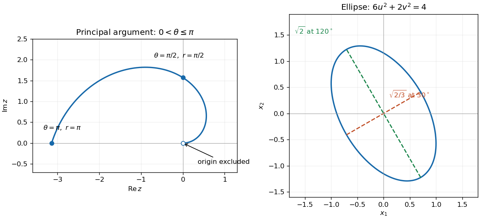

<h1 id="1/solution">Solution</h1>

↑ **Parent:** [1](../1.md)

Use [polar coordinates](../../../polar-coordinates.md) $z=re^{i\theta}$, where $r=|z|\geq0$. The equation sets $r=\theta$, giving an [Archimedean spiral](../../../archimedean-spiral.md). The origin is excluded because the [complex argument](../../../argument-complex-analysis.md) of zero is undefined. With the principal [complex argument](../../../argument-complex-analysis.md) in $(-\pi,\pi]$, the locus is

$$
\boxed{z(\theta)=\theta\cos\theta+i\theta\sin\theta,\qquad0<\theta\leq\pi.}
$$

It approaches the excluded origin along the positive real axis, passes through $i\pi/2$, and ends at $-\pi$. The choice of argument matters: the convention $[0,2\pi)$ instead gives $0<\theta<2\pi$, while allowing all values of the [complex argument](../../../argument-complex-analysis.md) gives every turn with $\theta>0$.

**[Figure 1](#1/image-the-principal-argument-spiral-and-the-rotated-ellipse-obtained-from-the-quadratic-form). The principal-argument spiral and the rotated ellipse obtained from the quadratic form**.

## ↑ Ancestors (11)

1. [1](../1.md)
2. [2015](../../2015-split.md)
3. [Past exam of the mathematical methods I course of the University of Oxford](../../split.md)
4. [Mathematical methods I course of the University of Oxford](../../../mathematical-methods-i-course-of-the-university-of-oxford.md)
5. [Year 1 of the physics course of the University of Oxford](../../../year-1-of-the-physics-course-of-the-university-of-oxford.md)
6. [Physics course of the University of Oxford](../../../physics-course-of-the-university-of-oxford.md)
7. [Undergraduate course of the University of Oxford](../../../undergraduate-course-of-the-university-of-oxford.md)
8. [Course of the University of Oxford](../../../course-of-the-university-of-oxford.md)
9. [University of Oxford](../../../university-of-oxford-split.md)
10. [List of universities](../../../list-of-universities.md)
11. [Codex Wiki](../../../split.md)
