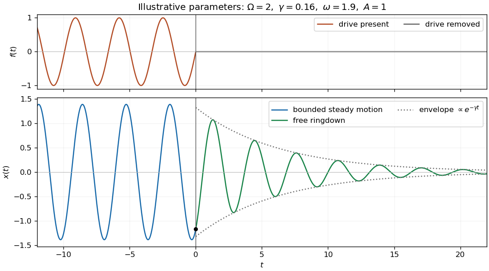

<h1 id="11/ii/solution">Solution</h1>

↑ **Parent:** [Ii](../ii.md)

After the force is removed, the [damped harmonic oscillator](../../../../damped-harmonic-oscillator.md) evolves freely. There is no impulsive force at zero, so both displacement and velocity are continuous. Matching the values in part (i) gives

$$
\boxed{x(t)=e^{-\gamma t}\left[x_0\cos\nu t+\frac{v_0+\gamma x_0}{\nu}\sin\nu t\right],\qquad t>0.}
$$

Equivalently,

$$
x(t)=\frac{A\omega e^{-\gamma t}}N\left[-2\gamma\cos\nu t+\frac{\Omega^2-\omega^2-2\gamma^2}{\nu}\sin\nu t\right].
$$

This is bounded in positive time, completing the unique globally bounded solution. The formulas also include $\omega=0$, for which the forcing and solution both vanish.

**[Figure 2](#11/ii/image-steady-forced-motion-before-switch-off-joins-continuously-to-a-freely-decaying-oscillation). Steady forced motion before switch-off joins continuously to a freely decaying oscillation**.

## ↑ Ancestors (12)

1. [Ii](../ii.md)
2. [11](../../11.md)
3. [2015](../../../2015-split.md)
4. [Past exam of the mathematical methods I course of the University of Oxford](../../../split.md)
5. [Mathematical methods I course of the University of Oxford](../../../../mathematical-methods-i-course-of-the-university-of-oxford.md)
6. [Year 1 of the physics course of the University of Oxford](../../../../year-1-of-the-physics-course-of-the-university-of-oxford.md)
7. [Physics course of the University of Oxford](../../../../physics-course-of-the-university-of-oxford.md)
8. [Undergraduate course of the University of Oxford](../../../../undergraduate-course-of-the-university-of-oxford.md)
9. [Course of the University of Oxford](../../../../course-of-the-university-of-oxford.md)
10. [University of Oxford](../../../../university-of-oxford-split.md)
11. [List of universities](../../../../list-of-universities.md)
12. [Codex Wiki](../../../../split.md)
