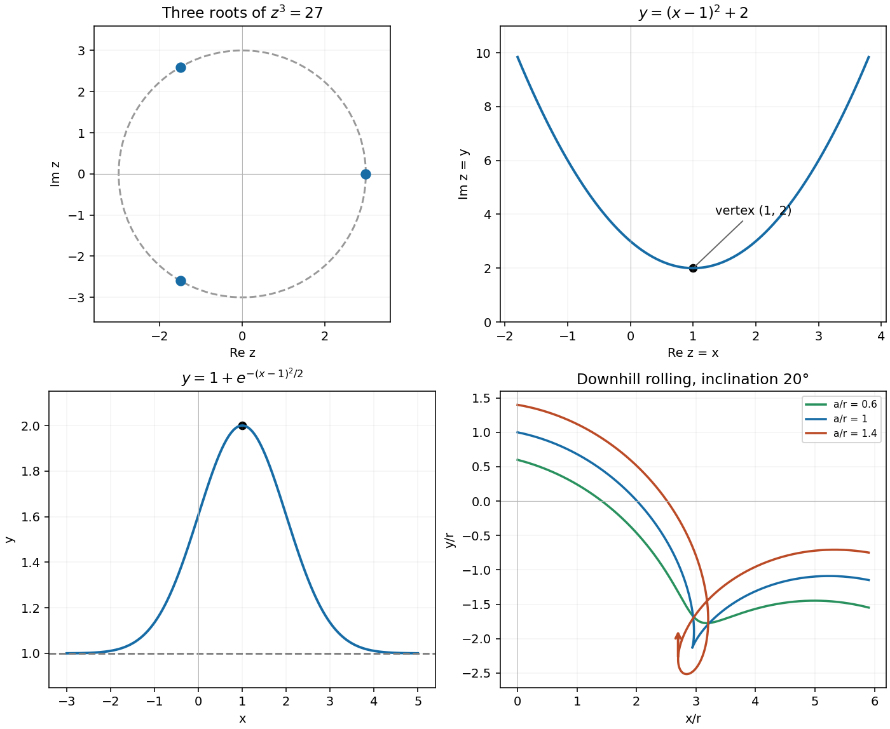
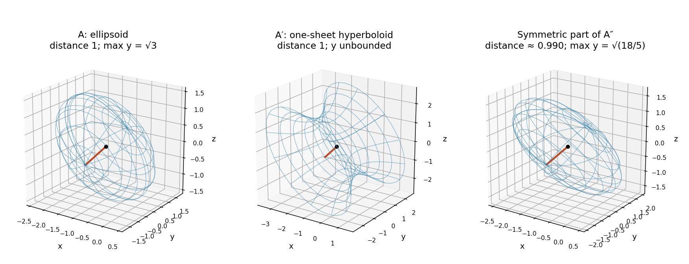
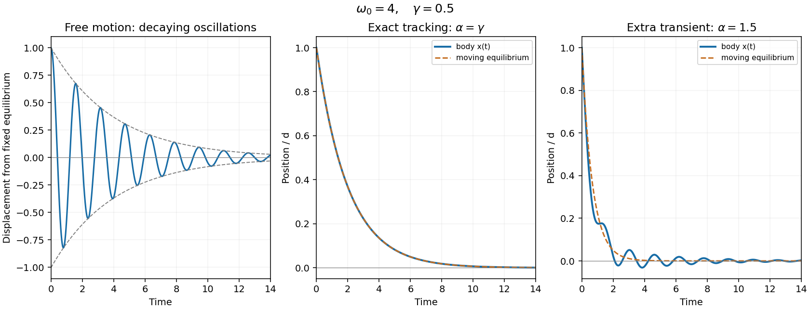

# 2016 resit

↑ **Parent:** [Past exam of the mathematical methods I course of the University of Oxford](../past-exam-of-the-mathematical-methods-i-course-of-the-university-of-oxford.md)

Source paper: [https://www.whatdotheyknow.com/request/physics_past_exam_papers_2015_16/response/973997/attach/3/Cowell%20Attachment.zip?cookie_passthrough=1](https://www.whatdotheyknow.com/request/physics_past_exam_papers_2015_16/response/973997/attach/3/Cowell%20Attachment.zip?cookie_passthrough=1)

**Table of contents**

- [1](#1)
  - [i](#1/i)
    - [Solution](#1/i/solution)
  - [ii](#1/ii)
    - [Solution](#1/ii/solution)
- [2](#2)
  - [Solution](#2/solution)
- [3](#3)
  - [Solution](#3/solution)
- [4](#4)
  - [Solution](#4/solution)
- [5](#5)
  - [Solution](#5/solution)
- [6](#6)
  - [Solution](#6/solution)
- [7](#7)
  - [Solution](#7/solution)
- [8](#8)
  - [a](#8/a)
    - [1](#8/a/1)
      - [Solution](#8/a/1/solution)
    - [2](#8/a/2)
      - [Solution](#8/a/2/solution)
  - [b](#8/b)
    - [Solution](#8/b/solution)
- [9](#9)
  - [i](#9/i)
    - [Solution](#9/i/solution)
  - [ii](#9/ii)
    - [Solution](#9/ii/solution)
  - [iii](#9/iii)
    - [Solution](#9/iii/solution)
  - [iv](#9/iv)
    - [Solution](#9/iv/solution)
  - [v](#9/v)
    - [Solution](#9/v/solution)
- [10](#10)
  - [a](#10/a)
    - [Solution](#10/a/solution)
  - [b](#10/b)
    - [Solution](#10/b/solution)
  - [c](#10/c)
    - [Solution](#10/c/solution)
- [11](#11)
  - [a](#11/a)
    - [Solution](#11/a/solution)
  - [b](#11/b)
    - [Solution](#11/b/solution)
  - [i](#11/i)
    - [Solution](#11/i/solution)
  - [ii](#11/ii)
    - [Solution](#11/ii/solution)
  - [iii](#11/iii)
    - [Solution](#11/iii/solution)

## 1

↑ **Parent:** [2016 resit](2016-resit.md)

<h3 id="1/i">i</h3>

↑ **Parent:** [1](#1)

<h4 id="1/i/solution">Solution</h4>

↑ **Parent:** [I](#1/i)

Write $27=27e^{2\pi i n}$. The three [complex roots](../polynomial.md#complex-root) are

$$
\boxed{z=3,\qquad z=-\frac32+\frac{3\sqrt3}{2}i,\qquad
z=-\frac32-\frac{3\sqrt3}{2}i.}
$$

On the [Argand diagram](../complex-analysis.md#complex-plane), these are three equally spaced points on the circle $|z|=3$, with [arguments](../complex-analysis.md#argument-complex-analysis) $0,2\pi/3,4\pi/3$. They are isolated points, rather than the whole circle.

**[Figure 1](#1/i/image-complex-root-and-parabola-loci-a-first-order-differential-equation-solution-and-rolling-point-trajectories). Complex root and parabola loci, a first-order differential-equation solution, and rolling-point trajectories**.

<h3 id="1/ii">ii</h3>

↑ **Parent:** [1](#1)

<h4 id="1/ii/solution">Solution</h4>

↑ **Parent:** [Ii](#1/ii)

Put $z=x+iy$ and $z^*=x-iy$. The first two squared terms are [complex conjugates](../complex-analysis.md#complex-conjugate), so their sum is $2[(x-2)^2-(y+1)^2]$. Also $zz^*=x^2+y^2$. The equation therefore reduces to

$$
2[(x-2)^2-(y+1)^2]+2(x^2+y^2)+6
=4(x^2-2x-y+3)=0.
$$

Thus the [locus](../euclidean-geometry.md#locus-mathematics) is the upward-opening [parabola](../euclidean-geometry.md#parabola)

$$
\boxed{y=(x-1)^2+2,}
$$

with vertex $1+2i$ and axis $x=1$ in the [Argand diagram](../complex-analysis.md#complex-plane).

## 2

↑ **Parent:** [2016 resit](2016-resit.md)

<h3 id="2/solution">Solution</h3>

↑ **Parent:** [2](#2)

Expanding the [determinant](../multilinear-algebra.md#determinant) along its first row gives

$$
\det A=a(a^2-bc)-b(ac-b^2)+c(c^2-ab)
=a^3+b^3+c^3-3abc.
$$

The required factorization is

$$
\boxed{(a+b+c)(a^2+b^2+c^2-ab-bc-ca).}
$$

Each factor is a [symmetric polynomial](../polynomial.md#symmetric-polynomial). The second is $\tfrac12[(a-b)^2+(b-c)^2+(c-a)^2]$, making its permutation symmetry especially transparent. This factorization holds over both real and complex coefficients.

## 3

↑ **Parent:** [2016 resit](2016-resit.md)

<h3 id="3/solution">Solution</h3>

↑ **Parent:** [3](#3)

Let $R=|\alpha|$, $S=|\beta|$ and $d=|\mathbf b-\mathbf a|$. For distinct centres, the two spherical surfaces intersect exactly when

$$
\boxed{|R-S|\le d\le R+S.}
$$

Strict inequalities give a nondegenerate [circle](../topology.md#circle); equality gives a single tangency point. If $d=0$, equal radii give coincident spheres and unequal radii give no intersection, so the circle-centre formula below does not apply.

Subtracting the squared sphere equations gives the [radical plane](../euclidean-geometry.md#radical-plane)

$$
2(\mathbf b-\mathbf a)\cdot\mathbf r
=|\mathbf b|^2-|\mathbf a|^2+\alpha^2-\beta^2.
$$

The [centre of the circle of intersection of two spheres](../euclidean-geometry.md#centre-of-the-circle-of-intersection-of-two-spheres) is the projection of either sphere centre onto this plane. Write $\mathbf c=\mathbf a+\ell(\mathbf b-\mathbf a)/d$; substitution gives $\ell=(d^2+\alpha^2-\beta^2)/(2d)$ and hence

$$
\boxed{\mathbf c=\frac12\left(\mathbf a+\mathbf b+
\frac{(\alpha^2-\beta^2)(\mathbf b-\mathbf a)}{|\mathbf b-\mathbf a|^2}\right).}
$$

The circle radius squared is $R^2-\ell^2$, providing another check of the intersection conditions.

Its centre equals $\mathbf a$ precisely when $\ell=0$, or $\boxed{\beta^2=\alpha^2+d^2}$. For a positive first radius, the intersection is then a [great circle](../euclidean-geometry.md#great-circle) of the first sphere. A triangle from its centre to an intersection point and then to the second centre is right-angled at $\mathbf a$, explaining the [Pythagorean theorem](../euclidean-geometry.md#pythagorean-theorem) relation geometrically.

## 4

↑ **Parent:** [2016 resit](2016-resit.md)

<h3 id="4/solution">Solution</h3>

↑ **Parent:** [4](#4)

Choose the cylinder centre's initial position as the coordinate origin, with downhill motion to the right and $0\le\alpha<\pi/2$. For [rolling without slipping](../rigid-body-dynamics.md#rolling-without-slipping), the clockwise [angular speed](../rigid-body-dynamics.md#angular-speed) is $\omega=v/r$. A point initially vertically above the axis therefore has

$$
\boxed{x(t)=vt\cos\alpha+a\sin(vt/r),\qquad
y(t)=-vt\sin\alpha+a\cos(vt/r).}
$$

A different origin adds constant coordinates without changing the following [velocity](../classical-mechanics.md#velocity) test. Setting $\theta=vt/r$ gives $\dot x/v=\cos\alpha+(a/r)\cos\theta$ and $\dot y/v=-\sin\alpha-(a/r)\sin\theta$.

For strictly upward motion, $\dot x=0$ and $\dot y>0$. The first condition fixes $\cos\theta=-(r/a)\cos\alpha$; choose the negative sine branch to maximize $\dot y$. Positivity then requires

$$
\sqrt{(a/r)^2-\cos^2\alpha}>\sin\alpha,
\qquad\text{equivalently}\qquad\boxed{a>r.}
$$

At $a=r$ the relevant point is momentarily stationary, not moving upward. Thus a material point inside or on an ordinary cylinder cannot move exactly vertically upward in this motion. The mathematical extension $a>r$ describes the looping [trochoid](../topology.md#trochoid) of a point beyond the rolling radius, illustrated in the figure.

## 5

↑ **Parent:** [2016 resit](2016-resit.md)

<h3 id="5/solution">Solution</h3>

↑ **Parent:** [5](#5)

Rearrange as $y'+(x-1)y=x-1$ and put $w=y-1$. The resulting [linear differential equation](../differential-equation.md#linear-differential-equation) is $w'+(x-1)w=0$, so

$$
\boxed{y=1+C\exp\left[-\frac12(x-1)^2\right].}
$$

The initial condition gives $C=1$. Its graph is a [Gaussian function](../calculus.md#gaussian-function) above the horizontal asymptote $y=1$, symmetric about $x=1$, with its maximum $y=2$ there. It rises for $x<1$ and falls for $x>1$, since $y'=-(x-1)e^{-(x-1)^2/2}$.

## 6

↑ **Parent:** [2016 resit](2016-resit.md)

<h3 id="6/solution">Solution</h3>

↑ **Parent:** [6](#6)

A plane through the three points also contains the origin exactly when their [position vectors](../classical-mechanics.md#position-vector) are linearly dependent. The [scalar triple product](../multilinear-algebra.md#scalar-triple-product) is

$$
\det\begin{pmatrix}1&2&3\\4&5&6\\\gamma&8&7\end{pmatrix}
=27-3\gamma.
$$

Thus $\boxed{\gamma=9}$. The resulting plane is $\boxed{x-2y+z=0}$, which contains all three points and the origin. The points are not collinear: the differences $(3,3,3)$ and $(\gamma-1,6,4)$ cannot be proportional, since their last two components would require $6=4$. Therefore the plane used in the argument is well defined.

## 7

↑ **Parent:** [2016 resit](2016-resit.md)

<h3 id="7/solution">Solution</h3>

↑ **Parent:** [7](#7)

For a [diagonal matrix](../linear-algebra.md#diagonal-matrix), each diagonal entry separately obeys $d^2+2d-15=(d-3)(d+5)=0$. Hence all four possibilities are

$$
\boxed{\operatorname{diag}(3,3),\quad\operatorname{diag}(3,-5),\quad
\operatorname{diag}(-5,3),\quad\operatorname{diag}(-5,-5).}
$$

For the second form, $X^2=I$ gives

$$
(aI+bX)^2+2(aI+bX)
=(a^2+b^2+2a)I+2b(a+1)X.
$$

Because $I,X$ are linearly independent and $b\ne0$, the $X$ coefficient forces $a=-1$; the $I$ coefficient then gives $b^2=16$. Thus

$$
\boxed{A=-I\pm4X=\begin{pmatrix}-1&\pm4\\\pm4&-1\end{pmatrix}.}
$$

Both constants are nonzero, as required.

## 8

↑ **Parent:** [2016 resit](2016-resit.md)

<h3 id="8/a">a</h3>

↑ **Parent:** [8](#8)

<h4 id="8/a/1">1</h4>

↑ **Parent:** [A](#8/a)

<h5 id="8/a/1/solution">Solution</h5>

↑ **Parent:** [1](#8/a/1)

For the [Bernoulli differential equation](../differential-equation.md#bernoulli-differential-equation), work on a branch where $y\ne0$ and the required powers are defined. Multiplication by $(1-m)y^{-m}$ makes the [chain rule](../calculus.md#chain-rule) useful:

$$
z=y^{1-m},\qquad
\boxed{z'+(1-m)f(x)z=(1-m)g(x).}
$$

Thus $\alpha=1-m$, $h=(1-m)f$ and $k=(1-m)g$. The case $m=1$ is already linear and must be treated separately, because the proposed substitution would be constant. Solutions lost by dividing by a power of $y$, particularly $y=0$ when it solves the original equation, must also be checked separately.

<h4 id="8/a/2">2</h4>

↑ **Parent:** [A](#8/a)

<h5 id="8/a/2/solution">Solution</h5>

↑ **Parent:** [2](#8/a/2)

Here $m=2$, so $z=1/y$ obeys $z'-2z\tan x=-\tan^2x$. An [integrating factor](../linear-ordinary-differential-equation.md#integrating-factor) is $\cos^2x$, giving

$$
(z\cos^2x)'=-\sin^2x,
\qquad z\cos^2x=C-\frac x2+\frac{\sin2x}{4}.
$$

The nonzero solutions are therefore

$$
\boxed{y(x)=\frac{\cos^2x}{C-x/2+\sin2x/4}.}
$$

The additional solution is $\boxed{y=0}$. Each formula is interpreted on an interval where $\tan x$ is defined and its displayed denominator is nonzero.

<h3 id="8/b">b</h3>

↑ **Parent:** [8](#8)

<h4 id="8/b/solution">Solution</h4>

↑ **Parent:** [B](#8/b)

The given particular solution $y_p=x^2$ suggests the standard reduction of a [Riccati equation](../analysis.md#riccati-equation). Substitution of $y=x^2+1/v$ gives

$$
-2x^3v'=5x^2v+2,
\qquad v'+\frac{5}{2x}v=-\frac1{x^3}.
$$

On either side of $x=0$, an [integrating factor](../linear-ordinary-differential-equation.md#integrating-factor) is $|x|^{5/2}$, so $v=(C-2\sqrt{|x|})/|x|^{5/2}$. Hence

$$
\boxed{y=x^2\frac{C-\sqrt{|x|}}{C-2\sqrt{|x|}},}
$$

along with the separately recovered particular solution $y=x^2$. The denominator must remain nonzero on the solution interval; $x=0$ is a singular point of the divided differential equation.

For the positive-$x$ branch, $y(1)=(C-1)/(C-2)$ and $y(4)=16(C-2)/(C-4)$. Nonsingular endpoint values exclude $C=2,4$, so

$$
\boxed{y(4)\bigl(3-2y(1)\bigr)=16.}
$$

The particular solution $y=x^2$ gives the same value directly. These evaluations concern one solution branch, with a common integration constant, rather than independently chosen solutions at the two points.

## 9

↑ **Parent:** [2016 resit](2016-resit.md)

<h3 id="9/i">i</h3>

↑ **Parent:** [9](#9)

<h4 id="9/i/solution">Solution</h4>

↑ **Parent:** [I](#9/i)

Both expressions are the same scalar:

$$
\boxed{\mathbf u^{\mathsf T}\mathbf v=\sum_i u_iv_i
=\sum_i v_iu_i=\mathbf v^{\mathsf T}\mathbf u.}
$$

This identity uses the ordinary [transpose](../vector-space.md#transpose) and remains true for complex entries. A [Hermitian inner product](../linear-algebra.md#hermitian-inner-product) uses a conjugate transpose instead and has conjugate symmetry, not this bilinear symmetry.

<h3 id="9/ii">ii</h3>

↑ **Parent:** [9](#9)

<h4 id="9/ii/solution">Solution</h4>

↑ **Parent:** [Ii](#9/ii)

The $y$ coordinate is an independent eigen-direction, while the $xz$ block is $\begin{pmatrix}2&1\\1&2\end{pmatrix}$. Thus

$$
\det(A-\lambda I)=(1-\lambda)^2(3-\lambda),
$$

which gives $\det(A-I)=0$. The [eigenspaces](../linear-operator-theory.md#eigenspace) are

$$
\boxed{\lambda=1:\ \operatorname{span}\{(1,0,-1),(0,1,0)\};\qquad
\lambda=3:\ \operatorname{span}\{(1,0,1)\}.}
$$

Divide the two diagonal $xz$ vectors by $\sqrt2$ to obtain an [orthonormal eigenbasis](../linear-operator-theory.md#orthonormal-eigenbasis). The eigenvalue one has multiplicity two; giving only the $y$ axis would omit an independent eigenvector.

<h3 id="9/iii">iii</h3>

↑ **Parent:** [9](#9)

<h4 id="9/iii/solution">Solution</h4>

↑ **Parent:** [Iii](#9/iii)

Because $A$ is symmetric, translating $\mathbf r=\mathbf x+\mathbf a$ gives

$$
\mathbf x^{\mathsf T}A\mathbf x+(2A\mathbf a+\mathbf b)^{\mathsf T}\mathbf x
+\mathbf a^{\mathsf T}A\mathbf a+\mathbf b^{\mathsf T}\mathbf a=1.
$$

The linear term vanishes when $\boxed{2A\mathbf a+\mathbf b=0}$. Solving gives $\boxed{\mathbf a=(-1,0,0)^{\mathsf T}}$. Since $\mathbf b=-2A\mathbf a$, the remaining constant is

$$
\boxed{C=1+\mathbf a^{\mathsf T}A\mathbf a=3,\qquad
\mathbf x^{\mathsf T}A\mathbf x=3.}
$$

This is [completing the square](../polynomial.md#completing-the-square) for a [quadratic form](../quadratic-form.md).

<h3 id="9/iv">iv</h3>

↑ **Parent:** [9](#9)

<h4 id="9/iv/solution">Solution</h4>

↑ **Parent:** [Iv](#9/iv)

An [orthogonal transformation](../linear-algebra.md#orthogonal-transformation) to the [eigenvectors](../linear-operator-theory.md#eigenvector) preserves distance from the centre and writes the surface as $u^2+v^2+3w^2=3$. It is an [ellipsoid](../euclidean-geometry.md#ellipsoid) with [semi-axes](../euclidean-geometry.md#semi-axis) $\sqrt3,\sqrt3,1$. Therefore

$$
\boxed{\text{nearest distance from }\mathbf a=1.}
$$

The original $y$ axis is one of the eigen-directions with eigenvalue one, and the centre has $a_y=0$. Consequently $y^2\le3$, attained when the other centred coordinates vanish, so $\boxed{y_{\max}=\sqrt3}$.

<h3 id="9/v">v</h3>

↑ **Parent:** [9](#9)

<h4 id="9/v/solution">Solution</h4>

↑ **Parent:** [V](#9/v)

For $A'$, the centre and constant remain $\mathbf a=(-1,0,0)$ and $C=3$. Its [eigenvalues](../linear-operator-theory.md#eigenvalue) are $3,1,-1$, so rotated coordinates put the surface in the form $3u^2+w^2-y^2=3$. This is a [one-sheet hyperboloid](../differential-geometry.md#one-sheet-hyperboloid). Since $3\|\mathbf x\|^2\ge\mathbf x^{\mathsf T}A'\mathbf x=3$, the nearest centre-to-surface distance is at least one, attained in the eigen-direction with eigenvalue three. The coordinate $y$ is unbounded, because arbitrarily large $|y|$ can be balanced by $u$ or $w$. Thus **the nearest distance is one, and there is no maximum value of $y$**.

For the printed nonsymmetric $A''$, use the [symmetric part of a matrix](../linear-algebra.md#symmetric-part-of-a-matrix):

$$
S=\frac{A''+A''^{\mathsf T}}2
=\begin{pmatrix}2&0&1\\0&1&1/2\\1&1/2&2\end{pmatrix},
\qquad \mathbf r^{\mathsf T}A''\mathbf r=\mathbf r^{\mathsf T}S\mathbf r.
$$

The [skew-symmetric part](../linear-algebra.md#skew-symmetric-part-of-a-matrix) contributes zero to this scalar. The same centre solves $2S\mathbf a+\mathbf b=0$, and again $C=3$. Sylvester's positive principal minors are $2,2,5/2$, so this surface is an [ellipsoid](../euclidean-geometry.md#ellipsoid).

Let $\lambda_*$ be the largest [eigenvalue](../linear-operator-theory.md#eigenvalue) of $S$. Its characteristic equation is $4\lambda^3-20\lambda^2+27\lambda-10=0$, and the [Rayleigh quotient](../linear-operator-theory.md#rayleigh-quotient) gives

$$
\boxed{d_{\min}=\sqrt{3/\lambda_*},\qquad
\lambda_*=\frac{5+\sqrt{19}\cos\!\left[\tfrac13\arccos\!\left(\frac{55}{19\sqrt{19}}\right)\right]}{3}.}
$$

For the maximum $y$, the [support function of a centred ellipsoid](../euclidean-geometry.md#support-function-of-a-centred-ellipsoid) gives the bound below. Equivalently, apply the [Cauchy-Schwarz inequality](../probability-and-statistics.md#cauchy-schwarz-inequality) in the $S$-weighted [inner product](../inner-product.md): $y^2\le3\,\mathbf e_y^{\mathsf T}S^{-1}\mathbf e_y$. The inverse entry is $\mathbf e_y^{\mathsf T}S^{-1}\mathbf e_y=6/5$, and equality is attained for a centred vector proportional to $S^{-1}\mathbf e_y$. Thus

$$
\boxed{y_{\max}=\sqrt{18/5}.}
$$

**[Figure 2](#9/v/image-ellipsoid-and-hyperboloid-geometry-after-translation-to-the-common-centre). Ellipsoid and hyperboloid geometry after translation to the common centre**.

Using the eigenvalues of the raw nonsymmetric $A''$ would be incorrect: it is its symmetric part that determines the surface and its Euclidean geometry.

## 10

↑ **Parent:** [2016 resit](2016-resit.md)

<h3 id="10/a">a</h3>

↑ **Parent:** [10](#10)

<h4 id="10/a/solution">Solution</h4>

↑ **Parent:** [A](#10/a)

The vector $(0,1,-1)$ is an [eigenvector](../linear-operator-theory.md#eigenvector) with [eigenvalue](../linear-operator-theory.md#eigenvalue) one. The other two orthogonal directions give eigenvalues two and five, leading to

$$
\boxed{V=\begin{pmatrix}
0&1/\sqrt3&2/\sqrt6\\
1/\sqrt2&1/\sqrt3&-1/\sqrt6\\
-1/\sqrt2&1/\sqrt3&-1/\sqrt6
\end{pmatrix},\qquad D=\operatorname{diag}(1,2,5).}
$$

Its columns are an [orthonormal eigenbasis](../linear-operator-theory.md#orthonormal-eigenbasis), so $V^{\mathsf T}V=I$ and $V^{\mathsf T}AV=D$. Multiplying by $V$ and $V^{\mathsf T}$ gives $\boxed{A=VDV^{\mathsf T}}$. Eigenvector signs and the joint order of columns and diagonal entries may be changed consistently.

<h3 id="10/b">b</h3>

↑ **Parent:** [10](#10)

<h4 id="10/b/solution">Solution</h4>

↑ **Parent:** [B](#10/b)

The [matrix exponential](../linear-operator-theory.md#matrix-exponential) acts entrywise on a diagonal matrix, so

$$
\boxed{e^B=\operatorname{diag}(e^3,e^4,1).}
$$

For the two-dimensional matrix $C$, direct multiplication gives $C^2=-C$, hence $C^n=(-1)^{n-1}C$ for $n\ge1$. Summing its defining [power series](../sequence-and-series.md#power-series) gives

$$
\boxed{e^C=I+(1-e^{-1})C
=\begin{pmatrix}1&0\\1-e^{-1}&e^{-1}\end{pmatrix}.}
$$

Finally, $e^A=V\operatorname{diag}(e,e^2,e^5)V^{\mathsf T}$, so each diagonal entry is a weighted sum of these exponential eigenvalues, with weights equal to squared eigenvector components:

$$
\boxed{(e^A)_{11}=\frac{e^2}{3}+\frac{2e^5}{3},\qquad
(e^A)_{22}=(e^A)_{33}=\frac e2+\frac{e^2}{3}+\frac{e^5}{6}.}
$$

<h3 id="10/c">c</h3>

↑ **Parent:** [10](#10)

<h4 id="10/c/solution">Solution</h4>

↑ **Parent:** [C](#10/c)

In a submultiplicative [matrix norm](../vector-space.md#matrix-norm), the exponential series is absolutely convergent. Its [Cauchy product](../sequence-and-series.md#cauchy-product) can therefore be grouped by the total degree:

$$
e^Ae^B=\sum_{n=0}^{\infty}\sum_{j=0}^n\frac{A^jB^{n-j}}{j!(n-j)!}
=\sum_{n=0}^{\infty}\frac1{n!}\sum_{j=0}^n\binom nj A^jB^{n-j}.
$$

When $AB=BA$, the inner sum is $(A+B)^n$ by the [binomial theorem](../binomial-coefficient.md#binomial-theorem). Thus $\boxed{e^Ae^B=e^{A+B}}$. The commutation assumption is used precisely in that binomial expansion; absolute convergence alone does not supply it.

## 11

↑ **Parent:** [2016 resit](2016-resit.md)

<h3 id="11/a">a</h3>

↑ **Parent:** [11](#11)

<h4 id="11/a/solution">Solution</h4>

↑ **Parent:** [A](#11/a)

Assume $k>0$, $m>0$ and $\gamma\ge0$. The [spring constant](../elasticity-physics.md#spring-constant) $k$ measures restoring [force](../force.md) per displacement from the equilibrium position $x_0$. The term $-\gamma m v$ is [linear drag](../fluid-mechanics.md#linear-drag), with damping rate $\gamma$ in inverse-time units. Writing $\omega_0=\sqrt{k/m}$, the equation is

$$
\ddot x+\gamma\dot x+\omega_0^2(x-x_0)=0.
$$

For small positive damping it gives [underdamped](../wave-equation.md#underdamping) motion: oscillations about $x_0$ with a decaying amplitude. If $\gamma=0$, the motion is undamped [simple harmonic motion](../classical-mechanics.md#simple-harmonic-motion).

<h3 id="11/b">b</h3>

↑ **Parent:** [11](#11)

<h4 id="11/b/solution">Solution</h4>

↑ **Parent:** [B](#11/b)

Set $\omega_d=\sqrt{\omega_0^2-\gamma^2/4}>0$. The real solution of the [damped harmonic oscillator](../analysis.md#damped-harmonic-oscillator) equation is $x-x_0=e^{-\gamma t/2}(A\cos\omega_dt+B\sin\omega_dt)$. The initial displacement fixes $A=a-x_0$, and release from rest gives $B=\gamma A/(2\omega_d)$. Therefore

$$
\boxed{x(t)=x_0+(a-x_0)e^{-\gamma t/2}
\left(\cos\omega_dt+\frac{\gamma}{2\omega_d}\sin\omega_dt\right).}
$$

The [exponential decay](../analysis.md#exponential-decay) rate of the amplitude is $\gamma/2$, while the weak-damping energy decay rate is $\gamma$.

<h3 id="11/i">i</h3>

↑ **Parent:** [11](#11)

<h4 id="11/i/solution">Solution</h4>

↑ **Parent:** [I](#11/i)

The amplitude envelope falls by $e^{-1/2}$ when $e^{-\gamma t/2}=e^{-1/2}$, so $t=1/\gamma$. Dividing by the period $2\pi/\omega_d$ gives

$$
\boxed{N=\frac{\omega_d}{2\pi\gamma}\simeq\frac{\omega_0}{2\pi\gamma}.}
$$

This is a cycle-count estimate in the small-damping regime, not necessarily an integer. With zero damping there is no amplitude decay and no finite such time.

<h3 id="11/ii">ii</h3>

↑ **Parent:** [11](#11)

<h4 id="11/ii/solution">Solution</h4>

↑ **Parent:** [Ii](#11/ii)

The weak-damping [mechanical energy](../energy.md#mechanical-energy) is proportional to the squared oscillation amplitude, so it decays as $e^{-\gamma t}$. Over one period $P=2\pi/\omega_d$, the fractional loss is $1-e^{-\gamma P}\simeq\gamma P$. Hence

$$
\boxed{\frac{E}{\Delta E}\simeq\frac1{\gamma P}
\simeq\frac{\omega_0}{2\pi\gamma}.}
$$

For the release-from-rest solution, comparison at successive corresponding turning points gives the more precise ratio $E/\Delta E=(1-e^{-\gamma P})^{-1}$. The [quality factor](../dynamical-systems.md#q-factor) is $Q\simeq2\pi E/\Delta E=\omega_0/\gamma$; the requested energy-to-loss ratio itself has the extra factor $1/(2\pi)$.

<h3 id="11/iii">iii</h3>

↑ **Parent:** [11](#11)

<h4 id="11/iii/solution">Solution</h4>

↑ **Parent:** [Iii](#11/iii)

The moving equilibrium produces a [forced harmonic oscillator](../analysis.md#forced-harmonic-oscillator):

$$
\ddot x+\gamma\dot x+\omega_0^2x=\omega_0^2d e^{-\alpha t}.
$$

A particular solution is $F e^{-\alpha t}$, where $F=\omega_0^2d/(\alpha^2-\gamma\alpha+\omega_0^2)$. The denominator equals $(\alpha-\gamma/2)^2+\omega_d^2>0$, so it cannot vanish for real $\alpha$ under the given underdamping condition. Imposing both initial conditions gives

$$
\boxed{x(t)=F e^{-\alpha t}+(d-F)e^{-\gamma t/2}
\left[\cos\omega_dt+\frac{\gamma/2-\alpha}{\omega_d}\sin\omega_dt\right].}
$$

For $\alpha=\gamma$, $F=d$, so the entire oscillatory term vanishes:

$$
\boxed{x(t)=d e^{-\gamma t}=x_0(t).}
$$

The body is [tracking an exponentially moving equilibrium without oscillation](../analysis.md#tracking-an-exponentially-moving-equilibrium-without-oscillation). There is no spring extension in this special motion: [linear drag](../fluid-mechanics.md#linear-drag) alone supplies $m\ddot x=\gamma^2md e^{-\gamma t}$. An underdamped homogeneous equation does not require every forced solution to contain an oscillatory transient.

**[Figure 3](#11/iii/image-free-damped-oscillations-and-exact-tracking-of-an-exponentially-moving-equilibrium). Free damped oscillations and exact tracking of an exponentially moving equilibrium**.

## ↑ Ancestors (9)

1. [Past exam of the mathematical methods I course of the University of Oxford](../past-exam-of-the-mathematical-methods-i-course-of-the-university-of-oxford.md)
2. [Mathematical methods I course of the University of Oxford](../university-of-oxford.md#mathematical-methods-i-course-of-the-university-of-oxford)
3. [Year 1 of the physics course of the University of Oxford](../university-of-oxford.md#year-1-of-the-physics-course-of-the-university-of-oxford)
4. [Physics course of the University of Oxford](../university-of-oxford.md#physics-course-of-the-university-of-oxford)
5. [Undergraduate course of the University of Oxford](../university-of-oxford.md#undergraduate-course-of-the-university-of-oxford)
6. [Course of the University of Oxford](../university-of-oxford.md#course-of-the-university-of-oxford)
7. [University of Oxford](../university-of-oxford.md)
8. [List of universities](../README.md#list-of-universities)
9. [Codex Wiki](../README.md)
