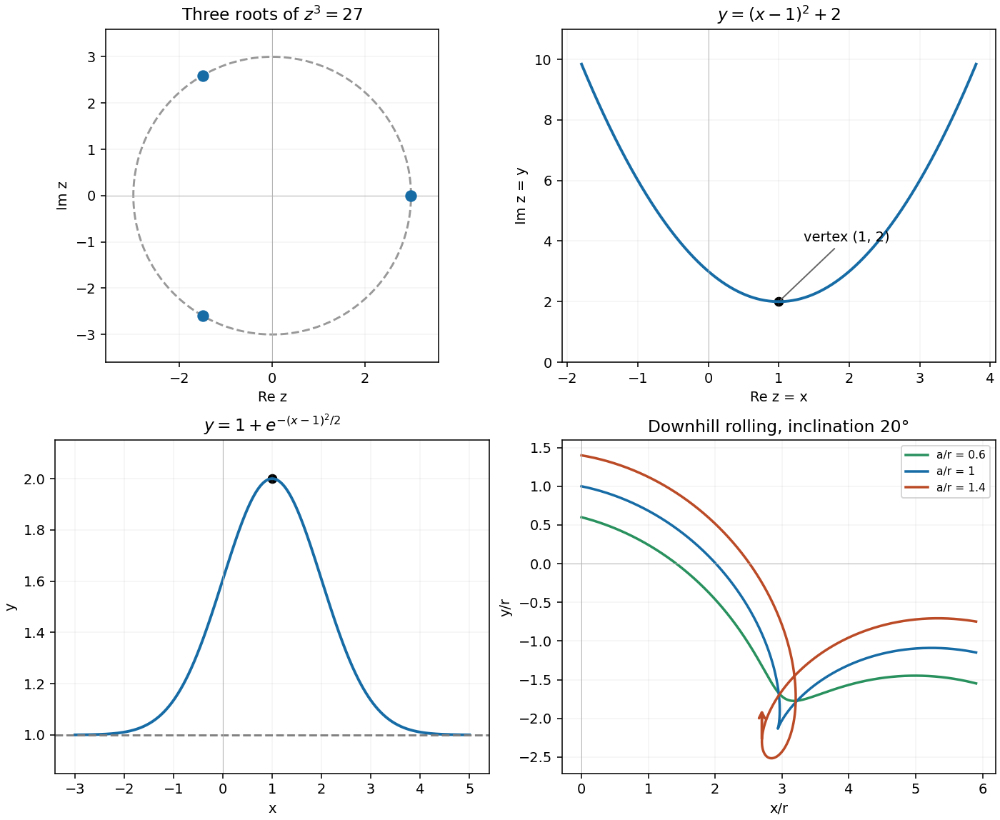

<h1 id="1/i/solution">Solution</h1>

↑ **Parent:** [I](../i.md)

Write $27=27e^{2\pi i n}$. The three [complex roots](../../../../complex-root.md) are

$$
\boxed{z=3,\qquad z=-\frac32+\frac{3\sqrt3}{2}i,\qquad
z=-\frac32-\frac{3\sqrt3}{2}i.}
$$

On the [Argand diagram](../../../../complex-plane.md), these are three equally spaced points on the circle $|z|=3$, with [arguments](../../../../argument-complex-analysis.md) $0,2\pi/3,4\pi/3$. They are isolated points, rather than the whole circle.

**[Figure 1](#1/i/image-complex-root-and-parabola-loci-a-first-order-differential-equation-solution-and-rolling-point-trajectories). Complex root and parabola loci, a first-order differential-equation solution, and rolling-point trajectories**.

## ↑ Ancestors (12)

1. [I](../i.md)
2. [1](../../1.md)
3. [2016 resit](../../../2016-resit-split.md)
4. [Past exam of the mathematical methods I course of the University of Oxford](../../../split.md)
5. [Mathematical methods I course of the University of Oxford](../../../../mathematical-methods-i-course-of-the-university-of-oxford.md)
6. [Year 1 of the physics course of the University of Oxford](../../../../year-1-of-the-physics-course-of-the-university-of-oxford.md)
7. [Physics course of the University of Oxford](../../../../physics-course-of-the-university-of-oxford.md)
8. [Undergraduate course of the University of Oxford](../../../../undergraduate-course-of-the-university-of-oxford.md)
9. [Course of the University of Oxford](../../../../course-of-the-university-of-oxford.md)
10. [University of Oxford](../../../../university-of-oxford-split.md)
11. [List of universities](../../../../list-of-universities.md)
12. [Codex Wiki](../../../../split.md)
