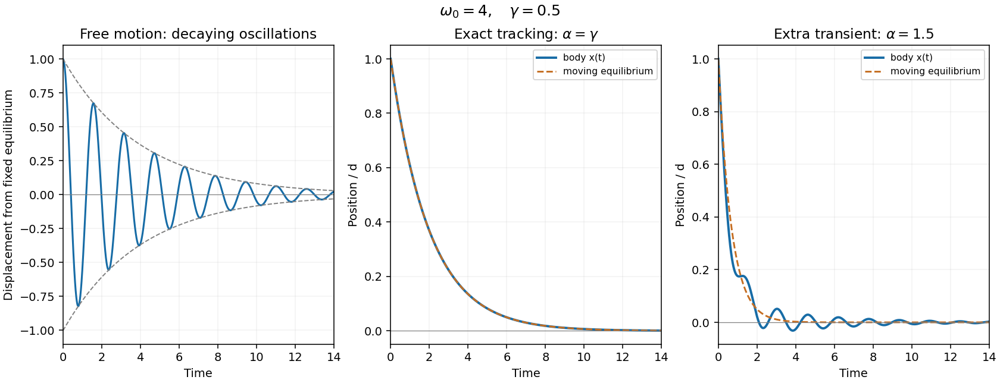

<h1 id="11/iii/solution">Solution</h1>

↑ **Parent:** [Iii](../iii.md)

The moving equilibrium produces a [forced harmonic oscillator](../../../../forced-harmonic-oscillator.md):

$$
\ddot x+\gamma\dot x+\omega_0^2x=\omega_0^2d e^{-\alpha t}.
$$

A particular solution is $F e^{-\alpha t}$, where $F=\omega_0^2d/(\alpha^2-\gamma\alpha+\omega_0^2)$. The denominator equals $(\alpha-\gamma/2)^2+\omega_d^2>0$, so it cannot vanish for real $\alpha$ under the given underdamping condition. Imposing both initial conditions gives

$$
\boxed{x(t)=F e^{-\alpha t}+(d-F)e^{-\gamma t/2}
\left[\cos\omega_dt+\frac{\gamma/2-\alpha}{\omega_d}\sin\omega_dt\right].}
$$

For $\alpha=\gamma$, $F=d$, so the entire oscillatory term vanishes:

$$
\boxed{x(t)=d e^{-\gamma t}=x_0(t).}
$$

The body is [tracking an exponentially moving equilibrium without oscillation](../../../../tracking-an-exponentially-moving-equilibrium-without-oscillation.md). There is no spring extension in this special motion: [linear drag](../../../../linear-drag.md) alone supplies $m\ddot x=\gamma^2md e^{-\gamma t}$. An underdamped homogeneous equation does not require every forced solution to contain an oscillatory transient.

**[Figure 3](#11/iii/image-free-damped-oscillations-and-exact-tracking-of-an-exponentially-moving-equilibrium). Free damped oscillations and exact tracking of an exponentially moving equilibrium**.

## ↑ Ancestors (12)

1. [Iii](../iii.md)
2. [11](../../11.md)
3. [2016 resit](../../../2016-resit-split.md)
4. [Past exam of the mathematical methods I course of the University of Oxford](../../../split.md)
5. [Mathematical methods I course of the University of Oxford](../../../../mathematical-methods-i-course-of-the-university-of-oxford.md)
6. [Year 1 of the physics course of the University of Oxford](../../../../year-1-of-the-physics-course-of-the-university-of-oxford.md)
7. [Physics course of the University of Oxford](../../../../physics-course-of-the-university-of-oxford.md)
8. [Undergraduate course of the University of Oxford](../../../../undergraduate-course-of-the-university-of-oxford.md)
9. [Course of the University of Oxford](../../../../course-of-the-university-of-oxford.md)
10. [University of Oxford](../../../../university-of-oxford-split.md)
11. [List of universities](../../../../list-of-universities.md)
12. [Codex Wiki](../../../../split.md)
