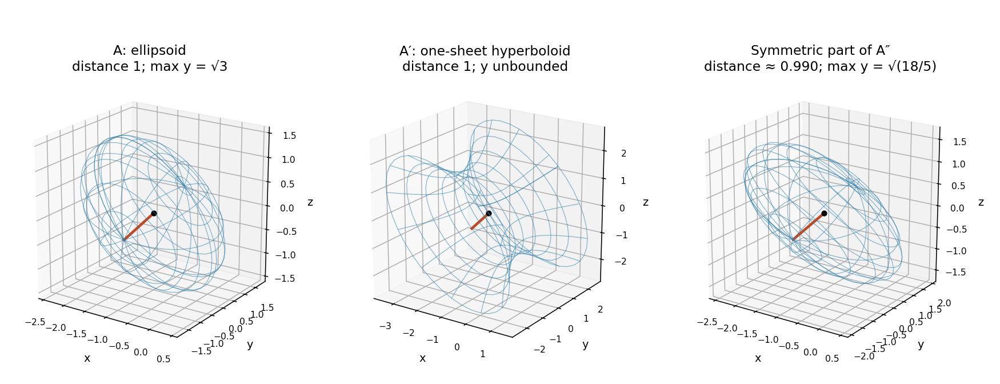

<h1 id="9/v/solution">Solution</h1>

↑ **Parent:** [V](../v.md)

For $A'$, the centre and constant remain $\mathbf a=(-1,0,0)$ and $C=3$. Its [eigenvalues](../../../../eigenvalue.md) are $3,1,-1$, so rotated coordinates put the surface in the form $3u^2+w^2-y^2=3$. This is a [one-sheet hyperboloid](../../../../one-sheet-hyperboloid.md). Since $3\|\mathbf x\|^2\ge\mathbf x^{\mathsf T}A'\mathbf x=3$, the nearest centre-to-surface distance is at least one, attained in the eigen-direction with eigenvalue three. The coordinate $y$ is unbounded, because arbitrarily large $|y|$ can be balanced by $u$ or $w$. Thus **the nearest distance is one, and there is no maximum value of $y$**.

For the printed nonsymmetric $A''$, use the [symmetric part of a matrix](../../../../symmetric-part-of-a-matrix.md):

$$
S=\frac{A''+A''^{\mathsf T}}2
=\begin{pmatrix}2&0&1\\0&1&1/2\\1&1/2&2\end{pmatrix},
\qquad \mathbf r^{\mathsf T}A''\mathbf r=\mathbf r^{\mathsf T}S\mathbf r.
$$

The [skew-symmetric part](../../../../skew-symmetric-part-of-a-matrix.md) contributes zero to this scalar. The same centre solves $2S\mathbf a+\mathbf b=0$, and again $C=3$. Sylvester's positive principal minors are $2,2,5/2$, so this surface is an [ellipsoid](../../../../ellipsoid.md).

Let $\lambda_*$ be the largest [eigenvalue](../../../../eigenvalue.md) of $S$. Its characteristic equation is $4\lambda^3-20\lambda^2+27\lambda-10=0$, and the [Rayleigh quotient](../../../../rayleigh-quotient.md) gives

$$
\boxed{d_{\min}=\sqrt{3/\lambda_*},\qquad
\lambda_*=\frac{5+\sqrt{19}\cos\!\left[\tfrac13\arccos\!\left(\frac{55}{19\sqrt{19}}\right)\right]}{3}.}
$$

For the maximum $y$, the [support function of a centred ellipsoid](../../../../support-function-of-a-centred-ellipsoid.md) gives the bound below. Equivalently, apply the [Cauchy-Schwarz inequality](../../../../cauchy-schwarz-inequality.md) in the $S$-weighted [inner product](../../../../inner-product-split.md): $y^2\le3\,\mathbf e_y^{\mathsf T}S^{-1}\mathbf e_y$. The inverse entry is $\mathbf e_y^{\mathsf T}S^{-1}\mathbf e_y=6/5$, and equality is attained for a centred vector proportional to $S^{-1}\mathbf e_y$. Thus

$$
\boxed{y_{\max}=\sqrt{18/5}.}
$$

**[Figure 2](#9/v/image-ellipsoid-and-hyperboloid-geometry-after-translation-to-the-common-centre). Ellipsoid and hyperboloid geometry after translation to the common centre**.

Using the eigenvalues of the raw nonsymmetric $A''$ would be incorrect: it is its symmetric part that determines the surface and its Euclidean geometry.

## ↑ Ancestors (12)

1. [V](../v.md)
2. [9](../../9.md)
3. [2016 resit](../../../2016-resit-split.md)
4. [Past exam of the mathematical methods I course of the University of Oxford](../../../split.md)
5. [Mathematical methods I course of the University of Oxford](../../../../mathematical-methods-i-course-of-the-university-of-oxford.md)
6. [Year 1 of the physics course of the University of Oxford](../../../../year-1-of-the-physics-course-of-the-university-of-oxford.md)
7. [Physics course of the University of Oxford](../../../../physics-course-of-the-university-of-oxford.md)
8. [Undergraduate course of the University of Oxford](../../../../undergraduate-course-of-the-university-of-oxford.md)
9. [Course of the University of Oxford](../../../../course-of-the-university-of-oxford.md)
10. [University of Oxford](../../../../university-of-oxford-split.md)
11. [List of universities](../../../../list-of-universities.md)
12. [Codex Wiki](../../../../split.md)
