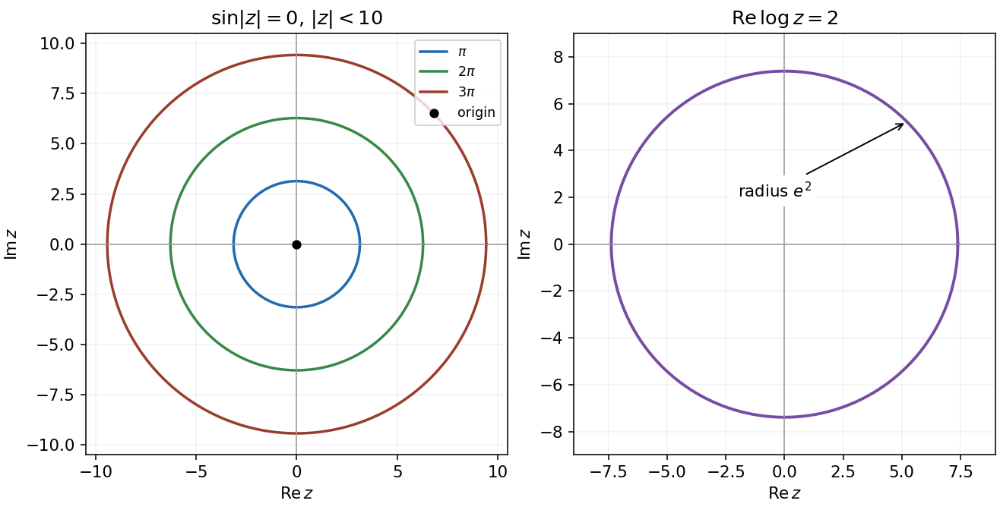
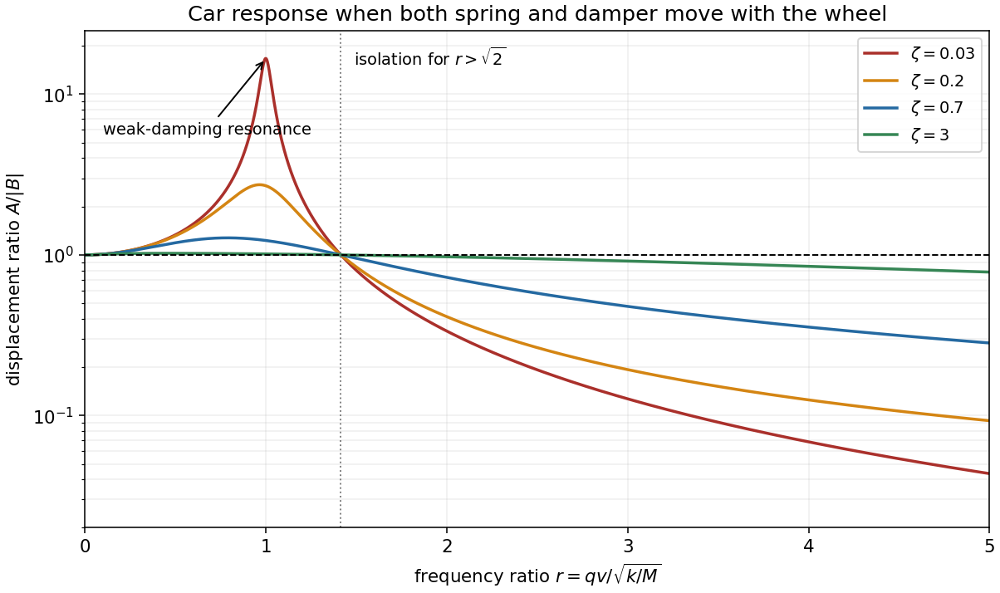
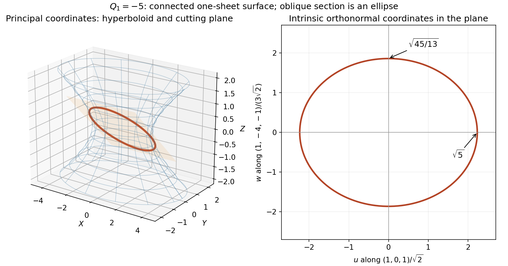
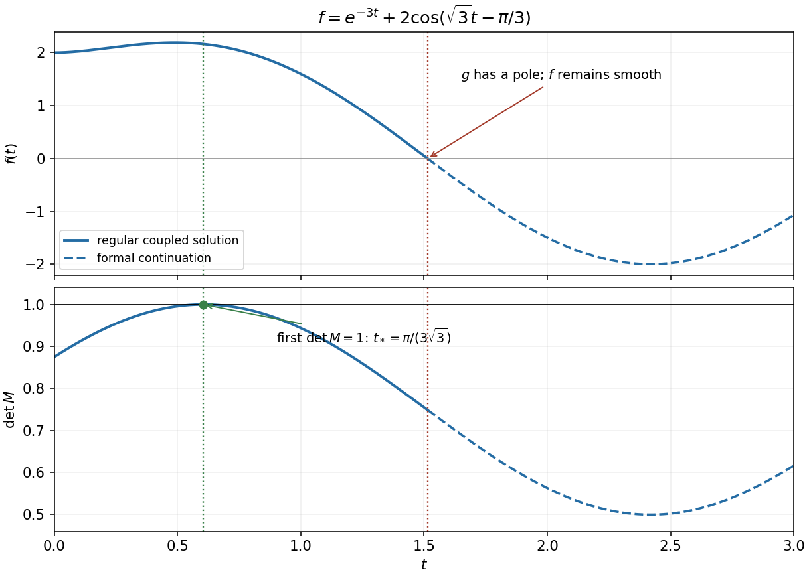

# 2016

↑ **Parent:** [Past exam of the mathematical methods I course of the University of Oxford](../past-exam-of-the-mathematical-methods-i-course-of-the-university-of-oxford.md)

Source paper: [https://www.whatdotheyknow.com/request/physics_past_exam_papers_2015_16/response/973997/attach/3/Cowell%20Attachment.zip?cookie_passthrough=1](https://www.whatdotheyknow.com/request/physics_past_exam_papers_2015_16/response/973997/attach/3/Cowell%20Attachment.zip?cookie_passthrough=1)

**Table of contents**

- [1](#1)
  - [i](#1/i)
    - [Solution](#1/i/solution)
  - [ii](#1/ii)
    - [Solution](#1/ii/solution)
- [2](#2)
  - [Solution](#2/solution)
- [3](#3)
  - [Solution](#3/solution)
- [4](#4)
  - [Solution](#4/solution)
- [5](#5)
  - [Solution](#5/solution)
- [6](#6)
  - [Solution](#6/solution)
- [7](#7)
  - [Solution](#7/solution)
- [8](#8)
  - [Solution](#8/solution)
- [9](#9)
  - [a](#9/a)
    - [Solution](#9/a/solution)
  - [b](#9/b)
    - [Solution](#9/b/solution)
  - [c](#9/c)
    - [Solution](#9/c/solution)
  - [d](#9/d)
    - [Solution](#9/d/solution)
- [10](#10)
  - [Solution](#10/solution)
- [11](#11)
  - [a](#11/a)
    - [i](#11/a/i)
      - [Solution](#11/a/i/solution)
    - [ii](#11/a/ii)
      - [Solution](#11/a/ii/solution)
    - [iii](#11/a/iii)
      - [Solution](#11/a/iii/solution)
    - [iv](#11/a/iv)
      - [Solution](#11/a/iv/solution)
  - [b](#11/b)
    - [Solution](#11/b/solution)

## 1

↑ **Parent:** [2016](2016.md)

<h3 id="1/i">i</h3>

↑ **Parent:** [1](#1)

<h4 id="1/i/solution">Solution</h4>

↑ **Parent:** [I](#1/i)

The nonnegative [modulus](../complex-analysis.md#modulus) $r=|z|$ must be a zero of the [sine](../geometry-and-topology.md#sine) function. The restriction $r<10$ permits $r=0,\pi,2\pi,3\pi$, since $3\pi<10<4\pi$. Thus the [locus](../euclidean-geometry.md#locus-mathematics) is **the origin and three concentric circles**, centred at the origin with radii $\pi$, $2\pi$ and $3\pi$. A circle of radius zero is just one point.

**[Figure 1](#1/i/image-complex-plane-loci-sine-of-the-modulus-vanishes-on-three-circles-and-the-origin-real-logarithm-part-fixes-one-circle). Complex-plane loci: sine of the modulus vanishes on three circles and the origin; real logarithm part fixes one circle**.

<h3 id="1/ii">ii</h3>

↑ **Parent:** [1](#1)

<h4 id="1/ii/solution">Solution</h4>

↑ **Parent:** [Ii](#1/ii)

For any value of the [complex logarithm](../analysis.md#complex-logarithm), $\log z=\ln|z|+i\arg z$ up to adding an integer multiple of $2\pi i$. Its [real part](../complex-analysis.md#real-part) therefore satisfies

$$
\operatorname{Re}\log z=2\iff\ln|z|=2\iff\boxed{|z|=e^2.}
$$

The [locus](../euclidean-geometry.md#locus-mathematics) is **the circle centred at the origin with radius $e^2$**. Different logarithm values change only the imaginary part. If a particular analytic [branch of the complex logarithm](../analysis.md#branch-of-the-complex-logarithm) with a cut is imposed, restrict the circle to that branch's domain; the modulus equation itself is branch independent.

## 2

↑ **Parent:** [2016](2016.md)

<h3 id="2/solution">Solution</h3>

↑ **Parent:** [2](#2)

The [complex sine](../geometry-and-topology.md#complex-sine) identity is

$$
\sin(x+iy)=\sin x\cosh y+i\cos x\sinh y.
$$

It follows either from the exponential definition of [sine](../geometry-and-topology.md#sine) or its addition formula, using $\sin(iy)=i\sinh y$ and $\cos(iy)=\cosh y$. Consequently

$$
\boxed{\operatorname{Re}\sin(2+3i)=\sin2\cosh3,\qquad \operatorname{Im}\sin(2+3i)=\cos2\sinh3.}
$$

The angles $2$ and $3$ in these functions are dimensionless; the real trigonometric argument is measured in radians.

## 3

↑ **Parent:** [2016](2016.md)

<h3 id="3/solution">Solution</h3>

↑ **Parent:** [3](#3)

The scalar product $\mathbf r\cdot\hat{\mathbf n}=d$ fixes the component of the [position vector](../classical-mechanics.md#position-vector) along the given [unit normal vector](../differential-geometry.md#unit-normal). Thus the [locus](../euclidean-geometry.md#locus-mathematics) is **a plane normal to $\hat{\mathbf n}$**, through $d\hat{\mathbf n}$. Its signed distance from the origin along that normal is $d$, and its perpendicular [distance](../geometry-and-topology.md#distance) from the origin is $|d|$. Any [displacement](../classical-mechanics.md#displacement) lying within the plane is [orthogonal](../inner-product.md#orthogonal-vectors) to $\hat{\mathbf n}$.

## 4

↑ **Parent:** [2016](2016.md)

<h3 id="4/solution">Solution</h3>

↑ **Parent:** [4](#4)

Noncoplanarity makes the [scalar triple product](../multilinear-algebra.md#scalar-triple-product) $\Delta$ nonzero, so the three displayed vectors form a [reciprocal basis](../multilinear-algebra.md#reciprocal-basis). Their scalar products obey

$$
\mathbf A\cdot\mathbf a=\mathbf B\cdot\mathbf b=\mathbf C\cdot\mathbf c=1,
$$

with all six cross-pairings zero. Therefore, assuming the nonzero $\alpha,\beta,\gamma$ needed to define the three given points,

$$
\mathbf X\cdot\frac{\mathbf a}{\alpha}=\mathbf X\cdot\frac{\mathbf b}{\beta}=\mathbf X\cdot\frac{\mathbf c}{\gamma}=1.
$$

Every difference of two of these points is [orthogonal](../inner-product.md#orthogonal-vectors) to $\mathbf X$. The two independent differences span their [plane](../geometry-and-topology.md#plane), so **$\mathbf X$ is a normal to the plane**, whose equation is $\mathbf X\cdot\mathbf r=1$. Also $\mathbf X\ne0$, because its scalar product with each specified point is $1$.

## 5

↑ **Parent:** [2016](2016.md)

<h3 id="5/solution">Solution</h3>

↑ **Parent:** [5](#5)

The equations are an [eigenvalue problem](../linear-operator-theory.md#eigenvalue-problem) for the [matrix](../vector-space.md#matrix)

$$
A=\begin{pmatrix}2&-2&1\\2&-3&2\\-1&2&0\end{pmatrix}.
$$

A nonzero solution requires $\det(\lambda I-A)=0$. Expanding gives

$$
\det(\lambda I-A)=(\lambda-1)^2(\lambda+3),\qquad \boxed{\lambda=1\ \text{or}\ -3.}
$$

[Row reduction](../numerical-linear-algebra.md#gaussian-elimination) gives the complete [eigenspaces](../linear-operator-theory.md#eigenspace):

$$
\boxed{\begin{aligned}
\lambda=1:&\quad (x,y,z)=s(2,1,0)+t(-1,0,1),\qquad s,t\in\mathbb R,\\
\lambda=-3:&\quad (x,y,z)=u(-1,-2,1),\qquad u\in\mathbb R.
\end{aligned}}
$$

For $\lambda=1$ the solutions form the [plane](../geometry-and-topology.md#plane) $x-2y+z=0$ through the origin; for $\lambda=-3$ they form a [line](../euclidean-geometry.md#straight-line) through the origin. Exclude the zero vector when requiring a nontrivial solution. The repeated [eigenvalue](../linear-operator-theory.md#eigenvalue) $1$ has a two-dimensional [eigenspace](../linear-operator-theory.md#eigenspace); there are three independent [eigenvectors](../linear-operator-theory.md#eigenvector) in total. This matrix is not symmetric, so its different [eigenspaces](../linear-operator-theory.md#eigenspace) need not be mutually [orthogonal](../inner-product.md#orthogonal-vectors).

## 6

↑ **Parent:** [2016](2016.md)

<h3 id="6/solution">Solution</h3>

↑ **Parent:** [6](#6)

Use direction $\mathbf u=(-3,-2,-1)$ and displacement $\mathbf w=(1,2,3)-(6,5,4)=(-5,-3,-1)$. The [point-to-line distance](../topological-analysis.md#distance-from-a-point-to-a-line) is the height of the [parallelogram](../euclidean-geometry.md#parallelogram) spanned by these vectors:

$$
\boxed{D=\frac{|\mathbf w\times\mathbf u|}{|\mathbf u|}=\frac{|(1,-2,1)|}{\sqrt{14}}=\frac{\sqrt{21}}7.}
$$

Equivalently the closest line parameter is $t=(\mathbf w\cdot\mathbf u)/|\mathbf u|^2=11/7$, giving the foot $(9/7,13/7,17/7)$. Its separation from the point is [orthogonal](../inner-product.md#orthogonal-vectors) to $\mathbf u$ and has the same length.

## 7

↑ **Parent:** [2016](2016.md)

<h3 id="7/solution">Solution</h3>

↑ **Parent:** [7](#7)

Measure the car's vertical [displacement](../classical-mechanics.md#displacement) $y$ from its static [equilibrium](../dynamical-systems.md#equilibrium-point-of-a-dynamical-system), so gravity's constant contribution is already balanced. Both the spring and the [viscous damper](../rheology.md#dashpot) act on motion relative to the wheel. The [base-excited oscillator](../analysis.md#base-excited-oscillator) therefore satisfies

$$
M\ddot y=-k(y-y_0)-\gamma(\dot y-\dot y_0).
$$

For dimensional clarity write the road profile as $B\sin(qx)$; the printed notation sets the implicit wave number $q=1$ in the chosen length units. Constant forward speed gives forcing [angular frequency](../lagrangian-mechanics.md#angular-frequency) $\omega=qv$. With complex amplitudes $Y,Y_0$, the steady response is

$$
\frac Y{Y_0}=\frac{k+i\gamma\omega}{k-M\omega^2+i\gamma\omega},\qquad
\boxed{A(v)=|B|\sqrt{\frac{k^2+\gamma^2q^2v^2}{(k-Mq^2v^2)^2+\gamma^2q^2v^2}}.}
$$

Set $q=1$ for the expression in the question's notation. Assuming $M,k>0$ and $\gamma>0$, the [transient response](../dynamical-systems.md#transient-response) decays, leaving this [steady-state response](../analysis.md#steady-state-response).

For a useful sketch define $\omega_n=\sqrt{k/M}$, $r=\omega/\omega_n$ and [damping ratio](../wave-equation.md#damping-ratio) $\zeta=\gamma/(2\sqrt{kM})$. The displacement [transmissibility](../analysis.md#transmissibility) is

$$
\frac A{|B|}=\sqrt{\frac{1+4\zeta^2r^2}{(1-r^2)^2+4\zeta^2r^2}}.
$$

It starts at $1$, rises to a finite maximum for finite positive damping, crosses $1$ at $r=\sqrt2$, then tends to zero. Differentiation with respect to $r^2$ gives the maximum at $r^2=2/[1+\sqrt{1+8\zeta^2}]$.

**Very small damping permits large resonant oscillations** near $\omega_n$, producing discomfort and potentially large suspension travel. At exactly zero damping the assumed decay of transients fails, and resonant forcing produces secular growth. **Very large damping makes the car follow the bumps** over a wide range of speeds, sacrificing vibration isolation: at each fixed forcing frequency, $Y/Y_0\to1$ as $\gamma\to\infty$. For any fixed finite damping the response still eventually decreases at sufficiently high frequency. These two limits should not be interchanged.

**[Figure 2](#7/image-base-excited-car-displacement-response-for-several-damping-ratios-including-the-weak-damping-resonance-and-isolation-threshold). Base-excited car displacement response for several damping ratios, including the weak-damping resonance and isolation threshold**.

## 8

↑ **Parent:** [2016](2016.md)

<h3 id="8/solution">Solution</h3>

↑ **Parent:** [8](#8)

Split the mixed quadratic terms evenly across a [real symmetric matrix](../linear-algebra.md#real-symmetric-matrix):

$$
A=\begin{pmatrix}1&-2&-2\\-2&-4&2\\-2&2&1\end{pmatrix},\qquad Q_1=\mathbf r^TA\mathbf r.
$$

Its [characteristic polynomial](../linear-operator-theory.md#characteristic-polynomial) is

$$
\det(\lambda I-A)=(\lambda+1)(\lambda+5)(\lambda-4)=\lambda^3+2\lambda^2-19\lambda-20,
$$

so **$c=2$**. Choose the orthonormal [eigenvectors](../linear-operator-theory.md#eigenvector)

$$
u_1=\frac{(1,0,1)^T}{\sqrt2},\quad u_2=\frac{(-1,-4,1)^T}{3\sqrt2},\quad u_3=\frac{(-2,1,2)^T}{3},\qquad P=(u_1\ u_2\ u_3).
$$

The [orthogonal transformation](../linear-algebra.md#orthogonal-transformation) $\mathbf r=P\mathbf R$ gives

$$
\boxed{Q_1=-X^2-5Y^2+4Z^2,\qquad Q_2=X^2+Y^2+Z^2,\qquad\beta=-5,\quad\gamma=4.}
$$

Indeed $P^TP=I$ and $P^TAP=\operatorname{diag}(-1,-5,4)$; preserving $Q_2$ is precisely the length-preserving property of an [orthogonal matrix](../linear-algebra.md#orthogonal-matrix).

The requested plane has normal $(2,1,-2)$. An [orthonormal basis](../inner-product.md#orthonormal-basis) within it is

$$
e_1=\frac{(1,0,1)}{\sqrt2},\qquad e_2=\frac{(1,-4,-1)}{3\sqrt2}.
$$

Write a point of that plane as $\mathbf r=ue_1+we_2$. Restricting the [quadratic form](../quadratic-form.md) gives $Q_1=-u^2-(13/9)w^2$, so its section with $Q_1=-5$ is

$$
\boxed{\frac{u^2}{5}+\frac{w^2}{45/13}=1.}
$$

It is an [ellipse](../euclidean-geometry.md#ellipse) centred at the origin, with [semi-axes](../euclidean-geometry.md#semi-axis) $\sqrt5$ along $e_1$ and $\sqrt{45/13}$ along $e_2$. Normalizing the in-plane basis is essential: coefficients in nonorthonormal coordinates would not directly give physical lengths.

The complete surface is the [one-sheet hyperboloid](../differential-geometry.md#one-sheet-hyperboloid)

$$
\frac{X^2}{5}+Y^2-\frac{Z^2}{5/4}=1.
$$

It is connected, extends indefinitely in both directions along its axis $u_3$, and has an elliptical waist at $Z=0$ with [semi-axes](../euclidean-geometry.md#semi-axis) $\sqrt5$ and $1$. At larger $|Z|$ its transverse sections widen; its asymptotic [cone](../euclidean-geometry.md#cone-geometry) is $4Z^2=X^2+5Y^2$. The specified plane is oblique to that axis, rather than the waist plane.

**[Figure 3](#8/image-one-sheet-hyperboloid-in-principal-coordinates-and-its-oblique-elliptical-section-with-the-intrinsic-semi-axis-lengths). One-sheet hyperboloid in principal coordinates and its oblique elliptical section, with the intrinsic semi-axis lengths**.

## 9

↑ **Parent:** [2016](2016.md)

<h3 id="9/a">a</h3>

↑ **Parent:** [9](#9)

<h4 id="9/a/solution">Solution</h4>

↑ **Parent:** [A](#9/a)

For $x\ne0$, the [integrating factor](../linear-ordinary-differential-equation.md#integrating-factor) for $y'-y/x=3$ can be taken as $1/x$ on either half-line. Thus $(y/x)'=3/x$, giving

$$
\boxed{y=x\bigl(C+3\ln|x|\bigr).}
$$

The arbitrary constant may differ on the disconnected domains $x>0$ and $x<0$.

<h3 id="9/b">b</h3>

↑ **Parent:** [9](#9)

<h4 id="9/b/solution">Solution</h4>

↑ **Parent:** [B](#9/b)

The initial point lies in $x>1$, where division by $\ln x$ is valid. The [first-order linear differential equation](../linear-ordinary-differential-equation.md#first-order-linear-differential-equation)

$$
y'+\frac{2}{x\ln x}y=\frac1{\ln x}
$$

has [integrating factor](../linear-ordinary-differential-equation.md#integrating-factor) $(\ln x)^2$. Hence

$$
\frac{d}{dx}\bigl[y(\ln x)^2\bigr]=\ln x,\qquad y(\ln x)^2=x\ln x-x+C.
$$

The condition at $x=e$ sets $C=0$, so

$$
\boxed{y(x)=\frac{x(\ln x-1)}{(\ln x)^2},\qquad x>1.}
$$

The solution cannot be continued regularly through $x=1$: its numerator tends to $-1$ while the denominator tends to zero. The real logarithm also requires $x>0$.

<h3 id="9/c">c</h3>

↑ **Parent:** [9](#9)

<h4 id="9/c/solution">Solution</h4>

↑ **Parent:** [C](#9/c)

The [characteristic equation](../linear-ordinary-differential-equation.md#characteristic-equation-of-a-constant-coefficient-differential-equation) of the homogeneous [ordinary differential equation](../differential-equation.md#ordinary-differential-equation) is $r^2-2r+5=0$, with roots $1\pm2i$. Therefore $y_h=e^x(C\cos2x+D\sin2x)$. For the forcing term, try the [particular solution](../linear-ordinary-differential-equation.md#particular-solution) $y_p=e^{-x}(ax+b)$. Substitution gives $8a=1$, $8b-4a=0$, so $a=1/8$, $b=1/16$. The two initial conditions give $C=-1/16$ and $D=0$. Consequently

$$
\boxed{y(x)=\frac{(2x+1)e^{-x}-e^x\cos2x}{16}.}
$$

Both the value and the first derivative vanish at zero; direct differentiation verifies the inhomogeneous equation.

<h3 id="9/d">d</h3>

↑ **Parent:** [9](#9)

<h4 id="9/d/solution">Solution</h4>

↑ **Parent:** [D](#9/d)

For the [Cauchy-Euler equation](../linear-ordinary-differential-equation.md#cauchy-euler-equation) $x^2y''-xy'+y=0$, the power trial $y=x^r$ on $x>0$ gives $(r-1)^2=0$. The repeated root supplies the logarithmic second solution. On either half-line,

$$
\boxed{y=x\bigl(C_1+C_2\ln|x|\bigr),\qquad x\ne0.}
$$

One may also obtain this by setting $y=xu$, which reduces the equation to $(xu')'=0$. Constants on opposite sides of the singular point need not agree.

## 10

↑ **Parent:** [2016](2016.md)

<h3 id="10/solution">Solution</h3>

↑ **Parent:** [10](#10)

Expanding $R\sin(x+\phi)$ and equating coefficients gives $R\sin\phi=A$, $R\cos\phi=B$. Thus

$$
\boxed{R=\sqrt{A^2+B^2},\qquad \phi=\operatorname{atan2}(A,B)\pmod{2\pi}.}
$$

The two-argument [arctangent](../geometry-and-topology.md#inverse-tangent) fixes the quadrant; if $R=0$, the phase is arbitrary.

For the coupled [ordinary differential equations](../differential-equation.md#ordinary-differential-equation), set $z=fg$. The first equation becomes $\dot z=-3z$, and the initial values give $z=2e^{-3t}$. The second then reduces to $f''+3f=12e^{-3t}$. Its [initial value problem](../differential-equation.md#initial-value-problem) has solution

$$
\boxed{f(t)=e^{-3t}+\cos(\sqrt3t)+\sqrt3\sin(\sqrt3t)=e^{-3t}+2\cos\left(\sqrt3t-\frac\pi3\right).}
$$

Where $f\ne0$, reconstruct $g(t)=2e^{-3t}/f(t)$. The scalar function $f$ is smooth for every real $t$, but the original coupled system cannot have a finite $g$ at its first zero, about $t=1.5146$. The requested sketch up to $t=3$ can display the analytic continuation of $f$, with that distinction marked. Initially $f=2$, $f'=0$ and $f''=6$; it first rises, reaches a maximum, then decreases through zero and becomes negative within the plotted interval.

**[Figure 4](#10/image-the-scalar-solution-and-matrix-determinant-with-the-first-regular-rotation-time-and-the-later-pole-in-the-reconstructed-variable). The scalar solution and matrix determinant, with the first regular rotation time and the later pole in the reconstructed variable**.

For the [determinant](../multilinear-algebra.md#determinant) of $M$, separate its upper-left block from the constant last diagonal entry. Using $fg=2e^{-3t}$ gives

$$
\det M=\frac34+\frac{f(2-g)}{16}=\frac34+\frac{\cos(\sqrt3t)+\sqrt3\sin(\sqrt3t)}8.
$$

Thus $\det M=1$ precisely when $2\cos(\sqrt3t-\pi/3)=2$. The smallest positive solution is

$$
\boxed{t_*=\frac\pi{3\sqrt3}.}
$$

It occurs before the zero of $f$, so $g$ and $M$ are finite there. Put $f_*=2+e^{-\pi/\sqrt3}$. At this time the upper block is

$$
\begin{pmatrix}f_*/(2a)&-\sqrt3/2\\\sqrt3/2&a/(2f_*)\end{pmatrix}.
$$

For a [rotation matrix](../linear-algebra.md#rotation-matrix), each column must have unit norm, giving $a^2=f_*^2$. Both signs are allowed by the stated assumption that $a$ is a constant:

$$
\boxed{\begin{array}{c|c|c}
a&\text{axis}&\text{angle about positive }z\\\hline
2+e^{-\pi/\sqrt3}&z&\pi/3\\
-(2+e^{-\pi/\sqrt3})&z&2\pi/3
\end{array}}
$$

Both have [determinant](../multilinear-algebra.md#determinant) $1$ and preserve lengths. If a positive $a$ is intended, only the first row remains; positivity is not stated in the question.

## 11

↑ **Parent:** [2016](2016.md)

<h3 id="11/a">a</h3>

↑ **Parent:** [11](#11)

<h4 id="11/a/i">i</h4>

↑ **Parent:** [A](#11/a)

<h5 id="11/a/i/solution">Solution</h5>

↑ **Parent:** [I](#11/a/i)

The [transpose of a matrix product](../vector-space.md#transpose-of-a-matrix-product) reverses factor order:

$$
\boxed{(AB)^T=B^TA^T.}
$$

For the requested two-dimensional check, put $A=\left(\begin{smallmatrix}a&b\\c&d\end{smallmatrix}\right)$ and $B=\left(\begin{smallmatrix}e&f\\g&h\end{smallmatrix}\right)$. Both sides are

$$
\begin{pmatrix}ae+bg&ce+dg\\af+bh&cf+dh\end{pmatrix}.
$$

More generally, the entry formula $(AB)_{ji}=\sum_kA_{jk}B_{ki}$ is exactly $(B^TA^T)_{ij}$.

<h4 id="11/a/ii">ii</h4>

↑ **Parent:** [A](#11/a)

<h5 id="11/a/ii/solution">Solution</h5>

↑ **Parent:** [Ii](#11/a/ii)

The [conjugate transpose](../linear-operator-theory.md#conjugate-transpose) also reverses factor order. If $U$ and $V$ are [unitary matrices](../linear-operator-theory.md#unitary-matrix),

$$
(UV)^\dagger(UV)=V^\dagger U^\dagger UV=V^\dagger IV=I.
$$

Thus their product is [unitary](../vector-bundle.md#unitary-connection). This is closure under multiplication in the [unitary group](../topological-group.md#unitary-group).

<h4 id="11/a/iii">iii</h4>

↑ **Parent:** [A](#11/a)

<h5 id="11/a/iii/solution">Solution</h5>

↑ **Parent:** [Iii](#11/a/iii)

For a [Hermitian matrix](../hilbert-space.md#hermitian-operator) $H$, $H^\dagger=H$. Reversing the product of $n$ identical factors has no effect, so

$$
(H^n)^\dagger=(H^\dagger)^n=H^n.
$$

Hence every positive integer power is [Hermitian](../hilbert-space.md#hermitian-operator). The identical-factor condition matters; a product of different [Hermitian matrices](../hilbert-space.md#hermitian-operator) need not be [Hermitian](../hilbert-space.md#hermitian-operator).

<h4 id="11/a/iv">iv</h4>

↑ **Parent:** [A](#11/a)

<h5 id="11/a/iv/solution">Solution</h5>

↑ **Parent:** [Iv](#11/a/iv)

If $A$ and $B$ are [Hermitian matrices](../hilbert-space.md#hermitian-operator), then $(AB)^\dagger=B^\dagger A^\dagger=BA$. Therefore

$$
\boxed{AB\text{ is Hermitian}\iff AB=BA\iff[A,B]=0.}
$$

The required condition is that the matrices [commute](../algebraic-operation.md#commuting-elements).

<h3 id="11/b">b</h3>

↑ **Parent:** [11](#11)

<h4 id="11/b/solution">Solution</h4>

↑ **Parent:** [B](#11/b)

At $t=0$ the [power series](../sequence-and-series.md#power-series) gives $\mathbf v(0)=\mathbf v_0$. Equate the coefficient of $t^n$ after differentiating the series and substituting into the [linear system of ordinary differential equations](../linear-ordinary-differential-equation.md#linear-system-of-differential-equations):

$$
(n+1)\mathbf v_{n+1}=-iH\mathbf v_n.
$$

[Mathematical induction](../foundations-of-mathematics.md#mathematical-induction) yields $\mathbf v_n=(-iH)^n\mathbf v_0/n!$. Summing gives the [matrix exponential](../linear-operator-theory.md#matrix-exponential) solution $\mathbf v(t)=e^{-iHt}\mathbf v_0$.

For the specified diagonal [Hermitian matrix](../hilbert-space.md#hermitian-operator), its powers and exponential act separately on the two components. Thus

$$
\boxed{U(t)=e^{-iHt}=\begin{pmatrix}e^{-it}&0\\0&e^{it}\end{pmatrix},\qquad\mathbf v(t)=U(t)\mathbf v_0.}
$$

This [unitary matrix](../linear-operator-theory.md#unitary-matrix) preserves $\mathbf v^\dagger\mathbf v$: the two components acquire opposite phases of unit [modulus](../complex-analysis.md#modulus). The coefficient recurrence applies to any constant finite square matrix $H$; unitarity here additionally uses its [Hermitian](../hilbert-space.md#hermitian-operator) property.

## ↑ Ancestors (9)

1. [Past exam of the mathematical methods I course of the University of Oxford](../past-exam-of-the-mathematical-methods-i-course-of-the-university-of-oxford.md)
2. [Mathematical methods I course of the University of Oxford](../university-of-oxford.md#mathematical-methods-i-course-of-the-university-of-oxford)
3. [Year 1 of the physics course of the University of Oxford](../university-of-oxford.md#year-1-of-the-physics-course-of-the-university-of-oxford)
4. [Physics course of the University of Oxford](../university-of-oxford.md#physics-course-of-the-university-of-oxford)
5. [Undergraduate course of the University of Oxford](../university-of-oxford.md#undergraduate-course-of-the-university-of-oxford)
6. [Course of the University of Oxford](../university-of-oxford.md#course-of-the-university-of-oxford)
7. [University of Oxford](../university-of-oxford.md)
8. [List of universities](../README.md#list-of-universities)
9. [Codex Wiki](../README.md)
