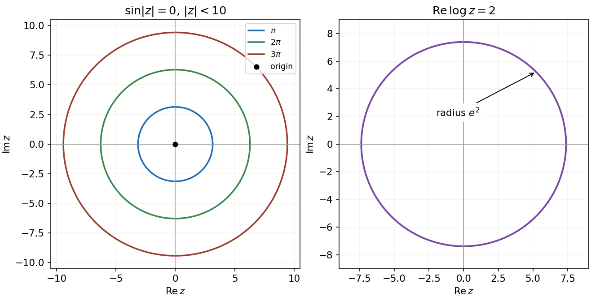

<h1 id="1/i/solution">Solution</h1>

↑ **Parent:** [I](../i.md)

The nonnegative [modulus](../../../../modulus.md) $r=|z|$ must be a zero of the [sine](../../../../sine.md) function. The restriction $r<10$ permits $r=0,\pi,2\pi,3\pi$, since $3\pi<10<4\pi$. Thus the [locus](../../../../locus-mathematics.md) is **the origin and three concentric circles**, centred at the origin with radii $\pi$, $2\pi$ and $3\pi$. A circle of radius zero is just one point.

**[Figure 1](#1/i/image-complex-plane-loci-sine-of-the-modulus-vanishes-on-three-circles-and-the-origin-real-logarithm-part-fixes-one-circle). Complex-plane loci: sine of the modulus vanishes on three circles and the origin; real logarithm part fixes one circle**.

## ↑ Ancestors (12)

1. [I](../i.md)
2. [1](../../1.md)
3. [2016](../../../2016-split.md)
4. [Past exam of the mathematical methods I course of the University of Oxford](../../../split.md)
5. [Mathematical methods I course of the University of Oxford](../../../../mathematical-methods-i-course-of-the-university-of-oxford.md)
6. [Year 1 of the physics course of the University of Oxford](../../../../year-1-of-the-physics-course-of-the-university-of-oxford.md)
7. [Physics course of the University of Oxford](../../../../physics-course-of-the-university-of-oxford.md)
8. [Undergraduate course of the University of Oxford](../../../../undergraduate-course-of-the-university-of-oxford.md)
9. [Course of the University of Oxford](../../../../course-of-the-university-of-oxford.md)
10. [University of Oxford](../../../../university-of-oxford-split.md)
11. [List of universities](../../../../list-of-universities.md)
12. [Codex Wiki](../../../../split.md)
