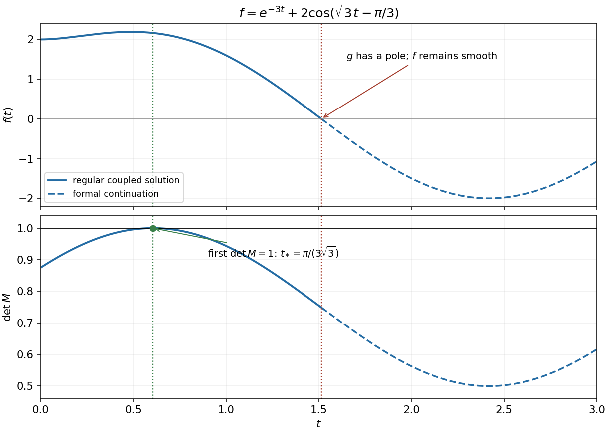

<h1 id="10/solution">Solution</h1>

↑ **Parent:** [10](../10.md)

Expanding $R\sin(x+\phi)$ and equating coefficients gives $R\sin\phi=A$, $R\cos\phi=B$. Thus

$$
\boxed{R=\sqrt{A^2+B^2},\qquad \phi=\operatorname{atan2}(A,B)\pmod{2\pi}.}
$$

The two-argument [arctangent](../../../inverse-tangent.md) fixes the quadrant; if $R=0$, the phase is arbitrary.

For the coupled [ordinary differential equations](../../../ordinary-differential-equation.md), set $z=fg$. The first equation becomes $\dot z=-3z$, and the initial values give $z=2e^{-3t}$. The second then reduces to $f''+3f=12e^{-3t}$. Its [initial value problem](../../../initial-value-problem.md) has solution

$$
\boxed{f(t)=e^{-3t}+\cos(\sqrt3t)+\sqrt3\sin(\sqrt3t)=e^{-3t}+2\cos\left(\sqrt3t-\frac\pi3\right).}
$$

Where $f\ne0$, reconstruct $g(t)=2e^{-3t}/f(t)$. The scalar function $f$ is smooth for every real $t$, but the original coupled system cannot have a finite $g$ at its first zero, about $t=1.5146$. The requested sketch up to $t=3$ can display the analytic continuation of $f$, with that distinction marked. Initially $f=2$, $f'=0$ and $f''=6$; it first rises, reaches a maximum, then decreases through zero and becomes negative within the plotted interval.

**[Figure 4](#10/image-the-scalar-solution-and-matrix-determinant-with-the-first-regular-rotation-time-and-the-later-pole-in-the-reconstructed-variable). The scalar solution and matrix determinant, with the first regular rotation time and the later pole in the reconstructed variable**.

For the [determinant](../../../determinant.md) of $M$, separate its upper-left block from the constant last diagonal entry. Using $fg=2e^{-3t}$ gives

$$
\det M=\frac34+\frac{f(2-g)}{16}=\frac34+\frac{\cos(\sqrt3t)+\sqrt3\sin(\sqrt3t)}8.
$$

Thus $\det M=1$ precisely when $2\cos(\sqrt3t-\pi/3)=2$. The smallest positive solution is

$$
\boxed{t_*=\frac\pi{3\sqrt3}.}
$$

It occurs before the zero of $f$, so $g$ and $M$ are finite there. Put $f_*=2+e^{-\pi/\sqrt3}$. At this time the upper block is

$$
\begin{pmatrix}f_*/(2a)&-\sqrt3/2\\\sqrt3/2&a/(2f_*)\end{pmatrix}.
$$

For a [rotation matrix](../../../rotation-matrix.md), each column must have unit norm, giving $a^2=f_*^2$. Both signs are allowed by the stated assumption that $a$ is a constant:

$$
\boxed{\begin{array}{c|c|c}
a&\text{axis}&\text{angle about positive }z\\\hline
2+e^{-\pi/\sqrt3}&z&\pi/3\\
-(2+e^{-\pi/\sqrt3})&z&2\pi/3
\end{array}}
$$

Both have [determinant](../../../determinant.md) $1$ and preserve lengths. If a positive $a$ is intended, only the first row remains; positivity is not stated in the question.

## ↑ Ancestors (11)

1. [10](../10.md)
2. [2016](../../2016-split.md)
3. [Past exam of the mathematical methods I course of the University of Oxford](../../split.md)
4. [Mathematical methods I course of the University of Oxford](../../../mathematical-methods-i-course-of-the-university-of-oxford.md)
5. [Year 1 of the physics course of the University of Oxford](../../../year-1-of-the-physics-course-of-the-university-of-oxford.md)
6. [Physics course of the University of Oxford](../../../physics-course-of-the-university-of-oxford.md)
7. [Undergraduate course of the University of Oxford](../../../undergraduate-course-of-the-university-of-oxford.md)
8. [Course of the University of Oxford](../../../course-of-the-university-of-oxford.md)
9. [University of Oxford](../../../university-of-oxford-split.md)
10. [List of universities](../../../list-of-universities.md)
11. [Codex Wiki](../../../split.md)
