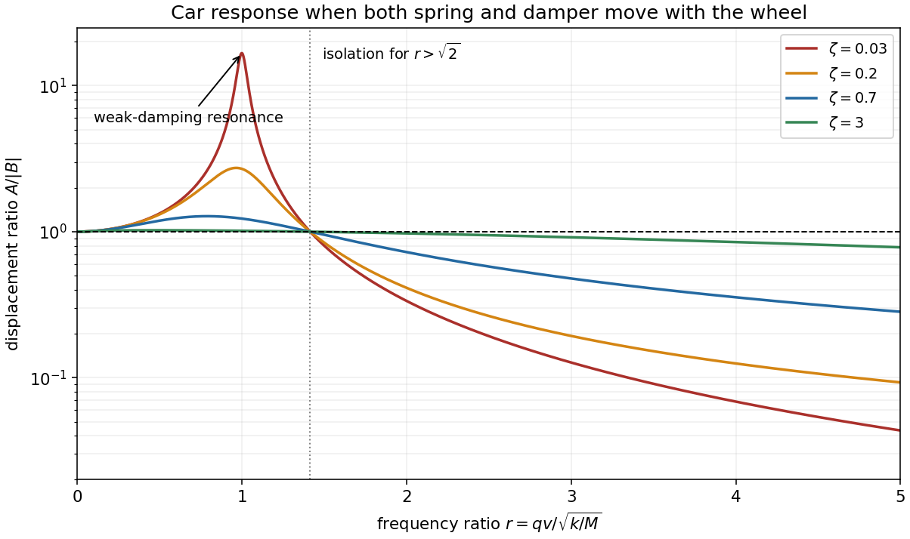

<h1 id="7/solution">Solution</h1>

↑ **Parent:** [7](../7.md)

Measure the car's vertical [displacement](../../../displacement.md) $y$ from its static [equilibrium](../../../equilibrium-point-of-a-dynamical-system.md), so gravity's constant contribution is already balanced. Both the spring and the [viscous damper](../../../dashpot.md) act on motion relative to the wheel. The [base-excited oscillator](../../../base-excited-oscillator.md) therefore satisfies

$$
M\ddot y=-k(y-y_0)-\gamma(\dot y-\dot y_0).
$$

For dimensional clarity write the road profile as $B\sin(qx)$; the printed notation sets the implicit wave number $q=1$ in the chosen length units. Constant forward speed gives forcing [angular frequency](../../../angular-frequency.md) $\omega=qv$. With complex amplitudes $Y,Y_0$, the steady response is

$$
\frac Y{Y_0}=\frac{k+i\gamma\omega}{k-M\omega^2+i\gamma\omega},\qquad
\boxed{A(v)=|B|\sqrt{\frac{k^2+\gamma^2q^2v^2}{(k-Mq^2v^2)^2+\gamma^2q^2v^2}}.}
$$

Set $q=1$ for the expression in the question's notation. Assuming $M,k>0$ and $\gamma>0$, the [transient response](../../../transient-response.md) decays, leaving this [steady-state response](../../../steady-state-response.md).

For a useful sketch define $\omega_n=\sqrt{k/M}$, $r=\omega/\omega_n$ and [damping ratio](../../../damping-ratio.md) $\zeta=\gamma/(2\sqrt{kM})$. The displacement [transmissibility](../../../transmissibility.md) is

$$
\frac A{|B|}=\sqrt{\frac{1+4\zeta^2r^2}{(1-r^2)^2+4\zeta^2r^2}}.
$$

It starts at $1$, rises to a finite maximum for finite positive damping, crosses $1$ at $r=\sqrt2$, then tends to zero. Differentiation with respect to $r^2$ gives the maximum at $r^2=2/[1+\sqrt{1+8\zeta^2}]$.

**Very small damping permits large resonant oscillations** near $\omega_n$, producing discomfort and potentially large suspension travel. At exactly zero damping the assumed decay of transients fails, and resonant forcing produces secular growth. **Very large damping makes the car follow the bumps** over a wide range of speeds, sacrificing vibration isolation: at each fixed forcing frequency, $Y/Y_0\to1$ as $\gamma\to\infty$. For any fixed finite damping the response still eventually decreases at sufficiently high frequency. These two limits should not be interchanged.

**[Figure 2](#7/image-base-excited-car-displacement-response-for-several-damping-ratios-including-the-weak-damping-resonance-and-isolation-threshold). Base-excited car displacement response for several damping ratios, including the weak-damping resonance and isolation threshold**.

## ↑ Ancestors (11)

1. [7](../7.md)
2. [2016](../../2016-split.md)
3. [Past exam of the mathematical methods I course of the University of Oxford](../../split.md)
4. [Mathematical methods I course of the University of Oxford](../../../mathematical-methods-i-course-of-the-university-of-oxford.md)
5. [Year 1 of the physics course of the University of Oxford](../../../year-1-of-the-physics-course-of-the-university-of-oxford.md)
6. [Physics course of the University of Oxford](../../../physics-course-of-the-university-of-oxford.md)
7. [Undergraduate course of the University of Oxford](../../../undergraduate-course-of-the-university-of-oxford.md)
8. [Course of the University of Oxford](../../../course-of-the-university-of-oxford.md)
9. [University of Oxford](../../../university-of-oxford-split.md)
10. [List of universities](../../../list-of-universities.md)
11. [Codex Wiki](../../../split.md)
