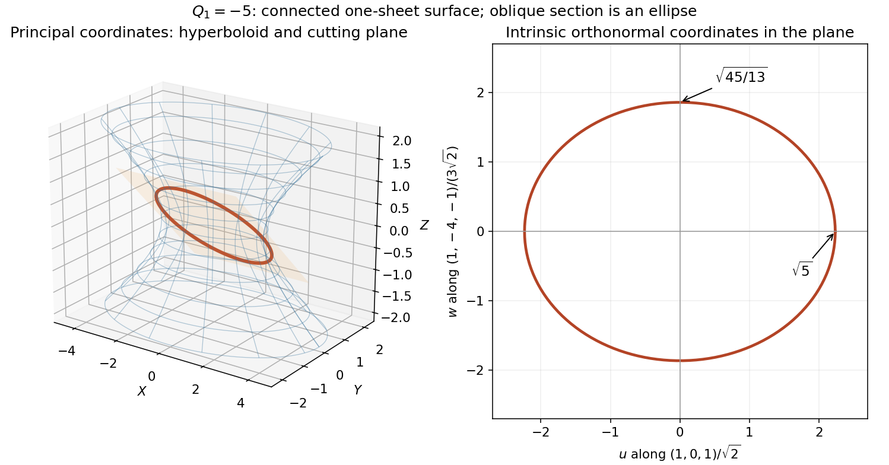

<h1 id="8/solution">Solution</h1>

↑ **Parent:** [8](../8.md)

Split the mixed quadratic terms evenly across a [real symmetric matrix](../../../real-symmetric-matrix.md):

$$
A=\begin{pmatrix}1&-2&-2\\-2&-4&2\\-2&2&1\end{pmatrix},\qquad Q_1=\mathbf r^TA\mathbf r.
$$

Its [characteristic polynomial](../../../characteristic-polynomial.md) is

$$
\det(\lambda I-A)=(\lambda+1)(\lambda+5)(\lambda-4)=\lambda^3+2\lambda^2-19\lambda-20,
$$

so **$c=2$**. Choose the orthonormal [eigenvectors](../../../eigenvector.md)

$$
u_1=\frac{(1,0,1)^T}{\sqrt2},\quad u_2=\frac{(-1,-4,1)^T}{3\sqrt2},\quad u_3=\frac{(-2,1,2)^T}{3},\qquad P=(u_1\ u_2\ u_3).
$$

The [orthogonal transformation](../../../orthogonal-transformation.md) $\mathbf r=P\mathbf R$ gives

$$
\boxed{Q_1=-X^2-5Y^2+4Z^2,\qquad Q_2=X^2+Y^2+Z^2,\qquad\beta=-5,\quad\gamma=4.}
$$

Indeed $P^TP=I$ and $P^TAP=\operatorname{diag}(-1,-5,4)$; preserving $Q_2$ is precisely the length-preserving property of an [orthogonal matrix](../../../orthogonal-matrix.md).

The requested plane has normal $(2,1,-2)$. An [orthonormal basis](../../../orthonormal-basis.md) within it is

$$
e_1=\frac{(1,0,1)}{\sqrt2},\qquad e_2=\frac{(1,-4,-1)}{3\sqrt2}.
$$

Write a point of that plane as $\mathbf r=ue_1+we_2$. Restricting the [quadratic form](../../../quadratic-form-split.md) gives $Q_1=-u^2-(13/9)w^2$, so its section with $Q_1=-5$ is

$$
\boxed{\frac{u^2}{5}+\frac{w^2}{45/13}=1.}
$$

It is an [ellipse](../../../ellipse.md) centred at the origin, with [semi-axes](../../../semi-axis.md) $\sqrt5$ along $e_1$ and $\sqrt{45/13}$ along $e_2$. Normalizing the in-plane basis is essential: coefficients in nonorthonormal coordinates would not directly give physical lengths.

The complete surface is the [one-sheet hyperboloid](../../../one-sheet-hyperboloid.md)

$$
\frac{X^2}{5}+Y^2-\frac{Z^2}{5/4}=1.
$$

It is connected, extends indefinitely in both directions along its axis $u_3$, and has an elliptical waist at $Z=0$ with [semi-axes](../../../semi-axis.md) $\sqrt5$ and $1$. At larger $|Z|$ its transverse sections widen; its asymptotic [cone](../../../cone-geometry.md) is $4Z^2=X^2+5Y^2$. The specified plane is oblique to that axis, rather than the waist plane.

**[Figure 3](#8/image-one-sheet-hyperboloid-in-principal-coordinates-and-its-oblique-elliptical-section-with-the-intrinsic-semi-axis-lengths). One-sheet hyperboloid in principal coordinates and its oblique elliptical section, with the intrinsic semi-axis lengths**.

## ↑ Ancestors (11)

1. [8](../8.md)
2. [2016](../../2016-split.md)
3. [Past exam of the mathematical methods I course of the University of Oxford](../../split.md)
4. [Mathematical methods I course of the University of Oxford](../../../mathematical-methods-i-course-of-the-university-of-oxford.md)
5. [Year 1 of the physics course of the University of Oxford](../../../year-1-of-the-physics-course-of-the-university-of-oxford.md)
6. [Physics course of the University of Oxford](../../../physics-course-of-the-university-of-oxford.md)
7. [Undergraduate course of the University of Oxford](../../../undergraduate-course-of-the-university-of-oxford.md)
8. [Course of the University of Oxford](../../../course-of-the-university-of-oxford.md)
9. [University of Oxford](../../../university-of-oxford-split.md)
10. [List of universities](../../../list-of-universities.md)
11. [Codex Wiki](../../../split.md)
