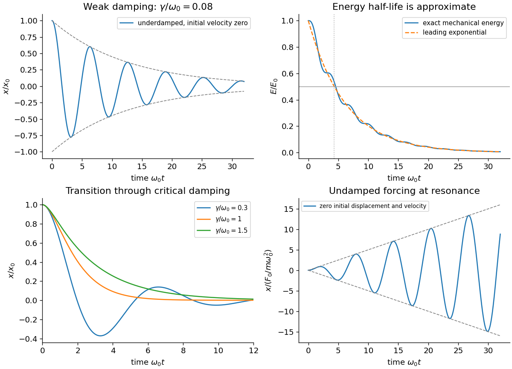

<h1 id="7/c/solution">Solution</h1>

↑ **Parent:** [C](../c.md)

The initial conditions in the underdamped solution give $A=x_0$ and $B=\gamma x_0/\Omega$. Consequently

$$
x=x_0e^{-\gamma t}\left(\cos\Omega t+\frac\gamma\Omega\sin\Omega t\right),\qquad
\dot x=-\frac{x_0\omega_0^2}{\Omega}e^{-\gamma t}\sin\Omega t.
$$

The exact [mechanical energy](../../../../mechanical-energy.md) is therefore

$$
E(t)=E_0e^{-2\gamma t}\left[1+\frac\gamma\Omega\sin2\Omega t+\frac{2\gamma^2}{\Omega^2}\sin^2\Omega t\right].
$$

For weak damping, $\gamma\ll\omega_0$, the bracket differs from one by a bounded relative correction of order $\gamma/\omega_0$. To leading order the energy and its half-life are

$$
\boxed{E(t)\simeq E_0e^{-2\gamma t},\qquad t_{1/2}\simeq\frac{\ln2}{2\gamma}.}
$$

The exact identity $\dot E=-2m\gamma\dot x^2\le0$ confirms [dissipation](../../../../dissipation.md). The small rapid variation of the exponential-normalized energy does not mean that total energy increases; the half-life formula is a weak-damping approximation, not an exact equality for arbitrary $\gamma$.

**[Figure 1](#7/c/image-damped-oscillator-displacement-and-energy-with-undamped-resonant-forcing). Damped oscillator displacement and energy, with undamped resonant forcing**. Original dimensionless model curves. The exact damped energy is compared with its weak-damping exponential approximation; resonant growth is the ideal prediction without damping.

## ↑ Ancestors (12)

1. [C](../c.md)
2. [7](../../7.md)
3. [2017 resit](../../../2017-resit-split.md)
4. [Past exam of the mathematical methods I course of the University of Oxford](../../../split.md)
5. [Mathematical methods I course of the University of Oxford](../../../../mathematical-methods-i-course-of-the-university-of-oxford.md)
6. [Year 1 of the physics course of the University of Oxford](../../../../year-1-of-the-physics-course-of-the-university-of-oxford.md)
7. [Physics course of the University of Oxford](../../../../physics-course-of-the-university-of-oxford.md)
8. [Undergraduate course of the University of Oxford](../../../../undergraduate-course-of-the-university-of-oxford.md)
9. [Course of the University of Oxford](../../../../course-of-the-university-of-oxford.md)
10. [University of Oxford](../../../../university-of-oxford-split.md)
11. [List of universities](../../../../list-of-universities.md)
12. [Codex Wiki](../../../../split.md)
