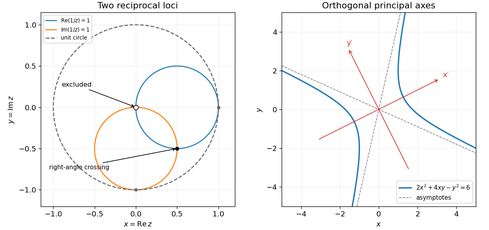

<h1 id="8/a/solution">Solution</h1>

↑ **Parent:** [A](../a.md)

Write $z=x+iy\ne0$. Since $z^{-1}=(x-iy)/(x^2+y^2)$, the two [loci](../../../../locus-mathematics.md) are

$$
\boxed{\left(x-\frac12\right)^2+y^2=\frac14,\qquad
x^2+\left(y+\frac12\right)^2=\frac14,\qquad z\ne0.}
$$

Thus they are radius-$1/2$ circles centred at $(1/2,0)$ and $(0,-1/2)$, each missing the origin. Their circle equations intersect at $(0,0)$ and $(1/2,-1/2)$, but only the latter belongs to the original loci. At that point the radius vectors are $(0,-1/2)$ and $(1/2,0)$, so the tangents meet at a right angle.

Every point on either circle has distance at most $1/2+1/2=1$ from the origin. Equality occurs only at $(1,0)$ on the first or $(0,-1)$ on the second. The [unit circle](../../../../complex-unit-circle.md) is therefore internally tangent to both and crosses neither. The sketch marks the excluded origin explicitly, rather than treating it as a second intersection.

**[Figure 2](#8/a/image-reciprocal-complex-loci-and-orthogonal-principal-axes-of-a-hyperbola). Reciprocal complex loci and orthogonal principal axes of a hyperbola**. Original exact geometric plots. The empty point at the origin is excluded from both reciprocal loci; the hyperbola uses the original level six, with its principal axes and asymptotes.

## ↑ Ancestors (12)

1. [A](../a.md)
2. [8](../../8.md)
3. [2017 resit](../../../2017-resit-split.md)
4. [Past exam of the mathematical methods I course of the University of Oxford](../../../split.md)
5. [Mathematical methods I course of the University of Oxford](../../../../mathematical-methods-i-course-of-the-university-of-oxford.md)
6. [Year 1 of the physics course of the University of Oxford](../../../../year-1-of-the-physics-course-of-the-university-of-oxford.md)
7. [Physics course of the University of Oxford](../../../../physics-course-of-the-university-of-oxford.md)
8. [Undergraduate course of the University of Oxford](../../../../undergraduate-course-of-the-university-of-oxford.md)
9. [Course of the University of Oxford](../../../../course-of-the-university-of-oxford.md)
10. [University of Oxford](../../../../university-of-oxford-split.md)
11. [List of universities](../../../../list-of-universities.md)
12. [Codex Wiki](../../../../split.md)
