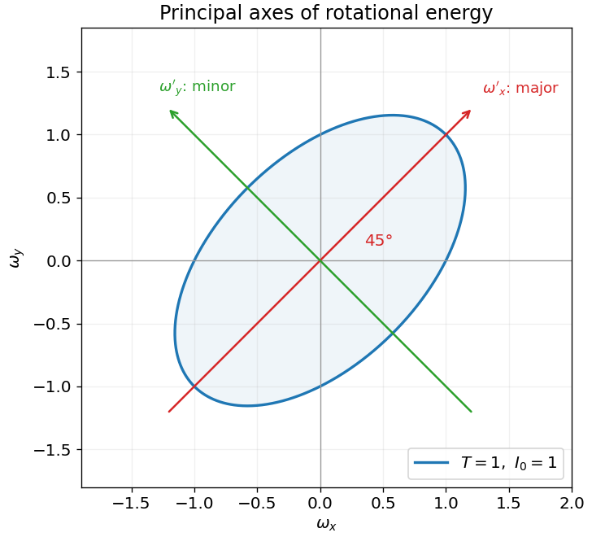
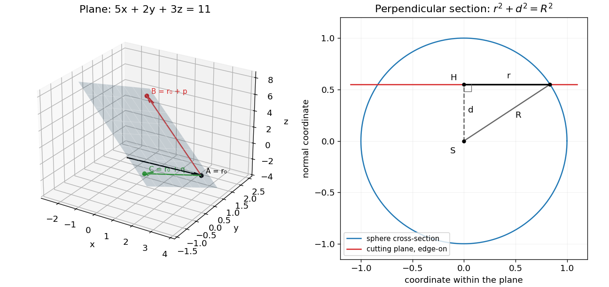

# 2017

↑ **Parent:** [Past exam of the mathematical methods I course of the University of Oxford](../past-exam-of-the-mathematical-methods-i-course-of-the-university-of-oxford.md)

Source paper: [https://www.whatdotheyknow.com/request/physics_past_papers_21/response/3037379/attach/2/FOI%20202505%20441%20Response.pdf?cookie_passthrough=1#page=92](https://www.whatdotheyknow.com/request/physics_past_papers_21/response/3037379/attach/2/FOI%20202505%20441%20Response.pdf?cookie_passthrough=1#page=92)

**Table of contents**

- [1](#1)
  - [a](#1/a)
    - [Solution](#1/a/solution)
  - [b](#1/b)
    - [Solution](#1/b/solution)
  - [c](#1/c)
    - [Solution](#1/c/solution)
- [2](#2)
  - [Solution](#2/solution)
- [3](#3)
  - [i](#3/i)
    - [Solution](#3/i/solution)
  - [ii](#3/ii)
    - [Solution](#3/ii/solution)
- [4](#4)
  - [a](#4/a)
    - [Solution](#4/a/solution)
  - [b](#4/b)
    - [Solution](#4/b/solution)
- [5](#5)
  - [Solution](#5/solution)
- [6](#6)
  - [Solution](#6/solution)
- [7](#7)
  - [a](#7/a)
    - [Solution](#7/a/solution)
  - [b](#7/b)
    - [Solution](#7/b/solution)
- [8](#8)
  - [a](#8/a)
    - [Solution](#8/a/solution)
  - [b](#8/b)
    - [i](#8/b/i)
      - [Solution](#8/b/i/solution)
    - [ii](#8/b/ii)
      - [Solution](#8/b/ii/solution)
    - [iii](#8/b/iii)
      - [Solution](#8/b/iii/solution)
    - [iv](#8/b/iv)
      - [Solution](#8/b/iv/solution)
- [9](#9)
  - [a](#9/a)
    - [Solution](#9/a/solution)
  - [b](#9/b)
    - [Solution](#9/b/solution)
  - [c](#9/c)
    - [Solution](#9/c/solution)
- [10](#10)
  - [a](#10/a)
    - [Solution](#10/a/solution)
  - [b](#10/b)
    - [Solution](#10/b/solution)
  - [c](#10/c)
    - [i](#10/c/i)
      - [Solution](#10/c/i/solution)
    - [ii](#10/c/ii)
      - [Solution](#10/c/ii/solution)

## 1

↑ **Parent:** [2017](2017.md)

<h3 id="1/a">a</h3>

↑ **Parent:** [1](#1)

<h4 id="1/a/solution">Solution</h4>

↑ **Parent:** [A](#1/a)

Since $(1+i)^2=2i$, the two [square roots](../algebra.md#square-root) are $1+i$ and $-1-i$. The [principal square root](../analysis.md#principal-square-root-of-a-complex-number) is $1+i$, whose [real part](../complex-analysis.md#real-part) is

$$
\boxed{1.}
$$

If the notation is meant to include both square-root values, their real parts are $+1$ and $-1$. Stating the principal-branch convention removes that ambiguity.

<h3 id="1/b">b</h3>

↑ **Parent:** [1](#1)

<h4 id="1/b/solution">Solution</h4>

↑ **Parent:** [B](#1/b)

For $\delta\notin2\pi\mathbb Z$, the finite [geometric series](../sequence-and-series.md#geometric-series) gives

$$
\sum_{n=1}^N e^{in\delta}
=\frac{e^{i\delta}(1-e^{iN\delta})}{1-e^{i\delta}}
=e^{i(N+1)\delta/2}\frac{\sin(N\delta/2)}{\sin(\delta/2)}.
$$

The exponential prefactor has [modulus](../complex-analysis.md#modulus) one. Thus

$$
\boxed{\left|\sum_{n=1}^N e^{in\delta}\right|
=\begin{cases}|\sin(N\delta/2)/\sin(\delta/2)|,&\delta\notin2\pi\mathbb Z,\\N,&\delta\in2\pi\mathbb Z.\end{cases}}
$$

At an excluded phase every summand is one, which supplies the removable limiting value directly. Here $N$ is a positive [integer](../integer.md).

<h3 id="1/c">c</h3>

↑ **Parent:** [1](#1)

<h4 id="1/c/solution">Solution</h4>

↑ **Parent:** [C](#1/c)

From the exponential definition, $\cos(iu)=\cosh u$. Therefore

$$
\boxed{\cos(2i\ln2)=\cosh(\ln4)=\frac{4+1/4}{2}=\frac{17}{8}.}
$$

A cosine of a nonreal argument need not lie between $-1$ and $1$; that bound applies to real arguments.

## 2

↑ **Parent:** [2017](2017.md)

<h3 id="2/solution">Solution</h3>

↑ **Parent:** [2](#2)

An [integrating factor](../linear-ordinary-differential-equation.md#integrating-factor) for $u'+P(x)u=Q(x)$ is a nonzero function $\mu(x)=\exp(\int P(x)dx)$, chosen so that $(\mu u)'=\mu Q$. Integrating this total derivative reduces the first-order [linear ordinary differential equation](../linear-ordinary-differential-equation.md) to one quadrature.

For the given nonlinear equation, let $u=y^2$, so $u'=2yy'$. Multiplication by $2y$ gives $u'+u=x^2+2x$. Using the [integrating factor](../linear-ordinary-differential-equation.md#integrating-factor) $e^x$, or recognizing the particular solution $u=x^2$, yields $u=x^2+Ce^{-x}$. The initial value gives $C=1$ and selects the positive branch:

$$
\boxed{y(x)=\sqrt{x^2+e^{-x}}.}
$$

The radicand is strictly positive for every real $x$. This solution never reaches the singular denominator $y=0$ of the original equation, so multiplication by $y$ has introduced no forbidden crossing. The negative branch would violate $y(0)=1$.

## 3

↑ **Parent:** [2017](2017.md)

<h3 id="3/i">i</h3>

↑ **Parent:** [3](#3)

<h4 id="3/i/solution">Solution</h4>

↑ **Parent:** [I](#3/i)

Let $Hv=\lambda v$ with $v\ne0$ and $H^*=H$. Then $v^*Hv=\lambda v^*v$, while taking the [complex conjugate](../complex-analysis.md#complex-conjugate) gives $v^*Hv=\overline\lambda v^*v$. Since $v^*v>0$, every [eigenvalue](../linear-operator-theory.md#eigenvalue) of a [Hermitian matrix](../hilbert-space.md#hermitian-operator) is real.

If $Hv=\lambda v$ and $Hw=\mu w$, then

$$
\lambda\,v^*w=(Hv)^*w=v^*Hw=\mu\,v^*w.
$$

Distinct [eigenvalues](../linear-operator-theory.md#eigenvalue) therefore force $v^*w=0$: their [eigenvectors](../linear-operator-theory.md#eigenvector) are orthogonal in the [Hermitian inner product](../linear-algebra.md#hermitian-inner-product). A degenerate [eigenvalue](../linear-operator-theory.md#eigenvalue) occurs more than once in the spectrum, counted with multiplicity. For a [Hermitian matrix](../hilbert-space.md#hermitian-operator), its [algebraic multiplicity](../linear-operator-theory.md#algebraic-multiplicity) equals its [geometric multiplicity](../linear-operator-theory.md#geometric-multiplicity), so degeneracy gives an [eigenspace](../linear-operator-theory.md#eigenspace) of dimension greater than one; an [orthonormal basis](../inner-product.md#orthonormal-basis) can be chosen within it.

<h3 id="3/ii">ii</h3>

↑ **Parent:** [3](#3)

<h4 id="3/ii/solution">Solution</h4>

↑ **Parent:** [Ii](#3/ii)

A [unitary matrix](../linear-operator-theory.md#unitary-matrix) preserves the [Hermitian inner product](../linear-algebra.md#hermitian-inner-product) and hence the [norm](../normed-vector-space.md#norm). If $Uv=\lambda v$ with $v\ne0$, then

$$
\|v\|^2=\|Uv\|^2=|\lambda|^2\|v\|^2.
$$

Dividing by the positive squared norm gives

$$
\boxed{|\lambda|=1.}
$$

Unlike the Hermitian case, this constrains [eigenvalues](../linear-operator-theory.md#eigenvalue) to the [unit circle](../complex-analysis.md#complex-unit-circle), not necessarily the real axis.

## 4

↑ **Parent:** [2017](2017.md)

<h3 id="4/a">a</h3>

↑ **Parent:** [4](#4)

<h4 id="4/a/solution">Solution</h4>

↑ **Parent:** [A](#4/a)

Subtracting the second equation from the first gives $2x-\lambda z=-4$. With $\lambda=2$ this is $x-z=-2$, whereas the third equation requires $x-z=-2\mu$. Consistency therefore requires

$$
\boxed{\mu=1.}
$$

At that value one parameter remains free:

$$
\boxed{(x,y,z)=(t-2,\,7-5t,\,t),\qquad t\in\mathbb R.}
$$

Thus the solution is not unique. For any other $\mu$ the two required values of $x-z$ conflict and the [linear system](../linear-algebra.md#system-of-linear-equations) has no solution.

<h3 id="4/b">b</h3>

↑ **Parent:** [4](#4)

<h4 id="4/b/solution">Solution</h4>

↑ **Parent:** [B](#4/b)

For $\lambda=1$ and $\mu=1/2$, the third equation gives $x=z-1$. Combining it with $2x-z=-4$ gives $z=-2$ and $x=-3$, after which the second equation gives $y=12$. Hence

$$
\boxed{(x,y,z)=(-3,12,-2).}
$$

The [coefficient matrix](../linear-algebra.md#coefficient-matrix) has [determinant](../multilinear-algebra.md#determinant) $\lambda-2=-1\ne0$, proving uniqueness. Direct substitution gives the required right-hand sides $1$, $5$ and $-1$.

## 5

↑ **Parent:** [2017](2017.md)

<h3 id="5/solution">Solution</h3>

↑ **Parent:** [5](#5)

For a [unit vector](../vector-space.md#unit-vector), the radial coordinate is $r=1$ and the [spherical coordinates](../multivariable-calculus.md#spherical-coordinate-system) give

$$
(n_x,n_y,n_z)=(\sin\theta\cos\phi,\sin\theta\sin\phi,\cos\theta).
$$

The [Pauli matrices](../algebra.md#pauli-matrices) therefore give

$$
\boxed{H=\begin{pmatrix}\cos\theta&e^{-i\phi}\sin\theta\\e^{i\phi}\sin\theta&-\cos\theta\end{pmatrix}.}
$$

The diagonal entries are real and the off-diagonal entries are [complex conjugates](../complex-analysis.md#complex-conjugate), so $H^*=H$. Its trace is zero and its [determinant](../multilinear-algebra.md#determinant) is $-1$, giving [eigenvalues](../linear-operator-theory.md#eigenvalue) $+1$ and $-1$. A convenient [orthonormal eigenbasis](../linear-operator-theory.md#orthonormal-eigenbasis) is

$$
\boxed{v_+=\binom{\cos(\theta/2)}{e^{i\phi}\sin(\theta/2)},\qquad
v_-=\binom{-\sin(\theta/2)}{e^{i\phi}\cos(\theta/2)}.}
$$

The half-angle identities verify $Hv_\pm=\pm v_\pm$, $v_\pm^*v_\pm=1$ and $v_+^*v_-=0$. Multiplication of either vector by any unit-modulus phase gives an equivalent normalized [eigenvector](../linear-operator-theory.md#eigenvector). At a pole, the azimuth is undefined geometrically, but the remaining phase freedom makes the chosen expressions consistent with the same one-dimensional [eigenspaces](../linear-operator-theory.md#eigenspace).

## 6

↑ **Parent:** [2017](2017.md)

<h3 id="6/solution">Solution</h3>

↑ **Parent:** [6](#6)

With the [Einstein summation convention](../multilinear-algebra.md#einstein-notation), the [magnetic force](../relativistic-electromagnetism.md#magnetic-force) has components $F_i=q\epsilon_{ijk}v_jB_k$. Thus its matrix acting on velocity is

$$
\boxed{M_{ij}=q\epsilon_{ijk}B_k,\qquad
M=q\begin{pmatrix}0&B_z&-B_y\\-B_z&0&B_x\\B_y&-B_x&0\end{pmatrix}.}
$$

The [Levi-Civita symbol](../multivariable-calculus.md#levi-civita-symbol) changes sign on exchanging $i,j$, so $M^T=-M$; the diagonal vanishes and the matrix has zero [trace](../linear-algebra.md#matrix-trace). For nonzero $\mathbf B$, $M\mathbf B=q\mathbf B\times\mathbf B=0$, exhibiting a nontrivial [kernel](../kernel-of-a-linear-map.md) and proving noninvertibility. If $\mathbf B=0$ or $q=0$, $M$ is the zero matrix and is again noninvertible.

Equivalently, an odd-dimensional real [antisymmetric matrix](../linear-algebra.md#skew-symmetric-matrix) has $\det M=\det M^T=\det(-M)=-\det M$, hence zero [determinant](../multilinear-algebra.md#determinant). The same antisymmetry gives $\mathbf v^TM\mathbf v=0$, expressing that the magnetic force does no work.

## 7

↑ **Parent:** [2017](2017.md)

<h3 id="7/a">a</h3>

↑ **Parent:** [7](#7)

<h4 id="7/a/solution">Solution</h4>

↑ **Parent:** [A](#7/a)

For $x>0$, use the [Euler differential equation](../linear-ordinary-differential-equation.md#cauchy-euler-equation) substitution $t=\ln x$, so $x=e^t$, $xy'=\dot y$ and $x^2y''=\ddot y-\dot y$. The transformed equation is

$$
\ddot y+\dot y-2y=e^t.
$$

Its [characteristic polynomial](../linear-operator-theory.md#characteristic-polynomial) factors as $(r-1)(r+2)$. The forcing $e^t$ coincides with a homogeneous solution, so the [method of undetermined coefficients](../linear-ordinary-differential-equation.md#method-of-undetermined-coefficients) requires a particular solution $y_p=At e^t$. Substitution gives $3Ae^t=e^t$, hence $A=1/3$. Transforming back,

$$
y(x)=C_1x+C_2x^{-2}+\frac{x\ln x}{3}.
$$

The conditions at $x=1$ give $C_1+C_2=0$ and $C_1-2C_2+1/3=0$, so

$$
\boxed{y(x)=\frac{x\ln x}{3}-\frac{x}{9}+\frac1{9x^2},\qquad x>0.}
$$

Differentiating confirms both initial values and the original equation. The solution interval containing $x=1$ excludes the singular point $x=0$.

<h3 id="7/b">b</h3>

↑ **Parent:** [7](#7)

<h4 id="7/b/solution">Solution</h4>

↑ **Parent:** [B](#7/b)

Using the [complex forcing method for a real differential equation](../linear-ordinary-differential-equation.md#complex-forcing-method-for-a-real-differential-equation), $\operatorname{Im}[(4x+2i)e^{ix}]=4x\sin x+2\cos x$, a suitable complex forcing is $f(x)=(4x+2i)e^{ix}$. Solve $u''+2u=f$ and take its [imaginary part](../complex-analysis.md#imaginary-part). Writing $u=p(x)e^{ix}$ reduces the equation to

$$
p''+2ip'+p=4x+2i.
$$

A linear polynomial $p=ax+b$ gives $a=4$ and $b=-6i$. Thus

$$
\boxed{y_p(x)=\operatorname{Im}[(4x-6i)e^{ix}]=4x\sin x-6\cos x.}
$$

For a direct check, $(4x\sin x)''+2(4x\sin x)=8\cos x+4x\sin x$, while $(-6\cos x)''+2(-6\cos x)=-6\cos x$. Their sum is the required forcing. Adding $A\cos(\sqrt2x)+B\sin(\sqrt2x)$ gives the full real solution if needed.

## 8

↑ **Parent:** [2017](2017.md)

<h3 id="8/a">a</h3>

↑ **Parent:** [8](#8)

<h4 id="8/a/solution">Solution</h4>

↑ **Parent:** [A](#8/a)

Let the columns of the given [unitary matrix](../linear-operator-theory.md#unitary-matrix) be $u_j$, with $Mu_j=\lambda_ju_j$. Columnwise, $MU=UD$ for $D=\operatorname{diag}(\lambda_1,\ldots,\lambda_n)$. Multiplication by $U^*$ and [unitarity](../vector-space.md#unitary-operator) give

$$
\boxed{U^*MU=D.}
$$

The premise includes an [orthonormal eigenbasis](../linear-operator-theory.md#orthonormal-eigenbasis). It is not true that an arbitrary matrix admits such a basis; over $\mathbb C$ it exists precisely for a [normal matrix](../linear-operator-theory.md#normal-matrix). The real symmetric inertia matrix in part (b) does satisfy the required condition.

<h3 id="8/b">b</h3>

↑ **Parent:** [8](#8)

<h4 id="8/b/i">i</h4>

↑ **Parent:** [B](#8/b)

<h5 id="8/b/i/solution">Solution</h5>

↑ **Parent:** [I](#8/b/i)

In the [quadratic form](../quadratic-form.md), the two equal off-diagonal contributions together supply the mixed term. Comparing coefficients gives

$$
\boxed{M=I_0\begin{pmatrix}2&-1\\-1&2\end{pmatrix}.}
$$

For a nontrivial physical [moment of inertia](../rigid-body-dynamics.md#moment-of-inertia) scale take $I_0>0$; then this [inertia tensor](../rigid-body-dynamics.md#inertia-tensor) is positive definite.

<h4 id="8/b/ii">ii</h4>

↑ **Parent:** [B](#8/b)

<h5 id="8/b/ii/solution">Solution</h5>

↑ **Parent:** [Ii](#8/b/ii)

The normalized vectors $u_1=(1,1)^T/\sqrt2$ and $u_2=(-1,1)^T/\sqrt2$ give [eigenvalues](../linear-operator-theory.md#eigenvalue) $I_0$ and $3I_0$. Therefore

$$
\boxed{U=\frac1{\sqrt2}\begin{pmatrix}1&-1\\1&1\end{pmatrix},\qquad
D=\begin{pmatrix}I_0&0\\0&3I_0\end{pmatrix}.}
$$

The columns are orthonormal, so $U^{-1}=U^T=U^*$ and direct multiplication verifies $U^{-1}MU=D$. Signs of individual [eigenvectors](../linear-operator-theory.md#eigenvector) are free; the displayed signs also make $\det U=+1$.

<h4 id="8/b/iii">iii</h4>

↑ **Parent:** [B](#8/b)

<h5 id="8/b/iii/solution">Solution</h5>

↑ **Parent:** [Iii](#8/b/iii)

The matrix has the standard [rotation matrix](../linear-algebra.md#rotation-matrix) form $\begin{pmatrix}\cos\theta&-\sin\theta\\\sin\theta&\cos\theta\end{pmatrix}$, with $\cos\theta=\sin\theta=1/\sqrt2$. Thus

$$
\boxed{\theta=\frac\pi4\pmod{2\pi}.}
$$

With $\omega=U\omega'$, the new first axis points along the original $(1,1)$ direction and is counterclockwise from the original first axis. Specifying this coordinate convention avoids confusing rotation of the axes with the inverse transformation of component columns.

<h4 id="8/b/iv">iv</h4>

↑ **Parent:** [B](#8/b)

<h5 id="8/b/iv/solution">Solution</h5>

↑ **Parent:** [Iv](#8/b/iv)

Substituting $\omega=U\omega'$ and using the diagonalization gives

$$
\boxed{T'(\omega_x',\omega_y')=\frac{I_0}{2}\omega_x'^2+\frac{3I_0}{2}\omega_y'^2.}
$$

For $I_0>0$ and energy level one in the chosen units, its [ellipse](../euclidean-geometry.md#ellipse) equation is

$$
\frac{\omega_x'^2}{2/I_0}+\frac{\omega_y'^2}{2/(3I_0)}=1.
$$

The major semiaxis has length $a=\sqrt{2/I_0}$ along $u_1=(1,1)/\sqrt2$; the minor semiaxis has length $b=\sqrt{2/(3I_0)}$ along $u_2=(-1,1)/\sqrt2$. The full axis lengths are $2a$ and $2b$. The original-coordinate curve is the same ellipse tilted by $45^\circ$, elongated along $\omega_y=\omega_x$; an orthogonal coordinate change preserves lengths and does not change the ellipse itself.

**[Figure 1](#8/b/iv/image-principal-axes-of-the-rotational-energy-ellipse). Principal axes of the rotational-energy ellipse**. Original plot at I0 equal to one and energy equal to one, showing the longer axis along the normalized (1,1) eigenvector and the shorter perpendicular axis.

## 9

↑ **Parent:** [2017](2017.md)

<h3 id="9/a">a</h3>

↑ **Parent:** [9](#9)

<h4 id="9/a/solution">Solution</h4>

↑ **Parent:** [A](#9/a)

A map between [vector spaces](../vector-space.md) over the same [field](../algebra.md#field) is linear when $L(av+bw)=aL(v)+bL(w)$ for every $v,w$ and scalars $a,b$. Its [kernel](../kernel-of-a-linear-map.md) is $\ker L=\{v\in V:L(v)=0\}$. It contains zero because $L(0)=0$. If $v,w\in\ker L$, then

$$
L(av+bw)=aL(v)+bL(w)=0.
$$

Thus it is closed under linear combinations and is a [vector subspace](../vector-space.md#vector-subspace) of $V$. No injectivity or equality of the dimensions of $V,W$ is needed.

<h3 id="9/b">b</h3>

↑ **Parent:** [9](#9)

<h4 id="9/b/solution">Solution</h4>

↑ **Parent:** [B](#9/b)

Write both [cross products](../vector-space.md#cross-product) with the [Levi-Civita symbol](../multivariable-calculus.md#levi-civita-symbol). Its contraction identity gives

$$
[a\times(b\times c)]_i=\epsilon_{ijk}\epsilon_{klm}a_jb_lc_m
=(\delta_{il}\delta_{jm}-\delta_{im}\delta_{jl})a_jb_lc_m
=b_i(a\cdot c)-c_i(a\cdot b).
$$

Therefore the [vector triple product](../multivariable-calculus.md#vector-triple-product) identity is

$$
\boxed{a\times(b\times c)=(a\cdot c)b-(a\cdot b)c.}
$$

The order matters: the [cross product](../vector-space.md#cross-product) is not associative, and exchanging the two nested arrangements changes the expression.

<h3 id="9/c">c</h3>

↑ **Parent:** [9](#9)

<h4 id="9/c/solution">Solution</h4>

↑ **Parent:** [C](#9/c)

The [vector triple product](../multivariable-calculus.md#vector-triple-product) with $|u|=1$ gives

$$
f(r)=r-u(u\cdot r),\qquad\boxed{A=I-uu^T,\quad A_{ij}=\delta_{ij}-u_iu_j.}
$$

This is the [orthogonal projection onto a plane](../geometry-and-topology.md#closest-point-on-a-plane) perpendicular to $u$, so it is a [linear map](../vector-space.md#linear-map). Its [image](../set-theory.md#image-of-a-function) is the plane $u^\perp$ through the origin, while its [kernel](../kernel-of-a-linear-map.md) is the normal line $\operatorname{span}\{u\}$. In components,

$$
A=\begin{pmatrix}1-u_1^2&-u_1u_2&-u_1u_3\\-u_1u_2&1-u_2^2&-u_2u_3\\-u_1u_3&-u_2u_3&1-u_3^2\end{pmatrix}.
$$

The equation $Ar=r$ is equivalent to $u(u\cdot r)=0$, hence to $u\cdot r=0$. Its solution set is precisely the two-dimensional plane $u^\perp$, with infinitely many nonzero vectors, not merely the normal line. These are the [eigenvectors](../linear-operator-theory.md#eigenvector) with [eigenvalue](../linear-operator-theory.md#eigenvalue) one; the normal direction has [eigenvalue](../linear-operator-theory.md#eigenvalue) zero.

## 10

↑ **Parent:** [2017](2017.md)

<h3 id="10/a">a</h3>

↑ **Parent:** [10](#10)

<h4 id="10/a/solution">Solution</h4>

↑ **Parent:** [A](#10/a)

For two nonparallel vectors $v_1,v_2\in\mathbb R^2$, a nontrivial relation $av_1+bv_2=0$ would make one a scalar multiple of the other. They are therefore [linearly independent](../vector-space.md#linear-independence). Two independent vectors in a two-dimensional [vector space](../vector-space.md) form a [basis](../vector-space.md#basis).

Likewise, three vectors in $\mathbb R^3$ that are not contained in one plane through the origin cannot obey a nontrivial [linear dependence](../vector-space.md#linear-dependence): such a relation would express one as a combination of the other two, or already make that pair dependent. Thus they are independent and form a [basis](../vector-space.md#basis) of $\mathbb R^3$. The plane condition here is linear coplanarity with the origin, as required for vectors, rather than affine coplanarity of three arbitrary points.

<h3 id="10/b">b</h3>

↑ **Parent:** [10](#10)

<h4 id="10/b/solution">Solution</h4>

↑ **Parent:** [B](#10/b)

Let $\Delta=v_1\cdot(v_2\times v_3)\ne0$, since the original vectors form a [basis](../vector-space.md#basis). The [reciprocal basis](../multilinear-algebra.md#reciprocal-basis) is

$$
\boxed{u^1=\frac{v_2\times v_3}{\Delta},\qquad
u^2=\frac{v_3\times v_1}{\Delta},\qquad
u^3=\frac{v_1\times v_2}{\Delta}.}
$$

Taking the [dot product](../inner-product.md#dot-product) with each $v_j$ gives $u^i\cdot v_j=\delta_{ij}$, using orthogonality of a [cross product](../vector-space.md#cross-product) and cyclic symmetry of the [scalar triple product](../multilinear-algebra.md#scalar-triple-product). If $\sum_i a_i u^i=0$, taking its [dot product](../inner-product.md#dot-product) with $v_j$ yields $a_j=0$. The three reciprocal vectors are therefore [linearly independent](../vector-space.md#linear-independence) and form a [basis](../vector-space.md#basis) of $\mathbb R^3$.

Equivalently, if $V$ has columns $v_j$ and $U$ columns $u^i$, then $U^TV=I$, so $U=V^{-T}$. In particular any vector has coordinates $r=\sum_i(r\cdot u^i)v_i$, even when the original basis is not orthonormal.

<h3 id="10/c">c</h3>

↑ **Parent:** [10](#10)

<h4 id="10/c/i">i</h4>

↑ **Parent:** [C](#10/c)

<h5 id="10/c/i/solution">Solution</h5>

↑ **Parent:** [I](#10/c/i)

Provided $p,q$ are [linearly independent](../vector-space.md#linear-independence), their linear combinations fill a two-dimensional direction space. Adding $r_0$ translates it to the plane through $r_0$. The [unit normal](../differential-geometry.md#unit-normal) and constant are

$$
\boxed{n=\frac{p\times q}{|p\times q|},\qquad c_0=n\cdot r_0.}
$$

Then $n\cdot(r_0+t_1p+t_2q)=c_0$ for every pair of parameters. Conversely a point satisfying $n\cdot r=c_0$ differs from $r_0$ by a vector in $n^\perp=\operatorname{span}\{p,q\}$, proving that the two descriptions give exactly the same plane.

For the three points, choose $r_0=(3,1,-2)$, $p=(-4,1,6)$ and $q=(-1,-2,3)$. Their [cross product](../vector-space.md#cross-product) is $(15,6,9)=3(5,2,3)$, which is nonzero. The plane therefore has equation

$$
\boxed{5x+2y+3z=11.}
$$

Each supplied point satisfies it. Its [unit normal](../differential-geometry.md#unit-normal) is $(5,2,3)/\sqrt{38}$, up to an overall sign, and $c_0=11/\sqrt{38}$.

**[Figure 2](#10/c/i/image-an-affine-plane-from-two-direction-vectors-and-a-spherical-section). An affine plane from two direction vectors and a spherical section**. Original geometric illustrations: the supplied three points determine the plane, while a separate schematic shows a generic sphere cut at perpendicular distance d from its centre.

<h4 id="10/c/ii">ii</h4>

↑ **Parent:** [C](#10/c)

<h5 id="10/c/ii/solution">Solution</h5>

↑ **Parent:** [Ii](#10/c/ii)

Let $s=(x_0,y_0,z_0)$ be the sphere centre. The circle centre is its perpendicular projection onto the plane:

$$
\boxed{h=s-(n\cdot s-c_0)n,\qquad d=|s-h|=|n\cdot s-c_0|.}
$$

For the specific plane this is

$$
d=\frac{|5x_0+2y_0+3z_0-11|}{\sqrt{38}},\qquad
h=s-\frac{5x_0+2y_0+3z_0-11}{38}(5,2,3).
$$

For a point on the section, its displacement from $h$ lies in the plane and is perpendicular to $s-h$. The [Pythagorean theorem](../euclidean-geometry.md#pythagorean-theorem) therefore gives

$$
\boxed{r=\sqrt{R^2-d^2}.}
$$

A genuine circle requires $d<R$. At $d=R$ the section is a single tangent point, and at $d>R$ the plane misses the sphere. A central cut $d=0$ gives a great circle of radius $R$.

## ↑ Ancestors (9)

1. [Past exam of the mathematical methods I course of the University of Oxford](../past-exam-of-the-mathematical-methods-i-course-of-the-university-of-oxford.md)
2. [Mathematical methods I course of the University of Oxford](../university-of-oxford.md#mathematical-methods-i-course-of-the-university-of-oxford)
3. [Year 1 of the physics course of the University of Oxford](../university-of-oxford.md#year-1-of-the-physics-course-of-the-university-of-oxford)
4. [Physics course of the University of Oxford](../university-of-oxford.md#physics-course-of-the-university-of-oxford)
5. [Undergraduate course of the University of Oxford](../university-of-oxford.md#undergraduate-course-of-the-university-of-oxford)
6. [Course of the University of Oxford](../university-of-oxford.md#course-of-the-university-of-oxford)
7. [University of Oxford](../university-of-oxford.md)
8. [List of universities](../README.md#list-of-universities)
9. [Codex Wiki](../README.md)
