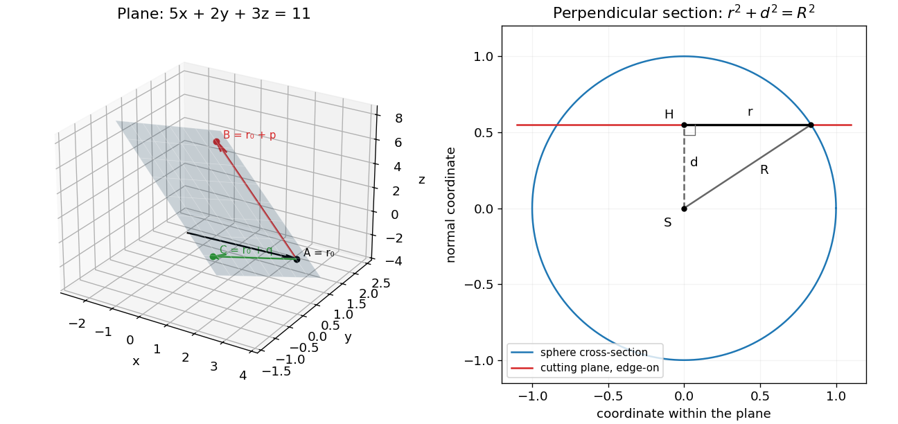

<h1 id="10/c/i/solution">Solution</h1>

↑ **Parent:** [I](../i.md)

Provided $p,q$ are [linearly independent](../../../../../linear-independence.md), their linear combinations fill a two-dimensional direction space. Adding $r_0$ translates it to the plane through $r_0$. The [unit normal](../../../../../unit-normal.md) and constant are

$$
\boxed{n=\frac{p\times q}{|p\times q|},\qquad c_0=n\cdot r_0.}
$$

Then $n\cdot(r_0+t_1p+t_2q)=c_0$ for every pair of parameters. Conversely a point satisfying $n\cdot r=c_0$ differs from $r_0$ by a vector in $n^\perp=\operatorname{span}\{p,q\}$, proving that the two descriptions give exactly the same plane.

For the three points, choose $r_0=(3,1,-2)$, $p=(-4,1,6)$ and $q=(-1,-2,3)$. Their [cross product](../../../../../cross-product.md) is $(15,6,9)=3(5,2,3)$, which is nonzero. The plane therefore has equation

$$
\boxed{5x+2y+3z=11.}
$$

Each supplied point satisfies it. Its [unit normal](../../../../../unit-normal.md) is $(5,2,3)/\sqrt{38}$, up to an overall sign, and $c_0=11/\sqrt{38}$.

**[Figure 2](#10/c/i/image-an-affine-plane-from-two-direction-vectors-and-a-spherical-section). An affine plane from two direction vectors and a spherical section**. Original geometric illustrations: the supplied three points determine the plane, while a separate schematic shows a generic sphere cut at perpendicular distance d from its centre.

## ↑ Ancestors (13)

1. [I](../i.md)
2. [C](../../c.md)
3. [10](../../../10.md)
4. [2017](../../../../2017-split.md)
5. [Past exam of the mathematical methods I course of the University of Oxford](../../../../split.md)
6. [Mathematical methods I course of the University of Oxford](../../../../../mathematical-methods-i-course-of-the-university-of-oxford.md)
7. [Year 1 of the physics course of the University of Oxford](../../../../../year-1-of-the-physics-course-of-the-university-of-oxford.md)
8. [Physics course of the University of Oxford](../../../../../physics-course-of-the-university-of-oxford.md)
9. [Undergraduate course of the University of Oxford](../../../../../undergraduate-course-of-the-university-of-oxford.md)
10. [Course of the University of Oxford](../../../../../course-of-the-university-of-oxford.md)
11. [University of Oxford](../../../../../university-of-oxford-split.md)
12. [List of universities](../../../../../list-of-universities.md)
13. [Codex Wiki](../../../../../split.md)
