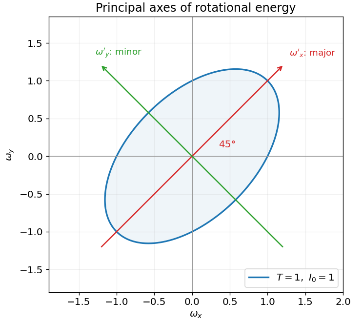

<h1 id="8/b/iv/solution">Solution</h1>

↑ **Parent:** [Iv](../iv.md)

Substituting $\omega=U\omega'$ and using the diagonalization gives

$$
\boxed{T'(\omega_x',\omega_y')=\frac{I_0}{2}\omega_x'^2+\frac{3I_0}{2}\omega_y'^2.}
$$

For $I_0>0$ and energy level one in the chosen units, its [ellipse](../../../../../ellipse.md) equation is

$$
\frac{\omega_x'^2}{2/I_0}+\frac{\omega_y'^2}{2/(3I_0)}=1.
$$

The major semiaxis has length $a=\sqrt{2/I_0}$ along $u_1=(1,1)/\sqrt2$; the minor semiaxis has length $b=\sqrt{2/(3I_0)}$ along $u_2=(-1,1)/\sqrt2$. The full axis lengths are $2a$ and $2b$. The original-coordinate curve is the same ellipse tilted by $45^\circ$, elongated along $\omega_y=\omega_x$; an orthogonal coordinate change preserves lengths and does not change the ellipse itself.

**[Figure 1](#8/b/iv/image-principal-axes-of-the-rotational-energy-ellipse). Principal axes of the rotational-energy ellipse**. Original plot at I0 equal to one and energy equal to one, showing the longer axis along the normalized (1,1) eigenvector and the shorter perpendicular axis.

## ↑ Ancestors (13)

1. [Iv](../iv.md)
2. [B](../../b.md)
3. [8](../../../8.md)
4. [2017](../../../../2017-split.md)
5. [Past exam of the mathematical methods I course of the University of Oxford](../../../../split.md)
6. [Mathematical methods I course of the University of Oxford](../../../../../mathematical-methods-i-course-of-the-university-of-oxford.md)
7. [Year 1 of the physics course of the University of Oxford](../../../../../year-1-of-the-physics-course-of-the-university-of-oxford.md)
8. [Physics course of the University of Oxford](../../../../../physics-course-of-the-university-of-oxford.md)
9. [Undergraduate course of the University of Oxford](../../../../../undergraduate-course-of-the-university-of-oxford.md)
10. [Course of the University of Oxford](../../../../../course-of-the-university-of-oxford.md)
11. [University of Oxford](../../../../../university-of-oxford-split.md)
12. [List of universities](../../../../../list-of-universities.md)
13. [Codex Wiki](../../../../../split.md)
