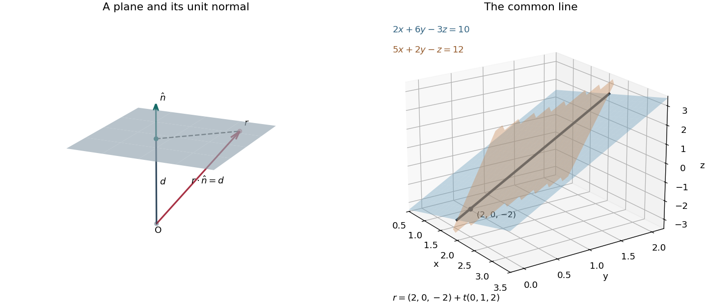
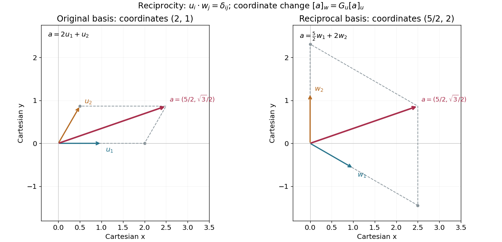

# 2018

↑ **Parent:** [Past exam of the mathematical methods I course of the University of Oxford](../past-exam-of-the-mathematical-methods-i-course-of-the-university-of-oxford.md)

Source paper: [https://www.whatdotheyknow.com/request/physics_preliminary_past_papers/response/2680788/attach/2/2014%202017%20Physics%20Prelim.zip?cookie_passthrough=1](https://www.whatdotheyknow.com/request/physics_preliminary_past_papers/response/2680788/attach/2/2014%202017%20Physics%20Prelim.zip?cookie_passthrough=1)

**Table of contents**

- [1](#1)
  - [a](#1/a)
    - [Solution](#1/a/solution)
  - [b](#1/b)
    - [Solution](#1/b/solution)
- [2](#2)
  - [a](#2/a)
    - [Solution](#2/a/solution)
  - [b](#2/b)
    - [Solution](#2/b/solution)
- [3](#3)
  - [Solution](#3/solution)
- [4](#4)
  - [a](#4/a)
    - [Solution](#4/a/solution)
  - [b](#4/b)
    - [Solution](#4/b/solution)
- [5](#5)
  - [a](#5/a)
    - [Solution](#5/a/solution)
  - [b](#5/b)
    - [Solution](#5/b/solution)
  - [c](#5/c)
    - [Solution](#5/c/solution)
- [6](#6)
  - [Solution](#6/solution)
- [7](#7)
  - [a](#7/a)
    - [Solution](#7/a/solution)
  - [b](#7/b)
    - [Solution](#7/b/solution)
  - [c](#7/c)
    - [Solution](#7/c/solution)
- [8](#8)
  - [a](#8/a)
    - [Solution](#8/a/solution)
  - [b](#8/b)
    - [Solution](#8/b/solution)
- [9](#9)
  - [a](#9/a)
    - [Solution](#9/a/solution)
  - [b](#9/b)
    - [Solution](#9/b/solution)
- [10](#10)
  - [a](#10/a)
    - [Solution](#10/a/solution)
  - [b](#10/b)
    - [Solution](#10/b/solution)
  - [c](#10/c)
    - [Solution](#10/c/solution)
  - [d](#10/d)
    - [Solution](#10/d/solution)

## 1

↑ **Parent:** [2018](2018.md)

<h3 id="1/a">a</h3>

↑ **Parent:** [1](#1)

<h4 id="1/a/solution">Solution</h4>

↑ **Parent:** [A](#1/a)

Put $w=\operatorname{artanh}z$. The [hyperbolic tangent](../calculus.md#hyperbolic-tangent) identity $z=(e^{2w}-1)/(e^{2w}+1)$ gives $e^{2w}=(1+z)/(1-z)$. Taking a compatible branch of the [complex logarithm](../analysis.md#complex-logarithm) gives

$$
\boxed{\operatorname{artanh}z=\frac12\log\frac{1+z}{1-z}.}
$$

As an identity for a single-valued [inverse hyperbolic tangent](../calculus.md#inverse-hyperbolic-tangent), this requires consistent [branch cuts](../analysis.md#branch-cut); one cannot choose unrelated logarithm branches on the two sides. Near $z=0$ the branch with value zero is fixed by $\operatorname{artanh}0=0$. The full inverse relation also allows $w\mapsto w+i\pi k$, $k\in\mathbb Z$, and $z=\pm1$ are singular points.

<h3 id="1/b">b</h3>

↑ **Parent:** [1](#1)

<h4 id="1/b/solution">Solution</h4>

↑ **Parent:** [B](#1/b)

Expand the [sine](../geometry-and-topology.md#sine) of the [complex number](../complex-analysis.md#complex-number) using [hyperbolic functions](../calculus.md#hyperbolic-function):

$$
\sin(x+iy)=\sin x\cosh y+i\cos x\sinh y.
$$

Its squared [complex modulus](../complex-analysis.md#complex-modulus) is

$$
|\sin(x+iy)|^2=\sin^2x\cosh^2y+\cos^2x\sinh^2y=\sin^2x+\sinh^2y\geq\sin^2x.
$$

Taking nonnegative [square roots](../algebra.md#square-root) proves $\boxed{|\sin z|\geq|\sin x|}$. Equality holds exactly when $y=0$.

## 2

↑ **Parent:** [2018](2018.md)

<h3 id="2/a">a</h3>

↑ **Parent:** [2](#2)

<h4 id="2/a/solution">Solution</h4>

↑ **Parent:** [A](#2/a)

Use the [Levi-Civita symbol](../multivariable-calculus.md#levi-civita-symbol) and [Einstein summation convention](../multilinear-algebra.md#einstein-notation). The [tensor contraction](../multilinear-algebra.md#tensor-contraction) $\epsilon_{ijk}\epsilon_{klm}=\delta_{il}\delta_{jm}-\delta_{im}\delta_{jl}$, expressed through the [Kronecker delta](../multilinear-algebra.md#kronecker-delta), gives

$$
\bigl(a\times(b\times c)\bigr)_i=\epsilon_{ijk}a_j\epsilon_{klm}b_lc_m
=b_i a_jc_j-c_i a_jb_j.
$$

The last two contractions are [dot products](../inner-product.md#dot-product), proving the [vector triple product](../multivariable-calculus.md#vector-triple-product) identity $\boxed{a\times(b\times c)=(a\cdot c)b-(a\cdot b)c}$.

<h3 id="2/b">b</h3>

↑ **Parent:** [2](#2)

<h4 id="2/b/solution">Solution</h4>

↑ **Parent:** [B](#2/b)

Choose the [linear relation](../vector-space.md#linear-relation)

$$
\boxed{c=Md,\qquad c_i=M_{ij}d_j.}
$$

Then the displayed [tensor contraction](../multilinear-algebra.md#tensor-contraction) is $(a_ic_i)b_k-(a_ib_i)c_k=(a\cdot c)b_k-(a\cdot b)c_k$, precisely the $k$th [vector component](../vector-space.md#coordinate-linear-algebra) of $a\times(b\times c)$ by the [vector triple product](../multivariable-calculus.md#vector-triple-product) identity. The [matrix](../vector-space.md#matrix) $M$ need not be a [symmetric matrix](../linear-algebra.md#symmetric-matrix).

## 3

↑ **Parent:** [2018](2018.md)

<h3 id="3/solution">Solution</h3>

↑ **Parent:** [3](#3)

The [characteristic equation](../linear-ordinary-differential-equation.md#characteristic-equation-of-a-constant-coefficient-differential-equation) of the [damped harmonic oscillator](../analysis.md#damped-harmonic-oscillator) is $r^2+\gamma r+\omega_0^2=0$. In the underdamped case its [roots](../semisimple-lie-algebra.md#root-of-a-root-system) are $-\gamma/2\pm i\omega_d$, where $\omega_d=\sqrt{\omega_0^2-\gamma^2/4}$. Thus the exact real solution is $y=Ae^{-\gamma t/2}\cos(\omega_dt+\alpha)$. For $\gamma\ll\omega_0$, $\omega_d=\omega_0+O(\gamma^2/\omega_0)$, giving the requested leading approximation

$$
\boxed{y(t)\simeq y_0e^{-\gamma t/2}\cos(\omega_0t+\alpha).}
$$

For [mass](../classical-mechanics.md#mass) $m$ and [spring constant](../elasticity-physics.md#spring-constant) $m\omega_0^2$, the [mechanical energy](../energy.md#mechanical-energy) is $E=\tfrac12m(\dot y^2+\omega_0^2y^2)$. Differentiating and using the [differential equation](../differential-equation.md) gives $\dot E=-m\gamma\dot y^2$. In particular, [energy decay of a viscously damped harmonic oscillator](../analysis.md#energy-decay-of-a-viscously-damped-harmonic-oscillator) is not an exact pointwise [exponential decay](../analysis.md#exponential-decay): $\dot E=0$ at a turning point. To leading order in $\gamma/\omega_0$, the [period average](../function.md#period-average) is

$$
\boxed{\overline E(t)\simeq\frac12m\omega_0^2y_0^2e^{-\gamma t},\qquad \overline P_{\mathrm{loss}}\simeq\gamma\overline E.}
$$

The [quality factor](../dynamical-systems.md#q-factor) is $Q=2\pi\overline E/(\text{energy lost in one cycle})$. Using the [period](../mathematics.md#period-of-a-function) $T\simeq2\pi/\omega_0$ and the small fractional loss $\gamma T$ gives $\boxed{Q\simeq\omega_0/\gamma}$. Equivalently, the energy-decay definition $Q=\omega_0\overline E/\overline P_{\mathrm{loss}}$ yields the same leading result. Replacing $\omega_d$ by $\omega_0$ in the oscillatory phase is not uniform over arbitrarily long times; its phase error is $O(\gamma^2t/\omega_0)$.

## 4

↑ **Parent:** [2018](2018.md)

<h3 id="4/a">a</h3>

↑ **Parent:** [4](#4)

<h4 id="4/a/solution">Solution</h4>

↑ **Parent:** [A](#4/a)

For $n\ne1$ and a nonzero solution, set $v=y^{1-n}$. Since $v'=(1-n)y^{-n}y'$, multiplying the [Bernoulli differential equation](../differential-equation.md#bernoulli-differential-equation) by $(1-n)y^{-n}$ gives the [linear ordinary differential equation](../linear-ordinary-differential-equation.md)

$$
\boxed{v'+(1-n)p(x)v=(1-n)q(x).}
$$

An [integrating factor](../linear-ordinary-differential-equation.md#integrating-factor) $\mu=\exp((1-n)\int p(x)\,dx)$ gives $v=\mu^{-1}(C+(1-n)\int\mu q\,dx)$. Recover $y$ from $y^{1-n}=v$ on an appropriate real or complex branch. This substitution can omit the zero solution, which must be checked in the original equation. For $n=1$, no substitution is needed: $y'+(p-q)y=0$ is already a [linear ordinary differential equation](../linear-ordinary-differential-equation.md).

<h3 id="4/b">b</h3>

↑ **Parent:** [4](#4)

<h4 id="4/b/solution">Solution</h4>

↑ **Parent:** [B](#4/b)

Work on an interval with $x\ne0$. When $n=3$, let $v=y^{-2}$. The resulting [linear ordinary differential equation](../linear-ordinary-differential-equation.md) and its [integrating factor](../linear-ordinary-differential-equation.md#integrating-factor) are

$$
v'-\frac4xv=-2x^2,\qquad \mu=x^{-4},\qquad (x^{-4}v)'=-2x^{-2}.
$$

Integration gives $v=2x^3+Cx^4$. The real nonzero solutions and the separately checked zero solution are therefore

$$
\boxed{y=\pm(2x^3+Cx^4)^{-1/2}\quad\text{where }2x^3+Cx^4>0;\qquad y\equiv0.}
$$

For $n=1$, separation in the [linear ordinary differential equation](../linear-ordinary-differential-equation.md) gives $y'/y=x^2-2/x$, hence

$$
\boxed{y=Cx^{-2}e^{x^3/3}.}
$$

Here $C=0$ already includes the zero solution. Division by $x$ is why these formulas are stated on intervals excluding zero; the original equation requires $y(0)=0$ if a classical solution is to extend through zero.

## 5

↑ **Parent:** [2018](2018.md)

<h3 id="5/a">a</h3>

↑ **Parent:** [5](#5)

<h4 id="5/a/solution">Solution</h4>

↑ **Parent:** [A](#5/a)

Write the [matrix trace](../linear-algebra.md#matrix-trace) in [Einstein summation convention](../multilinear-algebra.md#einstein-notation):

$$
\operatorname{tr}(AB)=\sum_{i,j}A_{ij}B_{ji}=\sum_{j,i}B_{ji}A_{ij}=\boxed{\operatorname{tr}(BA)}.
$$

The entries are [scalars](../vector-space.md#scalar), so their multiplication commutes, and the two summed indices may be relabelled. The argument works for square [matrices](../vector-space.md#matrix) of any finite size, and also for rectangular $A,B$ of compatible opposite shapes.

<h3 id="5/b">b</h3>

↑ **Parent:** [5](#5)

<h4 id="5/b/solution">Solution</h4>

↑ **Parent:** [B](#5/b)

Let $Av=\lambda v$ with $v\ne0$. A vanishing [commutator](../lie-algebra.md#commutator) gives $A(Bv)=B(Av)=\lambda Bv$, so $Bv$ belongs to the [eigenspace](../linear-operator-theory.md#eigenspace) $E_\lambda$. This is [eigenspace invariance for commuting linear maps](../lie-algebra.md#eigenspace-invariance-for-commuting-linear-maps). A [nondegenerate eigenvalue](../linear-operator-theory.md#simple-eigenvalue) has a one-dimensional [eigenspace](../linear-operator-theory.md#eigenspace), so $Bv=\beta v$ for a [scalar](../vector-space.md#scalar) $\beta$; $\beta=0$ is allowed. Therefore **$v$ is also an [eigenvector](../linear-operator-theory.md#eigenvector) of $B$**. Without the simple-[eigenvalue](../linear-operator-theory.md#eigenvalue) condition, $B$ can mix [vectors](../vector-space.md#vector) inside a larger [eigenspace](../linear-operator-theory.md#eigenspace), and an arbitrarily chosen [eigenvector](../linear-operator-theory.md#eigenvector) of $A$ need not be an [eigenvector](../linear-operator-theory.md#eigenvector) of $B$.

<h3 id="5/c">c</h3>

↑ **Parent:** [5](#5)

<h4 id="5/c/solution">Solution</h4>

↑ **Parent:** [C](#5/c)

For [Hermitian matrices](../hilbert-space.md#hermitian-operator), $A^\dagger=A$ and $B^\dagger=B$, so

$$
[A,B]^\dagger=B^\dagger A^\dagger-A^\dagger B^\dagger=-[A,B].
$$

The [commutator](../lie-algebra.md#commutator) is an [anti-Hermitian matrix](../linear-operator-theory.md#skew-hermitian-matrix). Consequently

$$
\boxed{\alpha=i,\qquad C=-i[A,B]}
$$

makes $C^\dagger=C$. More generally, any nonzero purely imaginary $\alpha$ works. For a nonzero [commutator](../lie-algebra.md#commutator) this is also necessary if $C$ is to be [Hermitian](../hilbert-space.md#hermitian-operator): comparing the [Hermitian adjoint](../hilbert-space.md#adjoint-operator) equations gives $(\overline\alpha+\alpha)C=0$.

## 6

↑ **Parent:** [2018](2018.md)

<h3 id="6/solution">Solution</h3>

↑ **Parent:** [6](#6)

The [characteristic polynomial](../linear-operator-theory.md#characteristic-polynomial) factors as $\det(\lambda I-A)=(\lambda-1)(\lambda^2-1)$. Thus $\boxed{\lambda=1\text{ twice},\quad\lambda=-1\text{ once}}$ in [algebraic multiplicity](../linear-operator-theory.md#algebraic-multiplicity). An [orthonormal basis](../inner-product.md#orthonormal-basis) of corresponding [eigenvectors](../linear-operator-theory.md#eigenvector) is

$$
v_1=\begin{pmatrix}1\\0\\0\end{pmatrix},\quad
v_2=\frac1{\sqrt2}\begin{pmatrix}0\\1\\-i\end{pmatrix}\quad(\lambda=1),\qquad
v_3=\frac1{\sqrt2}\begin{pmatrix}0\\1\\i\end{pmatrix}\quad(\lambda=-1).
$$

Direct multiplication verifies $Av_1=v_1$, $Av_2=v_2$, $Av_3=-v_3$. Their mutual [Hermitian inner products](../linear-algebra.md#hermitian-inner-product) vanish and each has [norm](../normed-vector-space.md#norm) one, which proves [linear independence](../vector-space.md#linear-independence). For the repeated [eigenvalue](../linear-operator-theory.md#eigenvalue), [Gaussian elimination](../numerical-linear-algebra.md#gaussian-elimination) gives

$$
A-I=\begin{pmatrix}0&0&0\\0&-1&i\\0&-i&-1\end{pmatrix}
\ \longrightarrow\ 
\begin{pmatrix}0&1&-i\\0&0&0\\0&0&0\end{pmatrix}.
$$

Hence $\boxed{\operatorname{rank}(A-I)=1,\quad\dim\ker(A-I)=2}$. The second equality follows from the [rank-nullity theorem](../kernel-of-a-linear-map.md#rank-nullity-theorem) and agrees with the two-dimensional [eigenspace](../linear-operator-theory.md#eigenspace). A repeated [eigenvalue](../linear-operator-theory.md#eigenvalue) alone would not imply a two-dimensional [eigenspace](../linear-operator-theory.md#eigenspace) for an arbitrary [matrix](../vector-space.md#matrix); here the [Hermitian matrix](../hilbert-space.md#hermitian-operator) is [diagonalizable](../linear-operator-theory.md#diagonalizable-matrix).

## 7

↑ **Parent:** [2018](2018.md)

<h3 id="7/a">a</h3>

↑ **Parent:** [7](#7)

<h4 id="7/a/solution">Solution</h4>

↑ **Parent:** [A](#7/a)

For a purely imaginary candidate $z=it$, $t\in\mathbb R$, the imaginary part of the [polynomial](../polynomial.md) is $2t(t^2-4)$. The candidate $t=0$ is not a [root](../semisimple-lie-algebra.md#root-of-a-root-system), while $t=\pm2$ both make the real part zero. The resulting [factorization](../algebra.md#factorization) into [quadratic polynomials](../polynomial.md#quadratic-polynomial) gives

$$
f(z)=(z^2+4)(z^2-2z+4),\qquad
\boxed{z=2i,-2i,1+i\sqrt3,1-i\sqrt3.}
$$

The [roots of a polynomial](../polynomial.md#root-of-a-polynomial) sum to $0+2=2$ and have product $4\cdot4=16$, as required by [Vieta's formulas](../polynomial.md#vieta-s-formulas) for a monic quartic with cubic coefficient $-2$ and constant coefficient $16$.

<h3 id="7/b">b</h3>

↑ **Parent:** [7](#7)

<h4 id="7/b/solution">Solution</h4>

↑ **Parent:** [B](#7/b)

Expand $(\cos\theta+i\sin\theta)^4$ using [De Moivre's theorem](../analysis.md#de-moivre-s-theorem), then divide its imaginary and real parts by $\cos^4\theta$. With $u=\tan\theta$, this gives

$$
\boxed{\tan4\theta=\frac{4u-4u^3}{1-6u^2+u^4}.}
$$

The quotient holds where its denominator and $\cos\theta$ are nonzero. At $\theta=\pi/8$, use the undivided real-part identity: $\cos4\theta=0$ implies $u^4-6u^2+1=0$. Thus $u^2=3\pm2\sqrt2$. Since $0<\tan(\pi/8)<1$, the smaller positive value applies:

$$
\boxed{\tan22.5^\circ=\sqrt{3-2\sqrt2}=\sqrt2-1.}
$$

This limiting step avoids treating an undefined value of $\tan4\theta$ as an ordinary finite number.

<h3 id="7/c">c</h3>

↑ **Parent:** [7](#7)

<h4 id="7/c/solution">Solution</h4>

↑ **Parent:** [C](#7/c)

A [plane](../geometry-and-topology.md#plane) through $r_0$ with nonzero [normal vector](../differential-geometry.md#normal-vector) $n$ consists of the [position vectors](../classical-mechanics.md#position-vector) $r$ satisfying $(r-r_0)\cdot n=0$. Thus $r\cdot n=d$, with $d=r_0\cdot n$. When $n$ is a [unit vector](../vector-space.md#unit-vector), $d$ is the signed distance from the origin in the direction $n$; for an unnormalized [normal vector](../differential-geometry.md#normal-vector), that distance is $d/\|n\|$. The displacement within the [plane](../geometry-and-topology.md#plane) is perpendicular to $n$.

**[Figure 1](#7/c/image-a-unit-normal-vector-and-signed-plane-distance-followed-by-the-intersection-of-two-planes-as-a-straight-line). A unit normal vector and signed plane distance, followed by the intersection of two planes as a straight line**.

The [cross product](../vector-space.md#cross-product) of the two [normal vectors](../differential-geometry.md#normal-vector) is $(2,6,-3)\times(5,2,-1)=(0,-13,-26)$, so their [intersection of two planes](../geometry-and-topology.md#intersection-of-two-planes) has direction $(0,1,2)$. Eliminating $2y-z$ gives $x=2$, and substitution then gives $z=2y-2$. Thus the Cartesian constraints and [parametric equation of a straight line](../euclidean-geometry.md#parametric-equation-of-a-straight-line) are

$$
\boxed{x=2,\quad z=2y-2;\qquad r=\begin{pmatrix}2\\0\\-2\end{pmatrix}+t\begin{pmatrix}0\\1\\2\end{pmatrix},\quad t\in\mathbb R.}
$$

There is no valid division by a zero $x$ component in a symmetric ratio form; retaining $x=2$ explicitly handles that component.

## 8

↑ **Parent:** [2018](2018.md)

<h3 id="8/a">a</h3>

↑ **Parent:** [8](#8)

<h4 id="8/a/solution">Solution</h4>

↑ **Parent:** [A](#8/a)

The [characteristic equation](../linear-ordinary-differential-equation.md#characteristic-equation-of-a-constant-coefficient-differential-equation) $r^2+5r+4=(r+1)(r+4)=0$ gives the [complementary function](../linear-ordinary-differential-equation.md#homogeneous-solution) $C_1e^{-x}+C_2e^{-4x}$. Write the forcing as $30e^x+30e^{-x}$. The [method of undetermined coefficients](../linear-ordinary-differential-equation.md#method-of-undetermined-coefficients) gives $3e^x$ for the first term. Because $e^{-x}$ already belongs to the [homogeneous solution](../linear-ordinary-differential-equation.md#homogeneous-solution), [resonance in a differential equation](../linear-ordinary-differential-equation.md#resonance-in-a-differential-equation) requires a trial $Kxe^{-x}$ for the second; substitution gives $3K=30$. Therefore

$$
\boxed{y=C_1e^{-x}+C_2e^{-4x}+3e^x+10xe^{-x}.}
$$

<h3 id="8/b">b</h3>

↑ **Parent:** [8](#8)

<h4 id="8/b/solution">Solution</h4>

↑ **Parent:** [B](#8/b)

Substitute the [power series](../sequence-and-series.md#power-series) and its termwise [derivatives](../calculus.md#derivative) into the [ordinary differential equation](../differential-equation.md#ordinary-differential-equation). The coefficient of $x^n$, for $n\geq0$, is

$$
(n+2)(n+1)a_{n+2}+[n(n-1)-6n+12]a_n=0.
$$

The bracket factors as $(n-3)(n-4)$, so the [power-series solution of a differential equation](../linear-ordinary-differential-equation.md#power-series-solution-of-a-differential-equation) satisfies

$$
\boxed{a_{n+2}=-\frac{(n-3)(n-4)}{(n+1)(n+2)}a_n.}
$$

The odd and even [recurrence relations](../sequence-and-series.md#recurrence-relation) terminate: $a_3=-a_1$, $a_5=0$, and $a_2=-6a_0$, $a_4=a_0$, $a_6=0$. Thus the full solution is $y=a_0(1-6x^2+x^4)+a_1(x-x^3)$. The two [polynomials](../polynomial.md) have independent initial data at zero, and the leading coefficient $1+x^2$ never vanishes on the real axis, so every real [solution of a differential equation](../differential-equation.md#solution-of-a-differential-equation) for this equation is their [linear combination](../vector-space.md#linear-combination) on the entire real axis. The given initial data select $a_0=0$, $a_1=1$:

$$
\boxed{y(x)=x-x^3.}
$$

## 9

↑ **Parent:** [2018](2018.md)

<h3 id="9/a">a</h3>

↑ **Parent:** [9](#9)

<h4 id="9/a/solution">Solution</h4>

↑ **Parent:** [A](#9/a)

The $j$th column of the [matrix representation of a linear map](../vector-space.md#matrix-representation-of-a-linear-map) is the [coordinate vector](../vector-space.md#coordinate-vector) of the image of the $j$th [basis vector](../vector-space.md#basis-vector):

$$
\phi(u_j)=\sum_iA_{ij}u_i.
$$

Define $C$ by $w_j=\sum_iC_{ij}u_i$, so its columns express the new [basis vectors](../vector-space.md#basis-vector) in the old [basis](../vector-space.md#basis). For every [vector](../vector-space.md#vector), $[v]_u=C[v]_w$. Applying $\phi$ in either coordinate system gives $AC[v]_w=CA'[v]_w$, proving the [change of basis](../linear-algebra.md#change-of-basis) formula

$$
\boxed{A'=C^{-1}AC.}
$$

To make $A'$ diagonal, choose the columns of $C$ to be [linearly independent](../vector-space.md#linear-independence) [eigenvectors](../linear-operator-theory.md#eigenvector) of $A$, expressed in the $u$ [basis](../vector-space.md#basis), and put their corresponding [eigenvalues](../linear-operator-theory.md#eigenvalue) on the diagonal in the same order. This is possible precisely when $A$ is a [diagonalizable matrix](../linear-operator-theory.md#diagonalizable-matrix) over the stated [field](../algebra.md#field); an [eigenbasis](../linear-operator-theory.md#eigenbasis) need not exist over an arbitrary [field](../algebra.md#field).

<h3 id="9/b">b</h3>

↑ **Parent:** [9](#9)

<h4 id="9/b/solution">Solution</h4>

↑ **Parent:** [B](#9/b)

The [linear system of differential equations](../linear-ordinary-differential-equation.md#linear-system-of-differential-equations) has [matrix](../vector-space.md#matrix)

$$
M=\begin{pmatrix}0&\alpha\\-\alpha&0\end{pmatrix},\qquad
C=\begin{pmatrix}1&1\\i&-i\end{pmatrix},\qquad C^{-1}MC=\begin{pmatrix}i\alpha&0\\0&-i\alpha\end{pmatrix}.
$$

The columns of $C$ are [eigenvectors](../linear-operator-theory.md#eigenvector) of $M$. The [change of basis](../linear-algebra.md#change-of-basis) $v'=C^{-1}v$ therefore gives $v'_1=(v_1-iv_2)/2$, $v'_2=(v_1+iv_2)/2$, with independent [first-order linear differential equations](../linear-ordinary-differential-equation.md#first-order-linear-differential-equation)

$$
\dot v'_1=i\alpha v'_1,\quad \dot v'_2=-i\alpha v'_2,\qquad
v'_1(t)=K_+e^{i\alpha t},\quad v'_2(t)=K_-e^{-i\alpha t}.
$$

The initial [velocity](../classical-mechanics.md#velocity) gives $K_+=-iv_0/2$, $K_-=iv_0/2$. Transforming back, $v=Cv'$, yields the real [velocity](../classical-mechanics.md#velocity) [vector components](../vector-space.md#coordinate-linear-algebra)

$$
\boxed{v_1(t)=v_0\sin\alpha t,\qquad v_2(t)=v_0\cos\alpha t.}
$$

These also cover $\alpha=0$. Complex [coordinates](../vector-space.md#coordinate-linear-algebra) have decoupled a real rotation without making the physical [velocity](../classical-mechanics.md#velocity) complex.

## 10

↑ **Parent:** [2018](2018.md)

<h3 id="10/a">a</h3>

↑ **Parent:** [10](#10)

<h4 id="10/a/solution">Solution</h4>

↑ **Parent:** [A](#10/a)

Adopt the convention that an [inner product](../inner-product.md) is linear in its second slot. Over $\mathbb R$, it is a [symmetric bilinear form](../bilinear-form.md#symmetric-bilinear-form) with $\langle v,v\rangle\geq0$, equality only for $v=0$. Over $\mathbb C$, a [Hermitian inner product](../linear-algebra.md#hermitian-inner-product) obeys

$$
\langle u,av+bw\rangle=a\langle u,v\rangle+b\langle u,w\rangle,\qquad
\langle u,v\rangle=\overline{\langle v,u\rangle},\qquad
\langle v,v\rangle>0\quad(v\ne0).
$$

These imply conjugate linearity in the first slot: $\langle au+bv,w\rangle=\overline a\langle u,w\rangle+\overline b\langle v,w\rangle$. The strict positivity condition distinguishes an [inner product](../inner-product.md) from a general [Hermitian form](../linear-algebra.md#hermitian-form).

<h3 id="10/b">b</h3>

↑ **Parent:** [10](#10)

<h4 id="10/b/solution">Solution</h4>

↑ **Parent:** [B](#10/b)

Expand the [vector](../vector-space.md#vector) in the [orthonormal basis](../inner-product.md#orthonormal-basis), $v=\sum_jv_je_j$. Using linearity in the second slot and the [Kronecker delta](../multilinear-algebra.md#kronecker-delta) gives

$$
\boxed{\langle e_i,v\rangle=\sum_jv_j\langle e_i,e_j\rangle=v_i.}
$$

Expanding both [vectors](../vector-space.md#vector) and using conjugate linearity in the first slot therefore gives

$$
\boxed{\langle u,v\rangle=\sum_{i,j}\overline{u_i}v_j\langle e_i,e_j\rangle=\sum_i\overline{u_i}v_i.}
$$

An [orthonormal set](../inner-product.md#orthonormal-set) that is not a [basis](../vector-space.md#basis) would recover only the coordinates of the [orthogonal projection](../hilbert-space.md#orthogonal-projection) onto its [linear span](../vector-space.md#linear-span); here the $n$ [vectors](../vector-space.md#vector) span $\mathbb C^n$.

<h3 id="10/c">c</h3>

↑ **Parent:** [10](#10)

<h4 id="10/c/solution">Solution</h4>

↑ **Parent:** [C](#10/c)

The two [reciprocal bases](../multilinear-algebra.md#reciprocal-basis) satisfy $\langle u_i,w_j\rangle=\delta_{ij}$. Expanding each [vector](../vector-space.md#vector) in its specified [basis](../vector-space.md#basis) and using real bilinearity gives

$$
\boxed{\langle a,b\rangle=\left\langle\sum_i a_iu_i,\sum_jb_jw_j\right\rangle=\sum_i a_ib_i.}
$$

The simple sum-of-products formula holds because the two [coordinate vectors](../vector-space.md#coordinate-vector) use paired [reciprocal bases](../multilinear-algebra.md#reciprocal-basis). It does not require either [basis](../vector-space.md#basis) to be [orthogonal](../inner-product.md#orthogonal-vectors), and would generally fail if both sets of components were taken in the same nonorthogonal [basis](../vector-space.md#basis).

<h3 id="10/d">d</h3>

↑ **Parent:** [10](#10)

<h4 id="10/d/solution">Solution</h4>

↑ **Parent:** [D](#10/d)

Take the [inner product](../inner-product.md) with $u_i$ in $a=\sum_ja'_jw_j$. The [reciprocal basis](../multilinear-algebra.md#reciprocal-basis) condition gives $a'_i=\langle u_i,a\rangle$. Expanding instead in the $u$ [basis](../vector-space.md#basis) proves the [reciprocal-basis coordinate transformation](../multilinear-algebra.md#reciprocal-basis-coordinate-transformation)

$$
\boxed{a'_i=\sum_jG_{ij}a_j,\qquad G_{ij}=\langle u_i,u_j\rangle.}
$$

Thus $G$ is the [Gram matrix](../inner-product.md#gram-matrix) of the original [basis](../vector-space.md#basis). It is a [positive-definite matrix](../quadratic-form.md#positive-definite-matrix), so this [change of basis](../linear-algebra.md#change-of-basis) is invertible.

In the specified two-dimensional Cartesian frame,

$$
u_1=(1,0),\qquad u_2=\left(\frac12,\frac{\sqrt3}{2}\right).
$$

Solving the four [dot product](../inner-product.md#dot-product) conditions gives

$$
\boxed{w_1=\left(1,-\frac1{\sqrt3}\right),\qquad w_2=\left(0,\frac2{\sqrt3}\right).}
$$

They are perpendicular to $u_2$ and $u_1$, respectively, with lengths adjusted so the other [dot product](../inner-product.md#dot-product) is one. Equating the Cartesian components of $a=a_1u_1+a_2u_2=a'_1w_1+a'_2w_2$ gives

$$
a_x=a_1+\frac12a_2=a'_1,\qquad
a_y=\frac{\sqrt3}{2}a_2=\frac{-a'_1+2a'_2}{\sqrt3}.
$$

Consequently

$$
\boxed{\begin{pmatrix}a'_1\\a'_2\end{pmatrix}=\begin{pmatrix}1&1/2\\1/2&1\end{pmatrix}\begin{pmatrix}a_1\\a_2\end{pmatrix},}
$$

which agrees entry by entry with the [Gram matrix](../inner-product.md#gram-matrix) computed directly from the two unit [basis vectors](../vector-space.md#basis-vector).

**[Figure 2](#10/d/image-one-vector-reconstructed-in-two-reciprocal-bases-coordinates-2-1-become-5-2-2-through-the-gram-matrix). One vector reconstructed in two reciprocal bases: coordinates $(2,1)$ become $(5/2,2)$ through the Gram matrix**.

## ↑ Ancestors (9)

1. [Past exam of the mathematical methods I course of the University of Oxford](../past-exam-of-the-mathematical-methods-i-course-of-the-university-of-oxford.md)
2. [Mathematical methods I course of the University of Oxford](../university-of-oxford.md#mathematical-methods-i-course-of-the-university-of-oxford)
3. [Year 1 of the physics course of the University of Oxford](../university-of-oxford.md#year-1-of-the-physics-course-of-the-university-of-oxford)
4. [Physics course of the University of Oxford](../university-of-oxford.md#physics-course-of-the-university-of-oxford)
5. [Undergraduate course of the University of Oxford](../university-of-oxford.md#undergraduate-course-of-the-university-of-oxford)
6. [Course of the University of Oxford](../university-of-oxford.md#course-of-the-university-of-oxford)
7. [University of Oxford](../university-of-oxford.md)
8. [List of universities](../README.md#list-of-universities)
9. [Codex Wiki](../README.md)
