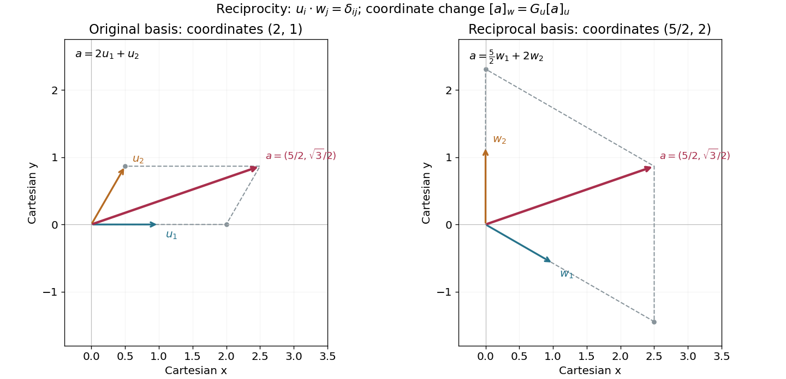

<h1 id="10/d/solution">Solution</h1>

↑ **Parent:** [D](../d.md)

Take the [inner product](../../../../inner-product-split.md) with $u_i$ in $a=\sum_ja'_jw_j$. The [reciprocal basis](../../../../reciprocal-basis.md) condition gives $a'_i=\langle u_i,a\rangle$. Expanding instead in the $u$ [basis](../../../../basis.md) proves the [reciprocal-basis coordinate transformation](../../../../reciprocal-basis-coordinate-transformation.md)

$$
\boxed{a'_i=\sum_jG_{ij}a_j,\qquad G_{ij}=\langle u_i,u_j\rangle.}
$$

Thus $G$ is the [Gram matrix](../../../../gram-matrix.md) of the original [basis](../../../../basis.md). It is a [positive-definite matrix](../../../../positive-definite-matrix.md), so this [change of basis](../../../../change-of-basis.md) is invertible.

In the specified two-dimensional Cartesian frame,

$$
u_1=(1,0),\qquad u_2=\left(\frac12,\frac{\sqrt3}{2}\right).
$$

Solving the four [dot product](../../../../dot-product.md) conditions gives

$$
\boxed{w_1=\left(1,-\frac1{\sqrt3}\right),\qquad w_2=\left(0,\frac2{\sqrt3}\right).}
$$

They are perpendicular to $u_2$ and $u_1$, respectively, with lengths adjusted so the other [dot product](../../../../dot-product.md) is one. Equating the Cartesian components of $a=a_1u_1+a_2u_2=a'_1w_1+a'_2w_2$ gives

$$
a_x=a_1+\frac12a_2=a'_1,\qquad
a_y=\frac{\sqrt3}{2}a_2=\frac{-a'_1+2a'_2}{\sqrt3}.
$$

Consequently

$$
\boxed{\begin{pmatrix}a'_1\\a'_2\end{pmatrix}=\begin{pmatrix}1&1/2\\1/2&1\end{pmatrix}\begin{pmatrix}a_1\\a_2\end{pmatrix},}
$$

which agrees entry by entry with the [Gram matrix](../../../../gram-matrix.md) computed directly from the two unit [basis vectors](../../../../basis-vector.md).

**[Figure 2](#10/d/image-one-vector-reconstructed-in-two-reciprocal-bases-coordinates-2-1-become-5-2-2-through-the-gram-matrix). One vector reconstructed in two reciprocal bases: coordinates $(2,1)$ become $(5/2,2)$ through the Gram matrix**.

## ↑ Ancestors (12)

1. [D](../d.md)
2. [10](../../10.md)
3. [2018](../../../2018-split.md)
4. [Past exam of the mathematical methods I course of the University of Oxford](../../../split.md)
5. [Mathematical methods I course of the University of Oxford](../../../../mathematical-methods-i-course-of-the-university-of-oxford.md)
6. [Year 1 of the physics course of the University of Oxford](../../../../year-1-of-the-physics-course-of-the-university-of-oxford.md)
7. [Physics course of the University of Oxford](../../../../physics-course-of-the-university-of-oxford.md)
8. [Undergraduate course of the University of Oxford](../../../../undergraduate-course-of-the-university-of-oxford.md)
9. [Course of the University of Oxford](../../../../course-of-the-university-of-oxford.md)
10. [University of Oxford](../../../../university-of-oxford-split.md)
11. [List of universities](../../../../list-of-universities.md)
12. [Codex Wiki](../../../../split.md)
