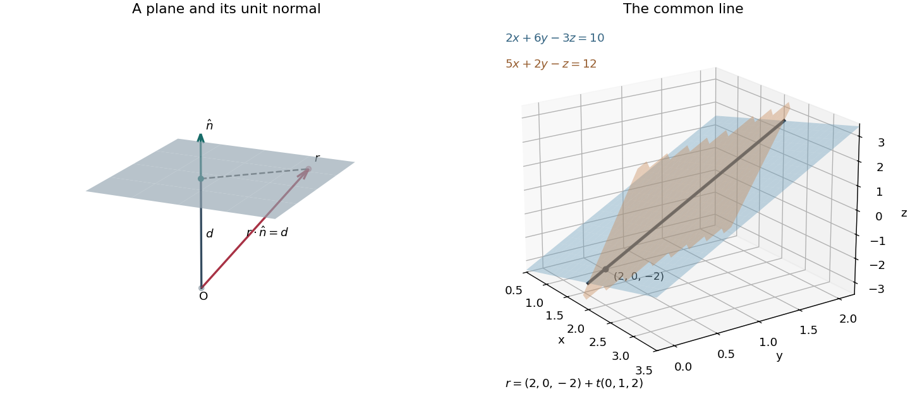

<h1 id="7/c/solution">Solution</h1>

↑ **Parent:** [C](../c.md)

A [plane](../../../../plane.md) through $r_0$ with nonzero [normal vector](../../../../normal-vector.md) $n$ consists of the [position vectors](../../../../position-vector.md) $r$ satisfying $(r-r_0)\cdot n=0$. Thus $r\cdot n=d$, with $d=r_0\cdot n$. When $n$ is a [unit vector](../../../../unit-vector.md), $d$ is the signed distance from the origin in the direction $n$; for an unnormalized [normal vector](../../../../normal-vector.md), that distance is $d/\|n\|$. The displacement within the [plane](../../../../plane.md) is perpendicular to $n$.

**[Figure 1](#7/c/image-a-unit-normal-vector-and-signed-plane-distance-followed-by-the-intersection-of-two-planes-as-a-straight-line). A unit normal vector and signed plane distance, followed by the intersection of two planes as a straight line**.

The [cross product](../../../../cross-product.md) of the two [normal vectors](../../../../normal-vector.md) is $(2,6,-3)\times(5,2,-1)=(0,-13,-26)$, so their [intersection of two planes](../../../../intersection-of-two-planes.md) has direction $(0,1,2)$. Eliminating $2y-z$ gives $x=2$, and substitution then gives $z=2y-2$. Thus the Cartesian constraints and [parametric equation of a straight line](../../../../parametric-equation-of-a-straight-line.md) are

$$
\boxed{x=2,\quad z=2y-2;\qquad r=\begin{pmatrix}2\\0\\-2\end{pmatrix}+t\begin{pmatrix}0\\1\\2\end{pmatrix},\quad t\in\mathbb R.}
$$

There is no valid division by a zero $x$ component in a symmetric ratio form; retaining $x=2$ explicitly handles that component.

## ↑ Ancestors (12)

1. [C](../c.md)
2. [7](../../7.md)
3. [2018](../../../2018-split.md)
4. [Past exam of the mathematical methods I course of the University of Oxford](../../../split.md)
5. [Mathematical methods I course of the University of Oxford](../../../../mathematical-methods-i-course-of-the-university-of-oxford.md)
6. [Year 1 of the physics course of the University of Oxford](../../../../year-1-of-the-physics-course-of-the-university-of-oxford.md)
7. [Physics course of the University of Oxford](../../../../physics-course-of-the-university-of-oxford.md)
8. [Undergraduate course of the University of Oxford](../../../../undergraduate-course-of-the-university-of-oxford.md)
9. [Course of the University of Oxford](../../../../course-of-the-university-of-oxford.md)
10. [University of Oxford](../../../../university-of-oxford-split.md)
11. [List of universities](../../../../list-of-universities.md)
12. [Codex Wiki](../../../../split.md)
