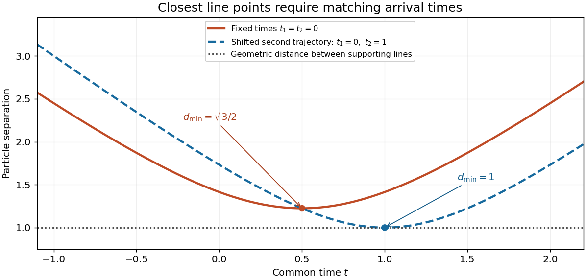

# 2019 resit

↑ **Parent:** [Past exam of the mathematical methods I course of the University of Oxford](../past-exam-of-the-mathematical-methods-i-course-of-the-university-of-oxford.md)

Source paper: [https://www.whatdotheyknow.com/request/physics_past_papers_21/response/3037379/attach/2/FOI%20202505%20441%20Response.pdf?cookie_passthrough=1](https://www.whatdotheyknow.com/request/physics_past_papers_21/response/3037379/attach/2/FOI%20202505%20441%20Response.pdf?cookie_passthrough=1)

Solutions use the resit paper, not the separate ordinary sitting. Question 9 distinguishes fixed-time closest approach from an additional synchronization condition; question 12(d) is solved on the actual regular components of its printed interval.

**Table of contents**

- [1](#1)
  - [a](#1/a)
    - [Solution](#1/a/solution)
  - [b](#1/b)
    - [Solution](#1/b/solution)
- [2](#2)
  - [Solution](#2/solution)
- [3](#3)
  - [Solution](#3/solution)
- [4](#4)
  - [Solution](#4/solution)
- [5](#5)
  - [Solution](#5/solution)
- [6](#6)
  - [Solution](#6/solution)
- [7](#7)
  - [Solution](#7/solution)
- [8](#8)
  - [Solution](#8/solution)
- [9](#9)
  - [Solution](#9/solution)
- [10](#10)
  - [a](#10/a)
    - [Solution](#10/a/solution)
  - [b](#10/b)
    - [Solution](#10/b/solution)
  - [c](#10/c)
    - [Solution](#10/c/solution)
- [11](#11)
  - [a](#11/a)
    - [i](#11/a/i)
      - [Solution](#11/a/i/solution)
    - [ii](#11/a/ii)
      - [Solution](#11/a/ii/solution)
    - [iii](#11/a/iii)
      - [Solution](#11/a/iii/solution)
    - [iv](#11/a/iv)
      - [Solution](#11/a/iv/solution)
  - [b](#11/b)
    - [i](#11/b/i)
      - [Solution](#11/b/i/solution)
    - [ii](#11/b/ii)
      - [Solution](#11/b/ii/solution)
    - [iii](#11/b/iii)
      - [Solution](#11/b/iii/solution)
- [12](#12)
  - [a](#12/a)
    - [Solution](#12/a/solution)
  - [b](#12/b)
    - [Solution](#12/b/solution)
  - [c](#12/c)
    - [Solution](#12/c/solution)
  - [d](#12/d)
    - [Solution](#12/d/solution)

## 1

↑ **Parent:** [2019 resit](2019-resit.md)

<h3 id="1/a">a</h3>

↑ **Parent:** [1](#1)

<h4 id="1/a/solution">Solution</h4>

↑ **Parent:** [A](#1/a)

Since $(1-i)^3=-2-2i$, divide and multiply by the [complex conjugate](../complex-analysis.md#complex-conjugate) of the denominator:

$$
\boxed{\frac{i}{(1-i)^3}=\frac{i(-2+2i)}8=-\frac14-\frac14i.}
$$

Multiplication by $-2-2i$ verifies the result directly.

<h3 id="1/b">b</h3>

↑ **Parent:** [1](#1)

<h4 id="1/b/solution">Solution</h4>

↑ **Parent:** [B](#1/b)

A [complex power](../analysis.md#complex-exponentiation) requires a choice of [complex logarithm](../analysis.md#complex-logarithm). Taking the [principal argument](../complex-analysis.md#principal-argument) of $-e$ to be $+\pi$ gives $\operatorname{Log}(-e)=1+i\pi$, hence

$$
\boxed{(-e)^{i\pi/2}=\exp\left(\frac{i\pi}{2}(1+i\pi)\right)=i e^{-\pi^2/2}.}
$$

Thus $a=0$ and $b=e^{-\pi^2/2}$ for this principal value. If the power is interpreted as multivalued, the logarithms are $1+i(2k+1)\pi$ and the possible values are $i\exp[-(2k+1)\pi^2/2]$, $k\in\mathbb Z$. Applying an identity for real powers without specifying this branch would lose the ambiguity.

## 2

↑ **Parent:** [2019 resit](2019-resit.md)

<h3 id="2/solution">Solution</h3>

↑ **Parent:** [2](#2)

Here $i^3=-i$, so the [argument](../complex-analysis.md#argument-complex-analysis) condition concerns $z+i$. Writing $z=x+iy$, the [complex number](../complex-analysis.md#complex-number) $x+i(y+1)$ must point along the direction $1+i$. Consequently

$$
\boxed{z=-i+s(1+i),\quad s>0,\qquad\text{equivalently }y=x-1,\ x>0.}
$$

This is an [open ray](../euclidean-geometry.md#open-ray) in the [Argand plane](../complex-analysis.md#complex-plane), rather than the whole straight [line](../euclidean-geometry.md#straight-line). Its endpoint $z=-i$ is excluded because the [argument](../complex-analysis.md#argument-complex-analysis) of zero is undefined; the opposite half-line has a different [argument](../complex-analysis.md#argument-complex-analysis).

## 3

↑ **Parent:** [2019 resit](2019-resit.md)

<h3 id="3/solution">Solution</h3>

↑ **Parent:** [3](#3)

To solve $A\mathbf x=\mathbf b$, subtract the first row from the second, and twice the first from the third. The resulting equations give $y=b_2-b_1$, $y+z=b_3-2b_1$, and hence $z=b_3-b_1-b_2$. Substituting in the original first equation gives $x=7b_1-3b_3$. Thus the [inverse matrix](../matrix-inverse.md) is

$$
\boxed{A^{-1}=\begin{pmatrix}7&0&-3\\-1&1&0\\-1&-1&1\end{pmatrix}.}
$$

The [determinant](../multilinear-algebra.md#determinant) is one, and multiplying in either order gives the [identity matrix](../vector-space.md#identity-matrix).

## 4

↑ **Parent:** [2019 resit](2019-resit.md)

<h3 id="4/solution">Solution</h3>

↑ **Parent:** [4](#4)

Use the [Leibniz formula for determinants](../multilinear-algebra.md#leibniz-formula-for-determinants):

$$
\det M=\sum_{\sigma\in S_n}\operatorname{sgn}(\sigma)\prod_{j=1}^n m_{j,\sigma(j)}.
$$

For a nonzero product in an [upper triangular matrix](../linear-algebra.md#upper-triangular-matrix), every selected column must satisfy $\sigma(j)\geq j$. But a [permutation](../combinatorics.md#permutation) has $\sum_j\sigma(j)=\sum_jj$, so every one of these inequalities is an equality. Only the identity [permutation](../combinatorics.md#permutation) can contribute. Its sign is positive and its product is $\prod_jm_{jj}$, which proves the result even if some diagonal entries vanish.

## 5

↑ **Parent:** [2019 resit](2019-resit.md)

<h3 id="5/solution">Solution</h3>

↑ **Parent:** [5](#5)

The common ratio supplies a [line](../euclidean-geometry.md#straight-line) parameter $s$:

$$
\boxed{\mathbf r=\mathbf p+s\mathbf v,\qquad\mathbf p=(1,1,1),\quad\mathbf v=(2,3,4).}
$$

The nearest point is the [orthogonal projection](../hilbert-space.md#orthogonal-projection) of the origin onto the [line](../euclidean-geometry.md#straight-line). Minimize $|\mathbf p+s\mathbf v|^2$: its [derivative](../calculus.md#derivative) is $2\mathbf v\cdot(\mathbf p+s\mathbf v)$, so $s_*=-9/29$ and the foot is $(11,2,-7)/29$. Thus

$$
\boxed{d=\sqrt{\frac6{29}}.}
$$

The [cross product](../vector-space.md#cross-product) formula $d=|\mathbf p\times\mathbf v|/|\mathbf v|$ agrees, since $\mathbf p\times\mathbf v=(1,-2,1)$.

## 6

↑ **Parent:** [2019 resit](2019-resit.md)

<h3 id="6/solution">Solution</h3>

↑ **Parent:** [6](#6)

The last equation gives $x=1/2-y$, and the first then gives $y+3z=3/2$. Together with the middle equation this reduces the consistency question to $(1-3\alpha)z=\beta-3\alpha/2$.

If $\alpha\ne1/3$, the [linear system](../linear-algebra.md#system-of-linear-equations) has the unique solution

$$
\boxed{(x,y,z)=\frac{(6\beta-3\alpha-2,\ 3-6\beta,\ 2\beta-3\alpha)}{2(1-3\alpha)}.}
$$

If $\alpha=1/3$ and $\beta=1/2$, the middle equation repeats one third of $y+3z=3/2$, giving the [affine line](../locally-ringed-space.md#affine-line) of solutions

$$
\boxed{(x,y,z)=(-1+3s,\ 3/2-3s,\ s),\qquad s\in\mathbb R.}
$$

If $\alpha=1/3$ and $\beta\ne1/2$, the two equations contradict each other and **there is no solution**. These are three possible types of solution set, rather than three individual solutions for one fixed choice of parameters.

## 7

↑ **Parent:** [2019 resit](2019-resit.md)

<h3 id="7/solution">Solution</h3>

↑ **Parent:** [7](#7)

Work on an interval with $x\ne0$ and $\cos(y/x)\ne0$, as required by the original equation. Set $v=y/x$, so $y'=v+xv'$, and obtain $xv'=3\tan v$. Where $\sin v\ne0$, [separation of variables](../partial-differential-equation.md#separation-of-variables) gives $\cot v\,dv=3\,dx/x$ and therefore

$$
\boxed{\sin(y/x)=Cx^3.}
$$

The solutions lost by division by $\tan v$ are $v=k\pi$, and they are included by $C=0$. On a fixed local branch one can write

$$
y=x\left[k\pi+(-1)^k\arcsin(Cx^3)\right],\qquad |Cx^3|<1.
$$

The integer $k$ is fixed along a connected regular branch. Implicit [differentiation](../calculus.md#differentiation) recovers the original equation whenever $x\cos(y/x)\ne0$. The boundary $|Cx^3|=1$ is excluded because the original [tangent function](../geometry-and-topology.md#tangent-function) has a pole there.

## 8

↑ **Parent:** [2019 resit](2019-resit.md)

<h3 id="8/solution">Solution</h3>

↑ **Parent:** [8](#8)

Eliminate $y$ using $y=1-x'$ to get $x''+x=-1$. The initial data give $x(0)=1$ and $x'(0)=0$, so the [simple harmonic motion](../classical-mechanics.md#simple-harmonic-motion) about the equilibrium $x=-1$ is

$$
\boxed{x(t)=-1+2\cos t,\qquad y(t)=1+2\sin t.}
$$

Indeed, $x'+y=1$ and $y'-x=1$ identically, and both initial coordinates equal one. This also describes a [circle](../topology.md#circle) of [radius](../topology.md#radius) two around $(-1,1)$ in the [phase plane](../dynamical-systems.md#phase-plane).

## 9

↑ **Parent:** [2019 resit](2019-resit.md)

<h3 id="9/solution">Solution</h3>

↑ **Parent:** [9](#9)

The three [vectors](../vector-space.md#vector) are [coplanar](../euclidean-geometry.md#coplanarity) precisely when their [scalar triple product](../multilinear-algebra.md#scalar-triple-product) vanishes:

$$
\boxed{\mathbf a\cdot(\mathbf b\times\mathbf c)=0.}
$$

This includes [linearly dependent](../vector-space.md#linear-dependence) or zero [vectors](../vector-space.md#vector). It expresses that the [determinant](../multilinear-algebra.md#determinant) with those [vectors](../vector-space.md#vector) as columns is zero.

For the two moving particles, distinguish closest approach at a common time from the geometric [distance](../geometry-and-topology.md#distance) between their supporting lines. For fixed reference times, put

$$
\mathbf d_0=\mathbf a_1-\mathbf a_2-\mathbf b_1t_1+\mathbf b_2t_2,\qquad
\mathbf v=\mathbf b_1-\mathbf b_2.
$$

Their relative position is $\mathbf d_0+t\mathbf v$. If $\mathbf v\ne0$, the [closest approach of two uniformly moving particles](../classical-mechanics.md#closest-approach-of-two-uniformly-moving-particles) occurs at

$$
\boxed{t_*=-\frac{\mathbf d_0\cdot\mathbf v}{|\mathbf v|^2},\qquad
 d_{\min}^2=|\mathbf d_0|^2-\frac{(\mathbf d_0\cdot\mathbf v)^2}{|\mathbf v|^2}.}
$$

If $\mathbf v=0$, the [distance](../geometry-and-topology.md#distance) is constant. If only $t\geq0$ is permitted, replace $t_*$ by $\max(0,t_*)$ before evaluating the [distance](../geometry-and-topology.md#distance).

Now suppose the velocities are nonparallel, and allow the relative starting-time offset to be chosen so that the particles reach the closest points of the two lines simultaneously. Write $\Delta=\mathbf a_2-\mathbf a_1$, $A=|\mathbf b_1|^2$, $B=\mathbf b_1\cdot\mathbf b_2$, $C=|\mathbf b_2|^2$ and $D=AC-B^2>0$. The independent [line](../euclidean-geometry.md#straight-line) parameters $s_1,s_2$ at the closest points satisfy

$$
A s_1-Bs_2=\mathbf b_1\cdot\Delta,\qquad
B s_1-Cs_2=\mathbf b_2\cdot\Delta.
$$

These equations make the connecting [vector](../vector-space.md#vector) perpendicular to both velocities. Solving the two-by-two [linear system](../linear-algebra.md#system-of-linear-equations) gives

$$
s_1=\frac{C\,\mathbf b_1\cdot\Delta-B\,\mathbf b_2\cdot\Delta}{D},\qquad
s_2=\frac{B\,\mathbf b_1\cdot\Delta-A\,\mathbf b_2\cdot\Delta}{D}.
$$

The corresponding [distance between skew lines](../euclidean-geometry.md#distance-between-skew-lines) is $|\Delta\cdot(\mathbf b_1\times\mathbf b_2)|/|\mathbf b_1\times\mathbf b_2|$. Simultaneous arrival requires $t_1+s_1=t_2+s_2$, so $t_1-t_2=s_2-s_1$. Since the [vector triple product](../multivariable-calculus.md#vector-triple-product) gives

$$
(\mathbf b_1\times\mathbf b_2)\times(\mathbf b_1-\mathbf b_2)
=(A-B)\mathbf b_2+(C-B)\mathbf b_1,
$$

this condition is precisely

$$
\boxed{t_1-t_2=
\frac{\Delta\cdot[(\mathbf b_1\times\mathbf b_2)\times(\mathbf b_1-\mathbf b_2)]}
{B^2-AC}.}
$$

Thus the printed formula has a valid interpretation as a synchronization condition for attaining the line-distance lower bound. It is not an identity that must hold for arbitrary fixed reference times at the time of closest approach.

For a counterexample to that stronger reading, take $\mathbf a_1=0$, $\mathbf a_2=(1,0,1)$, $\mathbf b_1=(1,0,0)$, $\mathbf b_2=(0,1,0)$ and $t_1=t_2=0$. The actual squared [distance](../geometry-and-topology.md#distance) is $2(t-1/2)^2+3/2$, minimized at $t=1/2$. The printed right-hand side is $-1$, whereas the fixed difference $t_1-t_2$ is zero. The line-distance bound is one, but it is not attained by that synchronized motion. Parallel velocities also require separate treatment because the displayed denominator then vanishes.

**[Figure 1](#9/image-closest-line-points-need-not-be-reached-at-the-same-time-shifting-a-trajectory-s-time-origin-changes-the-actual-minimum-distance). Closest line points need not be reached at the same time; shifting a trajectory's time origin changes the actual minimum distance**.

## 10

↑ **Parent:** [2019 resit](2019-resit.md)

<h3 id="10/a">a</h3>

↑ **Parent:** [10](#10)

<h4 id="10/a/solution">Solution</h4>

↑ **Parent:** [A](#10/a)

The [integrating factor](../linear-ordinary-differential-equation.md#integrating-factor) is $e^{2x}$, giving $(e^{2x}y)'=1+e^{2x}(x^2+2x)$. A quadratic particular solution for the [polynomial](../polynomial.md) forcing is $x^2/2+x/2-1/4$, while the resonant exponential forcing contributes $xe^{-2x}$. Consequently

$$
\boxed{y=(x+C)e^{-2x}+\frac{x^2+x}{2}-\frac14.}
$$

Substitution gives $y'+2y=e^{-2x}+x^2+2x$, and the free multiple of $e^{-2x}$ is the [homogeneous solution](../linear-ordinary-differential-equation.md#homogeneous-solution).

<h3 id="10/b">b</h3>

↑ **Parent:** [10](#10)

<h4 id="10/b/solution">Solution</h4>

↑ **Parent:** [B](#10/b)

Integrate the equation without dividing by $y$:

$$
\frac{d}{dx}\left(\frac{y^2}{2}\right)=1-\frac1{x+1},\qquad
\boxed{y^2=2x-2\log|x+1|+C.}
$$

This holds on a connected interval excluding $x=-1$. The real solutions are differentiable branches of this implicit curve. Where the radicand is positive, $y=\pm\sqrt{2x-2\log|x+1|+C}$, with a locally fixed sign.

A zero of $y$ can belong to a classical solution only at $x=0$, since the original equation then requires $x/(x+1)=0$. For $C=0$ near zero, $2x-2\log(1+x)=x^2+O(x^3)$; the smooth continuations have slopes $+1$ or $-1$ and switch between square-root signs across zero. Keeping the principal nonnegative [square root](../algebra.md#square-root) across zero instead gives a cusp. Thus the implicit expression requires a smooth branch choice, not an unrestricted global choice of one square-root sign.

<h3 id="10/c">c</h3>

↑ **Parent:** [10](#10)

<h4 id="10/c/solution">Solution</h4>

↑ **Parent:** [C](#10/c)

The operator is $(D+1)^2$. Set $y=e^{-x}u$; direct [differentiation](../calculus.md#differentiation) gives $(D+1)^2y=e^{-x}u''$. Hence $u''=3x^2$, and two integrations give

$$
\boxed{y=e^{-x}\left(\frac{x^4}{4}+C_1x+C_2\right).}
$$

The two free constants multiply the independent homogeneous solutions $e^{-x}$ and $xe^{-x}$.

## 11

↑ **Parent:** [2019 resit](2019-resit.md)

<h3 id="11/a">a</h3>

↑ **Parent:** [11](#11)

<h4 id="11/a/i">i</h4>

↑ **Parent:** [A](#11/a)

<h5 id="11/a/i/solution">Solution</h5>

↑ **Parent:** [I](#11/a/i)

For finite-dimensional operators, use $(AB)^\dagger=B^\dagger A^\dagger$ and the [Hermitian](../hilbert-space.md#hermitian-operator) assumptions. The [commutator](../lie-algebra.md#commutator) satisfies $[A,B]^\dagger=-[A,B]$, so

$$
(i[A,B])^\dagger=-i(-[A,B])=i[A,B].
$$

Thus **$i[A,B]$ is [Hermitian](../hilbert-space.md#hermitian-operator)**. These adjoint identities are the intended matrix-level setting; for unbounded operators, domains and self-adjointness require additional analysis.

<h4 id="11/a/ii">ii</h4>

↑ **Parent:** [A](#11/a)

<h5 id="11/a/ii/solution">Solution</h5>

↑ **Parent:** [Ii](#11/a/ii)

The [commutator](../lie-algebra.md#commutator) is [anti-Hermitian](../linear-operator-theory.md#skew-hermitian-matrix): $[A,B]^\dagger=-[A,B]$. It is also [Hermitian](../hilbert-space.md#hermitian-operator) precisely when it is zero, so **it is not [Hermitian](../hilbert-space.md#hermitian-operator) in general; it is [Hermitian](../hilbert-space.md#hermitian-operator) if and only if $A$ and $B$ commute**. For example, $[\sigma_x,\sigma_y]=2i\sigma_z\ne0$ for the [Pauli matrices](../algebra.md#pauli-matrices).

<h4 id="11/a/iii">iii</h4>

↑ **Parent:** [A](#11/a)

<h5 id="11/a/iii/solution">Solution</h5>

↑ **Parent:** [Iii](#11/a/iii)

Taking the [Hermitian adjoint](../hilbert-space.md#adjoint-operator) reverses the products and leaves their sum unchanged:

$$
\left(\frac{AB+BA}{2}\right)^\dagger=\frac{BA+AB}{2}.
$$

Thus **the symmetrized product is [Hermitian](../hilbert-space.md#hermitian-operator)**, whether or not $A$ and $B$ commute. This is the [Hermitian](../hilbert-space.md#hermitian-operator) [anticommutator](../vector-space.md#anticommutator) divided by two.

<h4 id="11/a/iv">iv</h4>

↑ **Parent:** [A](#11/a)

<h5 id="11/a/iv/solution">Solution</h5>

↑ **Parent:** [Iv](#11/a/iv)

One has $(C^\dagger C)^\dagger=C^\dagger C$, with no requirement that $C$ itself be [Hermitian](../hilbert-space.md#hermitian-operator). Moreover,

$$
\langle v,C^\dagger Cv\rangle=\|Cv\|^2\geq0.
$$

Thus **$C^\dagger C$ is [Hermitian](../hilbert-space.md#hermitian-operator) and [positive semidefinite](../quadratic-form.md#positive-semidefinite-matrix)**. The [positive semidefinite](../quadratic-form.md#positive-semidefinite-matrix) property is stronger than the [Hermitian](../hilbert-space.md#hermitian-operator) conclusion alone.

<h3 id="11/b">b</h3>

↑ **Parent:** [11](#11)

<h4 id="11/b/i">i</h4>

↑ **Parent:** [B](#11/b)

<h5 id="11/b/i/solution">Solution</h5>

↑ **Parent:** [I](#11/b/i)

Each displayed [Pauli matrix](../algebra.md#pauli-matrices) has zero [trace](../linear-algebra.md#matrix-trace) and [determinant](../multilinear-algebra.md#determinant) $-1$. Direct multiplication gives $\sigma_i^2=I$, hence

$$
\boxed{\det\sigma_i=-1,\quad\operatorname{tr}\sigma_i=0,\quad\sigma_i^2=I,\quad\sigma_i^{-1}=\sigma_i\qquad(i=x,y,z).}
$$

Their two [eigenvalues](../linear-operator-theory.md#eigenvalue) are therefore $+1$ and $-1$.

<h4 id="11/b/ii">ii</h4>

↑ **Parent:** [B](#11/b)

<h5 id="11/b/ii/solution">Solution</h5>

↑ **Parent:** [Ii](#11/b/ii)

Besides their squares, direct multiplication yields $\sigma_x\sigma_y=i\sigma_z$, $\sigma_y\sigma_z=i\sigma_x$ and $\sigma_z\sigma_x=i\sigma_y$. Reversing each pair changes the sign. These identities combine into the [Pauli matrix multiplication identity](../algebra.md#pauli-multiplication-identity)

$$
\sigma_i\sigma_j=\delta_{ij}I+i\sum_k\epsilon_{ijk}\sigma_k.
$$

Adding the expression with $i,j$ exchanged cancels the antisymmetric term, proving $\{\sigma_i,\sigma_j\}=2\delta_{ij}I$. Taking the [trace](../linear-algebra.md#matrix-trace) instead uses $\operatorname{tr}I=2$ and $\operatorname{tr}\sigma_k=0$, proving $\operatorname{tr}(\sigma_i\sigma_j)=2\delta_{ij}$.

<h4 id="11/b/iii">iii</h4>

↑ **Parent:** [B](#11/b)

<h5 id="11/b/iii/solution">Solution</h5>

↑ **Parent:** [Iii](#11/b/iii)

Expand the two [linear combinations](../vector-space.md#linear-combination) and use the [Pauli matrix multiplication identity](../algebra.md#pauli-multiplication-identity):

$$
\begin{aligned}
\sigma(\mathbf a)\sigma(\mathbf b)
&=\sum_{ij}a_i b_j\left(\delta_{ij}I+i\sum_k\epsilon_{ijk}\sigma_k\right)\\
&=(\mathbf a\cdot\mathbf b)I+i\sigma(\mathbf a\times\mathbf b).
\end{aligned}
$$

Interchanging the [vectors](../vector-space.md#vector) reverses the [cross product](../vector-space.md#cross-product), so their [commutator](../lie-algebra.md#commutator) is $2i\sigma(\mathbf a\times\mathbf b)$. The three [Pauli matrices](../algebra.md#pauli-matrices) are [linearly independent](../vector-space.md#linear-independence); alternatively, [trace](../linear-algebra.md#matrix-trace) against $\sigma_k$ to recover each coefficient. Thus

$$
\boxed{[\sigma(\mathbf a),\sigma(\mathbf b)]=0\quad\Longleftrightarrow\quad\mathbf a\times\mathbf b=0.}
$$

For nonzero real [vectors](../vector-space.md#vector), this means they are parallel or antiparallel, equivalently [linearly dependent](../vector-space.md#linear-dependence). The algebra also extends to complex [vectors](../vector-space.md#vector) using bilinear dot and cross products, with the same linear-dependence criterion; the [dot product](../inner-product.md#dot-product) there has no complex conjugation.

## 12

↑ **Parent:** [2019 resit](2019-resit.md)

<h3 id="12/a">a</h3>

↑ **Parent:** [12](#12)

<h4 id="12/a/solution">Solution</h4>

↑ **Parent:** [A](#12/a)

Use [variation of parameters](../linear-ordinary-differential-equation.md#variation-of-parameters), writing $y_p=t_1u_1+t_2u_2$ and imposing $t_1'u_1+t_2'u_2=0$. [Differentiation](../calculus.md#differentiation) then gives $y_p'=t_1u_1'+t_2u_2'$. Since the $u_j$ solve the homogeneous equation,

$$
L(y_p)=t_1'u_1'+t_2'u_2'.
$$

Thus solve the two-by-two [linear system](../linear-algebra.md#system-of-linear-equations)

$$
\begin{pmatrix}u_1&u_2\\u_1'&u_2'\end{pmatrix}
\begin{pmatrix}t_1'\\t_2'\end{pmatrix}
=\begin{pmatrix}0\\R\end{pmatrix}.
$$

Its [determinant](../multilinear-algebra.md#determinant) is the nonzero [Wronskian](../linear-ordinary-differential-equation.md#wronskian) $W$. [Cramer's rule](../multilinear-algebra.md#cramer-s-rule) gives $t_1'=-u_2R/W$ and $t_2'=u_1R/W$, and [integration](../integral.md) gives the stated antiderivatives. Their [integration](../integral.md) constants only add homogeneous solutions. The construction applies on a regular interval where the forcing and coefficients are defined and $W\ne0$.

<h3 id="12/b">b</h3>

↑ **Parent:** [12](#12)

<h4 id="12/b/solution">Solution</h4>

↑ **Parent:** [B](#12/b)

Differentiate the [Wronskian](../linear-ordinary-differential-equation.md#wronskian) and cancel the mixed first-derivative terms:

$$
W'=u_1u_2''-u_2u_1''=u_1(-au_2'-bu_2)-u_2(-au_1'-bu_1)=-aW.
$$

This is the constant-coefficient form of [Abel's identity](../linear-ordinary-differential-equation.md#abel-s-identity). Hence $W(x)=Ce^{-ax}$, or $W(x)=W(x_0)e^{-a(x-x_0)}$. Since the [exponential function](../calculus.md#exponential-function) is never zero, $W$ is either identically zero or nowhere zero on a connected interval of the homogeneous equation.

<h3 id="12/c">c</h3>

↑ **Parent:** [12](#12)

<h4 id="12/c/solution">Solution</h4>

↑ **Parent:** [C](#12/c)

Linear dependence means there are constants $c_1,c_2$, not both zero, with $c_1u_1+c_2u_2=0$. Since $u_1$ is nowhere zero, $c_2\ne0$, so $u_2=Cu_1$ and $u_2'=Cu_1'$. Substitution gives $W=u_1Cu_1'-Cu_1u_1'=0$.

The nonvanishing assumption is more than is needed for this direction. It also gives the converse directly: if $W=0$, then $(u_2/u_1)'=W/u_1^2=0$, so the ratio is constant on a connected interval. For arbitrary differentiable functions with zeros, a vanishing [Wronskian](../linear-ordinary-differential-equation.md#wronskian) alone needs more care; here the homogeneous linear equation also supplies an appropriate uniqueness theorem.

<h3 id="12/d">d</h3>

↑ **Parent:** [12](#12)

<h4 id="12/d/solution">Solution</h4>

↑ **Parent:** [D](#12/d)

The forcing $\sec(2x)$ is undefined at $x=\pm\pi/4$, both inside the printed interval. Therefore **there is no classical solution on the whole stated interval**. Solve separately on the three connected components obtained by removing those two points.

Choose $u_1=\cos(2x)$ and $u_2=\sin(2x)$, whose [Wronskian](../linear-ordinary-differential-equation.md#wronskian) is two. [Variation of parameters](../linear-ordinary-differential-equation.md#variation-of-parameters) gives $t_1'=-(1/2)\tan(2x)$ and $t_2'=1/2$, so a particular solution is $\tfrac14\cos(2x)\log|\cos(2x)|+\tfrac x2\sin(2x)$. The full answer on each regular component is

$$
\boxed{y=A\cos(2x)+B\sin(2x)+\frac14\cos(2x)\log|\cos(2x)|+\frac x2\sin(2x).}
$$

The constants $A,B$ can differ between $(-\pi/2,-\pi/4)$, $(-\pi/4,\pi/4)$ and $(\pi/4,\pi/2)$. [Differentiation](../calculus.md#differentiation) gives $y''+4y=1/\cos(2x)$ wherever the forcing is defined. Although the particular solution has finite one-sided values at the singularities, its [derivative](../calculus.md#derivative) has a logarithmic divergence, and the equation itself is undefined there. It cannot be promoted to one classical solution across the poles.

## ↑ Ancestors (9)

1. [Past exam of the mathematical methods I course of the University of Oxford](../past-exam-of-the-mathematical-methods-i-course-of-the-university-of-oxford.md)
2. [Mathematical methods I course of the University of Oxford](../university-of-oxford.md#mathematical-methods-i-course-of-the-university-of-oxford)
3. [Year 1 of the physics course of the University of Oxford](../university-of-oxford.md#year-1-of-the-physics-course-of-the-university-of-oxford)
4. [Physics course of the University of Oxford](../university-of-oxford.md#physics-course-of-the-university-of-oxford)
5. [Undergraduate course of the University of Oxford](../university-of-oxford.md#undergraduate-course-of-the-university-of-oxford)
6. [Course of the University of Oxford](../university-of-oxford.md#course-of-the-university-of-oxford)
7. [University of Oxford](../university-of-oxford.md)
8. [List of universities](../README.md#list-of-universities)
9. [Codex Wiki](../README.md)
