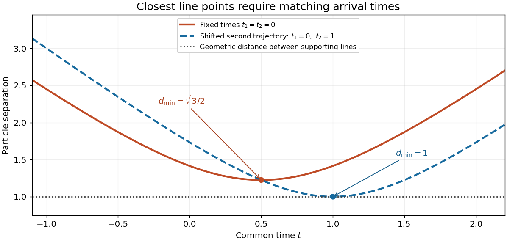

<h1 id="9/solution">Solution</h1>

↑ **Parent:** [9](../9.md)

The three [vectors](../../../vector.md) are [coplanar](../../../coplanarity.md) precisely when their [scalar triple product](../../../scalar-triple-product.md) vanishes:

$$
\boxed{\mathbf a\cdot(\mathbf b\times\mathbf c)=0.}
$$

This includes [linearly dependent](../../../linear-dependence.md) or zero [vectors](../../../vector.md). It expresses that the [determinant](../../../determinant.md) with those [vectors](../../../vector.md) as columns is zero.

For the two moving particles, distinguish closest approach at a common time from the geometric [distance](../../../distance.md) between their supporting lines. For fixed reference times, put

$$
\mathbf d_0=\mathbf a_1-\mathbf a_2-\mathbf b_1t_1+\mathbf b_2t_2,\qquad
\mathbf v=\mathbf b_1-\mathbf b_2.
$$

Their relative position is $\mathbf d_0+t\mathbf v$. If $\mathbf v\ne0$, the [closest approach of two uniformly moving particles](../../../closest-approach-of-two-uniformly-moving-particles.md) occurs at

$$
\boxed{t_*=-\frac{\mathbf d_0\cdot\mathbf v}{|\mathbf v|^2},\qquad
 d_{\min}^2=|\mathbf d_0|^2-\frac{(\mathbf d_0\cdot\mathbf v)^2}{|\mathbf v|^2}.}
$$

If $\mathbf v=0$, the [distance](../../../distance.md) is constant. If only $t\geq0$ is permitted, replace $t_*$ by $\max(0,t_*)$ before evaluating the [distance](../../../distance.md).

Now suppose the velocities are nonparallel, and allow the relative starting-time offset to be chosen so that the particles reach the closest points of the two lines simultaneously. Write $\Delta=\mathbf a_2-\mathbf a_1$, $A=|\mathbf b_1|^2$, $B=\mathbf b_1\cdot\mathbf b_2$, $C=|\mathbf b_2|^2$ and $D=AC-B^2>0$. The independent [line](../../../straight-line.md) parameters $s_1,s_2$ at the closest points satisfy

$$
A s_1-Bs_2=\mathbf b_1\cdot\Delta,\qquad
B s_1-Cs_2=\mathbf b_2\cdot\Delta.
$$

These equations make the connecting [vector](../../../vector.md) perpendicular to both velocities. Solving the two-by-two [linear system](../../../system-of-linear-equations.md) gives

$$
s_1=\frac{C\,\mathbf b_1\cdot\Delta-B\,\mathbf b_2\cdot\Delta}{D},\qquad
s_2=\frac{B\,\mathbf b_1\cdot\Delta-A\,\mathbf b_2\cdot\Delta}{D}.
$$

The corresponding [distance between skew lines](../../../distance-between-skew-lines.md) is $|\Delta\cdot(\mathbf b_1\times\mathbf b_2)|/|\mathbf b_1\times\mathbf b_2|$. Simultaneous arrival requires $t_1+s_1=t_2+s_2$, so $t_1-t_2=s_2-s_1$. Since the [vector triple product](../../../vector-triple-product.md) gives

$$
(\mathbf b_1\times\mathbf b_2)\times(\mathbf b_1-\mathbf b_2)
=(A-B)\mathbf b_2+(C-B)\mathbf b_1,
$$

this condition is precisely

$$
\boxed{t_1-t_2=
\frac{\Delta\cdot[(\mathbf b_1\times\mathbf b_2)\times(\mathbf b_1-\mathbf b_2)]}
{B^2-AC}.}
$$

Thus the printed formula has a valid interpretation as a synchronization condition for attaining the line-distance lower bound. It is not an identity that must hold for arbitrary fixed reference times at the time of closest approach.

For a counterexample to that stronger reading, take $\mathbf a_1=0$, $\mathbf a_2=(1,0,1)$, $\mathbf b_1=(1,0,0)$, $\mathbf b_2=(0,1,0)$ and $t_1=t_2=0$. The actual squared [distance](../../../distance.md) is $2(t-1/2)^2+3/2$, minimized at $t=1/2$. The printed right-hand side is $-1$, whereas the fixed difference $t_1-t_2$ is zero. The line-distance bound is one, but it is not attained by that synchronized motion. Parallel velocities also require separate treatment because the displayed denominator then vanishes.

**[Figure 1](#9/image-closest-line-points-need-not-be-reached-at-the-same-time-shifting-a-trajectory-s-time-origin-changes-the-actual-minimum-distance). Closest line points need not be reached at the same time; shifting a trajectory's time origin changes the actual minimum distance**.

## ↑ Ancestors (11)

1. [9](../9.md)
2. [2019 resit](../../2019-resit-split.md)
3. [Past exam of the mathematical methods I course of the University of Oxford](../../split.md)
4. [Mathematical methods I course of the University of Oxford](../../../mathematical-methods-i-course-of-the-university-of-oxford.md)
5. [Year 1 of the physics course of the University of Oxford](../../../year-1-of-the-physics-course-of-the-university-of-oxford.md)
6. [Physics course of the University of Oxford](../../../physics-course-of-the-university-of-oxford.md)
7. [Undergraduate course of the University of Oxford](../../../undergraduate-course-of-the-university-of-oxford.md)
8. [Course of the University of Oxford](../../../course-of-the-university-of-oxford.md)
9. [University of Oxford](../../../university-of-oxford-split.md)
10. [List of universities](../../../list-of-universities.md)
11. [Codex Wiki](../../../split.md)
