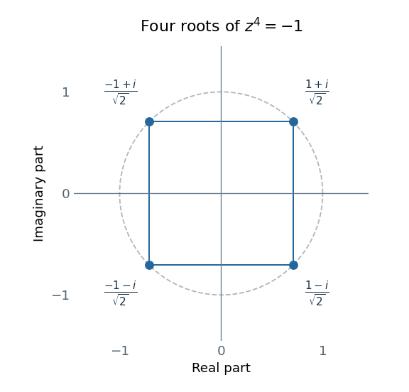
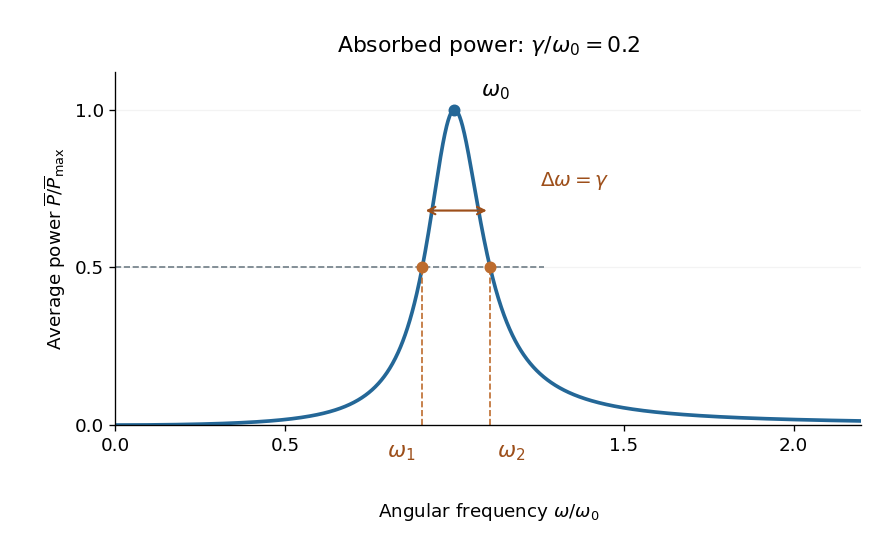

# 2019

↑ **Parent:** [Past exam of the mathematical methods I course of the University of Oxford](../past-exam-of-the-mathematical-methods-i-course-of-the-university-of-oxford.md)

Source paper: [https://www.whatdotheyknow.com/request/oxford_physics_past_papers_2/response/2340696/attach/7/Physics%20Papers%202018.pdf?cookie_passthrough=1](https://www.whatdotheyknow.com/request/oxford_physics_past_papers_2/response/2340696/attach/7/Physics%20Papers%202018.pdf?cookie_passthrough=1)

The annual bundle is named “Physics Papers 2018”, but this ordinary-sitting paper's cover is dated 12 June 2019. The year follows the cover. All twelve questions are solved, including all four choices in Section B.

**Table of contents**

- [1](#1)
  - [a](#1/a)
    - [Solution](#1/a/solution)
  - [b](#1/b)
    - [Solution](#1/b/solution)
  - [c](#1/c)
    - [Solution](#1/c/solution)
  - [d](#1/d)
    - [Solution](#1/d/solution)
- [2](#2)
  - [Solution](#2/solution)
- [3](#3)
  - [Solution](#3/solution)
- [4](#4)
  - [Solution](#4/solution)
- [5](#5)
  - [Solution](#5/solution)
- [6](#6)
  - [Solution](#6/solution)
- [7](#7)
  - [Solution](#7/solution)
- [8](#8)
  - [Solution](#8/solution)
- [9](#9)
  - [a](#9/a)
    - [Solution](#9/a/solution)
  - [b](#9/b)
    - [Solution](#9/b/solution)
  - [c](#9/c)
    - [i](#9/c/i)
      - [Solution](#9/c/i/solution)
    - [ii](#9/c/ii)
      - [Solution](#9/c/ii/solution)
    - [iii](#9/c/iii)
      - [Solution](#9/c/iii/solution)
- [10](#10)
  - [a](#10/a)
    - [Solution](#10/a/solution)
  - [b](#10/b)
    - [Solution](#10/b/solution)
  - [c](#10/c)
    - [Solution](#10/c/solution)
  - [d](#10/d)
    - [Solution](#10/d/solution)
- [11](#11)
  - [a](#11/a)
    - [Solution](#11/a/solution)
  - [b](#11/b)
    - [Solution](#11/b/solution)
  - [c](#11/c)
    - [i](#11/c/i)
      - [Solution](#11/c/i/solution)
    - [ii](#11/c/ii)
      - [Solution](#11/c/ii/solution)
    - [iii](#11/c/iii)
      - [Solution](#11/c/iii/solution)
    - [iv](#11/c/iv)
      - [Solution](#11/c/iv/solution)
    - [v](#11/c/v)
      - [Solution](#11/c/v/solution)
    - [vi](#11/c/vi)
      - [Solution](#11/c/vi/solution)
  - [d](#11/d)
    - [Solution](#11/d/solution)
- [12](#12)
  - [a](#12/a)
    - [Solution](#12/a/solution)
  - [b](#12/b)
    - [Solution](#12/b/solution)
  - [c](#12/c)
    - [Solution](#12/c/solution)

## 1

↑ **Parent:** [2019](2019.md)

<h3 id="1/a">a</h3>

↑ **Parent:** [1](#1)

<h4 id="1/a/solution">Solution</h4>

↑ **Parent:** [A](#1/a)

Squaring the [modulus](../complex-analysis.md#modulus) and doubling the [complex argument](../complex-analysis.md#argument-complex-analysis) gives

$$
(2e^{i\pi/4})^2=4e^{i\pi/2}=\boxed{0+4i}.
$$

This uses [Euler's formula](../complex-analysis.md#euler-s-formula) $e^{i\theta}=\cos\theta+i\sin\theta$.

<h3 id="1/b">b</h3>

↑ **Parent:** [1](#1)

<h4 id="1/b/solution">Solution</h4>

↑ **Parent:** [B](#1/b)

Multiply numerator and denominator by the [complex conjugate](../complex-analysis.md#complex-conjugate) of the denominator:

$$
\frac{1+i}{1-i}=\frac{(1+i)^2}{(1-i)(1+i)}=\frac{2i}{2}=\boxed{0+i}.
$$

The denominator is the squared [modulus](../complex-analysis.md#modulus) $|1-i|^2=2$.

<h3 id="1/c">c</h3>

↑ **Parent:** [1](#1)

<h4 id="1/c/solution">Solution</h4>

↑ **Parent:** [C](#1/c)

The [complex number](../complex-analysis.md#complex-number) $\sqrt3+i$ has [modulus](../complex-analysis.md#modulus) two and [principal argument](../complex-analysis.md#principal-argument) $\pi/6$. Therefore its [principal complex logarithm](../analysis.md#principal-complex-logarithm) is

$$
\boxed{\operatorname{Log}(\sqrt3+i)=\ln2+i\frac\pi6.}
$$

If the source's logarithm means the full multivalued [complex logarithm](../analysis.md#complex-logarithm), rather than its principal value, the complete answer is $\ln2+i(\pi/6+2\pi n)$ with $n\in\mathbb Z$. A branch convention is necessary to obtain a unique imaginary part.

<h3 id="1/d">d</h3>

↑ **Parent:** [1](#1)

<h4 id="1/d/solution">Solution</h4>

↑ **Parent:** [D](#1/d)

Use the [principal complex logarithm](../analysis.md#principal-complex-logarithm) at each stage of the nested [complex exponentiation](../analysis.md#complex-exponentiation). Since $\operatorname{Log}i=i\pi/2$,

$$
i^i=e^{i\operatorname{Log}i}=e^{-\pi/2}.
$$

This inner value is positive real, so its [principal complex logarithm](../analysis.md#principal-complex-logarithm) is $-\pi/2$. Consequently

$$
\boxed{(i^i)^i=e^{i(-\pi/2)}=-i=0-i.}
$$

One must retain the parentheses: [complex exponentiation is not associative](../analysis.md#complex-exponentiation-is-not-associative). If all [complex logarithm](../analysis.md#complex-logarithm) branches are allowed, the inner values are $e^{-\pi/2-2\pi k}$. Taking the outer logarithm with an independent integer branch index $\ell$ yields $\exp[-i\pi/2-2\pi ik-2\pi\ell]=-ie^{-2\pi\ell}$. Thus the complete multivalued set is $\{-ie^{-2\pi\ell}:\ell\in\mathbb Z\}$, and the boxed answer selects its principal evaluation.

## 2

↑ **Parent:** [2019](2019.md)

<h3 id="2/solution">Solution</h3>

↑ **Parent:** [2](#2)

The [determinant](../multilinear-algebra.md#determinant) is $z\cdot z^3-(-i)(-i)=z^4+1$. Thus $z^4=-1=e^{i(\pi+2\pi n)}$, and its four [polynomial roots](../polynomial.md#root-of-a-polynomial) are

$$
\boxed{z_k=e^{i(\pi/4+k\pi/2)},\qquad k=0,1,2,3.}
$$

In Cartesian form these are $(1+i)/\sqrt2$, $(-1+i)/\sqrt2$, $(-1-i)/\sqrt2$ and $(1-i)/\sqrt2$. Their [moduli](../complex-analysis.md#modulus) are one and their [complex arguments](../complex-analysis.md#argument-complex-analysis) are equally spaced by $\pi/2$. The [Argand diagram](../complex-analysis.md#complex-plane) is therefore a square centered at the origin, with sides parallel to the coordinate axes.

**[Figure 1](#2/image-the-four-roots-of-z-to-the-fourth-equals-minus-one-plotted-on-the-unit-circle-in-the-complex-plane). The four roots of z to the fourth equals minus one, plotted on the unit circle in the complex plane.**

## 3

↑ **Parent:** [2019](2019.md)

<h3 id="3/solution">Solution</h3>

↑ **Parent:** [3](#3)

The right-hand side depends on $x+y$, suggesting the substitution $u=x+y$. Then $y'=u'-1$, so the [ordinary differential equation](../differential-equation.md#ordinary-differential-equation) becomes

$$
u'=2-\frac4u=\frac{2(u-2)}u.
$$

The original equation is undefined at $u=0$. If $u\ne2$, this is a [separable differential equation](../differential-equation.md#separable-differential-equation):

$$
\frac{u}{u-2}\,du=2\,dx,\qquad
u+2\ln|u-2|=2x+C.
$$

Substituting back gives the implicit family

$$
\boxed{y-x+2\ln|x+y-2|=C,\qquad x+y\ne0,2.}
$$

Differentiating the implicit equation gives $y'-1+2(1+y')/(x+y-2)=0$, or $(x+y)y'=x+y-4$, verifying it on its permitted intervals.

Division by $u-2$ excluded the constant solution $u=2$, which must be restored separately:

$$
\boxed{y=2-x.}
$$

It satisfies $y'=-1=(2-4)/2$. Together these give all local real solutions on intervals where $x+y\ne0$.

## 4

↑ **Parent:** [2019](2019.md)

<h3 id="4/solution">Solution</h3>

↑ **Parent:** [4](#4)

On the interval $x>0$ containing the initial point, divide the [linear ordinary differential equation](../linear-ordinary-differential-equation.md) by $x$ to obtain $y'-2y/x=x$. Its [integrating factor](../linear-ordinary-differential-equation.md#integrating-factor) is $e^{\int-2\,dx/x}=x^{-2}$, giving

$$
\frac{d}{dx}\left(\frac{y}{x^2}\right)=\frac1x,
\qquad y=x^2(\ln x+C).
$$

The initial condition gives $1=C$. Hence

$$
\boxed{y(x)=x^2(1+\ln x),\qquad x>0.}
$$

Direct differentiation gives $y'=x(3+2\ln x)$, so $xy'-2y=x^2$ and $y(1)=1$. The coefficient of $y'$ vanishes at zero; the boxed expression is the solution on the regular initial-value interval, rather than an assertion of unique continuation through zero.

## 5

↑ **Parent:** [2019](2019.md)

<h3 id="5/solution">Solution</h3>

↑ **Parent:** [5](#5)

A [normal vector](../differential-geometry.md#normal-vector) to the [plane](../geometry-and-topology.md#plane) is $n=(3,4,12)^T$, with [Euclidean norm](../normed-vector-space.md#euclidean-norm) $\|n\|=\sqrt{9+16+144}=13$. For $p=(1,1,1)^T$, $n\cdot p=19$, so the [distance from a point to a plane](../geometry-and-topology.md#distance-from-a-point-to-a-plane) is

$$
\boxed{d=\frac{|n\cdot p-26|}{\|n\|}=\frac7{13}.}
$$

To verify that this is the minimum, the displacement to the [closest point on a plane](../geometry-and-topology.md#closest-point-on-a-plane) is parallel to $n$. Put $q=p+tn$ and require $n\cdot q=26$. This gives $t=7/169$ and

$$
q=\frac1{169}(190,197,253)^T.
$$

For every other point $r$ on the [plane](../geometry-and-topology.md#plane), the displacement $r-q$ is orthogonal to $q-p$. The [Pythagorean theorem](../euclidean-geometry.md#pythagorean-theorem) gives $\|r-p\|^2=\|q-p\|^2+\|r-q\|^2\geq(7/13)^2$, proving minimality.

## 6

↑ **Parent:** [2019](2019.md)

<h3 id="6/solution">Solution</h3>

↑ **Parent:** [6](#6)

Let $Av=\lambda v$ with $v\ne0$, using the standard complex [Hermitian inner product](../linear-algebra.md#hermitian-inner-product). Then

$$
v^\dagger Av=\lambda v^\dagger v.
$$

Taking the [complex conjugate](../complex-analysis.md#complex-conjugate) and using $A^\dagger=-A$ yields $\overline\lambda v^\dagger v=v^\dagger A^\dagger v=-\lambda v^\dagger v$. Since $v^\dagger v>0$,

$$
\boxed{\overline\lambda=-\lambda,\qquad \operatorname{Re}\lambda=0.}
$$

Thus every [eigenvalue](../linear-operator-theory.md#eigenvalue) of an [anti-Hermitian matrix](../linear-operator-theory.md#skew-hermitian-matrix) lies on the imaginary axis, including the possible zero [eigenvalue](../linear-operator-theory.md#eigenvalue); each nonzero [eigenvalue](../linear-operator-theory.md#eigenvalue) is purely imaginary.

Now take $Au=\lambda u$ and $Av=\mu v$. On one hand $u^\dagger Av=\mu u^\dagger v$. On the other hand

$$
u^\dagger Av=-(Au)^\dagger v=-\overline\lambda u^\dagger v=\lambda u^\dagger v.
$$

Consequently $(\mu-\lambda)u^\dagger v=0$. Distinct [eigenvalues](../linear-operator-theory.md#eigenvalue) therefore imply

$$
\boxed{u^\dagger v=0,}
$$

which is the required orthogonality of the [eigenvectors](../linear-operator-theory.md#eigenvector).

## 7

↑ **Parent:** [2019](2019.md)

<h3 id="7/solution">Solution</h3>

↑ **Parent:** [7](#7)

Write the given [matrix](../vector-space.md#matrix) as $A$. Expanding its [characteristic polynomial](../linear-operator-theory.md#characteristic-polynomial) along the middle column gives

$$
\begin{aligned}
\det(\lambda I-A)
&=(\lambda+2)\big[(\lambda-7)(\lambda+8)+54\big]\\
&=(\lambda+2)(\lambda^2+\lambda-2)
=(\lambda-1)(\lambda+2)^2.
\end{aligned}
$$

Thus the [eigenvalues](../linear-operator-theory.md#eigenvalue) are $1,-2,-2$, counted with [algebraic multiplicity](../linear-operator-theory.md#algebraic-multiplicity).

For $\lambda=1$, solving $(A-I)v=0$ gives $z=2x$ and $y=-x$. For $\lambda=-2$, solving $(A+2I)v=0$ gives $z=3x$, with $y$ free. A convenient [eigenbasis](../linear-operator-theory.md#eigenbasis) is therefore

$$
\boxed{\begin{array}{c|c}
\lambda&\text{eigenvector}\\\hline
1&(1,-1,2)^T\\
-2&(1,0,3)^T\\
-2&(0,1,0)^T
\end{array}}
$$

The last two [eigenvectors](../linear-operator-theory.md#eigenvector) span the two-dimensional [eigenspace](../linear-operator-theory.md#eigenspace) for $-2$. The three columns have [determinant](../multilinear-algebra.md#determinant) $-1$, so they are linearly independent and form a [basis](../vector-space.md#basis) of $\mathbb R^3$. In particular the repeated [eigenvalue](../linear-operator-theory.md#eigenvalue) causes no failure of [diagonalizability](../linear-operator-theory.md#diagonalizable-matrix) here.

## 8

↑ **Parent:** [2019](2019.md)

<h3 id="8/solution">Solution</h3>

↑ **Parent:** [8](#8)

Apply the [vector triple product identity](../multivariable-calculus.md#vector-triple-product) $p\times(c\times d)=c(p\cdot d)-d(p\cdot c)$ with $p=a\times b$. This gives

$$
(a\times b)\times(c\times d)
=c\big((a\times b)\cdot d\big)-d\big((a\times b)\cdot c\big).
$$

For column [vectors](../vector-space.md#vector) $a,b,d$, the [scalar triple product](../multilinear-algebra.md#scalar-triple-product) is $(a\times b)\cdot d=\det(a,b,d)$; replacing $d$ by $c$ gives the other coefficient. Therefore

$$
\boxed{(a\times b)\times(c\times d)=\det(a,b,d)c-\det(a,b,c)d.}
$$

The signs follow the stated column convention and the cyclic invariance of the [scalar triple product](../multilinear-algebra.md#scalar-triple-product). No independence assumptions on the four [vectors](../vector-space.md#vector) are needed.

## 9

↑ **Parent:** [2019](2019.md)

<h3 id="9/a">a</h3>

↑ **Parent:** [9](#9)

<h4 id="9/a/solution">Solution</h4>

↑ **Parent:** [A](#9/a)

Put $w=e^{i\theta}$. By [Euler's formula](../complex-analysis.md#euler-s-formula), $w-w^{-1}=2i\sin\theta$. The [binomial theorem](../binomial-coefficient.md#binomial-theorem) gives

$$
(w-w^{-1})^7=w^7-7w^5+21w^3-35w+35w^{-1}-21w^{-3}+7w^{-5}-w^{-7}.
$$

Group opposite powers and use $w^j-w^{-j}=2i\sin(j\theta)$:

$$
(2i)^7\sin^7\theta=2i\big[\sin7\theta-7\sin5\theta+21\sin3\theta-35\sin\theta\big].
$$

Since $(2i)^7=-128i$, division by $-2i$ yields

$$
\boxed{64\sin^7\theta=35\sin\theta-21\sin3\theta+7\sin5\theta-\sin7\theta.}
$$

This derivation is an application of the same exponential representation underlying [De Moivre's theorem](../analysis.md#de-moivre-s-theorem).

<h3 id="9/b">b</h3>

↑ **Parent:** [9](#9)

<h4 id="9/b/solution">Solution</h4>

↑ **Parent:** [B](#9/b)

To invert the complex [cosine](../geometry-and-topology.md#cosine), let $z=\cos w$ and put $u=e^{iw}$. Since the [exponential function](../calculus.md#exponential-function) is nonzero, $u\ne0$, and [Euler's formula](../complex-analysis.md#euler-s-formula) gives $2z=u+u^{-1}$. Multiplying by $u$ yields the [quadratic equation](../polynomial.md#quadratic-equation) $u^2-2zu+1=0$. Thus

$$
u=z\pm\sqrt{z^2-1}=z\pm i\sqrt{1-z^2}.
$$

Choosing either [square root](../algebra.md#square-root) of $1-z^2$ merely exchanges the two signs. The two values have product one, so neither vanishes; taking a [complex logarithm](../analysis.md#complex-logarithm) is legitimate.

For each choice of sign, all solutions of $e^{iw}=u$ satisfy $iw=\operatorname{Log}u+2\pi in$. Therefore the full inverse relation is

$$
\boxed{w=-i\operatorname{Log}\left(z\pm i\sqrt{1-z^2}\right)+2\pi n,\qquad n\in\mathbb Z.}
$$

Conversely, exponentiating any displayed value recovers one root of the [quadratic equation](../polynomial.md#quadratic-equation), and hence $(e^{iw}+e^{-iw})/2=z$, proving completeness. With a multivalued [complex logarithm](../analysis.md#complex-logarithm), the $2\pi n$ term is already included and this is the source's compact formula for [inverse cosine](../geometry-and-topology.md#arccosine).

The principal [inverse cosine](../geometry-and-topology.md#arccosine) requires compatible choices of [logarithm branch](../analysis.md#branch-of-the-complex-logarithm), [square root](../algebra.md#square-root) and sign. Both signs cannot represent that same principal function indiscriminately: at $z=0$, the two principal-log values are $\pi/2$ and $-\pi/2$, whereas the principal $\arccos0$ is $\pi/2$. Thus the printed $\pm$ is correct for the inverse relation, not a pair of interchangeable principal-value formulas.

<h3 id="9/c">c</h3>

↑ **Parent:** [9](#9)

<h4 id="9/c/i">i</h4>

↑ **Parent:** [C](#9/c)

<h5 id="9/c/i/solution">Solution</h5>

↑ **Parent:** [I](#9/c/i)

By [Vieta's formulas](../polynomial.md#vieta-s-formulas), the sum of all five [polynomial roots](../polynomial.md#root-of-a-polynomial), counted with [multiplicity of a root](../polynomial.md#multiplicity-of-a-root), is minus the coefficient of $z^4$ divided by the leading coefficient. Hence

$$
\boxed{\sum_{j=1}^5z_j=5.}
$$

<h4 id="9/c/ii">ii</h4>

↑ **Parent:** [C](#9/c)

<h5 id="9/c/ii/solution">Solution</h5>

↑ **Parent:** [Ii](#9/c/ii)

For a monic [polynomial](../polynomial.md) of degree five, [Vieta's formulas](../polynomial.md#vieta-s-formulas) give the product of its [polynomial roots](../polynomial.md#root-of-a-polynomial) as $(-1)^5$ times its constant coefficient. Therefore

$$
\boxed{\prod_{j=1}^5z_j=-8.}
$$

<h4 id="9/c/iii">iii</h4>

↑ **Parent:** [C](#9/c)

<h5 id="9/c/iii/solution">Solution</h5>

↑ **Parent:** [Iii](#9/c/iii)

The coefficients are real, so the supplied [polynomial root](../polynomial.md#root-of-a-polynomial) $2+2i$ has its [complex conjugate](../complex-analysis.md#complex-conjugate) $2-2i$ as another [polynomial root](../polynomial.md#root-of-a-polynomial). Their monic [polynomial factor](../polynomial.md#polynomial-factor) of degree two is

$$
(z-2-2i)(z-2+2i)=(z-2)^2+4=z^2-4z+8.
$$

Polynomial division then gives

$$
\begin{aligned}
z^5-5z^4+11z^3-3z^2-12z+8
&=(z^2-4z+8)(z^3-z^2-z+1)\\
&=(z^2-4z+8)(z-1)^2(z+1).
\end{aligned}
$$

Thus all five [polynomial roots](../polynomial.md#root-of-a-polynomial), with [multiplicity of a root](../polynomial.md#multiplicity-of-a-root), are

$$
\boxed{2+2i,\qquad2-2i,\qquad1,\qquad1,\qquad-1.}
$$

Their sum is $5$ and their product is $8\cdot1\cdot(-1)=-8$, agreeing with [solution](#9/c/i/solution) and [solution](#9/c/ii/solution).

## 10

↑ **Parent:** [2019](2019.md)

<h3 id="10/a">a</h3>

↑ **Parent:** [10](#10)

<h4 id="10/a/solution">Solution</h4>

↑ **Parent:** [A](#10/a)

Assume a physical [mass](../classical-mechanics.md#mass) $m>0$, [spring constant](../elasticity-physics.md#spring-constant) $k>0$, and nonnegative viscous damping parameter $\gamma$. The homogeneous [damped harmonic oscillator](../analysis.md#damped-harmonic-oscillator) has [characteristic equation](../linear-ordinary-differential-equation.md#characteristic-equation-of-a-constant-coefficient-differential-equation)

$$
r^2+\gamma r+\omega_0^2=0,\qquad\omega_0^2=\frac{k}{m}.
$$

Its roots are $r=-\gamma/2\pm\sqrt{\gamma^2/4-\omega_0^2}$. They have nonzero imaginary parts precisely when $\gamma^2<4k/m$. Defining $\Omega=\sqrt{k/m-\gamma^2/4}$, the real oscillatory solutions are

$$
\boxed{z_h(t)=e^{-\gamma t/2}\big(C\cos\Omega t+D\sin\Omega t\big),\qquad\gamma^2<\frac{4k}{m}.}
$$

For strictly decaying oscillations also require $\gamma>0$. The limiting $\gamma=0$ case is an undamped [harmonic oscillator](../classical-mechanics.md#simple-harmonic-motion). Equality gives critical damping with $z_h=(C+Dt)e^{-\gamma t/2}$, and a larger positive $\gamma$ gives two real decaying exponentials rather than oscillations.

<h3 id="10/b">b</h3>

↑ **Parent:** [10](#10)

<h4 id="10/b/solution">Solution</h4>

↑ **Parent:** [B](#10/b)

Take $m,k,\gamma,F_0>0$ and $\omega>0$, and write $D_\omega=k-m\omega^2$ and $B_\omega=m\gamma\omega$. Substitution of $z=A\cos\omega t$ into the [forced harmonic oscillator](../analysis.md#forced-harmonic-oscillator) equation gives

$$
A D_\omega\cos\omega t-A B_\omega\sin\omega t
=F_0\cos\phi_0\cos\omega t-F_0\sin\phi_0\sin\omega t.
$$

Equating the independent [sine](../geometry-and-topology.md#sine) and [cosine](../geometry-and-topology.md#cosine) coefficients yields

$$
\boxed{A D_\omega=F_0\cos\phi_0,\qquad A B_\omega=F_0\sin\phi_0.}
$$

Thus the required [phase matching for a displacement referenced driven oscillator](../analysis.md#phase-matching-for-a-displacement-referenced-driven-oscillator) is

$$
\boxed{(k-m\omega^2)\sin\phi_0=m\gamma\omega\cos\phi_0.}
$$

For a positive [amplitude](../wave.md#wave-amplitude) $A$, one must also choose the correct quadrant: $\cos\phi_0=D_\omega/\sqrt{D_\omega^2+B_\omega^2}$ and $\sin\phi_0=B_\omega/\sqrt{D_\omega^2+B_\omega^2}$. Squaring and adding the coefficient equations gives

$$
\boxed{A=\frac{F_0}{\sqrt{(k-m\omega^2)^2+(m\gamma\omega)^2}}.}
$$

For arbitrary forcing [phase](../wave.md#phase-waves), the steady response is instead $z=A\cos(\omega t+\phi_0-\delta)$, where $\delta$ has the sine and cosine just specified. A change of time origin can put this displacement into $A\cos\omega t$, but it also changes the stated forcing [phase](../wave.md#phase-waves).

The source's requested parameter list for $A$ omits $\gamma$; in general it cannot be omitted. As a concrete counterexample, take $m=k=F_0=\omega=1$ and $\phi_0=\pi/2$. The prescribed cosine response exists for every $\gamma>0$, but $A=1/\gamma$, so fixing all four listed parameters does not fix the [amplitude](../wave.md#wave-amplitude). Likewise, with fixed $\phi_0=0$, positive damping and nonzero $\omega$, the second coefficient equation prevents a nonzero pure-cosine response. The forcing [phase](../wave.md#phase-waves) is an essential part of the condition.

<h3 id="10/c">c</h3>

↑ **Parent:** [10](#10)

<h4 id="10/c/solution">Solution</h4>

↑ **Parent:** [C](#10/c)

In the steady periodic response, the cycle average of the [mechanical energy](../energy.md#mechanical-energy) derivative vanishes. The applied [average power](../energy.md#average-power) therefore equals the power dissipated by the viscous [force](../force.md):

$$
\overline P=m\gamma\langle\dot z^{\,2}\rangle=\frac12m\gamma A^2\omega^2.
$$

Using [solution](#10/b/solution) gives

$$
\boxed{\overline P(\omega)=\frac{F_0^2m\gamma\omega^2}{2\big[(k-m\omega^2)^2+(m\gamma\omega)^2\big]}.}
$$

The same result follows from averaging the instantaneous input [power](../energy.md#power) $F(t)\dot z(t)$, using the response [phase](../wave.md#phase-waves) relative to the drive.

For positive $m,k,\gamma$ and $\omega>0$, rewrite this as

$$
\overline P=\frac{F_0^2}{2m\gamma}\,
\frac{(m\gamma\omega)^2}{(k-m\omega^2)^2+(m\gamma\omega)^2}.
$$

The last factor is at most one, with equality precisely when $k-m\omega^2=0$. Thus the power peak occurs at $\omega_0=\sqrt{k/m}$ and

$$
\boxed{\overline P_{\max}=\frac{F_0^2}{2m\gamma}.}
$$

This power-resonance [angular frequency](../lagrangian-mechanics.md#angular-frequency) is exactly $\omega_0$; it need not equal the [angular frequency](../lagrangian-mechanics.md#angular-frequency) maximizing displacement [amplitude](../wave.md#wave-amplitude). Positive damping is essential: at $\gamma=0$ and exact resonance there is no bounded steady periodic response to nonzero forcing, so the divergent expression is not a finite-power solution.

<h3 id="10/d">d</h3>

↑ **Parent:** [10](#10)

<h4 id="10/d/solution">Solution</h4>

↑ **Parent:** [D](#10/d)

Use $\omega_0^2=k/m$ and the power formula from [solution](#10/c/solution). Its normalized form is

$$
\frac{\overline P(\omega)}{\overline P_{\max}}
=\frac{\gamma^2\omega^2}{(\omega_0^2-\omega^2)^2+\gamma^2\omega^2}.
$$

It is zero at $\omega=0$, rises to one at $\omega_0$, and decays to zero as $\omega\to\infty$. The two positive half-power [angular frequencies](../lagrangian-mechanics.md#angular-frequency) satisfy

$$
(\omega_0^2-\omega^2)^2=\gamma^2\omega^2.
$$

On the low-frequency side, $\omega_0^2-\omega_1^2=\gamma\omega_1$; on the high-frequency side, $\omega_2^2-\omega_0^2=\gamma\omega_2$. Solving these [quadratic equations](../polynomial.md#quadratic-equation) gives

$$
\boxed{\omega_1=\frac{\sqrt{4\omega_0^2+\gamma^2}-\gamma}{2},\qquad
\omega_2=\frac{\sqrt{4\omega_0^2+\gamma^2}+\gamma}{2}.}
$$

Consequently the [frequency bandwidth of viscous oscillator power absorption](../analysis.md#frequency-bandwidth-of-viscous-oscillator-power-absorption) obeys the stronger exact result

$$
\boxed{\omega_2-\omega_1=\gamma.}
$$

For a sharp resonance, $\gamma\ll\omega_0$, expansion gives $\omega_{1,2}=\omega_0\mp\gamma/2+O(\gamma^2/\omega_0)$, which recovers the requested approximation. The exact width above assumes the constant viscous damping coefficient in this model. Although the curve is approximately symmetric near a sharp peak, the exact half-power points satisfy $\omega_1\omega_2=\omega_0^2$ rather than exact symmetry about $\omega_0$.

**[Figure 2](#10/d/image-normalized-absorbed-power-for-gamma-divided-by-omega-zero-equal-to-0-2-the-peak-and-the-two-exact-half-power-frequencies-are-marked-their-separation-is-gamma). Normalized absorbed power for gamma divided by omega zero equal to 0.2. The peak and the two exact half-power frequencies are marked; their separation is gamma.**

## 11

↑ **Parent:** [2019](2019.md)

<h3 id="11/a">a</h3>

↑ **Parent:** [11](#11)

<h4 id="11/a/solution">Solution</h4>

↑ **Parent:** [A](#11/a)

For a finite [matrix](../vector-space.md#matrix), the series defining the [matrix exponential](../linear-operator-theory.md#matrix-exponential) converges absolutely in any [matrix norm](../vector-space.md#matrix-norm), because $\|A^m/m!\|\leq\|A\|^m/m!$. Thus the [Hermitian adjoint](../hilbert-space.md#adjoint-operator) may be taken term by term. Since $A^\dagger=A$,

$$
(e^A)^\dagger=\sum_{m=0}^\infty\frac{(A^m)^\dagger}{m!}
=\sum_{m=0}^\infty\frac{(A^\dagger)^m}{m!}
=\sum_{m=0}^\infty\frac{A^m}{m!}=e^A.
$$

Therefore the [matrix exponential](../linear-operator-theory.md#matrix-exponential) of a [Hermitian matrix](../hilbert-space.md#hermitian-operator) is Hermitian.

If $A=\operatorname{diag}(a_1,\ldots,a_n)$ is a [diagonal matrix](../linear-algebra.md#diagonal-matrix), then $A^m=\operatorname{diag}(a_1^m,\ldots,a_n^m)$. Summing each entry separately gives

$$
\boxed{e^A=\operatorname{diag}(e^{a_1},\ldots,e^{a_n}),\qquad(e^A)_{ij}=\delta_{ij}e^{a_i}.}
$$

For the [Hermitian matrix](../hilbert-space.md#hermitian-operator) case each $a_i$ is real. The diagonal entry formula itself remains valid for complex diagonal entries.

<h3 id="11/b">b</h3>

↑ **Parent:** [11](#11)

<h4 id="11/b/solution">Solution</h4>

↑ **Parent:** [B](#11/b)

The upper-triangular [matrix](../vector-space.md#matrix) has distinct [eigenvalues](../linear-operator-theory.md#eigenvalue) $2,-1$, with respective [eigenvectors](../linear-operator-theory.md#eigenvector) $(1,0)^T$ and $(-2,1)^T$. Thus

$$
A=S\begin{pmatrix}2&0\\0&-1\end{pmatrix}S^{-1},\qquad
S=\begin{pmatrix}1&-2\\0&1\end{pmatrix},\qquad
S^{-1}=\begin{pmatrix}1&2\\0&1\end{pmatrix}.
$$

The defining [power series](../sequence-and-series.md#power-series) shows that the [matrix exponential respects similarity](../linear-operator-theory.md#matrix-exponential-respects-similarity). Applying [solution](#11/a/solution) to the diagonal factor gives

$$
\boxed{e^A=S\begin{pmatrix}e^2&0\\0&e^{-1}\end{pmatrix}S^{-1}
=\begin{pmatrix}e^2&2(e^2-e^{-1})\\0&e^{-1}\end{pmatrix}.}
$$

As a direct series check, $(A^m)_{12}=2(2^m-(-1)^m)$ for $m\geq0$; summing this entry divided by $m!$ gives the same off-diagonal expression.

<h3 id="11/c">c</h3>

↑ **Parent:** [11](#11)

<h4 id="11/c/i">i</h4>

↑ **Parent:** [C](#11/c)

<h5 id="11/c/i/solution">Solution</h5>

↑ **Parent:** [I](#11/c/i)

If $M$ is an $r\times s$ [matrix](../vector-space.md#matrix), the product $M^2=MM$ is defined in ordinary [matrix multiplication](../vector-space.md#matrix-multiplication) only when $s=r$. Hence the defining equation of an [idempotent matrix](../function.md#idempotent-matrix) already requires equal row and column counts:

$$
\boxed{M\text{ is square}.}
$$

Equivalently, an [idempotent linear map](../vector-space.md#projection-linear-algebra) is an [endomorphism](../algebra.md#endomorphism), so the same [vector space](../vector-space.md) is both its domain and codomain.

<h4 id="11/c/ii">ii</h4>

↑ **Parent:** [C](#11/c)

<h5 id="11/c/ii/solution">Solution</h5>

↑ **Parent:** [Ii](#11/c/ii)

If the [idempotent matrix](../function.md#idempotent-matrix) $M$ is invertible, multiply $M^2=M$ on the left by its [matrix inverse](../matrix-inverse.md):

$$
M^{-1}M^2=M^{-1}M\quad\Longrightarrow\quad\boxed{M=I.}
$$

Thus a nonidentity [idempotent matrix](../function.md#idempotent-matrix) must be singular; the identity itself is both invertible and idempotent.

<h4 id="11/c/iii">iii</h4>

↑ **Parent:** [C](#11/c)

<h5 id="11/c/iii/solution">Solution</h5>

↑ **Parent:** [Iii](#11/c/iii)

Using $M^2=M$,

$$
\boxed{(I-M)^2=I-2M+M^2=I-M.}
$$

Thus $I-M$ is another [idempotent matrix](../function.md#idempotent-matrix). In fact $M(I-M)=(I-M)M=0$: as [linear projections](../vector-space.md#projection-linear-algebra), they select the complementary summands in the decomposition $x=Mx+(I-M)x$.

<h4 id="11/c/iv">iv</h4>

↑ **Parent:** [C](#11/c)

<h5 id="11/c/iv/solution">Solution</h5>

↑ **Parent:** [Iv](#11/c/iv)

Take [determinants](../multilinear-algebra.md#determinant) of the idempotence equation and use multiplicativity of the [determinant](../multilinear-algebra.md#determinant):

$$
(\det M)^2=\det(M^2)=\det M.
$$

Thus $d=\det M$ satisfies $d(d-1)=0$, proving

$$
\boxed{\det M\in\{0,1\}.}
$$

If the [determinant](../multilinear-algebra.md#determinant) is one, $M$ is invertible and [solution](#11/c/ii/solution) gives $M=I$. Every other [idempotent matrix](../function.md#idempotent-matrix) has zero [determinant](../multilinear-algebra.md#determinant).

<h4 id="11/c/v">v</h4>

↑ **Parent:** [C](#11/c)

<h5 id="11/c/v/solution">Solution</h5>

↑ **Parent:** [V](#11/c/v)

For real orthonormal column [vectors](../vector-space.md#vector), $u^Tu=v^Tv=1$ and $u^Tv=v^Tu=0$. Expand using associativity of [matrix multiplication](../vector-space.md#matrix-multiplication):

$$
\begin{aligned}
(uu^T+vv^T)^2
&=u(u^Tu)u^T+u(u^Tv)v^T+v(v^Tu)u^T+v(v^Tv)v^T\\
&=uu^T+vv^T.
\end{aligned}
$$

Hence

$$
\boxed{M=uu^T+vv^T\text{ is idempotent}.}
$$

More precisely, it is the [orthogonal projection](../hilbert-space.md#orthogonal-projection) onto the span of $u,v$: it fixes both [vectors](../vector-space.md#vector) and annihilates every [vector](../vector-space.md#vector) orthogonal to both.

The transpose convention presumes real [vectors](../vector-space.md#vector), or the explicitly stated bilinear identities above. For complex [vectors](../vector-space.md#vector) orthonormal in the [Hermitian inner product](../linear-algebra.md#hermitian-inner-product), the correct [orthogonal projection](../hilbert-space.md#orthogonal-projection) is $uu^\dagger+vv^\dagger$. The printed transpose formula need not work in that setting: $u=(i,0)^T$ and $v=(0,1)^T$ are Hermitian-orthonormal, but $uu^T+vv^T=\operatorname{diag}(-1,1)$ has square $I_2$, which is different from itself.

<h4 id="11/c/vi">vi</h4>

↑ **Parent:** [C](#11/c)

<h5 id="11/c/vi/solution">Solution</h5>

↑ **Parent:** [Vi](#11/c/vi)

Induction from $M^2=M$ gives $M^j=M$ for every integer $j\geq1$. Separate the zeroth term of the [matrix exponential](../linear-operator-theory.md#matrix-exponential) series:

$$
\begin{aligned}
e^{\alpha M}
&=I+\sum_{j=1}^\infty\frac{\alpha^jM^j}{j!}
=I+M\sum_{j=1}^\infty\frac{\alpha^j}{j!}\\
&=I+(e^\alpha-1)M.
\end{aligned}
$$

Therefore the [exponential of an idempotent linear map](../vector-space.md#exponential-of-an-idempotent-linear-map) is

$$
\boxed{e^{\alpha M}=I+(e^\alpha-1)M=(I-M)+e^\alpha M.}
$$

The last form shows its action directly: it multiplies the [image of a linear map](../vector-space.md#image-of-a-linear-map) of $M$ by $e^\alpha$ and fixes its [kernel of a linear map](../kernel-of-a-linear-map.md). No Hermiticity assumption on the [idempotent matrix](../function.md#idempotent-matrix) is needed.

<h3 id="11/d">d</h3>

↑ **Parent:** [11](#11)

<h4 id="11/d/solution">Solution</h4>

↑ **Parent:** [D](#11/d)

Write $M=\begin{pmatrix}a&b\\c&d\end{pmatrix}$. The two off-diagonal entries of $M^2=M$ give

$$
b(a+d)=b,\qquad c(a+d)=c,
$$

or $b(\operatorname{tr}M-1)=c(\operatorname{tr}M-1)=0$. If both $b,c$ vanish, $M$ is diagonal; if either is nonzero, the [trace](../linear-algebra.md#matrix-trace) must be one. Thus the [trace criterion for a two-by-two idempotent](../vector-space.md#trace-criterion-for-a-two-by-two-idempotent) is

$$
\boxed{M^2=M\quad\Longrightarrow\quad M\text{ is diagonal or }\operatorname{tr}M=1.}
$$

For the diagonal case, idempotence further forces $a,d\in\{0,1\}$. The stated alternative is only necessary: $\begin{pmatrix}1&1\\1&0\end{pmatrix}$ has [trace](../linear-algebra.md#matrix-trace) one but its square is $\begin{pmatrix}2&1\\1&1\end{pmatrix}$, so it is not idempotent. Among two-by-two [matrices](../vector-space.md#matrix) of [trace](../linear-algebra.md#matrix-trace) one, the additional condition $\det M=0$ is sufficient by the [Cayley-Hamilton theorem](../cayley-hamilton-theorem.md), which gives $M^2-M+(\det M)I=0$.

## 12

↑ **Parent:** [2019](2019.md)

<h3 id="12/a">a</h3>

↑ **Parent:** [12](#12)

<h4 id="12/a/solution">Solution</h4>

↑ **Parent:** [A](#12/a)

The [linear system](../linear-algebra.md#system-of-linear-equations) has the [matrix](../vector-space.md#matrix) form

$$
\boxed{A\boldsymbol x=\boldsymbol b,\qquad
A=\begin{pmatrix}0&-3&-2\\1&-4&-2\\-3&4&1\end{pmatrix},\quad
\boldsymbol x=\begin{pmatrix}x_1\\x_2\\x_3\end{pmatrix},\quad
\boldsymbol b=\begin{pmatrix}4\\2\\-1\end{pmatrix}.}
$$

The first equation gives $3x_2+2x_3=-4$. Substitute it into the second to obtain $x_1=2+4x_2+2x_3=x_2-2$. Substitution into the third gives $x_2+x_3=-7$. Consequently

$$
3x_2+2(-7-x_2)=-4\quad\Longrightarrow\quad x_2=10.
$$

It follows that

$$
\boxed{\boldsymbol x=(8,10,-17)^T.}
$$

Substitution verifies all three equations. Also $\det A=1\ne0$, so this [solution of a linear system](../linear-algebra.md#solution-of-a-linear-system) is unique.

<h3 id="12/b">b</h3>

↑ **Parent:** [12](#12)

<h4 id="12/b/solution">Solution</h4>

↑ **Parent:** [B](#12/b)

The [characteristic polynomial](../linear-operator-theory.md#characteristic-polynomial) of $M$ is

$$
\det(\lambda I-M)=(\lambda-6)(\lambda-3)+2=(\lambda-4)(\lambda-5).
$$

The corresponding [eigenvectors](../linear-operator-theory.md#eigenvector) may be chosen as $v_4=(1,2)^T$ and $v_5=(1,1)^T$. They are linearly independent, so write $\boldsymbol x=q_4(t)v_4+q_5(t)v_5$. Substitution in the system of [ordinary differential equations](../differential-equation.md#ordinary-differential-equation) gives

$$
(q_4''+4q_4)v_4+(q_5''+5q_5)v_5=0.
$$

Independence of the [eigenvectors](../linear-operator-theory.md#eigenvector) yields two decoupled [harmonic oscillator equations](../classical-mechanics.md#simple-harmonic-motion). Their four integration constants give the general real solution

$$
\boxed{\boldsymbol x(t)=
\begin{pmatrix}1\\2\end{pmatrix}(A\cos2t+B\sin2t)
+\begin{pmatrix}1\\1\end{pmatrix}(C\cos(\sqrt5t)+D\sin(\sqrt5t)).}
$$

Both components can be differentiated directly to verify $\boldsymbol x''+M\boldsymbol x=0$. Orthogonality of the [eigenvectors](../linear-operator-theory.md#eigenvector) is unnecessary: diagonalizing this nonsymmetric [matrix](../vector-space.md#matrix) requires an invertible [eigenbasis](../linear-operator-theory.md#eigenbasis), not an orthonormal one.

<h3 id="12/c">c</h3>

↑ **Parent:** [12](#12)

<h4 id="12/c/solution">Solution</h4>

↑ **Parent:** [C](#12/c)

In a real orthonormal [basis](../vector-space.md#basis), a [matrix](../vector-space.md#matrix) is a proper [rotation matrix](../linear-algebra.md#rotation-matrix) exactly when $R^TR=I$ and $\det R=1$. The first condition preserves [dot products](../inner-product.md#dot-product), and the second preserves [orientation of a vector space](../multilinear-algebra.md#orientation-of-a-vector-space).

Put $s=\sqrt3$, $p=(1+s)/3$, $q=(1-s)/3$ and $r=1/3$, so the rows of the given [matrix](../vector-space.md#matrix) are $(p,q,r),(r,p,q),(q,r,p)$. Their squared [Euclidean norms](../normed-vector-space.md#euclidean-norm) and pairwise [dot products](../inner-product.md#dot-product) are

$$
p^2+q^2+r^2=1,\qquad pq+qr+rp=0.
$$

Thus $R^TR=I$. For the sign of its [determinant](../multilinear-algebra.md#determinant), use the circulant form:

$$
\det R=p^3+q^3+r^3-3pqr
=(p+q+r)(p^2+q^2+r^2-pq-qr-rp)=1.
$$

This proves that it is a [rotation matrix](../linear-algebra.md#rotation-matrix). Its fixed axis is $(1,1,1)^T$, because each row sums to one. The [rotation trace formula](../linear-algebra.md#trace-of-a-three-dimensional-rotation) gives $\cos\theta=(\operatorname{tr}R-1)/2=\sqrt3/2$; the skew part selects a positive [angle](../geometry-and-topology.md#angle) $\theta=\pi/6$ about the unit axis $(1,1,1)^T/\sqrt3$.

The original triangle has edge [vectors](../vector-space.md#vector) $b-a=(-2,2,0)^T$ and $c-a=(-2,0,2)^T$. Its [area](../differential-geometry.md#surface-area) is half the [Euclidean norm](../normed-vector-space.md#euclidean-norm) of their [cross product](../vector-space.md#cross-product):

$$
\boxed{\mathcal A=\tfrac12\|(b-a)\times(c-a)\|=\tfrac12\|(4,4,4)^T\|=2\sqrt3.}
$$

The rotated vertices are twice the three columns of $R$:

$$
\boxed{a'=\frac23\begin{pmatrix}1+\sqrt3\\1\\1-\sqrt3\end{pmatrix},\qquad
b'=\frac23\begin{pmatrix}1-\sqrt3\\1+\sqrt3\\1\end{pmatrix},\qquad
c'=\frac23\begin{pmatrix}1\\1-\sqrt3\\1+\sqrt3\end{pmatrix}.}
$$

A [rotation matrix](../linear-algebra.md#rotation-matrix) preserves lengths and the [angle](../geometry-and-topology.md#angle) between the two edge [vectors](../vector-space.md#vector), so it preserves their parallelogram [area](../differential-geometry.md#surface-area). More explicitly, $(Ru)\times(Rv)=R(u\times v)$ for a proper [rotation matrix](../linear-algebra.md#rotation-matrix), and $R(1,1,1)^T=(1,1,1)^T$, so the rotated edge [cross product](../vector-space.md#cross-product) is again $(4,4,4)^T$. Therefore

$$
\boxed{\mathcal A'=2\sqrt3.}
$$

## ↑ Ancestors (9)

1. [Past exam of the mathematical methods I course of the University of Oxford](../past-exam-of-the-mathematical-methods-i-course-of-the-university-of-oxford.md)
2. [Mathematical methods I course of the University of Oxford](../university-of-oxford.md#mathematical-methods-i-course-of-the-university-of-oxford)
3. [Year 1 of the physics course of the University of Oxford](../university-of-oxford.md#year-1-of-the-physics-course-of-the-university-of-oxford)
4. [Physics course of the University of Oxford](../university-of-oxford.md#physics-course-of-the-university-of-oxford)
5. [Undergraduate course of the University of Oxford](../university-of-oxford.md#undergraduate-course-of-the-university-of-oxford)
6. [Course of the University of Oxford](../university-of-oxford.md#course-of-the-university-of-oxford)
7. [University of Oxford](../university-of-oxford.md)
8. [List of universities](../README.md#list-of-universities)
9. [Codex Wiki](../README.md)
