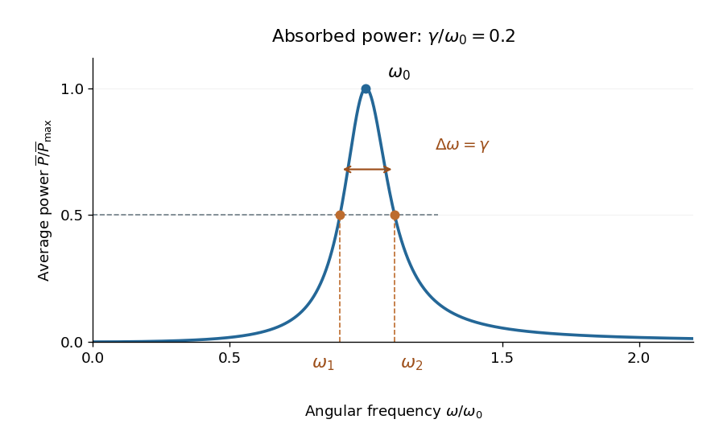

<h1 id="10/d/solution">Solution</h1>

↑ **Parent:** [D](../d.md)

Use $\omega_0^2=k/m$ and the power formula from [solution](../c/solution.md). Its normalized form is

$$
\frac{\overline P(\omega)}{\overline P_{\max}}
=\frac{\gamma^2\omega^2}{(\omega_0^2-\omega^2)^2+\gamma^2\omega^2}.
$$

It is zero at $\omega=0$, rises to one at $\omega_0$, and decays to zero as $\omega\to\infty$. The two positive half-power [angular frequencies](../../../../angular-frequency.md) satisfy

$$
(\omega_0^2-\omega^2)^2=\gamma^2\omega^2.
$$

On the low-frequency side, $\omega_0^2-\omega_1^2=\gamma\omega_1$; on the high-frequency side, $\omega_2^2-\omega_0^2=\gamma\omega_2$. Solving these [quadratic equations](../../../../quadratic-equation.md) gives

$$
\boxed{\omega_1=\frac{\sqrt{4\omega_0^2+\gamma^2}-\gamma}{2},\qquad
\omega_2=\frac{\sqrt{4\omega_0^2+\gamma^2}+\gamma}{2}.}
$$

Consequently the [frequency bandwidth of viscous oscillator power absorption](../../../../frequency-bandwidth-of-viscous-oscillator-power-absorption.md) obeys the stronger exact result

$$
\boxed{\omega_2-\omega_1=\gamma.}
$$

For a sharp resonance, $\gamma\ll\omega_0$, expansion gives $\omega_{1,2}=\omega_0\mp\gamma/2+O(\gamma^2/\omega_0)$, which recovers the requested approximation. The exact width above assumes the constant viscous damping coefficient in this model. Although the curve is approximately symmetric near a sharp peak, the exact half-power points satisfy $\omega_1\omega_2=\omega_0^2$ rather than exact symmetry about $\omega_0$.

**[Figure 2](#10/d/image-normalized-absorbed-power-for-gamma-divided-by-omega-zero-equal-to-0-2-the-peak-and-the-two-exact-half-power-frequencies-are-marked-their-separation-is-gamma). Normalized absorbed power for gamma divided by omega zero equal to 0.2. The peak and the two exact half-power frequencies are marked; their separation is gamma.**

## ↑ Ancestors (12)

1. [D](../d.md)
2. [10](../../10.md)
3. [2019](../../../2019-split.md)
4. [Past exam of the mathematical methods I course of the University of Oxford](../../../split.md)
5. [Mathematical methods I course of the University of Oxford](../../../../mathematical-methods-i-course-of-the-university-of-oxford.md)
6. [Year 1 of the physics course of the University of Oxford](../../../../year-1-of-the-physics-course-of-the-university-of-oxford.md)
7. [Physics course of the University of Oxford](../../../../physics-course-of-the-university-of-oxford.md)
8. [Undergraduate course of the University of Oxford](../../../../undergraduate-course-of-the-university-of-oxford.md)
9. [Course of the University of Oxford](../../../../course-of-the-university-of-oxford.md)
10. [University of Oxford](../../../../university-of-oxford-split.md)
11. [List of universities](../../../../list-of-universities.md)
12. [Codex Wiki](../../../../split.md)
