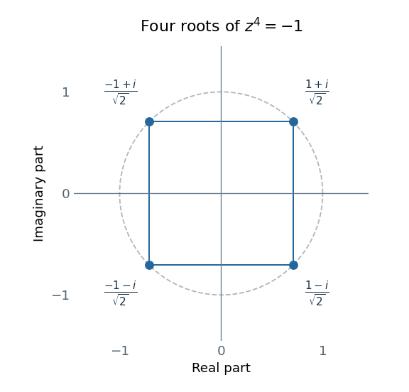

<h1 id="2/solution">Solution</h1>

↑ **Parent:** [2](../2.md)

The [determinant](../../../determinant.md) is $z\cdot z^3-(-i)(-i)=z^4+1$. Thus $z^4=-1=e^{i(\pi+2\pi n)}$, and its four [polynomial roots](../../../root-of-a-polynomial.md) are

$$
\boxed{z_k=e^{i(\pi/4+k\pi/2)},\qquad k=0,1,2,3.}
$$

In Cartesian form these are $(1+i)/\sqrt2$, $(-1+i)/\sqrt2$, $(-1-i)/\sqrt2$ and $(1-i)/\sqrt2$. Their [moduli](../../../modulus.md) are one and their [complex arguments](../../../argument-complex-analysis.md) are equally spaced by $\pi/2$. The [Argand diagram](../../../complex-plane.md) is therefore a square centered at the origin, with sides parallel to the coordinate axes.

**[Figure 1](#2/image-the-four-roots-of-z-to-the-fourth-equals-minus-one-plotted-on-the-unit-circle-in-the-complex-plane). The four roots of z to the fourth equals minus one, plotted on the unit circle in the complex plane.**

## ↑ Ancestors (11)

1. [2](../2.md)
2. [2019](../../2019-split.md)
3. [Past exam of the mathematical methods I course of the University of Oxford](../../split.md)
4. [Mathematical methods I course of the University of Oxford](../../../mathematical-methods-i-course-of-the-university-of-oxford.md)
5. [Year 1 of the physics course of the University of Oxford](../../../year-1-of-the-physics-course-of-the-university-of-oxford.md)
6. [Physics course of the University of Oxford](../../../physics-course-of-the-university-of-oxford.md)
7. [Undergraduate course of the University of Oxford](../../../undergraduate-course-of-the-university-of-oxford.md)
8. [Course of the University of Oxford](../../../course-of-the-university-of-oxford.md)
9. [University of Oxford](../../../university-of-oxford-split.md)
10. [List of universities](../../../list-of-universities.md)
11. [Codex Wiki](../../../split.md)
