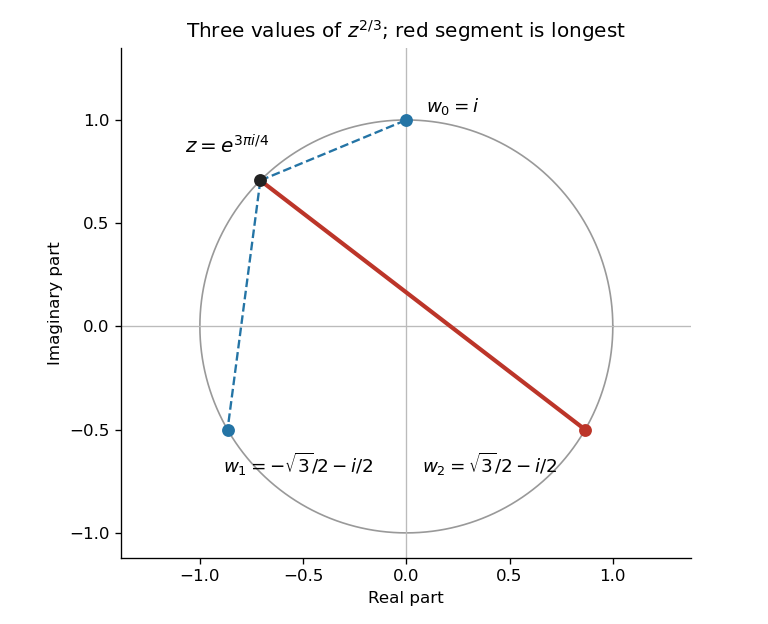

<h1 id="1/solution">Solution</h1>

↑ **Parent:** [1](../1.md)

The [polar form](../../../polar-form-of-a-complex-number.md) is $z=e^{3\pi i/4}$. Interpreting the fractional [complex exponentiation](../../../complex-exponentiation.md) as all its values, a candidate $w$ satisfies $w^3=z^2=-i$. The three [roots of a complex number](../../../root-of-a-complex-number.md) are

$$
w_0=i,\qquad w_1=-\frac{\sqrt3}{2}-\frac i2,\qquad w_2=\frac{\sqrt3}{2}-\frac i2.
$$

They have [arguments](../../../argument-complex-analysis.md) $\pi/2$, $7\pi/6$ and $11\pi/6$, respectively. Since all have [modulus](../../../modulus.md) one, their squared distances from $z$ in the [complex plane](../../../complex-plane.md) are $|w-z|^2=2-2\cos(\arg w-3\pi/4)$, giving

$$
|w_0-z|^2=2-\sqrt2,\quad
|w_1-z|^2=2-\frac{\sqrt6-\sqrt2}{2},\quad
|w_2-z|^2=2+\frac{\sqrt6+\sqrt2}{2}.
$$

The last is strictly largest, so the required [root of a complex number](../../../root-of-a-complex-number.md) is

$$
\boxed{w=\frac{\sqrt3-i}{2}.}
$$

Restricting [complex exponentiation](../../../complex-exponentiation.md) to its principal value would give only $i$; the request to choose among roots requires all three values.

**[Figure 1](#1/image-the-three-values-of-the-fractional-complex-power-and-their-distances-from-z). The three values of the fractional complex power and their distances from z**.

## ↑ Ancestors (11)

1. [1](../1.md)
2. [2021 resit](../../2021-resit-split.md)
3. [Past exam of the mathematical methods I course of the University of Oxford](../../split.md)
4. [Mathematical methods I course of the University of Oxford](../../../mathematical-methods-i-course-of-the-university-of-oxford.md)
5. [Year 1 of the physics course of the University of Oxford](../../../year-1-of-the-physics-course-of-the-university-of-oxford.md)
6. [Physics course of the University of Oxford](../../../physics-course-of-the-university-of-oxford.md)
7. [Undergraduate course of the University of Oxford](../../../undergraduate-course-of-the-university-of-oxford.md)
8. [Course of the University of Oxford](../../../course-of-the-university-of-oxford.md)
9. [University of Oxford](../../../university-of-oxford-split.md)
10. [List of universities](../../../list-of-universities.md)
11. [Codex Wiki](../../../split.md)
