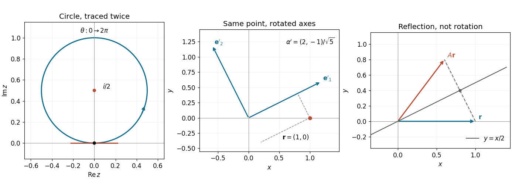

<h1 id="1/solution">Solution</h1>

↑ **Parent:** [1](../1.md)

The [complex exponential](../../../complex-exponential-function.md) identity $\sin\theta=(e^{i\theta}-e^{-i\theta})/(2i)$ gives

$$
z=\frac{e^{2i\theta}-1}{2i},\qquad
\boxed{(\Re z)^2+(\Im z-\tfrac12)^2=\tfrac14.}
$$

Thus the [locus](../../../locus-mathematics.md) is a [circle](../../../circle.md) of [radius](../../../radius.md) $1/2$ centered at $i/2$, traversed counterclockwise twice as $\theta$ runs through the specified interval. Its period as a parametrized [curve](../../../curve.md) is $\pi$. Near $\theta=0$, the [Taylor expansion](../../../taylor-expansion.md) gives $\Re z=\theta+O(\theta^3)$ and $\Im z=\theta^2+O(\theta^4)$, so locally $\Im z=(\Re z)^2+O((\Re z)^4)$. There is **a smooth horizontal tangent, not a cusp**: $dz/d\theta=e^{2i\theta}$ is nonzero at each passage through the origin.

**[Figure 1](#1/image-a-twice-traversed-complex-circle-a-passive-rotation-of-coordinate-axes-and-reflection-in-the-line-y-x-2). A twice-traversed complex circle, a passive rotation of coordinate axes, and reflection in the line y=x/2**.

## ↑ Ancestors (11)

1. [1](../1.md)
2. [2021](../../2021-split.md)
3. [Past exam of the mathematical methods I course of the University of Oxford](../../split.md)
4. [Mathematical methods I course of the University of Oxford](../../../mathematical-methods-i-course-of-the-university-of-oxford.md)
5. [Year 1 of the physics course of the University of Oxford](../../../year-1-of-the-physics-course-of-the-university-of-oxford.md)
6. [Physics course of the University of Oxford](../../../physics-course-of-the-university-of-oxford.md)
7. [Undergraduate course of the University of Oxford](../../../undergraduate-course-of-the-university-of-oxford.md)
8. [Course of the University of Oxford](../../../course-of-the-university-of-oxford.md)
9. [University of Oxford](../../../university-of-oxford-split.md)
10. [List of universities](../../../list-of-universities.md)
11. [Codex Wiki](../../../split.md)
