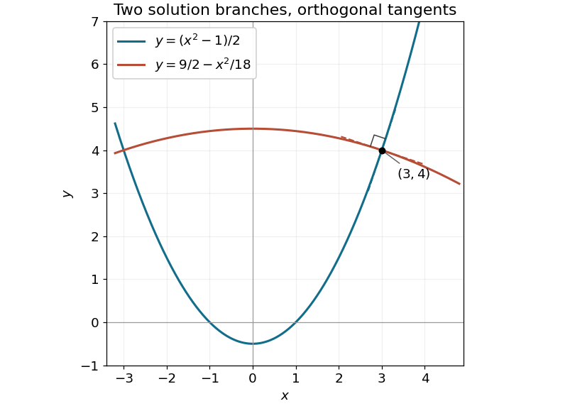

<h1 id="10/b/solution">Solution</h1>

↑ **Parent:** [B](../b.md)

The two real slope roots of $p^2+fp-1=0$ are distinct because their discriminant is $f^2+4>0$. [Vieta's formulas](../../../../vieta-s-formulas.md) give $p_+p_-=-1$, so the tangent vectors $(1,p_+)$ and $(1,p_-)$ have zero [scalar product](../../../../dot-product.md). Whenever the coefficients define local solution curves, the two families are therefore [orthogonal trajectories](../../../../orthogonal-trajectory.md).

For the stated example at $(3,4)$, the slopes are $3$ and $-1/3$. In the family from part [a](../a.md), the constants are $1$ and $-1/9$, giving

$$
\boxed{y=\frac{x^2-1}{2},\qquad y=\frac92-\frac{x^2}{18}.}
$$

Both curves pass through $(3,4)$, and $3(-1/3)=-1$ verifies the right angle.

**[Figure 2](#10/b/image-two-members-of-the-same-parabolic-family-pass-through-3-4-with-perpendicular-tangent-lines). Two members of the same parabolic family pass through (3,4) with perpendicular tangent lines**.

## ↑ Ancestors (12)

1. [B](../b.md)
2. [10](../../10.md)
3. [2021](../../../2021-split.md)
4. [Past exam of the mathematical methods I course of the University of Oxford](../../../split.md)
5. [Mathematical methods I course of the University of Oxford](../../../../mathematical-methods-i-course-of-the-university-of-oxford.md)
6. [Year 1 of the physics course of the University of Oxford](../../../../year-1-of-the-physics-course-of-the-university-of-oxford.md)
7. [Physics course of the University of Oxford](../../../../physics-course-of-the-university-of-oxford.md)
8. [Undergraduate course of the University of Oxford](../../../../undergraduate-course-of-the-university-of-oxford.md)
9. [Course of the University of Oxford](../../../../course-of-the-university-of-oxford.md)
10. [University of Oxford](../../../../university-of-oxford-split.md)
11. [List of universities](../../../../list-of-universities.md)
12. [Codex Wiki](../../../../split.md)
