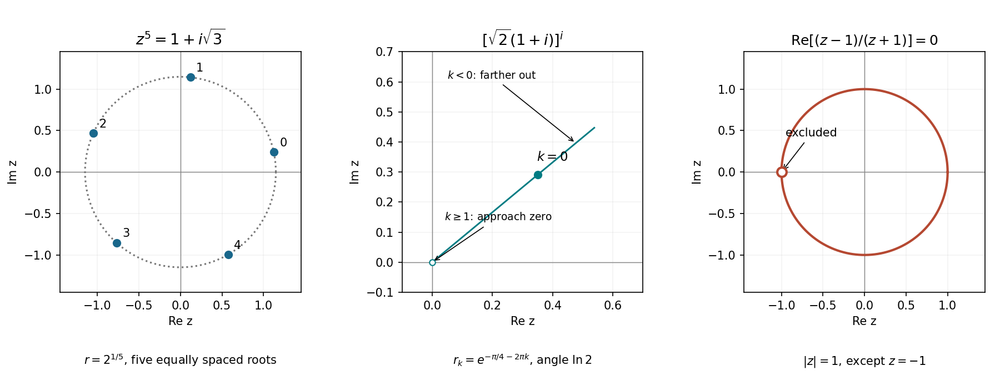

# 2022

↑ **Parent:** [Past exam of the mathematical methods I course of the University of Oxford](../past-exam-of-the-mathematical-methods-i-course-of-the-university-of-oxford.md)

Source paper: [https://www.whatdotheyknow.com/request/physics_preliminary_past_papers/response/2680788/attach/3/2018%202021%20Physics%20prelims.zip?cookie_passthrough=1](https://www.whatdotheyknow.com/request/physics_preliminary_past_papers/response/2680788/attach/3/2018%202021%20Physics%20prelims.zip?cookie_passthrough=1)

All questions and inline Roman subparts are covered. The solutions distinguish signed from unsigned distances, branches of complex powers, and the exceptional zero-frequency differential equation.

**Table of contents**

- [1](#1)
  - [Solution](#1/solution)
- [2](#2)
  - [Solution](#2/solution)
- [3](#3)
  - [Solution](#3/solution)
- [4](#4)
  - [Solution](#4/solution)
- [5](#5)
  - [i](#5/i)
    - [Solution](#5/i/solution)
  - [ii](#5/ii)
    - [Solution](#5/ii/solution)
- [6](#6)
  - [Solution](#6/solution)
- [7](#7)
  - [i](#7/i)
    - [Solution](#7/i/solution)
  - [ii](#7/ii)
    - [Solution](#7/ii/solution)
- [8](#8)
  - [a](#8/a)
    - [i](#8/a/i)
      - [Solution](#8/a/i/solution)
    - [ii](#8/a/ii)
      - [Solution](#8/a/ii/solution)
  - [b](#8/b)
    - [i](#8/b/i)
      - [Solution](#8/b/i/solution)
    - [ii](#8/b/ii)
      - [Solution](#8/b/ii/solution)
    - [iii](#8/b/iii)
      - [Solution](#8/b/iii/solution)
  - [c](#8/c)
    - [Solution](#8/c/solution)
- [9](#9)
  - [a](#9/a)
    - [i](#9/a/i)
      - [Solution](#9/a/i/solution)
    - [ii](#9/a/ii)
      - [Solution](#9/a/ii/solution)
    - [iii](#9/a/iii)
      - [Solution](#9/a/iii/solution)
  - [b](#9/b)
    - [Solution](#9/b/solution)
- [10](#10)
  - [a](#10/a)
    - [Solution](#10/a/solution)
  - [b](#10/b)
    - [Solution](#10/b/solution)
  - [c](#10/c)
    - [Solution](#10/c/solution)
- [11](#11)
  - [a](#11/a)
    - [Solution](#11/a/solution)
  - [b](#11/b)
    - [Solution](#11/b/solution)
  - [c](#11/c)
    - [i](#11/c/i)
      - [Solution](#11/c/i/solution)
    - [ii](#11/c/ii)
      - [Solution](#11/c/ii/solution)

## 1

↑ **Parent:** [2022](2022.md)

<h3 id="1/solution">Solution</h3>

↑ **Parent:** [1](#1)

Let $\Delta=\mathbf a\cdot(\mathbf b\times\mathbf c)\ne0$. Taking the [scalar product](../inner-product.md#dot-product) with $\mathbf b\times\mathbf c$ in the first expansion kills its other two terms. Taking the [scalar product](../inner-product.md#dot-product) with $\mathbf a$ in the second expansion does the same. Thus the two requested [coordinates](../vector-space.md#coordinate-linear-algebra) are

$$
\boxed{\lambda_1=\frac{\mathbf r\cdot(\mathbf b\times\mathbf c)}{\Delta},\qquad
\mu_1=\frac{\mathbf r\cdot\mathbf a}{\Delta}.}
$$

The [scalar triple product](../multilinear-algebra.md#scalar-triple-product) condition guarantees [linear independence](../vector-space.md#linear-independence) and the existence of these [reciprocal bases](../multilinear-algebra.md#reciprocal-basis). The second coordinate is not obtained by merely normalizing the first basis [vector](../vector-space.md#vector): the two expansions use different bases.

## 2

↑ **Parent:** [2022](2022.md)

<h3 id="2/solution">Solution</h3>

↑ **Parent:** [2](#2)

On an interval with $x\ne0$, the zero function is one solution. For a nonzero solution, set $u=y^{-2}$. Dividing the equation by two and differentiating $u$ gives the [linear ordinary differential equation](../linear-ordinary-differential-equation.md)

$$
u'-\frac2xu=-\frac1{x^3}.
$$

Its [integrating factor](../linear-ordinary-differential-equation.md#integrating-factor) is $x^{-2}$, so $(u/x^2)'=-x^{-5}$ and $u=1/(4x^2)+Cx^2$. Absorbing the factor four into the integration constant gives

$$
\boxed{y(x)=\frac{\pm2x}{\sqrt{1+Kx^4}},\quad\text{or}\quad y(x)=0.}
$$

For real solutions, choose a connected interval avoiding $x=0$ on which $1+Kx^4>0$, with a fixed sign. The special straight solutions $y=\pm2x$ are already included at $K=0$. The separate zero solution would be lost by the division used in the substitution.

## 3

↑ **Parent:** [2022](2022.md)

<h3 id="3/solution">Solution</h3>

↑ **Parent:** [3](#3)

Using the complex-angle identity,

$$
\cos(x+iy)=\cos x\cosh y-i\sin x\sinh y.
$$

Since $\cosh y>0$, the real part can vanish only when $x=\pi/2+k\pi$. Then the imaginary part requires $\sinh y=(-1)^{k+1}$. Therefore all roots are

$$
\boxed{z=\frac\pi2+k\pi+i(-1)^{k+1}\ln(1+\sqrt2),\qquad k\in\mathbb Z.}
$$

Substitution gives $\cos z=i$ for every integer $k$, and the positivity of $\cosh y$ shows that no other real parts were missed. The imaginary offsets are the two values $\pm\operatorname{arsinh}1$.

## 4

↑ **Parent:** [2022](2022.md)

<h3 id="4/solution">Solution</h3>

↑ **Parent:** [4](#4)

Set $v=\dot z$. The second-order position equation becomes the first-order [linear ordinary differential equation](../linear-ordinary-differential-equation.md) $\dot v+\gamma v=-g$. For $\gamma>0$, multiply by the [integrating factor](../linear-ordinary-differential-equation.md#integrating-factor) $e^{\gamma t}$ and impose $v(0)=v_0$:

$$
\boxed{v(t)=\left(v_0+\frac g\gamma\right)e^{-\gamma t}-\frac g\gamma.}
$$

The limiting [terminal velocity](../classical-mechanics.md#terminal-velocity) is $-g/\gamma$, consistent with upward-positive position and downward [gravity](../physics.md#gravity). The continuous zero-drag limit is $v_0-gt$; one must take that limit of the whole expression rather than set $\gamma=0$ in its two singular-looking terms separately.

## 5

↑ **Parent:** [2022](2022.md)

<h3 id="5/i">i</h3>

↑ **Parent:** [5](#5)

<h4 id="5/i/solution">Solution</h4>

↑ **Parent:** [I](#5/i)

Multiplication by $A$ rotates the $(x,y)$ components by $\theta$ counterclockwise when viewed from positive $z$ toward the origin, leaving $z$ unchanged. It is a [proper rotation](../linear-algebra.md#proper-rotation) about the $z$ axis, with [determinant](../multilinear-algebra.md#determinant) $+1$. Multiplication by $B$ sends $(x,y,z)$ to $(x,y,-z)$: it is a [reflection](../linear-algebra.md#reflection-mathematics) in the $xy$ plane, with [determinant](../multilinear-algebra.md#determinant) $-1$. Neither operation changes a [vector](../vector-space.md#vector)'s Euclidean [norm](../normed-vector-space.md#norm).

<h3 id="5/ii">ii</h3>

↑ **Parent:** [5](#5)

<h4 id="5/ii/solution">Solution</h4>

↑ **Parent:** [Ii](#5/ii)

Directly multiplying the columns' [scalar products](../inner-product.md#dot-product) gives $C^TC=I$, and direct evaluation gives $\det C=1$. Thus **the operation is a [proper rotation](../linear-algebra.md#proper-rotation)**. Its [trace](../linear-algebra.md#matrix-trace) is zero. A three-dimensional [proper rotation](../linear-algebra.md#proper-rotation) has [eigenvalues](../linear-operator-theory.md#eigenvalue) $1,e^{i\varphi},e^{-i\varphi}$, hence $\operatorname{tr}C=1+2\cos\varphi$. Therefore

$$
\boxed{\varphi=\frac{2\pi}{3}=120^\circ.}
$$

This determines the usual unsigned angle in $[0,\pi]$ without changing [coordinates](../vector-space.md#coordinate-linear-algebra). The axis can be checked, if desired, from $C(0,1,-1)^T=(0,1,-1)^T$. The [determinant](../multilinear-algebra.md#determinant) test must precede the [trace](../linear-algebra.md#matrix-trace) formula: an [improper rotation](../linear-algebra.md#improper-rotation) instead has [trace](../linear-algebra.md#matrix-trace) $-1+2\cos\varphi$.

## 6

↑ **Parent:** [2022](2022.md)

<h3 id="6/solution">Solution</h3>

↑ **Parent:** [6](#6)

Let $a=R/(2L)$ and $\omega_d=\sqrt{1/(LC)-a^2}>0$. The roots of the [characteristic polynomial](../linear-operator-theory.md#characteristic-polynomial) are $-a\pm i\omega_d$, so the real underdamped solution is $Q=e^{-at}(A\cos\omega_dt+B\sin\omega_dt)$. The initial charge gives $A=Q_0$ and the zero initial current gives $B=aQ_0/\omega_d$. Hence

$$
\boxed{Q(t)=Q_0e^{-Rt/(2L)}\left[\cos(\omega_dt)+\frac{R}{2L\omega_d}\sin(\omega_dt)\right].}
$$

This solves the homogeneous [RLC circuit](../electrical-circuit.md#rlc-circuit) equation supplied in the question. A nonzero applied voltage would appear as a forcing term and require a particular solution; it is not present in that equation.

## 7

↑ **Parent:** [2022](2022.md)

<h3 id="7/i">i</h3>

↑ **Parent:** [7](#7)

<h4 id="7/i/solution">Solution</h4>

↑ **Parent:** [I](#7/i)

The [additive identity](../algebraic-operation.md#additive-identity) for the shifted operation must satisfy $\mathbf x+\mathbf0_{\oplus}-\mathbf a=\mathbf x$, giving $\mathbf0_{\oplus}=\mathbf a$. The [additive inverse](../arithmetic.md#additive-inverse) must satisfy $\mathbf x+\mathbf x'-\mathbf a=\mathbf a$, giving

$$
\boxed{\mathbf0_{\oplus}=\mathbf a,\qquad\mathbf x'=2\mathbf a-\mathbf x.}
$$

The notation distinguishes the new [additive identity](../algebraic-operation.md#additive-identity) from the ordinary zero [vector](../vector-space.md#vector). This is a translated [abelian group](../group.md#abelian-group) structure on the same underlying set.

<h3 id="7/ii">ii</h3>

↑ **Parent:** [7](#7)

<h4 id="7/ii/solution">Solution</h4>

↑ **Parent:** [Ii](#7/ii)

The [translated vector-space structure](../geometry-and-topology.md#translated-vector-space-structure) follows by translating the new origin to the ordinary one using the [bijection](../function.md#bijection) $T(\mathbf x)=\mathbf x-\mathbf a$. Transporting ordinary [scalar multiplication](../vector-space.md#scalar-multiplication) through $T$ gives

$$
\boxed{k\odot\mathbf x=\mathbf a+k(\mathbf x-\mathbf a).}
$$

Then $T(\mathbf x\oplus\mathbf y)=T(\mathbf x)+T(\mathbf y)$ and $T(k\odot\mathbf x)=kT(\mathbf x)$, so the transported operations satisfy all [vector space](../vector-space.md) axioms. In particular, an explicit distributive check is

$$
k\odot(\mathbf x\oplus\mathbf y)=\mathbf a+k(\mathbf x+\mathbf y-2\mathbf a)
=(k\odot\mathbf x)\oplus(k\odot\mathbf y).
$$

The other distributive law follows in the same [coordinates](../vector-space.md#coordinate-linear-algebra), or directly by expanding $(k+l)\odot\mathbf x$.

## 8

↑ **Parent:** [2022](2022.md)

<h3 id="8/a">a</h3>

↑ **Parent:** [8](#8)

<h4 id="8/a/i">i</h4>

↑ **Parent:** [A](#8/a)

<h5 id="8/a/i/solution">Solution</h5>

↑ **Parent:** [I](#8/a/i)

For $c>0$, this is the [sphere](../euclidean-geometry.md#sphere) centered at $\mathbf a$ with radius $c$. If $c=0$, its locus is the singleton $\{\mathbf a\}$; if $c<0$, it is empty, because a Euclidean [norm](../normed-vector-space.md#norm) cannot be negative. The equation describes the surface, not the enclosed ball.

<h4 id="8/a/ii">ii</h4>

↑ **Parent:** [A](#8/a)

<h5 id="8/a/ii/solution">Solution</h5>

↑ **Parent:** [Ii](#8/a/ii)

Assume $\mathbf a\ne0$ and allow all $\mathbf R\ne0$. Put $\widehat{\mathbf a}=\mathbf a/|\mathbf a|$ and $\mathbf u=\mathbf R/|\mathbf R|$. Every resulting [vector](../vector-space.md#vector) is perpendicular to $\mathbf a$ and has $|\mathbf r|=|c|\sin\theta\le|c|$. Conversely, for $c\ne0$ and any $\mathbf q=\mathbf r/c$ perpendicular to $\widehat{\mathbf a}$ with $|\mathbf q|\le1$, choose

$$
\mathbf u=\widehat{\mathbf a}\times\mathbf q
+\sqrt{1-|\mathbf q|^2}\,\widehat{\mathbf a}.
$$

The [vector triple product](../multivariable-calculus.md#vector-triple-product) gives $\mathbf u\times\widehat{\mathbf a}=\mathbf q$, and $|\mathbf u|=1$. Thus every point of the **closed disk centered at the origin, perpendicular to $\mathbf a$, of radius $|c|$** is attained. The boundary circle alone would omit allowed directions of $\mathbf R$. For $c=0$ the locus is the origin; for $\mathbf a=0$ the original expression is undefined.

<h3 id="8/b">b</h3>

↑ **Parent:** [8](#8)

<h4 id="8/b/i">i</h4>

↑ **Parent:** [B](#8/b)

<h5 id="8/b/i/solution">Solution</h5>

↑ **Parent:** [I](#8/b/i)

A [vector](../vector-space.md#vector) from the point on $L_2$ to the point on $L_1$ is

$$
\boxed{\mathbf R(\lambda,\mu)=\mathbf a-\mathbf c+\lambda\mathbf b-\mu\mathbf d.}
$$

Choosing the opposite direction negates this [vector](../vector-space.md#vector) and does not change its [norm](../normed-vector-space.md#norm) or the shortest distance.

<h4 id="8/b/ii">ii</h4>

↑ **Parent:** [B](#8/b)

<h5 id="8/b/ii/solution">Solution</h5>

↑ **Parent:** [Ii](#8/b/ii)

For nonparallel direction vectors, let $\mathbf n=(\mathbf b\times\mathbf d)/|\mathbf b\times\mathbf d|$. Every joining [vector](../vector-space.md#vector) has the same [normal](../probability-distribution.md#normal-distribution) component, $\mathbf R\cdot\mathbf n=(\mathbf a-\mathbf c)\cdot\mathbf n$. Its [norm](../normed-vector-space.md#norm) is therefore at least the absolute value of that component. Minimizing $|\mathbf R|^2$ makes it perpendicular to both directions, and hence parallel to $\mathbf n$, attaining the bound:

$$
\boxed{d_{\min}=\left|(\mathbf a-\mathbf c)\cdot\mathbf n\right|.}
$$

The expression printed without absolute values is an oriented separation, not a nonnegative distance. Reversing either line's parametrization can flip its sign. For parallel nonzero directions, this [normal](../probability-distribution.md#normal-distribution) is undefined and the distance is instead $| (\mathbf a-\mathbf c)\times\mathbf b|/|\mathbf b|$.

<h4 id="8/b/iii">iii</h4>

↑ **Parent:** [B](#8/b)

<h5 id="8/b/iii/solution">Solution</h5>

↑ **Parent:** [Iii](#8/b/iii)

Write $\mathbf w=\mathbf a-\mathbf c$, $B=\mathbf b\cdot\mathbf b$, $D=\mathbf d\cdot\mathbf d$ and $E=\mathbf b\cdot\mathbf d$. Differentiating $|\mathbf w+\lambda\mathbf b-\mu\mathbf d|^2$ with respect to the two parameters gives

$$
B\lambda-E\mu=-\mathbf w\cdot\mathbf b,\qquad
E\lambda-D\mu=-\mathbf w\cdot\mathbf d.
$$

For nonparallel directions, $BD-E^2=|\mathbf b\times\mathbf d|^2>0$. Solving this [linear system](../linear-algebra.md#system-of-linear-equations) yields

$$
\boxed{\lambda=\frac{(\mathbf b\cdot\mathbf d)[(\mathbf a-\mathbf c)\cdot\mathbf d]-|\mathbf d|^2[(\mathbf a-\mathbf c)\cdot\mathbf b]}{|\mathbf b|^2|\mathbf d|^2-(\mathbf b\cdot\mathbf d)^2}.}
$$

The quadratic being minimized is strictly convex in the two parameters under this nonparallel assumption, so the critical point gives the unique pair of closest points. Parallel lines do not select a unique value of $\lambda$.

<h3 id="8/c">c</h3>

↑ **Parent:** [8](#8)

<h4 id="8/c/solution">Solution</h4>

↑ **Parent:** [C](#8/c)

Parametrize the first line by $(x,y,z)=(3+t,4-2t,1+3t)$ and the second by $(2+\alpha s,-1+s,5+2s)$. Equality of the $y,z$ components gives $s=5-2t$ and $3t-2s=4$, hence $t=2$, $s=1$. The $x$ components then require $5=2+\alpha$. Thus

$$
\boxed{\alpha=3,\qquad\text{intersection }(5,0,7).}
$$

The two independent component equations fixed the parameters before the remaining component determined $\alpha$, so no extra intersection case was discarded.

## 9

↑ **Parent:** [2022](2022.md)

<h3 id="9/a">a</h3>

↑ **Parent:** [9](#9)

<h4 id="9/a/i">i</h4>

↑ **Parent:** [A](#9/a)

<h5 id="9/a/i/solution">Solution</h5>

↑ **Parent:** [I](#9/a/i)

The right-hand side has [modulus](../complex-analysis.md#modulus) two and argument $\pi/3$. Its fifth roots therefore have

$$
\boxed{z_k=2^{1/5}\exp\left[i\left(\frac\pi{15}+\frac{2\pi k}{5}\right)\right],\qquad k=0,1,2,3,4.}
$$

They are the vertices of a regular pentagon on the circle of radius $2^{1/5}$, beginning at angle $\pi/15$. These five roots are distinct, and a degree-five [polynomial](../polynomial.md) has no further [complex roots](../polynomial.md#complex-root).

**[Figure 1](#9/a/i/image-the-fifth-roots-the-discrete-ray-of-values-of-a-complex-power-and-the-unit-circle-locus-with-its-excluded-point). The fifth roots, the discrete ray of values of a complex power, and the unit-circle locus with its excluded point**.

<h4 id="9/a/ii">ii</h4>

↑ **Parent:** [A](#9/a)

<h5 id="9/a/ii/solution">Solution</h5>

↑ **Parent:** [Ii](#9/a/ii)

The base is $2e^{i\pi/4}$. Its [complex logarithms](../analysis.md#complex-logarithm) are $\ln2+i(\pi/4+2\pi k)$, $k\in\mathbb Z$. Exponentiating $i$ times each logarithm gives all values of the multivalued power:

$$
\boxed{z_k=e^{-\pi/4-2\pi k}\exp(i\ln2),\qquad k\in\mathbb Z.}
$$

The values form a discrete [geometric sequence](../sequence-and-series.md#geometric-progression) along the Argand ray of angle $\ln2$. Consecutive radii differ by $e^{-2\pi}$. The origin is an accumulation point but is not itself a value. If the power is instead defined using the [principal logarithm](../analysis.md#principal-complex-logarithm), only $k=0$ is retained. The phrase “all values” requires this branch distinction.

<h4 id="9/a/iii">iii</h4>

↑ **Parent:** [A](#9/a)

<h5 id="9/a/iii/solution">Solution</h5>

↑ **Parent:** [Iii](#9/a/iii)

For $z\ne-1$, multiply numerator and denominator by $\overline z+1$. The real part is

$$
\operatorname{Re}\frac{z-1}{z+1}=\frac{|z|^2-1}{|z+1|^2}.
$$

Thus its zero locus is

$$
\boxed{z=e^{i\theta},\qquad \theta\not\equiv\pi\pmod{2\pi}.}
$$

It is the [unit circle](../complex-analysis.md#complex-unit-circle) with the point $-1$ removed. That point cannot be restored by the zero numerator obtained after clearing a denominator: the original expression is undefined there.

<h3 id="9/b">b</h3>

↑ **Parent:** [9](#9)

<h4 id="9/b/solution">Solution</h4>

↑ **Parent:** [B](#9/b)

Use the imaginary part of the finite complex sum:

$$
\sum_{n=0}^N\binom Nn\sin(n\theta+\phi)
=\operatorname{Im}\left[e^{i\phi}\sum_{n=0}^N\binom Nn e^{in\theta}\right]
=\operatorname{Im}\left[e^{i\phi}(1+e^{i\theta})^N\right].
$$

The identity $1+e^{i\theta}=2e^{i\theta/2}\cos(\theta/2)$ then gives

$$
\boxed{\sum_{n=0}^N\binom Nn\sin(n\theta+\phi)
=2^N\cos^N(\theta/2)\sin(N\theta/2+\phi).}
$$

Here $N$ is a nonnegative integer. Keeping the signed cosine raised to the integer power makes the result valid even when $\cos(\theta/2)<0$; inserting an absolute value would lose the sign for odd $N$.

## 10

↑ **Parent:** [2022](2022.md)

<h3 id="10/a">a</h3>

↑ **Parent:** [10](#10)

<h4 id="10/a/solution">Solution</h4>

↑ **Parent:** [A](#10/a)

For [unitary matrices](../linear-operator-theory.md#unitary-matrix), $U^\dagger U=I$ and $V^\dagger V=I$. The [adjoint matrix](../linear-operator-theory.md#conjugate-transpose) reverses the order of multiplication, so

$$
(UV)^\dagger(UV)=V^\dagger U^\dagger UV=V^\dagger V=I.
$$

Thus **the product is unitary**. Likewise $(UV)(UV)^\dagger=I$, or this follows from invertibility in finite dimension.

<h3 id="10/b">b</h3>

↑ **Parent:** [10](#10)

<h4 id="10/b/solution">Solution</h4>

↑ **Parent:** [B](#10/b)

Take the [adjoint matrix](../linear-operator-theory.md#conjugate-transpose) of $M^\dagger\mathbf v_i=\lambda_i\mathbf v_i$ to obtain $\mathbf v_i^\dagger M=\lambda_i^*\mathbf v_i^\dagger$. Evaluating $\mathbf v_i^\dagger M\mathbf u_j$ using this equation and $M\mathbf u_j=\lambda_j\mathbf u_j$ gives

$$
(\lambda_j-\lambda_i^*)\mathbf v_i^\dagger\mathbf u_j=0.
$$

Hence $\boxed{\mathbf v_i^\dagger\mathbf u_j=0\text{ if }\lambda_i^*\ne\lambda_j}$. The proof does not assume that $M$ is a [normal matrix](../linear-operator-theory.md#normal-matrix) or [diagonalizable](../linear-operator-theory.md#diagonalizable-matrix).

In general the [spectrum](../linear-operator-theory.md#spectrum-functional-analysis) of an [adjoint matrix](../linear-operator-theory.md#conjugate-transpose) is the [complex conjugate](../complex-analysis.md#complex-conjugate) of the original [spectrum](../linear-operator-theory.md#spectrum-functional-analysis), not necessarily the same set. The equality of the two sets in the question is an additional assumption, possible for a conjugation-invariant [spectrum](../linear-operator-theory.md#spectrum-functional-analysis); the displayed orthogonality proof only uses the two stated [eigenvalue equations](../linear-operator-theory.md#eigenvalue-equation).

<h3 id="10/c">c</h3>

↑ **Parent:** [10](#10)

<h4 id="10/c/solution">Solution</h4>

↑ **Parent:** [C](#10/c)

A column of [coordinates](../vector-space.md#coordinate-linear-algebra) transforms as $\mathbf x'=U^\dagger\mathbf x$, because the columns of $U$ are the new [orthonormal basis](../inner-product.md#orthonormal-basis) vectors expressed in the old [coordinates](../vector-space.md#coordinate-linear-algebra). A symmetric unitary choice is

$$
\boxed{U=\frac1{\sqrt2}\begin{pmatrix}1&0&i\\0&\sqrt2&0\\i&0&1\end{pmatrix},\quad
A'=\operatorname{diag}(-1,3,1),\quad
\mathbf x'=\begin{pmatrix}(1-i)/\sqrt2\\1\\(1-i)/\sqrt2\end{pmatrix}.}
$$

Its first and third columns are orthogonal [eigenvectors](../linear-operator-theory.md#eigenvector) of the $xz$ block, with [eigenvalues](../linear-operator-theory.md#eigenvalue) $-1$ and $+1$ respectively; its second column is the $y$ axis with eigenvalue $3$. Direct multiplication checks $U^\dagger U=I$, while the displayed entries give $U^T=U$. The symmetry here means transpose symmetry, not [Hermitian](../hilbert-space.md#hermitian-operator) symmetry.

## 11

↑ **Parent:** [2022](2022.md)

<h3 id="11/a">a</h3>

↑ **Parent:** [11](#11)

<h4 id="11/a/solution">Solution</h4>

↑ **Parent:** [A](#11/a)

Separation of variables gives $\ln|y|=\sqrt{1+x^2}+C$ for a nonzero solution. Including the zero solution in the arbitrary real amplitude gives

$$
\boxed{y(x)=A\exp\sqrt{1+x^2},\qquad A\in\mathbb R.}
$$

Differentiating the exponent verifies the equation. This form keeps the zero solution that a division by $y$ could otherwise conceal.

<h3 id="11/b">b</h3>

↑ **Parent:** [11](#11)

<h4 id="11/b/solution">Solution</h4>

↑ **Parent:** [B](#11/b)

On the component $x>0$ containing the boundary point, divide by $2x$ and use [integrating factor](../linear-ordinary-differential-equation.md#integrating-factor) $x^{-1/2}$:

$$
\frac d{dx}(x^{-1/2}y)=\frac12x^{3/2}.
$$

Integration gives $y=x^3/5+C\sqrt x$, and $y(1)=1$ fixes $C=4/5$. Therefore

$$
\boxed{y(x)=\frac{x^3+4\sqrt x}{5},\qquad x>0.}
$$

Although the function has a continuous limit at zero, its derivative diverges there; the solution with this boundary datum does not extend as a differentiable solution through the singular point of the equation.

<h3 id="11/c">c</h3>

↑ **Parent:** [11](#11)

<h4 id="11/c/i">i</h4>

↑ **Parent:** [C](#11/c)

<h5 id="11/c/i/solution">Solution</h5>

↑ **Parent:** [I](#11/c/i)

The [exponential substitution removing a constant first derivative](../linear-ordinary-differential-equation.md#exponential-substitution-removing-a-constant-first-derivative), $y=e^xu$, reduces the equation to $u''+\beta^2u=1+\cos x$. For $\beta\ne0$ and $\beta^2\ne1$, solve the homogeneous harmonic equation and use a constant plus a cosine for the particular solution:

$$
\boxed{y=e^x\left[A\cos(\beta x)+B\sin(\beta x)+\frac1{\beta^2}+\frac{\cos x}{\beta^2-1}\right].}
$$

There is a further exceptional case inside the printed condition $\beta^2\ne1$: **$\beta=0$ must be treated separately**. It gives $u''=1+\cos x$, hence

$$
\boxed{y=e^x\left[A+Bx+\frac{x^2}{2}-\cos x\right],\qquad\beta=0.}
$$

This retains the constant forcing's [resonance](../dynamical-systems.md#resonance) with the zero-[frequency](../wave.md#frequency) homogeneous equation. Substitution verifies both branches.

<h4 id="11/c/ii">ii</h4>

↑ **Parent:** [C](#11/c)

<h5 id="11/c/ii/solution">Solution</h5>

↑ **Parent:** [Ii](#11/c/ii)

For $\beta^2=1$, the reduced equation is $u''+u=1+\cos x$. The constant forcing has particular solution one, while the resonant cosine requires $u_p=(x/2)\sin x$. Thus

$$
\boxed{y=e^x\left[A\cos x+B\sin x+1+\frac x2\sin x\right],\qquad\beta=\pm1.}
$$

The secular factor $x$ is the signature of [resonance](../dynamical-systems.md#resonance). It must replace the divergent nonresonant coefficient $1/(\beta^2-1)$; substituting $\beta^2=1$ directly into that coefficient is invalid.

## ↑ Ancestors (9)

1. [Past exam of the mathematical methods I course of the University of Oxford](../past-exam-of-the-mathematical-methods-i-course-of-the-university-of-oxford.md)
2. [Mathematical methods I course of the University of Oxford](../university-of-oxford.md#mathematical-methods-i-course-of-the-university-of-oxford)
3. [Year 1 of the physics course of the University of Oxford](../university-of-oxford.md#year-1-of-the-physics-course-of-the-university-of-oxford)
4. [Physics course of the University of Oxford](../university-of-oxford.md#physics-course-of-the-university-of-oxford)
5. [Undergraduate course of the University of Oxford](../university-of-oxford.md#undergraduate-course-of-the-university-of-oxford)
6. [Course of the University of Oxford](../university-of-oxford.md#course-of-the-university-of-oxford)
7. [University of Oxford](../university-of-oxford.md)
8. [List of universities](../README.md#list-of-universities)
9. [Codex Wiki](../README.md)
