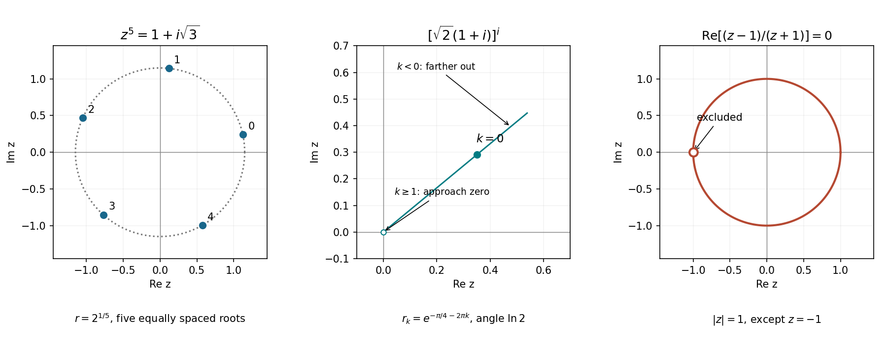

<h1 id="9/a/i/solution">Solution</h1>

↑ **Parent:** [I](../i.md)

The right-hand side has [modulus](../../../../../modulus.md) two and argument $\pi/3$. Its fifth roots therefore have

$$
\boxed{z_k=2^{1/5}\exp\left[i\left(\frac\pi{15}+\frac{2\pi k}{5}\right)\right],\qquad k=0,1,2,3,4.}
$$

They are the vertices of a regular pentagon on the circle of radius $2^{1/5}$, beginning at angle $\pi/15$. These five roots are distinct, and a degree-five [polynomial](../../../../../polynomial-split.md) has no further [complex roots](../../../../../complex-root.md).

**[Figure 1](#9/a/i/image-the-fifth-roots-the-discrete-ray-of-values-of-a-complex-power-and-the-unit-circle-locus-with-its-excluded-point). The fifth roots, the discrete ray of values of a complex power, and the unit-circle locus with its excluded point**.

## ↑ Ancestors (13)

1. [I](../i.md)
2. [A](../../a.md)
3. [9](../../../9.md)
4. [2022](../../../../2022-split.md)
5. [Past exam of the mathematical methods I course of the University of Oxford](../../../../split.md)
6. [Mathematical methods I course of the University of Oxford](../../../../../mathematical-methods-i-course-of-the-university-of-oxford.md)
7. [Year 1 of the physics course of the University of Oxford](../../../../../year-1-of-the-physics-course-of-the-university-of-oxford.md)
8. [Physics course of the University of Oxford](../../../../../physics-course-of-the-university-of-oxford.md)
9. [Undergraduate course of the University of Oxford](../../../../../undergraduate-course-of-the-university-of-oxford.md)
10. [Course of the University of Oxford](../../../../../course-of-the-university-of-oxford.md)
11. [University of Oxford](../../../../../university-of-oxford-split.md)
12. [List of universities](../../../../../list-of-universities.md)
13. [Codex Wiki](../../../../../split.md)
