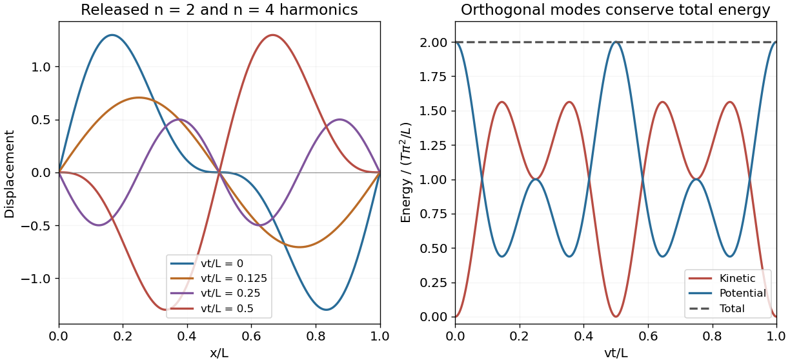
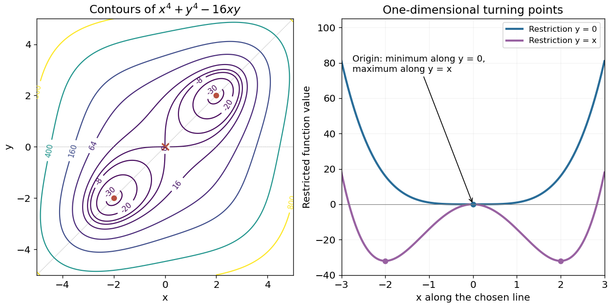

# 2013 resit

↑ **Parent:** [Past exam of the mathematical methods II course of the University of Oxford](../past-exam-of-the-mathematical-methods-ii-course-of-the-university-of-oxford.md)

Source: [public Oxford archive](https://www.whatdotheyknow.com/request/physics_preliminary_examinations/response/1162943/attach/3/Twain.7z?cookie_passthrough=1). The held cover dates this sitting to 12 September 2013. All four Section B options are answered.

**Table of contents**

- [1](#1)
  - [Solution](#1/solution)
- [2](#2)
  - [Solution](#2/solution)
- [3](#3)
  - [a](#3/a)
    - [Solution](#3/a/solution)
  - [b](#3/b)
    - [Solution](#3/b/solution)
- [4](#4)
  - [Solution](#4/solution)
- [5](#5)
  - [Solution](#5/solution)
- [6](#6)
  - [Solution](#6/solution)
- [7](#7)
  - [Solution](#7/solution)
- [8](#8)
  - [a](#8/a)
    - [Solution](#8/a/solution)
  - [b](#8/b)
    - [Solution](#8/b/solution)
  - [c](#8/c)
    - [Solution](#8/c/solution)
- [9](#9)
  - [a](#9/a)
    - [Solution](#9/a/solution)
  - [b](#9/b)
    - [Solution](#9/b/solution)
  - [c](#9/c)
    - [Solution](#9/c/solution)
- [10](#10)
  - [a](#10/a)
    - [Solution](#10/a/solution)
  - [b](#10/b)
    - [Solution](#10/b/solution)
  - [c](#10/c)
    - [Solution](#10/c/solution)
- [11](#11)
  - [a](#11/a)
    - [i](#11/a/i)
      - [Solution](#11/a/i/solution)
    - [ii](#11/a/ii)
      - [Solution](#11/a/ii/solution)
    - [iii](#11/a/iii)
      - [Solution](#11/a/iii/solution)
  - [b](#11/b)
    - [Solution](#11/b/solution)
  - [c](#11/c)
    - [Solution](#11/c/solution)
    - [i](#11/c/i)
      - [Solution](#11/c/i/solution)
    - [ii](#11/c/ii)
      - [Solution](#11/c/ii/solution)

## 1

↑ **Parent:** [2013 resit](2013-resit.md)

<h3 id="1/solution">Solution</h3>

↑ **Parent:** [1](#1)

Near zero, the [Taylor expansions](../calculus.md#taylor-expansion) are

$$
\ln(1+x)=x-\frac{x^2}{2}+\frac{x^3}{3}+O(x^4),\qquad \sqrt{1+2x}=1+x-\frac{x^2}{2}+\frac{x^3}{2}+O(x^4).
$$

The constant, linear and quadratic terms cancel in the numerator. Consequently

$$
1+\ln(1+x)-\sqrt{1+2x}=-\frac{x^3}{6}+O(x^4),\qquad \boxed{\lim_{x\to0}\frac{1+\ln(1+x)-\sqrt{1+2x}}{x^3}=-\frac16.}
$$

The square root and logarithm are both real in a sufficiently small neighborhood of zero, so the two-sided real limit is well defined.

## 2

↑ **Parent:** [2013 resit](2013-resit.md)

<h3 id="2/solution">Solution</h3>

↑ **Parent:** [2](#2)

Use the outward [normal vector](../differential-geometry.md#normal-vector). The [vector field](../multivariable-calculus.md#vector-field) is $\mathbf F=(xz,2y,-z^2)$, with [divergence](../multivariable-calculus.md#divergence) $\nabla\cdot\mathbf F=z+2-2z=2-z$. By the [divergence theorem](../multivariable-calculus.md#divergence-theorem), its outward flux equals the integral of this divergence over the solid cylinder. Each horizontal slice has area $8\pi$, so

$$
\boxed{\oint_{\partial V}\mathbf F\cdot\hat{\mathbf n}\,d\sigma=8\pi\int_0^3(2-z)\,dz=12\pi.}
$$

For an independent boundary check, the cylindrical side contributes $84\pi$, the top contributes $(-3^2)(8\pi)=-72\pi$, and the bottom contributes zero. Their sum is again $12\pi$. Reversing all normals changes its sign.

## 3

↑ **Parent:** [2013 resit](2013-resit.md)

<h3 id="3/a">a</h3>

↑ **Parent:** [3](#3)

<h4 id="3/a/solution">Solution</h4>

↑ **Parent:** [A](#3/a)

For one sine mode, $y_{xx}=-k_n^2A_n\sin(k_nx)\cos(\omega_nt)$ and $y_{tt}=-\omega_n^2A_n\sin(k_nx)\cos(\omega_nt)$. The [wave equation on a string](../wave-equation.md#wave-equation-on-a-string) therefore holds when

$$
\boxed{\omega_n^2=\frac T\mu k_n^2,\qquad \omega_n=vk_n,\quad v=\sqrt{T/\mu}.}
$$

The [superposition principle](../vector-space.md#superposition-principle) gives the same equation for the sum, assuming enough regularity to differentiate termwise, or interpreting finite-energy data in the usual modal sense. Fixed endpoints require $\sin(k_nL)=0$, so $k_n=n\pi/L$. Every cosine time factor has zero time derivative at $t=0$, giving the held-at-rest initial condition.

The coefficients must represent the actual held profile $f(x)$ through its [Fourier sine series](../fourier-series.md#fourier-sine-series), $A_n=(2/L)\int_0^Lf(x)\sin(n\pi x/L)dx$ for $n\geq1$. Thus the series accommodates the displacement initial condition once these coefficients are chosen; it does not select an unspecified initial shape by itself. The printed $n=0$ term is identically zero because $\sin0=0$, so the nontrivial fixed-end modes start at $n=1$.

<h3 id="3/b">b</h3>

↑ **Parent:** [3](#3)

<h4 id="3/b/solution">Solution</h4>

↑ **Parent:** [B](#3/b)

In the small-slope string model, the additional elastic [potential energy](../energy.md#potential-energy) is $V=(T/2)\int_0^L y_x^2dx$. For the fundamental mode, $y_x=A_1k_1\cos(k_1x)\cos(\omega_1t)$. Since $\int_0^L\cos^2(\pi x/L)dx=L/2$,

$$
V(t)=\frac14TA_1^2k_1^2L\cos^2\omega_1t.
$$

Using $Tk_1^2=\mu\omega_1^2$ from the [dispersion relation](../dispersion-relation.md) gives

$$
\boxed{V(t)=\frac14A_1^2\omega_1^2L\mu\cos^2\omega_1t.}
$$

The expression vanishes as the string passes through its straight equilibrium shape and is maximal at the turning shapes, when the corresponding [kinetic energy](../energy.md#kinetic-energy) is zero.

## 4

↑ **Parent:** [2013 resit](2013-resit.md)

<h3 id="4/solution">Solution</h3>

↑ **Parent:** [4](#4)

Substitute the path into the height before differentiating: $x^2=1+t$, $y=t-1$, so

$$
h(t)=\frac1{t+2+2(t-1)^4}.
$$

The ordinary [chain rule](../calculus.md#chain-rule) immediately yields

$$
\boxed{\frac{dh}{dt}=-\frac{1+8(t-1)^3}{[t+2+2(t-1)^4]^2}.}
$$

The multivariable calculation gives the same result: $h_x=-2x/(x^2+2y^4+1)^2$, $h_y=-8y^3/(x^2+2y^4+1)^2$, and $\dot h=h_x\dot x+h_y\dot y$ with $\dot x=1/(2\sqrt{1+t})$ and $\dot y=1$. The real path has $t\geq-1$; this chain-rule calculation applies for $t>-1$, and the simplified height has a finite right derivative at the endpoint even though $\dot x$ there is singular.

## 5

↑ **Parent:** [2013 resit](2013-resit.md)

<h3 id="5/solution">Solution</h3>

↑ **Parent:** [5](#5)

Write the plane as $z=6-3x-2y$. Its projection on the $xy$ plane is the triangle $0\leq x\leq2$, $0\leq y\leq3-3x/2$. The scalar [surface area element](../multivariable-calculus.md#surface-area-element) is

$$
d\Sigma=\sqrt{1+z_x^2+z_y^2}\,dx\,dy=\sqrt{14}\,dx\,dy.
$$

Thus the weighted [surface integral](../multivariable-calculus.md#surface-integral) is

$$
\boxed{\iint_\Sigma y\,d\Sigma=\sqrt{14}\int_0^2\int_0^{3-3x/2}y\,dy\,dx=3\sqrt{14}.}
$$

A geometric check uses the triangular face's area $3\sqrt{14}$ and mean $y$ coordinate $(0+3+0)/3=1$. Multiplying them gives the same result, because $y$ is an affine function on this planar triangle. Its edges have zero surface measure, so strict or non-strict octant inequalities do not change the integral.

## 6

↑ **Parent:** [2013 resit](2013-resit.md)

<h3 id="6/solution">Solution</h3>

↑ **Parent:** [6](#6)

The [gradient](../multivariable-calculus.md#gradient) is $\nabla f=(8x,2y)$, so $\nabla f(1,1)=(8,2)$. The supplied direction is not a [unit vector](../vector-space.md#unit-vector); normalize it to $\hat{\mathbf u}=(1,2)/\sqrt5$. Its [directional derivative](../multivariable-calculus.md#directional-derivative) is

$$
\boxed{D_{\hat{\mathbf u}}f=(8,2)\cdot\frac{(1,2)}{\sqrt5}=\frac{12}{\sqrt5}.}
$$

The direction of greatest decrease is opposite to the gradient:

$$
\boxed{\hat{\mathbf n}_{\rm decrease}=-\frac{(8,2)}{\sqrt{68}}=-\frac{(4,1)}{\sqrt{17}},\qquad D_{\hat{\mathbf n}_{\rm decrease}}f=-2\sqrt{17}.}
$$

The [Cauchy-Schwarz inequality](../probability-and-statistics.md#cauchy-schwarz-inequality) shows that no other unit direction can give a more negative derivative.

## 7

↑ **Parent:** [2013 resit](2013-resit.md)

<h3 id="7/solution">Solution</h3>

↑ **Parent:** [7](#7)

Let $h=x-\pi/3$. At the expansion point, the function and its first three derivatives have values $1/2$, $-\sqrt3/2$, $-1/2$ and $\sqrt3/2$. [Taylor's theorem](../calculus.md#taylor-s-theorem) therefore gives

$$
\boxed{\cos x=\frac12-\frac{\sqrt3}{2}h-\frac14h^2+\frac{\sqrt3}{12}h^3+O(h^4),\qquad h=x-\frac\pi3.}
$$

For real $x$, the magnitude of the omitted fourth-order remainder is at most $|h|^4/24$, because the fourth derivative is another cosine and has magnitude at most one.

## 8

↑ **Parent:** [2013 resit](2013-resit.md)

<h3 id="8/a">a</h3>

↑ **Parent:** [8](#8)

<h4 id="8/a/solution">Solution</h4>

↑ **Parent:** [A](#8/a)

Apply the ordinary product rule to the components of the [curl](../multivariable-calculus.md#curl). For example, the first component is

$$
[\nabla\times(\phi\mathbf F)]_x=\partial_y(\phi F_z)-\partial_z(\phi F_y)=\phi(\partial_yF_z-\partial_zF_y)+\phi_yF_z-\phi_zF_y.
$$

The last two terms are the first component of $\nabla\phi\times\mathbf F$. The other components follow cyclically, so

$$
\boxed{\nabla\times(\phi\mathbf F)=\phi\nabla\times\mathbf F+\nabla\phi\times\mathbf F=\phi\nabla\times\mathbf F-\mathbf F\times\nabla\phi.}
$$

The sign in the last form follows from antisymmetry of the [cross product](../vector-space.md#cross-product), not from a different curl convention. Continuous first derivatives suffice for this identity.

<h3 id="8/b">b</h3>

↑ **Parent:** [8](#8)

<h4 id="8/b/solution">Solution</h4>

↑ **Parent:** [B](#8/b)

For a twice continuously differentiable scalar function $\psi$, equality of mixed [partial derivatives](../multivariable-calculus.md#partial-derivative) gives $\nabla\times\nabla\psi=0$. Substitute $\mathbf F=\nabla\psi$ into the preceding product rule:

$$
\nabla\times(\phi\nabla\psi)=\nabla\phi\times\nabla\psi.
$$

[Stokes theorem](../multivariable-calculus.md#stokes-theorem) on a spanning surface with consistent boundary orientation then gives

$$
\boxed{\oint_{\partial S}\phi\nabla\psi\cdot d\mathbf l=\iint_S(\nabla\phi\times\nabla\psi)\cdot d\mathbf S.}
$$

This is a [weighted gradient circulation identity](../multivariable-calculus.md#weighted-gradient-circulation-identity). All fields must be defined and sufficiently smooth on a neighborhood of the surface; a scalar prefactor can create nonzero circulation even when the unweighted field is a gradient.

<h3 id="8/c">c</h3>

↑ **Parent:** [8](#8)

<h4 id="8/c/solution">Solution</h4>

↑ **Parent:** [C](#8/c)

Choose counterclockwise traversal viewed from $+z$, and span the curve by the disk $z=1$, $x^2+y^2\leq2$ with upward normal. Here

$$
\nabla\phi=(2xy,x^2,0),\qquad \nabla\psi=(z,0,x),\qquad \nabla\phi\times\nabla\psi=(x^3,-2x^2y,-x^2z).
$$

The surface side is therefore $-\iint_Dx^2dxdy$. In polar coordinates it is

$$
-\int_0^{2\pi}\int_0^{\sqrt2}r^3\cos^2\theta\,dr\,d\theta=-\pi.
$$

For the direct boundary integral, $dz=0$ gives $\nabla\psi\cdot d\mathbf l=dx$ on $z=1$. Set $x=\sqrt2\cos\theta$, $y=\sqrt2\sin\theta$, so

$$
\boxed{\oint x^2y\,dx=-4\int_0^{2\pi}\cos^2\theta\sin^2\theta\,d\theta=-\pi.}
$$

The two independent evaluations agree. Clockwise traversal and downward normal give $+\pi$ on both sides.

## 9

↑ **Parent:** [2013 resit](2013-resit.md)

<h3 id="9/a">a</h3>

↑ **Parent:** [9](#9)

<h4 id="9/a/solution">Solution</h4>

↑ **Parent:** [A](#9/a)

Take laboratory displacements from the equilibrium positions with the support at $f=0$. The left spring's dynamic extension is $x_1-f(t)$ and the spring between the masses has dynamic extension $x_2-x_1$. [Hooke's law](../elasticity-physics.md#hooke-s-law) and [Newton's second law](../force.md#newton-s-second-law) give

$$
\boxed{m\ddot x_1=-k(x_1-f)+2k(x_2-x_1),\qquad 2m\ddot x_2=-2k(x_2-x_1).}
$$

Equivalently,

$$
m\begin{pmatrix}1&0\\0&2\end{pmatrix}\ddot{\mathbf x}+k\begin{pmatrix}3&-2\\-2&2\end{pmatrix}\mathbf x=k\begin{pmatrix}f(t)\\0\end{pmatrix}.
$$

The natural length sets the equilibrium separations but disappears from these displacement equations. The support is externally prescribed, so no additional support equation is required.

<h3 id="9/b">b</h3>

↑ **Parent:** [9](#9)

<h4 id="9/b/solution">Solution</h4>

↑ **Parent:** [B](#9/b)

Set the support displacement to zero and seek a [normal mode](../wave-equation.md#normal-mode) $\mathbf x=(A,B)^{\mathsf T}\cos(\omega t+\varphi)$. With $s=m\omega^2/k$, the [generalized eigenvalue problem](../linear-operator-theory.md#generalized-eigenvalue-problem) requires

$$
\det\begin{pmatrix}3-s&-2\\-2&2-2s\end{pmatrix}=2(s^2-4s+1)=0.
$$

Thus

$$
\boxed{\omega_\pm^2=\frac km(2\pm\sqrt3),\qquad f_\pm=\frac1{2\pi}\sqrt{\frac km(2\pm\sqrt3)}.}
$$

The second row gives $A=(1-s)B$. The signed displacement ratios are therefore

$$
\boxed{\left(\frac{x_1}{x_2}\right)_{\rm slow}=\sqrt3-1,\qquad\left(\frac{x_1}{x_2}\right)_{\rm fast}=-1-\sqrt3.}
$$

The slow mode is in phase and the fast mode out of phase. Keeping the unequal mass matrix is essential: replacing it by the identity changes the eigenfrequencies.

<h3 id="9/c">c</h3>

↑ **Parent:** [9](#9)

<h4 id="9/c/solution">Solution</h4>

↑ **Parent:** [C](#9/c)

After transients have decayed, seek the driven response $\mathbf x=\mathbf a\sin\omega t$. At the given $\omega^2=k/m$, substitution gives

$$
\begin{pmatrix}2&-2\\-2&0\end{pmatrix}\mathbf a=\begin{pmatrix}F\\0\end{pmatrix}.
$$

The second row forces $a_1=0$, and the first gives $a_2=-F/2$. Hence, in the negligible-damping steady-response limit,

$$
\boxed{x_1(t)=0,\qquad x_2(t)=-\frac F2\sin\omega t.}
$$

The support forcing on the first mass is balanced by the inter-mass spring force while the second mass moves in antiphase. This is a [support-driven unequal-mass spring antiresonance](../wave.md#support-driven-unequal-mass-spring-antiresonance), not a resonance: the drive frequency lies between the two normal-mode frequencies. A genuinely finite damping coefficient produces small phase shifts and a small nonzero first-mass response; the displayed formula uses the source's instruction to neglect damping except for removal of transients.

## 10

↑ **Parent:** [2013 resit](2013-resit.md)

<h3 id="10/a">a</h3>

↑ **Parent:** [10](#10)

<h4 id="10/a/solution">Solution</h4>

↑ **Parent:** [A](#10/a)

For a separated solution $y=X(x)Q(t)$, the [wave equation](../wave-equation.md) gives $X''/X=\ddot Q/(v^2Q)$. Choose the separation constant $-k^2$. Then

$$
X=A\cos kx+B\sin kx,\qquad Q=C\cos(vkt)+D\sin(vkt).
$$

These are the oscillatory separated building blocks. Since no endpoint conditions have yet been imposed, the general solution is a superposition over the allowed continuum of $k$, rather than one product with four constants. Equivalently, combining the left- and right-travelling separated components gives the [D'Alembert's formula](../wave-equation.md#d-alembert-s-formula)

$$
\boxed{y(x,t)=F(x-vt)+G(x+vt),}
$$

with arbitrary twice differentiable functions $F,G$ on the relevant characteristic intervals. Indeed, in characteristic coordinates $\xi=x-vt$, $\eta=x+vt$, the equation becomes $y_{\xi\eta}=0$, whose general solution is exactly this sum. This also includes zero-frequency and polynomial limits that would be omitted by restricting to one nonzero-$k$ sine mode.

<h3 id="10/b">b</h3>

↑ **Parent:** [10](#10)

<h4 id="10/b/solution">Solution</h4>

↑ **Parent:** [B](#10/b)

Fixed endpoints select sine [normal modes](../wave-equation.md#normal-mode) with $k_n=n\pi/L$ and $\omega_n=vk_n$. The product identity $\sin z\cos z=\tfrac12\sin2z$ decomposes the held initial profile into $n=2$ and $n=4$, with amplitudes $1$ and $1/2$. Zero initial velocity selects cosine time dependence. Therefore

$$
\boxed{y(x,t)=\sin\frac{2\pi x}L\cos\frac{2\pi vt}L+\frac12\sin\frac{4\pi x}L\cos\frac{4\pi vt}L.}
$$

Both endpoints vanish at every time. At $t=0$ the product-form displacement is recovered and $y_t=0$. The implicit leading displacement amplitude is one in the source's chosen length units; including a physical amplitude $A$ multiplies the whole solution by $A$.

<h3 id="10/c">c</h3>

↑ **Parent:** [10](#10)

<h4 id="10/c/solution">Solution</h4>

↑ **Parent:** [C](#10/c)

The total [kinetic energy](../energy.md#kinetic-energy) and small-slope elastic [potential energy](../energy.md#potential-energy) are

$$
K=\frac\mu2\int_0^Ly_t^2dx,\qquad V=\frac T2\int_0^Ly_x^2dx.
$$

Orthogonality removes cross terms between the two distinct sine or cosine modes. A mode of amplitude $A_n$ contributes $K_n=\mu LA_n^2\omega_n^2\sin^2(\omega_nt)/4$ and $V_n=TLA_n^2k_n^2\cos^2(\omega_nt)/4$. For amplitudes $1,1/2$ and $n=2,4$, the prefactors agree. Writing $\Omega=2\pi v/L$,

$$
\boxed{K(t)=\frac{T\pi^2}{L}[\sin^2\Omega t+\sin^2(2\Omega t)],\qquad V(t)=\frac{T\pi^2}{L}[\cos^2\Omega t+\cos^2(2\Omega t)].}
$$

Thus

$$
\boxed{E=K+V=\frac{2T\pi^2}{L},}
$$

independent of time. This is another instance of [equal modal energies for inverse-harmonic string amplitudes](../wave-equation.md#equal-modal-energies-for-inverse-harmonic-string-amplitudes). An explicit initial amplitude $A$ multiplies every energy by $A^2$.

**[Figure 1](#10/c/image-two-harmonic-string-displacement-and-exchange-between-kinetic-and-potential-energy). Two-harmonic string displacement and exchange between kinetic and potential energy**.

## 11

↑ **Parent:** [2013 resit](2013-resit.md)

<h3 id="11/a">a</h3>

↑ **Parent:** [11](#11)

<h4 id="11/a/i">i</h4>

↑ **Parent:** [A](#11/a)

<h5 id="11/a/i/solution">Solution</h5>

↑ **Parent:** [I](#11/a/i)

For a twice continuously differentiable function, a finite second-order [Taylor expansion](../calculus.md#taylor-expansion) about an interior point is

$$
f(x+a,y+b)=f(x,y)+f_xa+f_yb+\frac12(Aa^2+2Bab+Cb^2)+o(a^2+b^2),
$$

where $A=f_{xx}$, $B=f_{xy}$, $C=f_{yy}$ at that point. A differentiable interior extremum requires $f_x=f_y=0$. For a strict minimum guaranteed by the quadratic term, the [Hessian matrix](../multivariable-calculus.md#hessian-matrix) must be positive definite. Completing the square gives $Aa^2+2Bab+Cb^2=A(a+Bb/A)^2+(AC-B^2)b^2/A$. Thus sufficient nondegenerate minimum conditions are

$$
\boxed{f_x=f_y=0,\qquad A>0,\qquad D=AC-B^2>0.}
$$

If $D=0$, the second-order test is inconclusive; for example $x^4+y^4$ has a strict minimum at zero despite a zero Hessian. The finite Taylor argument only needs $C^2$ regularity. The source's infinite Taylor representation additionally needs suitable analyticity: a smooth [flat function](../analysis.md#flat-function), such as $e^{-1/(x^2+y^2)}$ extended by zero at the origin, has every Taylor coefficient zero there but is positive nearby.

<h4 id="11/a/ii">ii</h4>

↑ **Parent:** [A](#11/a)

<h5 id="11/a/ii/solution">Solution</h5>

↑ **Parent:** [Ii](#11/a/ii)

At an interior [stationary point](../calculus-of-variations.md#stationary-point), let $A=f_{xx}$, $B=f_{xy}$, $C=f_{yy}$ and $D=AC-B^2$. The quadratic change in the [Taylor expansion](../calculus.md#taylor-expansion) is negative in every nonzero displacement when the [Hessian matrix](../multivariable-calculus.md#hessian-matrix) is negative definite. Applying the minimum test to $-f$ gives the sufficient nondegenerate maximum conditions

$$
\boxed{f_x=f_y=0,\qquad A<0,\qquad D>0.}
$$

The quadratic term then dominates the smaller Taylor remainder in a sufficiently small neighborhood, proving a strict local maximum. A vanishing determinant requires higher-order analysis instead.

<h4 id="11/a/iii">iii</h4>

↑ **Parent:** [A](#11/a)

<h5 id="11/a/iii/solution">Solution</h5>

↑ **Parent:** [Iii](#11/a/iii)

At an interior [stationary point](../calculus-of-variations.md#stationary-point), a negative determinant of the symmetric [Hessian matrix](../multivariable-calculus.md#hessian-matrix) means its two eigenvalues have opposite signs. Along their eigenvectors the leading quadratic change has opposite signs, and the higher-order remainder cannot reverse these signs sufficiently close to the point. Hence the nondegenerate saddle condition is

$$
\boxed{f_x=f_y=0,\qquad f_{xx}f_{yy}-f_{xy}^2<0.}
$$

When the determinant vanishes, a saddle is still possible but is not determined by second derivatives alone: $x^4-y^4$ is a simple example. Thus these tests are decisive for nondegenerate stationary points, not an exhaustive classification from first and second derivatives of every smooth function.

<h3 id="11/b">b</h3>

↑ **Parent:** [11](#11)

<h4 id="11/b/solution">Solution</h4>

↑ **Parent:** [B](#11/b)

The stationarity equations are $4x^3-16y=0$ and $4y^3-16x=0$. Thus $y=x^3/4$ and $x=y^3/4$, so $x(x^8-256)=0$. The real solutions are $(0,0)$, $(2,2)$ and $(-2,-2)$. The [Hessian matrix](../multivariable-calculus.md#hessian-matrix) is

$$
H=\begin{pmatrix}12x^2&-16\\-16&12y^2\end{pmatrix}.
$$

At the origin its determinant is $-256$, giving a saddle. At either nonzero stationary point it has eigenvalues $32,64$, so both are strict minima, with value $-32$:

$$
\boxed{(0,0):\text{saddle},\quad f=0;\qquad (2,2),(-2,-2):\text{minima},\quad f=-32.}
$$

They are also global minima, because $f=(x^2-y^2)^2+2(xy-4)^2-32\geq-32$, with equality exactly at those two points. This is the special coefficient choice in a [quartic double well with bilinear coupling](../analysis.md#quartic-double-well-with-bilinear-coupling).

<h3 id="11/c">c</h3>

↑ **Parent:** [11](#11)

<h4 id="11/c/solution">Solution</h4>

↑ **Parent:** [C](#11/c)

The contours have exchange symmetry $f(x,y)=f(y,x)$ and inversion symmetry $f(-x,-y)=f(x,y)$. Negative levels between $-32$ and zero form separate loops around the two minima. The zero contour meets itself at the origin, reflecting the saddle there; positive levels form a single outer closed contour. At large radius the positive quartic terms dominate, so the contours remain bounded. There are no contours below $-32$.

**[Figure 2](#11/c/image-quartic-contours-on-the-required-square-and-one-dimensional-restrictions-near-their-turning-points). Quartic contours on the required square and one-dimensional restrictions near their turning points**.

The diagram marks the two minima and central saddle. The restrictions are classified separately below: a minimum or maximum along a single line need not be a two-dimensional extremum.

<h4 id="11/c/i">i</h4>

↑ **Parent:** [C](#11/c)

<h5 id="11/c/i/solution">Solution</h5>

↑ **Parent:** [I](#11/c/i)

On $y=0$, the restricted function is $g(x)=x^4$, so $g'(x)=4x^3$ changes from negative to positive at zero. Hence

$$
\boxed{x=0,\quad (x,y)=(0,0),\quad g=0:\text{strict minimum along }y=0.}
$$

The restricted second derivative vanishes there, but the quartic term determines the minimum. This does not contradict the two-dimensional saddle: values decrease along other directions, including the diagonal near the origin.

<h4 id="11/c/ii">ii</h4>

↑ **Parent:** [C](#11/c)

<h5 id="11/c/ii/solution">Solution</h5>

↑ **Parent:** [Ii](#11/c/ii)

On $y=x$, the restricted function is $g(x)=2x^4-16x^2$. Its derivative is $g'(x)=8x(x^2-4)$, so the turning points are $x=-2,0,2$. The restricted second derivative is $g''=24x^2-32$, negative at zero and positive at $\pm2$. Thus

$$
\boxed{x=0:\text{local maximum }g=0;\qquad x=\pm2:\text{minima }g=-32.}
$$

The corresponding points in the plane are $(0,0)$ and $(\pm2,\pm2)$. Along the diagonal the derivative is $f_x+f_y$, not a single arbitrary partial derivative; here $f_x=f_y$, so their zeros and sign changes agree with the restricted-curve calculation.

## ↑ Ancestors (9)

1. [Past exam of the mathematical methods II course of the University of Oxford](../past-exam-of-the-mathematical-methods-ii-course-of-the-university-of-oxford.md)
2. [Mathematical methods II course of the University of Oxford](../university-of-oxford.md#mathematical-methods-ii-course-of-the-university-of-oxford)
3. [Year 1 of the physics course of the University of Oxford](../university-of-oxford.md#year-1-of-the-physics-course-of-the-university-of-oxford)
4. [Physics course of the University of Oxford](../university-of-oxford.md#physics-course-of-the-university-of-oxford)
5. [Undergraduate course of the University of Oxford](../university-of-oxford.md#undergraduate-course-of-the-university-of-oxford)
6. [Course of the University of Oxford](../university-of-oxford.md#course-of-the-university-of-oxford)
7. [University of Oxford](../university-of-oxford.md)
8. [List of universities](../README.md#list-of-universities)
9. [Codex Wiki](../README.md)
